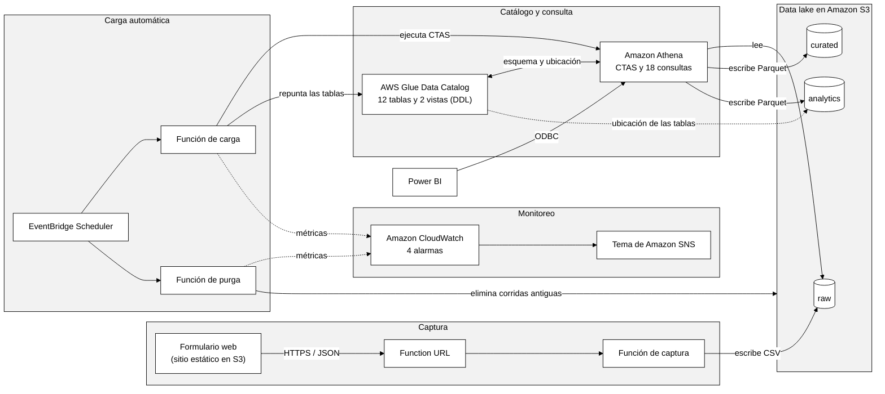
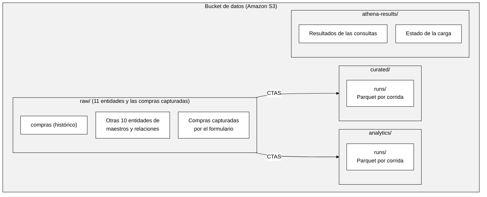
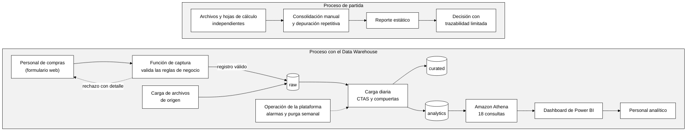
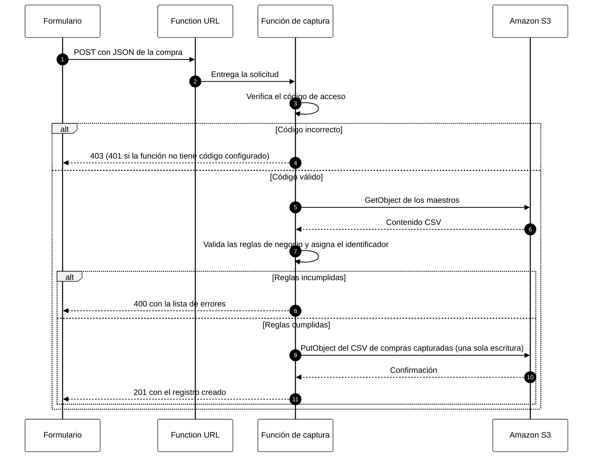
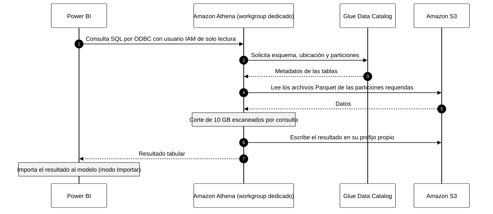
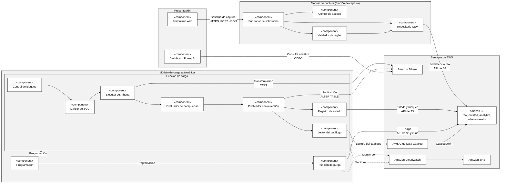
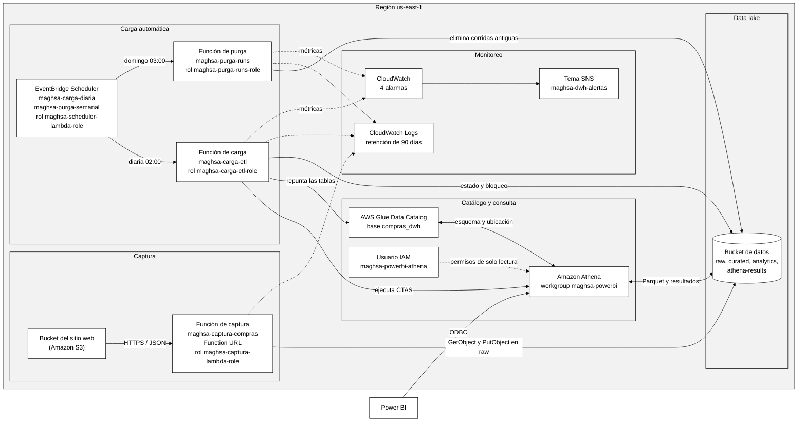

**UNIVERSIDAD MARIANO GÁLVEZ DE GUATEMALA**

**FACULTAD DE INGENIERÍA EN SISTEMAS DE**

**INFORMACIÓN**

**DESARROLLO E IMPLEMENTACIÓN DE UN DATA WAREHOUSE**   
**SERVERLESS EN AWS PARA EL ANÁLISIS DE COMPRAS MEDIANTE**   
**S3, GLUE DATA CATALOG Y ATHENA, CON DASHBOARDS DE**   
**INDICADORES Y ENFOQUE DE MANTENIMIENTO DE BAJO**   
**COSTO**  

**DAVID EDGAR RECINOS GARCÍA**

**Guatemala, noviembre de 2026.**

**UNIVERSIDAD MARIANO GÁLVEZ DE GUATEMALA**

**FACULTAD DE INGENIERÍA EN SISTEMAS DE**

**INFORMACIÓN**

**DESARROLLO E IMPLEMENTACIÓN DE UN DATA WAREHOUSE SERVERLESS EN AWS PARA EL ANÁLISIS DE COMPRAS MEDIANTE S3, GLUE DATA CATALOG Y ATHENA, CON DASHBOARDS DE INDICADORES Y ENFOQUE DE MANTENIMIENTO DE BAJO COSTO**

**TRABAJO DE GRADUACIÓN PRESENTADO**

**POR:**

**DAVID EDGAR RECINOS GARCÍA**

**PREVIO A OPTAR AL GRADO ACADÉMICO DE**

**LICENCIADO EN INGENIERÍA EN SISTEMAS DE**

**INFORMACIÓN Y CIENCIAS DE LA COMPUTACIÓN**

**Y TÍTULO PROFESIONAL DE**

**INGENIERO EN SISTEMAS DE INFORMACIÓN**

**Y CIENCIAS DE LA COMPUTACIÓN**

**Guatemala, noviembre de 2026.**

**AUTORIDADES DE LA FACULTAD Y ASESOR DEL TRABAJO**

**DE GRADUACIÓN.**

| DECANO DE LA FACULTAD: | ING. JORGE ALBERTO ARIAS TOBAR |
| :---- | :---- |
| **SECRETARIO DE LA FACULTAD:** | M.A. HUGO ADALBERTO HERNÁNDEZ SANTIZO |
| **ASESOR:** | M.A. EDDY ORLANDO HERNANDEZ CHOC |

**REGLAMENTO DE TESIS**

**Artículo 8: RESPONSABILIDAD**

Solamente el autor es responsable de los conceptos expresados en el trabajo de tesis. Su aprobación en manera alguna implica responsabilidad para la Universidad.

**Índice**

- [Introducción](#introducción)
- [Capítulo I - Marco Conceptual](#capítulo-i---marco-conceptual)
  - [1.1 Antecedentes](#11-antecedentes)
  - [1.2 Descripción del problema](#12-descripción-del-problema)
    - [1.2.1 Preguntas de investigación](#121-preguntas-de-investigación)
  - [1.3 Justificación](#13-justificación)
  - [1.4 Objetivos](#14-objetivos)
    - [1.4.1 Objetivo general](#141-objetivo-general)
    - [1.4.2 Objetivos específicos](#142-objetivos-específicos)
  - [1.5 Alcance](#15-alcance)
  - [1.6 Limitaciones](#16-limitaciones)
- [Capítulo II - Marco Teórico](#capítulo-ii---marco-teórico)
  - [2.1 Fundamentos de Data Warehouse y modelado analítico](#21-fundamentos-de-data-warehouse-y-modelado-analítico)
    - [2.1.1 Evolución de los Data Warehouses: de enfoques tradicionales a arquitecturas en la nube](#211-evolución-de-los-data-warehouses-de-enfoques-tradicionales-a-arquitecturas-en-la-nube)
    - [2.1.2 ETL vs ELT: estrategias modernas para DWH en la nube](#212-etl-vs-elt-estrategias-modernas-para-dwh-en-la-nube)
    - [2.1.3 Calidad de datos en entornos analíticos: consistencia, completitud, unicidad y trazabilidad](#213-calidad-de-datos-en-entornos-analíticos-consistencia-completitud-unicidad-y-trazabilidad)
  - [2.2 Arquitecturas serverless aplicadas a analítica](#22-arquitecturas-serverless-aplicadas-a-analítica)
    - [2.2.1 Computación serverless: principios, ventajas, limitaciones y modelos de costo](#221-computación-serverless-principios-ventajas-limitaciones-y-modelos-de-costo)
    - [2.2.2 Gobierno de datos en arquitecturas serverless: catálogo, metadatos, linaje y acceso](#222-gobierno-de-datos-en-arquitecturas-serverless-catálogo-metadatos-linaje-y-acceso)
    - [2.2.3 Diseño de zonas de datos (raw/bronze, curated/silver, analytics/gold)](#223-diseño-de-zonas-de-datos-rawbronze-curatedsilver-analyticsgold)
  - [2.3 Componentes AWS](#23-componentes-aws)
    - [2.3.1 S3 como Data Lake: organización por prefijos, particionamiento y ciclo de vida (lifecycle)](#231-s3-como-data-lake-organización-por-prefijos-particionamiento-y-ciclo-de-vida-lifecycle)
    - [2.3.2 Glue Data Catalog: esquemas, tablas, particiones y vistas](#232-glue-data-catalog-esquemas-tablas-particiones-y-vistas)
    - [2.3.3 Athena: ejecución SQL sobre S3, optimización por particiones y formatos columnares](#233-athena-ejecución-sql-sobre-s3-optimización-por-particiones-y-formatos-columnares)
    - [2.3.4 Seguridad en analítica cloud: IAM, control de acceso, cifrado at-rest/in-transit](#234-seguridad-en-analítica-cloud-iam-control-de-acceso-cifrado-at-restin-transit)
  - [2.4 Operación de compras: analítica, indicadores y gestión](#24-operación-de-compras-analítica-indicadores-y-gestión)
    - [2.4.1 Indicadores clave de compras (KPIs): costo, ahorro, cumplimiento, lead time, proveedores](#241-indicadores-clave-de-compras-kpis-costo-ahorro-cumplimiento-lead-time-proveedores)
    - [2.4.2 Evaluación de desempeño de proveedores: calidad, puntualidad, variabilidad de precio](#242-evaluación-de-desempeño-de-proveedores-calidad-puntualidad-variabilidad-de-precio)
    - [2.4.3 Gobernanza del dato de compras: maestros (proveedor, producto), reglas y consistencia](#243-gobernanza-del-dato-de-compras-maestros-proveedor-producto-reglas-y-consistencia)
  - [2.5 BI y Dashboards: Power BI y analítica](#25-bi-y-dashboards-power-bi-y-analítica)
    - [2.5.1 Dashboards para toma de decisiones: principios de visualización de KPIs y storytelling](#251-dashboards-para-toma-de-decisiones-principios-de-visualización-de-kpis-y-storytelling)
    - [2.5.2 Modelado semántico en Power BI: medidas DAX, star schema y performance](#252-modelado-semántico-en-power-bi-medidas-dax-star-schema-y-performance)
    - [2.5.3 Gobierno del reporte: refresh, dataset, control de acceso y versionado](#253-gobierno-del-reporte-refresh-dataset-control-de-acceso-y-versionado)
- [Capítulo III - Marco Metodológico](#capítulo-iii---marco-metodológico)
  - [3.1 Ruta de investigación](#31-ruta-de-investigación)
  - [3.2 Tipo de investigación](#32-tipo-de-investigación)
  - [3.3 Análisis de factibilidad](#33-análisis-de-factibilidad)
    - [3.3.1 Factibilidad económica](#331-factibilidad-económica)
    - [3.3.2 Factibilidad operativa](#332-factibilidad-operativa)
    - [3.3.3 Factibilidad tecnológica](#333-factibilidad-tecnológica)
    - [3.3.4 Factibilidad cognoscitiva](#334-factibilidad-cognoscitiva)
    - [3.3.5 Factibilidad legal y ambiental](#335-factibilidad-legal-y-ambiental)
  - [3.4 Hipótesis](#34-hipótesis)
    - [3.4.1 Variable independiente](#341-variable-independiente)
    - [3.4.2 Variable dependiente](#342-variable-dependiente)
  - [3.5 Definición de la población y tamaño de la muestra](#35-definición-de-la-población-y-tamaño-de-la-muestra)
    - [3.5.1 Tamaño de la población](#351-tamaño-de-la-población)
    - [3.5.2 Cálculo del tamaño de la muestra](#352-cálculo-del-tamaño-de-la-muestra)
    - [3.5.3 Instrumento](#353-instrumento)
    - [3.5.4 Recolección de datos](#354-recolección-de-datos)
  - [3.6 Interpretación de resultados](#36-interpretación-de-resultados)
    - [3.6.1 Gráficos y tabulares](#361-gráficos-y-tabulares)
  - [3.7 Recursos utilizados](#37-recursos-utilizados)
  - [3.8 Cronograma](#38-cronograma)
- [Capítulo IV - Análisis de la Aplicación](#capítulo-iv---análisis-de-la-aplicación)
  - [4.1 Descripción del proyecto](#41-descripción-del-proyecto)
  - [4.2 Identificación de usuarios](#42-identificación-de-usuarios)
  - [4.3 Modelado del negocio](#43-modelado-del-negocio)
    - [4.3.1 Design Science Research (DSR)](#431-design-science-research-dsr)
    - [4.3.2 Ciclo de vida](#432-ciclo-de-vida)
    - [4.3.3 Características](#433-características)
    - [4.3.4 Fases](#434-fases)
    - [4.3.5 Artefactos](#435-artefactos)
  - [4.4 Proceso de compras actual y propuesto](#44-proceso-de-compras-actual-y-propuesto)
  - [4.5 Requisitos del sistema](#45-requisitos-del-sistema)
- [Capítulo V - Diseño de la Aplicación](#capítulo-v---diseño-de-la-aplicación)
  - [5.1 Diagramas UML](#51-diagramas-uml)
    - [5.1.1 Diagrama de casos de uso](#511-diagrama-de-casos-de-uso)
    - [5.1.2 Diagrama de actividades](#512-diagrama-de-actividades)
    - [5.1.3 Diagrama de secuencia](#513-diagrama-de-secuencia)
    - [5.1.4 Diagrama de componentes](#514-diagrama-de-componentes)
    - [5.1.5 Diagrama de objetos](#515-diagrama-de-objetos)
    - [5.1.6 Diagrama de clases](#516-diagrama-de-clases)
    - [5.1.7 Diagrama de entidad relación](#517-diagrama-de-entidad-relación)
  - [5.2 Entidad Relación](#52-entidad-relación)
  - [5.3 Diagramas de infraestructura](#53-diagramas-de-infraestructura)
    - [5.3.1 Arquitectura general](#531-arquitectura-general)
    - [5.3.2 Infraestructura en AWS](#532-infraestructura-en-aws)
    - [5.3.3 Integraciones](#533-integraciones)
    - [5.3.4 Correspondencia entre objetivos y diseño](#534-correspondencia-entre-objetivos-y-diseño)
- [Capítulo VI - Presentación del Proyecto y Pruebas](#capítulo-vi---presentación-del-proyecto-y-pruebas)
  - [6.1 Presentación del proyecto (resumen del código)](#61-presentación-del-proyecto-resumen-del-código)
    - [6.1.1 Tecnologías, herramientas y componentes](#611-tecnologías-herramientas-y-componentes)
    - [6.1.2 Módulo de captura web y API de validación](#612-módulo-de-captura-web-y-api-de-validación)
    - [6.1.3 Carga automática y transformación por Athena](#613-carga-automática-y-transformación-por-athena)
    - [6.1.4 Modelo dimensional y catálogo de datos](#614-modelo-dimensional-y-catálogo-de-datos)
    - [6.1.5 Consultas de indicadores](#615-consultas-de-indicadores)
    - [6.1.6 Modelo semántico de Power BI e integración con Athena](#616-modelo-semántico-de-power-bi-e-integración-con-athena)
    - [6.1.7 Correspondencia entre el diseño y la implementación](#617-correspondencia-entre-el-diseño-y-la-implementación)
  - [6.2 Presentación del prototipo (pantallas)](#62-presentación-del-prototipo-pantallas)
    - [6.2.1 Formulario de captura](#621-formulario-de-captura)
    - [6.2.2 Catálogo de Glue](#622-catálogo-de-glue)
    - [6.2.3 Editor de Athena](#623-editor-de-athena)
    - [6.2.4 Tablero de Power BI](#624-tablero-de-power-bi)
      - [6.2.4.1 Resumen ejecutivo](#6241-resumen-ejecutivo)
      - [6.2.4.2 Gasto y categorías](#6242-gasto-y-categorías)
      - [6.2.4.3 Proveedores](#6243-proveedores)
      - [6.2.4.4 Desempeño y riesgo](#6244-desempeño-y-riesgo)
      - [6.2.4.5 Alternativas de proveedor](#6245-alternativas-de-proveedor)
  - [6.3 Pruebas](#63-pruebas)
    - [6.3.1 Pruebas automatizadas](#631-pruebas-automatizadas)
    - [6.3.2 Pruebas de las consultas de indicadores](#632-pruebas-de-las-consultas-de-indicadores)
    - [6.3.3 Reconciliación de cifras](#633-reconciliación-de-cifras)
    - [6.3.4 Compuertas de calidad de la carga](#634-compuertas-de-calidad-de-la-carga)
    - [6.3.5 Hallazgos y comportamientos esperados en los datos](#635-hallazgos-y-comportamientos-esperados-en-los-datos)
    - [6.3.6 Correcciones y ajustes derivados de las pruebas](#636-correcciones-y-ajustes-derivados-de-las-pruebas)
    - [6.3.7 Alcance y limitaciones de las pruebas](#637-alcance-y-limitaciones-de-las-pruebas)
- [Conclusiones](#conclusiones)
- [Recomendaciones](#recomendaciones)
- [Glosario](#glosario)
- [Bibliografía](#bibliografía)
- [Anexos](#anexos)

**Índice de figuras**

- [Figura 1 - Diagrama de proceso de extremo a extremo](#figura-1)
- [Figura 2 - Arquitectura de la solución del Data Warehouse serverless](#figura-2)
- [Figura 3 - Formulario de captura de datos de compras](#figura-3)
- [Figura 4 - Estructura de zonas del Data Lake en Amazon S3](#figura-4)
- [Figura 5 - Tablas del esquema dimensional registradas en AWS Glue Data Catalog](#figura-5)
- [Figura 6 - Resultado de la consulta de costo total de compras por periodo en Amazon Athena](#figura-6)
- [Figura 7 - Diagrama entidad-relación del modelo dimensional de compras](#figura-7)
- [Figura 8 - Proceso de compras: situación de partida y proceso con el Data Warehouse](#figura-8)
- [Figura 9 - Diagrama de casos de uso del sistema](#figura-9)
- [Figura 10 - Diagrama de actividades del registro de una orden de compra](#figura-10)
- [Figura 11 - Diagrama de secuencia del registro de una orden de compra](#figura-11)
- [Figura 12 - Diagrama de secuencia de la consulta de indicadores](#figura-12)
- [Figura 13 - Diagrama de componentes del sistema](#figura-13)
- [Figura 14 - Diagrama de objetos de la orden de compra OC0001](#figura-14)
- [Figura 15 - Diagrama de clases del dominio de compras](#figura-15)
- [Figura 16 - Diagrama de infraestructura de la solución en AWS](#figura-16)
- [Figura 17 - Página Resumen ejecutivo del tablero de Power BI](#figura-17)
- [Figura 18 - Página Gasto y categorías del tablero de Power BI](#figura-18)
- [Figura 19 - Página Proveedores del tablero de Power BI](#figura-19)
- [Figura 20 - Página Desempeño y riesgo del tablero de Power BI](#figura-20)
- [Figura 21 - Página Alternativas de proveedor del tablero de Power BI](#figura-21)

**Índice de tablas**

- [Tabla 1 - Trabajos previos comparables y su diferencia con la solución propuesta](#tabla-1)
- [Tabla 2 - Resumen general de costos](#tabla-2)
- [Tabla 3 - Factibilidad técnica de software](#tabla-3)
- [Tabla 4 - Fuentes documentales del proyecto](#tabla-4)
- [Tabla 5 - Variables e indicadores del análisis de compras](#tabla-5)
- [Tabla 6 - Costo total de compras por periodo](#tabla-6)
- [Tabla 7 - Gasto por categoría](#tabla-7)
- [Tabla 8 - Gasto por proveedor](#tabla-8)
- [Tabla 9 - Lead time promedio por proveedor](#tabla-9)
- [Tabla 10 - Recursos necesarios](#tabla-10)
- [Tabla 11 - Cronograma referencial](#tabla-11)
- [Tabla 12 - Perfiles de uso de la solución](#tabla-12)
- [Tabla 13 - Módulos y tecnologías del Data Warehouse](#tabla-13)
- [Tabla 14 - Requisitos funcionales y no funcionales de la solución](#tabla-14)
- [Tabla 15 - Especificación resumida de casos de uso principales](#tabla-15)
- [Tabla 16 - Especificación del caso de uso CU-02 Registrar orden de compra](#tabla-16)
- [Tabla 17 - Interfaces entre componentes](#tabla-17)
- [Tabla 18 - Entidades del modelo de datos](#tabla-18)
- [Tabla 19 - Recursos de infraestructura y configuración](#tabla-19)
- [Tabla 20 - Controles de seguridad por componente](#tabla-20)
- [Tabla 21 - Correspondencia entre objetivos, procesos y elementos de diseño](#tabla-21)
- [Tabla 22 - Componentes, tecnologías y configuración](#tabla-22)
- [Tabla 23 - Compuertas de validación de la carga automática](#tabla-23)
- [Tabla 24 - Pantallas del prototipo, usuario y regla o indicador que responden](#tabla-24)
- [Tabla 25 - Resultado de las pruebas automatizadas locales](#tabla-25)
- [Tabla 26 - Resultado de la ejecución de las consultas de indicadores en Athena](#tabla-26)
- [Tabla 27 - Reconciliación del resumen ejecutivo con la tabla de hechos](#tabla-27)
- [Tabla 28 - Defectos y ajustes derivados de las pruebas](#tabla-28)

# **Introducción**

La gestión y el control del proceso de compras dependen, en gran medida, de la disponibilidad de información confiable y oportuna. En la práctica, los datos relacionados con órdenes de compra, proveedores, productos, costos, condiciones de pago y tiempos de entrega suelen generarse en diferentes sistemas transaccionales y en diversos formatos, lo cual dificulta su integración, su trazabilidad y su análisis histórico. Esta dispersión provoca que, con frecuencia, el análisis de compras se realice mediante actividades manuales como extracción de datos, depuración en hojas de cálculo y elaboración de reportes estáticos, incrementando el esfuerzo operativo, el riesgo de inconsistencias y la dificultad para sostener indicadores bajo un mismo criterio.

Ante este escenario, surge la necesidad de contar con una solución que permita consolidar la información de compras en un repositorio analítico centralizado, orientado a consultas y generación de indicadores. Sin embargo, la implementación de un Data Warehouse tradicional puede implicar infraestructura dedicada, costos fijos y una carga de mantenimiento asociada a la administración de servidores, respaldos, escalamiento y operación continua. Por ello, el enfoque serverless representa una alternativa adecuada cuando se busca simplicidad operativa y control del costo, ya que permite construir capacidades de almacenamiento, catalogación y consulta analítica con servicios administrados y escalables bajo demanda.

El Data Warehouse serverless de compras de MAGHSA, desplegado en AWS y en operación, utiliza Amazon S3 como capa de almacenamiento, AWS Glue Data Catalog como repositorio de metadatos técnicos y Amazon Athena como motor de consulta SQL sobre los datos almacenados. El personal de compras registra la información mediante un portal web respaldado por una función AWS Lambda, que valida cada registro y lo escribe en la zona raw; una segunda función AWS Lambda, programada con Amazon EventBridge Scheduler, ejecuta cada día la transformación mediante consultas de Athena. A partir de esta base, los resultados analíticos se materializan mediante dashboards de indicadores en Power BI, de forma que la información consolidada pueda visualizarse en métricas y tendencias relevantes para la toma de decisiones. La selección de Power BI responde a un criterio de economía y experiencia previa, privilegiando una herramienta que permita producir tableros con rapidez y menor curva de aprendizaje, sin dejar de aprovechar el motor de consulta serverless de Athena.

El modelo dimensional de compras (hechos y dimensiones) soporta los indicadores seleccionados y responde a necesidades de análisis frecuentes como comparaciones por periodo, por proveedor, por categorías de gasto y por unidades organizacionales. El almacenamiento en S3 se organiza en tres zonas lógicas (raw, curated y analytics) que facilitan la consulta y el control del ciclo de vida de los datos.

El catálogo de metadatos se define en AWS Glue Data Catalog mediante sentencias DDL, lo que habilita el descubrimiento y la consulta consistente de los datasets. Las consultas analíticas de Athena producen las métricas y agregaciones que alimentan los indicadores definidos: 18 consultas, de las cuales 16 alimentan las 5 páginas del dashboard de Power BI y 2 son de catálogo puntual; el dashboard se conecta a Athena mediante ODBC a través de un workgroup dedicado con corte de 10 GB por consulta. La carga diaria transforma los datos de la zona raw a formato Parquet con sentencias CTAS de Athena, aplica compuertas de validación antes de publicar el resultado y se complementa con una purga semanal de las corridas antiguas. Las alarmas de Amazon CloudWatch notifican por Amazon SNS los errores, la duración excesiva y la ausencia de corridas. Esta capa de presentación traduce los datos consolidados en información interpretable y utilizable por usuarios de negocio.

La validación de extremo a extremo (S3 → Glue Data Catalog → Athena → Power BI) se apoya en pruebas de consultas y en la verificación de indicadores. El objetivo de bajo costo de mantenimiento se sostiene con la organización adecuada de los datos, el control de accesos con permisos de mínimo privilegio, la documentación del flujo y el uso eficiente de consultas; con el conjunto de datos sintético, el costo mensual de la infraestructura es inferior a USD 0.01. El resultado es un Data Warehouse serverless aplicado al análisis de compras, con énfasis en simplicidad, escalabilidad y sostenibilidad operativa.

# **Capítulo I - Marco Conceptual**

## **1.1 Antecedentes**

Durante las últimas décadas, las organizaciones han incrementado considerablemente la generación de datos provenientes de múltiples fuentes: sistemas transaccionales, archivos planos, bases de datos relacionales, registros de auditoría, integraciones con proveedores, servicios externos y aplicaciones corporativas, entre otras. Este crecimiento no solo se ha manifestado en volumen, sino también en diversidad y frecuencia de actualización, lo cual ha reforzado la necesidad de transformar dichos datos en información analítica útil para el control y la toma de decisiones del negocio.

En particular, en los procesos de compras se originan datos críticos relacionados con órdenes, proveedores, productos, costos, condiciones de pago, tiempos de entrega y movimientos de inventario. Sin embargo, en muchos escenarios estos datos se distribuyen en diferentes sistemas y formatos, dificultando la consolidación histórica, el análisis por dimensiones y la obtención de indicadores de gestión de manera oportuna. Como consecuencia, es común que las áreas operativas y administrativas recurran a reportes manuales y hojas de cálculo, generando esfuerzos repetitivos, inconsistencias y limitada trazabilidad del origen de los datos.

La analítica de compras se vincula con el desempeño de la función. Deloitte (2021) encuestó a más de 400 responsables de compras de 40 países y encontró que los directores de compras de alto desempeño tienen entre cuatro y cinco veces más probabilidad de haber desplegado por completo analítica y visualización avanzadas. La misma encuesta ubica la mala calidad de los datos entre las tres principales barreras tecnológicas. El estudio proviene de una consultora y se refiere a organizaciones grandes, por lo que no describe la situación de las empresas medianas ni pequeñas.

Sobre qué se mide, Caniato et al. (2014) analizaron nueve casos de empresas multinacionales y encontraron que los indicadores de compras más utilizados miden costo, tiempo y calidad, y que la medición se concentra en los proveedores. La medición del desempeño en la cadena de suministro cuenta, además, con una base conceptual anterior (Gunasekaran et al., 2001). Georgino et al. (2026) estudiaron siete empresas brasileñas y registraron 56 indicadores de compras, con un promedio de ocho por empresa. Los indicadores de costo predominan, la gestión se realiza principalmente en Power BI y en hojas de cálculo, y las barreras principales son la integración y la calidad de los datos. Los autores trabajan con una muestra pequeña, por lo que sus hallazgos no son generalizables. Los dos estudios coinciden en el predominio de los indicadores de costo.

En América Latina, la adopción de tecnologías digitales varía según el tamaño de la empresa y la madurez de la tecnología. La Comisión Económica para América Latina y el Caribe revisó las motivaciones y los obstáculos de las micro, pequeñas y medianas empresas para adoptarlas (Dini et al., 2021) [VERIFICAR AUTORES: CEPAL Dini et al. 2021].

Las hojas de cálculo son la herramienta habitual de esa gestión y su riesgo está documentado. Panko (2000) reunió auditorías de campo en las que 24 % de 367 hojas de cálculo contenía errores. Las auditorías más recientes que el autor cita, realizadas con mejor metodología, encontraron errores en al menos 86 % de las hojas examinadas. El autor señala además que un revisor individual detecta cerca de la mitad de los errores, mientras que la inspección grupal celda por celda alcanza cerca de 80 %. La fuente tiene más de dos décadas, pero las auditorías posteriores que recoge muestran porcentajes mayores y no menores.

Estas cifras corresponden a hojas de cálculo en general y no a hojas de compras. Aun así, son pertinentes: una hoja que consolida órdenes de compra no aplica por sí misma reglas de validación en el momento del registro, de modo que la detección de errores depende de la revisión posterior de quien la usa. Cuando esas hojas sustentan decisiones de gasto, el error se traslada al indicador que se reporta.

Tradicionalmente, para responder a estas necesidades analíticas se han implementado almacenes de datos y plataformas de integración que centralizan información estructurada y semiestructurada. No obstante, estos enfoques suelen implicar costos relevantes de infraestructura y licenciamiento, además de requerir tareas continuas de administración, aprovisionamiento, respaldo, actualización de componentes y soporte operativo. Dichas actividades incrementan la carga de mantenimiento y pueden convertirse en una barrera para organizaciones o proyectos que buscan soluciones analíticas escalables sin depender de infraestructura compleja.

La evolución de las plataformas de datos ilustra el cambio de enfoque. Armbrust et al. (2021) describen que los almacenes de datos tradicionales se diseñaron para hardware propio y que, posteriormente, los lagos de datos permitieron conservar grandes volúmenes de información sin imponer una estructura rígida desde el inicio. Desde 2015, esos lagos se trasladaron a servicios de almacenamiento de objetos en la nube, como Amazon S3, Azure Data Lake Storage y Google Cloud Storage, y sobre ellos se mantuvo un almacén de datos aguas abajo para las consultas de negocio.

Los autores señalan que esta arquitectura de dos niveles es compleja y que presenta problemas de fiabilidad y de datos desactualizados. Como alternativa, proponen plataformas denominadas lakehouse, que se apoyan en formatos de archivo abiertos, como Apache Parquet. Los autores pertenecen a Databricks, empresa que comercializa plataformas de esa categoría. Por esa razón, su planteamiento se toma como descripción de una tendencia de la industria y no como una evaluación independiente. El artículo fue presentado en una conferencia arbitrada.

Con la adopción creciente de computación en la nube, se han consolidado alternativas orientadas a arquitecturas administradas y de pago por uso. En este contexto, el enfoque serverless permite implementar capacidades de almacenamiento, catalogación y consulta analítica sin la necesidad de operar servidores o clústeres permanentes, reduciendo significativamente el esfuerzo de administración y permitiendo escalar el consumo conforme a la demanda real. Para escenarios de analítica de compras, esta aproximación facilita la construcción de un repositorio central en el que los datos puedan mantenerse organizados, versionados y disponibles para consultas, indicadores y tableros de visualización, priorizando la sostenibilidad y el bajo costo de mantenimiento.

El modelo serverless extiende esa lógica a la operación del cómputo. Jonas et al. (2019), en una revisión de la Universidad de California en Berkeley, indican que esta modalidad asume la mayor parte de la administración de sistemas que exige la nube y que, con ello, simplifica su programación. Los autores pronostican, además, que dominará la computación en la nube. Hellerstein et al. (2018) matizan ese panorama en un preprint, es decir, un borrador que no consta como versión publicada: reconocen el autoescalado y el pago por uso, pero advierten que las plataformas serverless de primera generación presentan carencias frente a las cargas de trabajo centradas en datos. Ambas posturas justifican verificar el comportamiento de los servicios elegidos con consultas reales, en lugar de asumir sus ventajas.

En el ecosistema de AWS, la documentación del proveedor describe tres servicios que materializan este enfoque para la analítica. Amazon Athena analiza datos almacenados en Amazon S3 mediante SQL estándar, no requiere configurar infraestructura, cobra por consulta y escala en paralelo de forma automática (Amazon Web Services, s. f.-c). La guía de Athena recomienda formatos columnares como Parquet y ORC, que comprimen por columna y permiten aplicar filtros durante la lectura y leer en paralelo; la conversión desde CSV o JSON se resuelve con consultas CTAS o con trabajos de AWS Glue (Amazon Web Services, s. f.-b). El AWS Glue Data Catalog funciona como repositorio central de metadatos (ubicación, esquema y propiedades), se integra con Athena y gestiona el versionado de los esquemas (Amazon Web Services, s. f.-a). Por tratarse de documentación del propio proveedor, estas descripciones indican capacidades declaradas y no resultados de desempeño comprobados por terceros.

Los trabajos previos comparables se resumen en la Tabla 1. Los datos de la tabla se limitan a lo que cada fuente declara en su resumen o introducción.

##### **Tabla 1**

###### *Trabajos previos comparables y su diferencia con la solución propuesta*

| Trabajo | Contexto | Arquitectura o herramienta | Resultado reportado | Diferencia con la solución propuesta |
| ----- | ----- | ----- | ----- | ----- |
| Ramos Sánchez y Mosquera Rentería (2025) | Microempresa láctea de Córdoba, Colombia; análisis de compras y proveedores | Inteligencia de negocios sobre datos del software contable, principalmente con hojas de cálculo | Segmentación de proveedores e indicadores de costo ponderado por litro, tiempo de entrega, calidad y eficiencia logística | Sin almacén de datos en la nube ni catálogo de metadatos; la base analítica es una herramienta ofimática |
| Georgino et al. (2026) | Siete empresas brasileñas; gestión de indicadores de compras | Gestión de indicadores en Power BI y hojas de cálculo | 56 indicadores en total (ocho por empresa en promedio); predominio de los de costo; barreras: integración y calidad de datos | Estudio cualitativo de casos; no propone ni evalúa una arquitectura de datos |
| Caniato et al. (2014) | Nueve empresas multinacionales; sistemas de medición del desempeño de compras | No aplica (estudio empírico) | Indicadores más usados: costo, tiempo y calidad; medición centrada en los proveedores | No corresponde a PYME ni a una implementación técnica |
| Urrutia Quequezana (2026) | Empresa financiera de microcréditos de Arequipa, Perú; reportes de seguimiento | AWS: Lambda para ETL, Amazon Redshift Serverless, modelo estrella, Power BI y EventBridge | Problema de partida según la tesis: 1 a 1,5 días hábiles por reporte, tasas de error de 25,0 % a 33,3 % y 51 horas mensuales de retrabajo | Dominio financiero y no de compras; usa Redshift Serverless en lugar de consulta directa sobre S3 con Athena |
| Marchiori (2024) | Empresa italiana (UNOX S.p.A.); data lake y análisis para la organización | Amazon S3, AWS Glue, Amazon Athena y Amazon QuickSight | No verificado (se revisaron el resumen y el índice) | Misma pila tecnológica de almacenamiento, catálogo y consulta; no es de compras ni de PYME |

*Nota.* Elaboración propia a partir de las fuentes citadas. Las cifras son las reportadas por cada autor y no fueron reproducidas. La tesis de Urrutia Quequezana (2026) corresponde a un borrador con dictamen de aprobación de abril de 2026.

Cada trabajo aporta un elemento distinto. Ramos Sánchez y Mosquera Rentería (2025) muestran que existe interés por la analítica de compras en la microempresa latinoamericana, con herramientas básicas y datos que el software contable ya almacena sin aprovechar para decidir compras. Urrutia Quequezana (2026) documenta el costo de los reportes manuales en hojas de cálculo y una implementación en AWS con modelo estrella, aunque con un almacén de datos distinto y en otro dominio. Marchiori (2024) constituye un precedente de la misma pila tecnológica de almacenamiento, catálogo y consulta. Entre los trabajos revisados, ninguno reúne las compras como dominio, la combinación de Amazon S3, AWS Glue y Amazon Athena y un mecanismo de captura para el personal que no accede a la consola.

En la revisión realizada no se identificaron estudios publicados sobre Data Warehouse de compras en Guatemala [CONFIRMAR CON EL AUTOR: afirmación sobre ausencia de literatura en Guatemala]. Tampoco se identificaron casos en español que combinen Amazon S3, AWS Glue y Amazon Athena para la analítica de compras en empresas pequeñas y medianas, ni estudios académicos sobre indicadores de compras específicos de ese segmento: las fuentes halladas se refieren a organizaciones de mayor tamaño. Estas ausencias se declaran como resultado de la revisión efectuada y no como prueba de que no existan.

De los antecedentes se toman cuatro criterios de diseño. Primero, los indicadores de costo y de tiempo de entrega son los de uso más extendido (Caniato et al., 2014; Georgino et al., 2026), de modo que el modelo debe sostenerlos con granularidad de línea de orden de compra. Segundo, la integración y la calidad de los datos son las barreras que más se repiten (Deloitte, 2021; Georgino et al., 2026), lo cual respalda validar cada registro en su origen y antes de publicarlo. Tercero, el esquema estrella documentado por Urrutia Quequezana (2026) es un patrón aplicable a este dominio. Cuarto, el almacenamiento columnar en Amazon S3 consultado con Athena (Amazon Web Services, s. f.-b; Marchiori, 2024) permite mantener el costo ligado al volumen consultado.

El aporte del Data Warehouse de compras de MAGHSA se ubica en esa intersección: una arquitectura serverless completa, con captura validada para el personal de compras, carga y consulta sobre S3, Glue y Athena, y presentación en Power BI, descrita de forma reproducible para una organización con presupuesto limitado.

De esta manera, surge la oportunidad de diseñar e implementar un Data Warehouse serverless en AWS, utilizando servicios administrados como Amazon S3 para almacenamiento, AWS Glue Data Catalog para la organización y descripción de metadatos, y Amazon Athena para la ejecución de consultas analíticas sobre los datos, complementando con dashboards que permitan visualizar indicadores clave. Este enfoque responde a la necesidad de consolidar la información de compras de forma estructurada y gobernada, habilitando analítica y reportes con una arquitectura de soporte a largo plazo, adaptable y con costos controlables.

## **1.2 Descripción del problema**

En la actualidad, muchas organizaciones dependen de información proveniente de distintos sistemas operacionales para ejecutar y controlar sus procesos de compras. Dichos datos suelen originarse en módulos transaccionales (órdenes de compra, recepciones, facturación), catálogos de proveedores y productos, archivos externos y registros históricos. Aunque estos insumos contienen información valiosa para evaluar el desempeño del proceso de abastecimiento, con frecuencia se encuentran dispersos, con formatos heterogéneos y con diferentes niveles de calidad y consistencia. Esta situación dificulta la consolidación histórica, la trazabilidad de los registros y la generación de indicadores confiables de manera oportuna.

Como consecuencia, la analítica de compras tiende a sostenerse mediante esfuerzos manuales: extracción de datos a hojas de cálculo, elaboración de reportes estáticos y depuración repetitiva de inconsistencias. Además de consumir tiempo operativo, este enfoque incrementa el riesgo de errores, reduce la reproducibilidad de los análisis y limita la disponibilidad de información para la toma de decisiones, especialmente cuando se requieren comparaciones por periodos, por proveedor, por categoría de gasto o por unidades organizacionales.

La evidencia disponible respalda esta preocupación. Las auditorías de hojas de cálculo reunidas por Panko (2000) encontraron errores en 24 % de 367 hojas examinadas y en al menos 86 % en las auditorías más recientes. En el análisis de indicadores de compras de siete empresas brasileñas, la integración y la calidad de los datos figuran entre las barreras principales (Georgino et al., 2026), y una encuesta a responsables de compras de 40 países ubica la mala calidad de los datos entre las tres principales barreras tecnológicas (Deloitte, 2021). Un caso comparable del sector financiero peruano documentó 51 horas mensuales de retrabajo asociadas con reportes manuales en hojas de cálculo (Urrutia Quequezana, 2026). Estas barreras se agravan cuando la captura depende de archivos individuales sin reglas de validación compartidas, porque cada persona aplica su propio formato y su propio criterio de depuración.

Bajo este escenario, se identifica la necesidad de contar con un repositorio analítico centralizado que permita integrar la información de compras en un modelo orientado al análisis, con estructura y gobierno de datos. No obstante, en contextos académicos o en organizaciones con presupuestos limitados, implementar un Data Warehouse tradicional puede representar un reto debido a los costos de infraestructura, licenciamiento y, principalmente, por el esfuerzo de administración y mantenimiento que implica operar servidores, bases de datos y herramientas dedicadas de forma permanente. En este sentido, las arquitecturas serverless en la nube representan una alternativa para reducir el costo total de propiedad y simplificar la operación, al basarse en servicios administrados y en un esquema de pago por uso. Sin embargo, adoptar un enfoque serverless requiere una definición clara de componentes, flujo de datos y criterios de diseño: cómo almacenar y organizar los datos de compras, cómo catalogarlos para garantizar consistencia y descubrimiento, cómo habilitar consultas eficientes y cómo exponer los resultados a tableros de control con indicadores relevantes, manteniendo el principio de bajo costo y bajo mantenimiento.

Por lo tanto, el problema central consiste en que no existe una implementación práctica consolidada, de alcance acotado y orientada a bajo costo, que demuestre cómo construir un Data Warehouse serverless en AWS para el análisis de compras, integrando almacenamiento en Amazon S3, catalogación mediante AWS Glue Data Catalog y consultas con Amazon Athena, y que a su vez permita visualizar indicadores a través de dashboards en Power BI. La ausencia de una solución de este tipo limita la posibilidad de contar con analítica de compras sostenible y escalable sin incurrir en infraestructura compleja o costos fijos elevados.

En consecuencia, se plantea como necesidad desarrollar e implementar una arquitectura que permita consolidar datos de compras en una estructura orientada a análisis, habilitar un catálogo de metadatos que facilite el gobierno y el acceso controlado, ejecutar consultas analíticas optimizadas sobre los datos, y disponibilizar indicadores de gestión mediante tableros en Power BI. Todo ello, con un enfoque explícito de mantenimiento de bajo costo, priorizando servicios administrados, facilidad operativa y escalabilidad bajo demanda.

### **1.2.1 Preguntas de investigación**

¿Qué problema se identificó y cómo se pretende dar solución? Se identificó la dificultad para consolidar y analizar datos de compras de forma consistente, debido a dispersión de fuentes, reprocesos manuales y limitada trazabilidad. La solución consiste en un Data Warehouse serverless en AWS con S3, Glue Data Catalog y Athena, desplegado en la infraestructura de MAGHSA, cuyos indicadores se consumen mediante dashboards en Power BI, con bajo mantenimiento y costos controlados.

¿Quiénes serán beneficiados al terminar el proyecto? Se benefician principalmente las áreas usuarias de análisis de compras, al disponer de indicadores más rápidos y consistentes. También se beneficia el área técnica o de soporte de datos, por la reducción de tareas operativas y por contar con una arquitectura más simple de administrar.

¿Se utilizará alguna metodología de desarrollo? Sí. Design Science Research (DSR) es el marco para diseñar, construir y evaluar el artefacto (DWH serverless y dashboards). El desarrollo práctico es incremental por etapas: almacenamiento, catalogación, consultas y visualización.

¿Cuántas personas se encuentran involucradas? Participa una persona responsable del desarrollo e implementación, con la revisión y retroalimentación del asesor académico.

¿Cuánto tiempo se necesita para terminarlo? La ejecución abarca 12 semanas para implementación, pruebas y dashboard, conforme al cronograma del apartado 3.8.

¿Los recursos con los que actualmente se cuentan son suficientes? Sí. Los recursos son una computadora personal, conexión a internet, una cuenta de AWS, un dataset de compras y Power BI Desktop. La publicación en Power BI Service con actualización programada requeriría un componente adicional, fuera del alcance definido.

¿Se capacitará al personal al finalizar el proyecto? La transferencia de conocimiento se apoya en documentación técnica y en una guía de uso que facilitan la adopción, y en una capacitación breve sobre el uso del dashboard y la lectura de indicadores, prevista en la última semana del cronograma (apartado 3.8).

¿Qué beneficios traerá a la empresa el implementar el proyecto? Mejora la disponibilidad de indicadores de compras, reduce reprocesos manuales y facilita análisis histórico por dimensiones. Además, aporta mayor trazabilidad de datos y un esquema de consulta más flexible sin necesidad de operar infraestructura compleja.

¿Cuál es la importancia de implementar este tipo de proyecto? Permite convertir datos de compras en información accionable con una base analítica estructurada y reutilizable. Además, introduce un enfoque moderno de analítica con servicios administrados, que favorece continuidad, escalabilidad y sostenibilidad operativa con costos controlados.

¿Se considera que el proyecto pueda ser operativo para la empresa a futuro? Sí, debido a que la arquitectura se basa en servicios administrados y escalables, lo cual facilita su continuidad; además, la carga diaria automática, la purga semanal de corridas antiguas y las alarmas de CloudWatch reducen la intervención manual. Su operatividad a futuro depende de mantener actualizados los datos de compras, controlar costos de consultas y documentar el flujo para que pueda ser administrado sin alta especialización.

## **1.3 Justificación**

El análisis de compras requiere información consolidada, consistente y trazable, debido a que los datos suelen originarse en múltiples fuentes, con variaciones de formato y calidad. Esta dispersión dificulta la construcción de indicadores confiables y oportunos, incrementa el trabajo manual para depurar datos y limita la capacidad de comparar el desempeño del gasto por periodos, proveedores, categorías y unidades organizacionales. En consecuencia, resulta necesario implementar un repositorio analítico que unifique la información de compras bajo una estructura orientada a consulta y generación de indicadores.

La justificación se refuerza con el estado de la literatura. En la revisión realizada no se identificaron estudios publicados sobre Data Warehouse de compras en Guatemala [CONFIRMAR CON EL AUTOR: afirmación sobre ausencia de literatura en Guatemala]. Los casos regionales hallados utilizan herramientas básicas, sobre todo hojas de cálculo (Ramos Sánchez & Mosquera Rentería, 2025), o un almacén de datos con cómputo administrado, como Amazon Redshift Serverless (Urrutia Quequezana, 2026). El único antecedente con la misma pila de Amazon S3, AWS Glue y Amazon Athena corresponde a una empresa tratada en una tesis de la Universidad de Padua y a un dominio distinto al de las compras (Marchiori, 2024). Un caso documentado, de alcance acotado y con una arquitectura descrita de forma reproducible, aporta evidencia aplicable a organizaciones de la región con restricciones presupuestarias.

La implementación de un Data Warehouse (DWH) serverless en AWS se justifica como alternativa viable cuando se busca disminuir el esfuerzo operativo y el costo asociado a la administración de infraestructura. A diferencia de enfoques tradicionales que requieren servidores dedicados, licenciamiento y actividades recurrentes de mantenimiento, una arquitectura basada en servicios administrados permite enfocarse en el diseño del modelo de datos, el aseguramiento de calidad y el consumo analítico, reduciendo la complejidad operativa. Este enfoque es consistente con un objetivo de mantenimiento de bajo costo, al priorizar componentes que escalan bajo demanda y se gestionan principalmente mediante configuración y buenas prácticas de organización de datos.

La documentación del proveedor respalda este criterio: Amazon Athena cobra por consulta y no exige configurar infraestructura (Amazon Web Services, s. f.-c), y los formatos columnares como Parquet permiten aplicar filtros durante la lectura y leer en paralelo (Amazon Web Services, s. f.-b). Las carencias de las plataformas serverless de primera generación señaladas por Hellerstein et al. (2018), en un preprint, justifican que el diseño se evalúe con consultas reales sobre el modelo dimensional y no solo con la expectativa de bajo costo.

Bajo esta perspectiva, el uso de Amazon S3 como capa de almacenamiento se fundamenta en su capacidad para funcionar como repositorio central de datos, favoreciendo la conservación histórica y la separación por zonas lógicas, lo cual facilita el control del ciclo de vida de la información. Asimismo, AWS Glue Data Catalog aporta valor al actuar como repositorio de metadatos técnicos, permitiendo describir bases, tablas y particiones, y habilitando un punto común de descubrimiento y estandarización de esquemas. Finalmente, Amazon Athena se justifica como motor de consulta porque permite realizar análisis mediante SQL directamente sobre los datos almacenados, evitando la necesidad de aprovisionar y administrar infraestructura de cómputo para consultas. En conjunto, estos componentes conforman una base adecuada para un DWH orientado a analítica de compras con énfasis en simplicidad operativa y control de costos.

La inclusión de dashboards de indicadores se justifica por la necesidad de traducir los datos consolidados en métricas accionables para la toma de decisiones. Power BI consume los datos de Athena mediante ODBC en modo Importar, a través de un workgroup dedicado con corte de 10 GB por consulta, lo que mantiene la capa analítica alineada con el enfoque serverless al consultar sobre el repositorio en AWS.

## **1.4 Objetivos**

### **1.4.1 Objetivo general**

Construir y evaluar una arquitectura de Data Warehouse serverless en AWS orientada al análisis de compras, basada en S3, Glue Data Catalog y Athena, y presentar indicadores mediante Power BI, priorizando simplicidad operativa y bajo costo de mantenimiento.

### **1.4.2 Objetivos específicos**

Definir el modelo dimensional de compras (hechos y dimensiones) para soportar indicadores clave.

Organizar el almacenamiento de datos de compras en Amazon S3 con una estructura lógica que facilite su consulta.

Catalogar los datasets de compras en AWS Glue Data Catalog para habilitar descubrimiento y consulta consistente.

Implementar un conjunto de visualizaciones en Power BI (KPIs y tendencias) a partir de consultas en Athena para apoyar la toma de decisiones.

Validar el funcionamiento del DWH mediante la ejecución de consultas y la visualización correcta de indicadores en Power BI.

## **1.5 Alcance**

El alcance de la investigación comprende el diseño, la construcción y la evaluación funcional de una arquitectura de Data Warehouse serverless orientada al análisis de compras. De manera específica, se contempla la definición del modelo dimensional de compras, la organización lógica de los datasets en Amazon S3, la catalogación de tablas y particiones en AWS Glue Data Catalog, la ejecución de consultas analíticas en Amazon Athena, la carga diaria automática con compuertas de validación, la purga semanal de corridas antiguas, las alarmas de monitoreo, la construcción de dashboards en Power BI con los indicadores de compras definidos, y la validación del flujo de extremo a extremo, desde el almacenamiento hasta la visualización.

El modelo dimensional comprende una tabla de hechos con grano de línea de orden de compra, siete dimensiones (tiempo, proveedor, producto, categoría, categoría de proveedor, unidad organizacional y contacto de proveedor) y tres tablas puente para las relaciones de muchos a muchos entre proveedores, categorías y productos. El dashboard se organiza en cinco páginas alimentadas por consultas de Athena definidas para cada indicador. El módulo de ingesta cubre el mantenimiento de seis entidades (proveedores, productos, categorías, categorías de proveedor, unidades organizacionales y compras) mediante las acciones de consulta, creación, actualización y eliminación. Las relaciones entre proveedores, categorías y productos se mantienen desde el registro del proveedor.

Dado que el acceso directo a la consola de AWS no resulta viable para el personal operativo de compras, se contempla dentro del alcance un módulo mínimo de ingesta validada, que permite registrar la información de compras sin requerir credenciales de AWS, aplicando reglas básicas de validación antes de escribir el registro en la zona raw del repositorio. Este módulo constituye el mecanismo de entrada de datos hacia la arquitectura ya descrita, y no sustituye ni amplía dicha arquitectura.

Quedan fuera del alcance la implementación de un sistema transaccional completo de compras (con flujo de aprobación, gestión de órdenes o integración con proveedores), la implementación empresarial a gran escala, la integración con múltiples sistemas operacionales en tiempo real, la ingesta continua por eventos y las plataformas corporativas de monitoreo. Estas exclusiones son deliberadas y responden al principio de acotamiento propio de una investigación académica con enfoque en la demostración funcional del artefacto diseñado (Hevner et al., 2004). Los resultados presentados se obtienen con un conjunto de datos sintético que reproduce la estructura de los datos de MAGHSA (sección 1.6).

## **1.6 Limitaciones**

Toda investigación aplicada presenta limitaciones que deben reconocerse y documentarse explícitamente, dado que estas condicionan el alcance de los resultados y la validez de las conclusiones. En el contexto del Design Science Research, identificar las restricciones del artefacto forma parte del proceso de evaluación honesta de su contribución (Peffers et al., 2007).

El alcance se enfoca en una implementación funcional, no en una plataforma corporativa de gran escala; en consecuencia, los resultados obtenidos son representativos del enfoque propuesto, pero no necesariamente generalizables a otras organizaciones sin adaptaciones adicionales. El sistema se despliega en la infraestructura de MAGHSA y, por confidencialidad, las cifras, las tablas de resultados y las capturas presentadas provienen de un conjunto de datos sintético que reproduce la estructura de los datos reales. Por esta razón, los valores de los indicadores ilustran el funcionamiento del sistema y no describen el comportamiento real de las compras de la empresa. La calidad y el volumen del conjunto de datos condicionan, asimismo, el nivel de detalle del análisis y de los indicadores.

La solución se construye con servicios específicos de AWS, por lo cual su implementación responde a las características, restricciones y políticas de dicho proveedor; cambios en los precios, la disponibilidad o las interfaces de los servicios utilizados podrían requerir ajustes en la arquitectura. La evaluación del artefacto, por su parte, se basa en pruebas funcionales y en la validación de indicadores, no en despliegues de producción a gran escala; en consecuencia, aspectos como la latencia bajo carga alta o la estabilidad a largo plazo quedan fuera del alcance de la evaluación formal realizada. Finalmente, la solución prioriza un bajo costo de mantenimiento, por lo cual evita componentes que impliquen administración continua de infraestructura, decisión que puede limitar capacidades de integración en tiempo real que requerirían servicios adicionales.

La actualización de los indicadores en Power BI depende de Power BI Desktop en modo Importar. La publicación en Power BI Service con actualización programada requeriría un componente adicional que queda fuera del alcance; por ello, la frecuencia con la que el usuario ve datos nuevos depende de la actualización del modelo semántico. El costo mensual de infraestructura declarado corresponde al conjunto de datos sintético; con volúmenes reales, el costo de consulta y de almacenamiento depende de los datos escaneados y debe reevaluarse.

El módulo de captura guarda cada entidad en un único archivo que se reemplaza completo en cada operación. El diseño supone un volumen bajo de escrituras y no impide que dos escrituras simultáneas sobre el mismo archivo se sobrescriban entre sí (sección 5.1.2). El acceso al formulario se controla con un código compartido que no identifica a cada persona, y la Function URL no ofrece un límite de intentos (sección 5.3.3). El reemplazo por autenticación individual queda fuera del alcance.

La evaluación la conduce una sola persona, con la revisión del asesor académico, lo cual limita la diversidad de perspectivas de la valoración. La revisión de antecedentes se limitó a fuentes de acceso abierto, no siguió un protocolo de revisión sistemática y, en varias fuentes, se apoyó en el resumen o la introducción [CONFIRMAR CON EL AUTOR: alcance metodológico de la revisión de antecedentes]. En consecuencia, la comparación de la Tabla 1 es indicativa y no exhaustiva.

# **Capítulo II - Marco Teórico**

## **2.1 Fundamentos de Data Warehouse y modelado analítico**

### **2.1.1 Evolución de los Data Warehouses: de enfoques tradicionales a arquitecturas en la nube**

La evolución de los Data Warehouses (DWH) puede describirse como la transición desde enfoques tradicionales, sustentados en infraestructura local y procesos de integración rígidos, hacia arquitecturas basadas en servicios de cómputo en la nube, más elásticas y orientadas a componentes. Este cambio no solo implica reubicar el almacenamiento, sino también redefinir cómo se integran, procesan y disponibilizan los datos para análisis, enfatizando la automatización y la escalabilidad. En ese sentido, Mayor Cebrian (2025) destaca que “… estos procesos se ejecutaban de forma manual o programada en servidores locales. Sin embargo, con la adopción generalizada de la computación en la nube y las arquitecturas Big Data, el enfoque ETL ha evolucionado hacia soluciones automatizadas, escalables y modulares…” (pp. 20–21).

Comprender esta evolución es clave en proyectos analíticos porque explica por qué muchas organizaciones migran de soluciones tradicionales (con costos fijos, operación intensiva y escalabilidad limitada) hacia modelos en nube que favorecen el crecimiento por demanda y la reducción de carga operativa. En la práctica, esta transformación habilita plataformas más flexibles para integrar datos heterogéneos, conservar históricos y acelerar la generación de indicadores para toma de decisiones. 

### **2.1.2 ETL vs ELT: estrategias modernas para DWH en la nube**

En la integración de datos para analítica, ETL (Extract, Transform, Load) y ELT (Extract, Load, Transform) representan dos estrategias para mover datos desde fuentes operacionales hacia repositorios analíticos. En ETL, los datos se transforman antes de cargarse al destino analítico; en ELT, se cargan primero (generalmente en un repositorio escalable como un Data Lake o almacén analítico) y luego se transforman en el propio entorno de análisis o consumo. En arquitecturas modernas en la nube, esta distinción se vuelve más relevante porque los repositorios de almacenamiento y los motores de consulta/transformación suelen estar desacoplados, permitiendo flujos más flexibles y escalables. 

Diferenciar ETL y ELT es importante porque influye directamente en la calidad y consistencia de la información que llega a los modelos analíticos; la agilidad para incorporar nuevas fuentes o redefinir reglas de transformación: el costo y rendimiento, especialmente cuando el motor de consulta cobra por procesamiento o por datos escaneados; y la gobernanza, ya que define dónde se aplican controles, validaciones y estandarización. En palabras de Palan Murillo (2025), “el procesamiento de los datos en bruto constituye una fase importante dentro de la arquitectura de gobernanza del dato, ya que garantiza que la información almacenada en el Data Lake sea consistente, fiable y lista para su consumo posterior” (pp. 41–42).

La solución adopta un enfoque ELT. Los registros se almacenan sin transformar en la zona raw de Amazon S3 y las consultas de Athena realizan después la transformación hacia las zonas curated y analytics, de modo que el cómputo se consume únicamente durante la carga.

### **2.1.3 Calidad de datos en entornos analíticos: consistencia, completitud, unicidad y trazabilidad**

La calidad de datos en entornos analíticos se refiere al grado en que los datos son aptos para su uso en análisis, reportes e indicadores. En un Data Warehouse o un Data Lake orientado al análisis, la calidad no es un “extra”, sino un requisito para garantizar que las conclusiones y métricas representen la realidad del negocio. En ese sentido, Muñoz Ramírez (2025) enfatiza que “la calidad de los datos es un prerrequisito para la analítica avanzada. Modelos de predicción, segmentación de clientes o evaluación de riesgo crediticio dependen de datos limpios, completos y actualizados” (p. 18).

La calidad de datos es crítica porque condiciona la confiabilidad de todo lo que se construye encima: indicadores, tendencias, segmentaciones y comparaciones históricas. Si los datos llegan incompletos, duplicados o inconsistentes, el sistema analítico puede producir conclusiones equivocadas. Para esto es clave los distintos indicadores de calidad de datos, como lo es la consistencia, que se refiere a que los datos no se contradicen entre sí a través de tablas, fuentes o periodos; la completitud, indica el grado en que los datos contienen todos los campos necesarios para soportar indicadores; la unicidad, evalúa que los registros no estén duplicados cuando deben ser únicos; y la trazabilidad, que es la capacidad de rastrear el origen del dato y sus transformaciones. En la solución, la carga diaria ejecuta compuertas de validación que verifican la integridad referencial de las claves, los conteos, la cobertura de la dimensión tiempo y el rango de fechas, y detienen la publicación de la corrida cuando alguna falla.

## **2.2 Arquitecturas serverless aplicadas a analítica**

### **2.2.1 Computación serverless: principios, ventajas, limitaciones y modelos de costo**

La computación serverless (o “sin servidor”) se refiere a un paradigma de computación en la nube en el que el usuario no administra servidores de forma directa (aprovisionamiento, escalado, parches, capacidad fija), sino que consume capacidades de ejecución y servicios administrados bajo demanda. Para entender dónde encaja este enfoque, resulta útil considerar que los servicios de nube suelen organizarse como una pila (stack) de servicios construidos unos sobre otros, desde capas más cercanas a infraestructura hasta capas más cercanas a aplicaciones. En esa línea, Kamlofsky (2022) indica que “el modelo de Servicios de la computación en nube a menudo se describe como una pila, como respuesta a la amplia gama de servicios construidos uno encima del otro bajo el nombre 'Nube'” (p. 5).

Este concepto es especialmente relevante en proyectos analíticos porque entre sus ventajas permite reducir carga operativa (administración de servidores), habilitar escalabilidad automática y alinear el consumo de recursos a la demanda real. En escenarios de analítica, donde el uso puede ser intermitente, serverless evita pagar capacidad de cómputo “ociosa” y favorece arquitecturas más simples de operar. No obstante, hay factores limitantes que no se pueden ignorar, como lo es la dependencia con el proveedor del servicio, ya que las decisiones quedan atadas a dichas especificaciones o cambios; la observabilidad y depuración, esta puede ser más compleja al momento de rastrear fallos entre componentes utilizados; y los costos impredecibles si no existe un control correcto, las consultas mal diseñadas o consumo sin límites pueden elevar considerablemente los gastos. En la solución, el cómputo se limita a tres funciones AWS Lambda (captura, carga diaria y purga semanal), invocadas por demanda o por Amazon EventBridge Scheduler, sin servidores ni clústeres permanentes; las alarmas de Amazon CloudWatch con notificación por Amazon SNS atienden la observabilidad de la carga y la purga. 

### **2.2.2 Gobierno de datos en arquitecturas serverless: catálogo, metadatos, linaje y acceso**

El gobierno de datos en arquitecturas serverless se entiende como el conjunto de prácticas, controles y mecanismos que permiten asegurar que los datos sean descubribles, confiables, seguros y trazables, desde su ingestión hasta su consumo analítico. En entornos cloud modernos, donde el almacenamiento, el catálogo y la consulta suelen estar desacoplados, el gobierno de datos se apoya fuertemente en metadatos, catálogos, control de acceso, auditoría y mejora continua. En ese contexto, el uso de marcos de referencia para evaluar decisiones técnicas es clave, así como nos guían Marceliano Alcantara & Villarreal Tello (2025), indicando un servicio útil para esto, es “el marco AWS Well-Architected actúa como una guía de referencia para mantener la calidad técnica y la gobernanza del sistema, permitiendo auditorías periódicas y una mejora continua de la arquitectura” (p. 29).

En una solución analítica serverless, el gobierno de datos es esencial porque reduce inconsistencias y ambigüedades, facilita el descubrimiento de datasets y su reutilización sin depender de conocimiento tribal, incrementa la confiabilidad de indicadores y dashboards, y refuerza seguridad y cumplimiento al asegurar que cada usuario/rol solo acceda a lo que le corresponde. Bajo este contexto, un catálogo centraliza la descripción de los datasets analíticos y sirve como punto de “descubrimiento” para usuarios técnicos y analíticos; los metadatos son los “datos sobre los datos”, es decir, esquemas, tipos, particiones, fechas de actualización, propietarios, definiciones y reglas de uso; el linaje permite corroborar de dónde vino un dato, qué transformaciones sufrió, y cuándo cambió; y cabe recalcar que el gobierno de datos exige un control claro de quién puede ver qué, con principios como mínimo privilegio, separación por roles y auditoría de actividades. En la solución, el catálogo registra en una única base de datos 12 tablas y 2 vistas, y el acceso se separa por rol: la función de captura opera únicamente sobre la zona raw y Power BI lee mediante un usuario IAM de solo lectura.

### **2.2.3 Diseño de zonas de datos (raw/bronze, curated/silver, analytics/gold)**

El diseño de zonas de datos (también conocido como arquitectura por capas o patrón multicapa) consiste en organizar el repositorio analítico en capas lógicas que representan distintos niveles de madurez del dato, desde su estado original hasta su forma lista para consumo analítico. Este enfoque se conoce ampliamente como arquitectura Medallion, donde las capas Bronze (bronce o raw), Silver (plata o curated) y Gold (oro o analytics) describen la calidad y preparación del dato en cada etapa del flujo. Su propósito central es refinar el dato de forma gradual mediante validaciones y transformaciones hasta obtener información confiable para inteligencia de negocios. 

En concordancia con esto, Berbel Carballal (2025) afirma que “su objetivo es mejorar de forma incremental y progresiva la estructura y calidad de los datos a medida que fluyen por cada capa de la arquitectura” (p. 32). Esta idea es consistente con la definición técnica del patrón Medallion, donde la mejora progresiva ocurre conforme los datos avanzan de Bronze (datos brutos), Silver (datos validados y depurados), y Gold (datos listos para consumo). El valor práctico de separar los datos por zonas/capas es que con esto evitamos que los repositorios tengan datos mezclados, sin calidad ni trazabilidad; se permite asignar garantías distintas de calidad según la capa; se facilita la auditoría y el reproceso, ya que es más sencillo de rastrear si un indicador termina mal; y mejora el rendimiento y el costo, esto gracias a que la capa de consumo debe estar optimizada para consultas y dashboards, esto reduciendo reprocesos. En la solución, las zonas raw, curated y analytics corresponden a Bronze, Silver y Gold. Cada corrida de carga escribe en prefijos propios y las tablas del catálogo se apuntan a la corrida únicamente después de superar las compuertas de validación. 

## **2.3 Componentes AWS**

### **2.3.1 S3 como Data Lake: organización por prefijos, particionamiento y ciclo de vida (lifecycle)**

Un Data Lake en Amazon S3 es un enfoque de almacenamiento analítico donde los datos se conservan en un repositorio central basado en almacenamiento de objetos, permitiendo alojar datos de diferentes fuentes y formatos y habilitar su consumo posterior mediante motores de consulta y procesamiento. En arquitecturas serverless, S3 suele funcionar como la capa base de almacenamiento por su desacoplamiento natural respecto al cómputo, facilitando que el análisis se ejecute bajo demanda con otros servicios. En esa línea, López Saldarriaga (2025) sostiene que “Amazon S3 suele ser pieza central de los data lake serverless. Estudios sobre lagos de datos corporativos muestran reducciones de costos > 60 % al migrar almacenamiento primario a S3, gracias a su separación de cómputo…” (p. 51).

Diseñar S3 como Data Lake tiene valor directo en analítica porque reduce dependencia de infraestructura fija; facilita almacenar histórico a bajo costo y escalar almacenamiento sin “planificación de capacidad”; permite controlar costos mediante políticas de ciclo de vida; y mejora eficiencia de consultas cuando la organización por prefijos y particiones está alineada a patrones de consulta (especialmente para motores como Athena). El bucket de datos de la solución separa las zonas raw, curated y analytics, cifra los objetos con SSE-S3 y aplica una regla de ciclo de vida que expira a los 30 días los resultados de consultas de Athena. La zona raw contiene 11 entidades.

### **2.3.2 Glue Data Catalog: esquemas, tablas, particiones y vistas**

El AWS Glue Data Catalog es un repositorio centralizado de metadatos que almacena información técnica sobre los conjuntos de datos de una organización, como ubicación, esquema, propiedades y estructura; y organiza dichos metadatos en bases de datos y tablas (similar a un catálogo relacional). AWS describe que los metadatos se almacenan en tablas de metadatos, donde cada tabla representa un almacén/dataset específico, y que el catálogo se integra con servicios analíticos como Amazon Athena. 

Bajo este contexto, Rodríguez Serrato & Quiñonez Zapata (2025) añaden que es un “… componente de gobernanza que mantiene … el inventario actualizado de todos los conjuntos de datos almacenados en las diferentes capas de la arquitectura medallón…” (p. 46). El catálogo se organiza en bases de datos y tablas, cada tabla incluye información como esquema y ubicación, habilitando que servicios de análisis consulten de forma uniforme. Las particiones forman parte del diseño de tablas y permiten segmentar datasets para mejorar consultas y administración. En la solución, las tablas se definen con sentencias DDL ejecutadas en Athena, que registran el formato, el esquema y la ubicación de cada tabla. La tabla de hechos resuelve sus particiones por año y mes mediante proyección de particiones, sin registrarlas una a una, y el catálogo incluye además dos vistas para consultas recurrentes.

### **2.3.3 Athena: ejecución SQL sobre S3, optimización por particiones y formatos columnares**

Amazon Athena es un servicio de consultas interactivo y serverless que permite analizar datos almacenados en Amazon S3 utilizando SQL estándar, sin necesidad de aprovisionar o administrar servidores; además, su modelo de cobro se basa en el consumo de consultas. En concordancia con esto, Landa Felices & Lujan Canicela (2024) señalan que "Amazon Athena permite realizar análisis potentes directamente en el almacenamiento de Amazon S3, eliminando la necesidad de una infraestructura de consultas independiente. Facilita la toma de decisiones proporcionando resultados en tiempo real y es compatible con SQL estándar…" (p. 36).

Athena es especialmente útil en analítica moderna porque reduce carga operativa, al ser serverless, elimina tareas típicas de operar un motor de consultas, permitiendo enfocarse en el modelado y el análisis; acelera exploración y consumo, ya que habilita consultas interactivas sobre datos ya almacenados en S3, ideal para escenarios donde los análisis se hacen “a demanda”; y por el control de costo por diseño, como el costo y el rendimiento están muy ligados a cómo se organizan los datos y qué formato se utiliza, Athena obliga a aplicar buenas prácticas de ingeniería (particiones, Parquet/ORC, compresión) para mantener la eficiencia.

En la solución, las sentencias CTAS (CREATE TABLE AS SELECT) de Athena materializan el resultado de cada consulta como tablas en formato Parquet dentro de Amazon S3; esa es la transformación que realiza la carga diaria. Las consultas de Power BI se ejecutan en un workgroup dedicado que escribe sus resultados en un prefijo propio y corta toda consulta que escanee más de 10 GB.

### **2.3.4 Seguridad en analítica cloud: IAM, control de acceso, cifrado at-rest/in-transit**

La seguridad en entornos de analítica en la nube constituye un componente esencial para garantizar la confidencialidad, integridad y disponibilidad de los datos. En arquitecturas orientadas al almacenamiento y consulta analítica, como las implementadas sobre AWS, la protección de la información no depende únicamente del resguardo del repositorio de datos, sino también del control riguroso sobre quién puede acceder a los recursos, qué acciones puede ejecutar y bajo qué condiciones se permite dicho acceso. En este contexto, la gestión de identidades y permisos adquiere un papel central, especialmente cuando diferentes servicios interactúan entre sí dentro de una misma solución analítica.

Uno de los mecanismos fundamentales para este propósito es AWS Identity and Access Management (IAM), servicio que permite definir políticas y roles para controlar el acceso a los recursos de la nube. En este sentido, Merchán y Azúa (2018) explican que "un rol de IAM en AWS, permite que un usuario, un grupo o una aplicación ejecutada en EC2 o en un dispositivo móvil asuma los permisos definidos por el rol, es decir que las credenciales transitorias se crean y se aplican a la entidad que asume el rol" (p. 10). Esta característica resulta especialmente relevante en arquitecturas serverless, ya que favorece un modelo de acceso más seguro y flexible, evitando el uso de credenciales permanentes y facilitando la asignación de permisos bajo el principio de mínimo privilegio.

En la solución, la función de captura asume un rol cuya política permite leer y escribir únicamente en la zona raw; las funciones de carga y purga y el servicio de programación asumen roles independientes con políticas propias; y Power BI se conecta con un usuario IAM de solo lectura asociado a una política gestionada. El bucket de datos cifra los objetos en reposo con SSE-S3 y aplica una política que rechaza las conexiones que no usan TLS.

## **2.4 Operación de compras: analítica, indicadores y gestión**

### **2.4.1 Indicadores clave de compras (KPIs): costo, ahorro, cumplimiento, lead time, proveedores**

Los indicadores clave de desempeño (Key Performance Indicators, KPIs) en el proceso de compras constituyen herramientas fundamentales para evaluar la eficiencia, eficacia y comportamiento general de la función de abastecimiento dentro de una organización. Su utilidad radica en que permiten traducir grandes volúmenes de datos operativos en métricas concretas que facilitan el monitoreo del desempeño, la identificación de desviaciones y la toma de decisiones basada en evidencia. En el contexto de la analítica de compras, los KPIs cumplen un papel central, ya que permiten analizar el gasto, medir oportunidades de optimización y evaluar el comportamiento de proveedores y procesos asociados.

Uno de los indicadores más relevantes es el costo de compras, entendido como el valor monetario total asociado a la adquisición de bienes o servicios en un periodo determinado. Este KPI permite identificar patrones de gasto, concentración presupuestaria y evolución histórica de las adquisiciones. Su análisis puede realizarse de forma agregada o segmentada por proveedor, categoría, unidad organizacional o periodo, lo que aporta una visión más detallada sobre cómo se distribuyen los recursos destinados al abastecimiento. Desde una perspectiva analítica, este indicador constituye una base para la elaboración de comparativos temporales, participación por categorías y evaluación del comportamiento del gasto frente a presupuestos o metas establecidas.

En la solución, 18 consultas de Athena, de las cuales 16 alimentan las 5 páginas del dashboard y 2 son de catálogo puntual, calculan los indicadores; el dashboard se organiza en cinco páginas: resumen ejecutivo, gasto y categorías, proveedores, desempeño y riesgo, y alternativas de proveedor.

### **2.4.2 Evaluación de desempeño de proveedores: calidad, puntualidad, variabilidad de precio**

La evaluación del desempeño de proveedores constituye una práctica esencial dentro de la gestión de compras, debido a que permite medir el grado en que los actores externos cumplen con las condiciones esperadas por la organización en términos de calidad, oportunidad y estabilidad comercial. Más allá de la simple relación transaccional, los proveedores representan un componente estratégico dentro de la cadena de abastecimiento, ya que su desempeño impacta directamente en la continuidad operativa, en los costos del proceso y en la capacidad de respuesta de la organización frente a sus propias necesidades internas. Por esta razón, el análisis sistemático del comportamiento de los proveedores se convierte en un elemento fundamental para la toma de decisiones en compras.

Uno de los criterios más relevantes en esta evaluación es la calidad de los bienes o servicios suministrados. Este aspecto puede interpretarse como el nivel de conformidad entre lo recibido y lo requerido por la organización, considerando especificaciones técnicas, condiciones pactadas y ausencia de defectos o incumplimientos funcionales. En términos analíticos, la calidad del proveedor puede medirse mediante indicadores relacionados con rechazos, devoluciones, incidencias recurrentes, cumplimiento de especificaciones o nivel de aceptación de entregas. La importancia de este criterio radica en que una baja calidad no solo afecta el resultado inmediato de la compra, sino que también puede generar costos adicionales por reposiciones, interrupciones operativas, reprocesos o insatisfacción en áreas usuarias.

### **2.4.3 Gobernanza del dato de compras: maestros (proveedor, producto), reglas y consistencia**

La gobernanza del dato en el proceso de compras se refiere al conjunto de lineamientos, reglas y mecanismos orientados a asegurar que la información utilizada en el análisis sea confiable, consistente y reutilizable a lo largo del tiempo. En un entorno analítico, la gobernanza no solo implica resguardar los datos, sino también definir cómo deben estructurarse, validarse, actualizarse y consumirse dentro de la organización. Esta dimensión adquiere especial relevancia en compras, debido a que la información suele provenir de múltiples fuentes y procesos operativos, lo que incrementa el riesgo de inconsistencias, duplicidades y ambigüedades si no existe una gestión adecuada de los datos fundamentales.

Dentro de este contexto, los datos maestros representan un componente esencial para sostener la calidad del análisis. En particular, entidades como proveedor y producto cumplen una función central, ya que actúan como referencias comunes sobre las cuales se articulan las transacciones de compras. El maestro de proveedores permite identificar de forma única a cada entidad con la que la organización mantiene relación comercial, integrando atributos como nombre, código, categoría, condiciones de pago, localización o estado de vigencia. De forma similar, el maestro de productos organiza la información asociada a los bienes o servicios adquiridos, incluyendo descripciones, clasificaciones, unidades de medida y vínculos con categorías o familias de gasto. La correcta administración de estos maestros resulta fundamental porque evita que un mismo proveedor o producto sea representado de maneras distintas en el sistema, situación que dificultaría la consolidación analítica y afectaría la precisión de los indicadores. En la solución, el módulo de captura aplica estas reglas antes de escribir en la zona raw: valida los datos de los maestros, rechaza toda compra cuyo producto no pertenece al proveedor y bloquea la eliminación de registros en uso.

## **2.5 BI y Dashboards: Power BI y analítica**

### **2.5.1 Dashboards para toma de decisiones: principios de visualización de KPIs y storytelling**

Los dashboards constituyen una herramienta central dentro de los sistemas de Business Intelligence, ya que permiten representar información clave del negocio de forma visual, resumida e interpretable. Su propósito no se limita a mostrar datos, sino a facilitar la comprensión de comportamientos, tendencias y desviaciones relevantes para la toma de decisiones. En este sentido, un dashboard efectivo transforma resultados analíticos en información accionable, reduciendo la complejidad del análisis y permitiendo que los usuarios identifiquen rápidamente situaciones que requieren atención, seguimiento o intervención.

En el contexto organizacional, los dashboards resultan especialmente valiosos cuando se utilizan para visualizar indicadores clave de desempeño (KPIs), debido a que estos sintetizan el comportamiento de procesos, áreas o resultados estratégicos en métricas concretas. La visualización adecuada de KPIs permite evaluar el estado actual de una operación, comparar resultados entre periodos, detectar variaciones significativas y monitorear el cumplimiento de objetivos previamente definidos. Por ello, la utilidad de un dashboard depende en gran medida de la calidad de los datos subyacentes, pero también de la forma en que dichos datos se presentan visualmente al usuario.

### **2.5.2 Modelado semántico en Power BI: medidas DAX, star schema y performance**

El modelado semántico en Power BI constituye una etapa fundamental dentro de la construcción de soluciones de inteligencia de negocios, ya que permite transformar los datos provenientes del repositorio analítico en una estructura comprensible, reutilizable y eficiente para el análisis. Mientras que el Data Warehouse organiza y consolida la información desde una perspectiva física y lógica orientada al almacenamiento y consulta, el modelo semántico define la forma en que los usuarios interactúan con dichos datos en la herramienta de visualización. En este sentido, el modelado semántico no solo establece relaciones entre tablas, sino que también organiza métricas, jerarquías, atributos y reglas de cálculo que permiten interpretar correctamente los indicadores expuestos en los dashboards.

Uno de los componentes más relevantes dentro de este modelo son las medidas DAX (Data Analysis Expressions), las cuales permiten construir cálculos dinámicos sobre los datos cargados en Power BI. A diferencia de las columnas calculadas, que generan valores fila por fila y quedan almacenadas dentro del modelo, las medidas se evalúan en tiempo de consulta según el contexto de filtros aplicado por el usuario. Esta característica las convierte en un recurso especialmente útil para el análisis de KPIs, ya que posibilitan calcular agregaciones, variaciones, acumulados, porcentajes, comparativos temporales y otras métricas que responden de forma flexible a la interacción con los reportes. En términos prácticos, las medidas DAX permiten que un mismo indicador pueda visualizarse por proveedor, período, categoría o unidad organizacional sin necesidad de replicar lógica de cálculo en múltiples tablas o visualizaciones.

El modelo semántico del dashboard contiene la tabla de hechos de compras y cinco dimensiones (tiempo, proveedor, producto, categoría y unidad organizacional), junto con dos vistas auxiliares ocultas. Las tablas puente no se importan, para evitar la multiplicación de filas en las agregaciones.

### **2.5.3 Gobierno del reporte: refresh, dataset, control de acceso y versionado**

El gobierno del reporte constituye una dimensión fundamental dentro de las soluciones de Business Intelligence, ya que permite asegurar que la información visualizada en dashboards y reportes mantenga condiciones adecuadas de disponibilidad, consistencia, seguridad y trazabilidad. En términos generales, no basta con construir visualizaciones atractivas o modelos analíticos técnicamente correctos; también es necesario establecer mecanismos que regulen la actualización de los datos, la administración de los datasets, el acceso de los usuarios y el control de versiones de los artefactos analíticos. Estos elementos son especialmente relevantes cuando los reportes se convierten en instrumentos recurrentes para la toma de decisiones, ya que cualquier inconsistencia o descontrol en su administración puede afectar directamente la confiabilidad del análisis.

Uno de los componentes centrales dentro del gobierno del reporte es el refresh o actualización de datos. Este proceso se refiere a la forma en que la información consumida por el dashboard se sincroniza con las fuentes analíticas subyacentes, asegurando que los resultados visualizados reflejen el estado más reciente disponible según la periodicidad definida. La gestión del refresh resulta importante porque influye tanto en la oportunidad de la información como en la eficiencia operativa de la solución. Una actualización excesivamente frecuente puede generar consumo innecesario de recursos y afectar el desempeño, mientras que una actualización insuficiente puede hacer que los indicadores pierdan vigencia para el usuario final. Por ello, el gobierno del reporte debe definir criterios claros sobre periodicidad, horario, dependencia de la fuente y validación posterior a cada actualización, considerando el uso real de los tableros y el propósito analítico de la solución.

En la solución, Power BI se conecta a Athena mediante ODBC con un usuario IAM de solo lectura, en modo Importar y a través del workgroup dedicado. Por ello, el dashboard refleja el estado publicado por la última carga diaria al momento de actualizar el modelo.

# **Capítulo III - Marco Metodológico**

## **3.1 Ruta de investigación**

La investigación siguió una ruta secuencial derivada del modelo de proceso propuesto para Design Science Research por Peffers et al. (2007). El trabajo inició con la identificación del problema de dispersión y baja trazabilidad en los datos de compras de Máquinas Agroindustriales MAGHSA, S.A., seguido de la definición de los objetivos de la solución planteados en el Capítulo I. A partir de estos objetivos se diseñó la arquitectura del artefacto, se construyó el modelo dimensional y el flujo de datos correspondiente, y finalmente se evaluó su funcionamiento mediante la ejecución del flujo completo, desde la captura hasta el dashboard, en la infraestructura de AWS de MAGHSA y la interpretación de los indicadores obtenidos. Esta secuencia, de carácter iterativo, permitió validar avances parciales antes de continuar con la siguiente fase, en lugar de seguir un esquema lineal rígido.

## **3.2 Tipo de investigación**

Conforme al paradigma Design Science Research adoptado, el tipo de investigación no se ajusta plenamente a la clasificación tradicional de enfoque cuantitativo o cualitativo aplicada a estudios con sujetos humanos, dado que el objeto de evaluación es un artefacto tecnológico y no una población de personas. No obstante, para efectos de clasificación metodológica, el estudio combina un componente cualitativo, orientado al diseño y evaluación del artefacto mediante criterios de observación técnica y documental, con un componente cuantitativo, expresado en la medición de los indicadores del análisis de compras y en los resultados de la validación funcional (apartado 3.6). El diseño es no experimental y transeccional, dado que los datos se recolectan y evalúan en un único conjunto que cubre de enero a noviembre de 2026, sin manipulación de variables ni comparación entre grupos de control.

## **3.3 Análisis de factibilidad**

### **3.3.1 Factibilidad económica**

La propuesta prioriza el bajo costo de mantenimiento como un principio de diseño explícito. Al emplear servicios serverless, el costo se alinea al uso real del almacenamiento y de las consultas, evitando el pago de capacidad ociosa característico de soluciones tradicionales. López Saldarriaga (2025) documenta reducciones de costos superiores al 60% al migrar almacenamiento analítico a Amazon S3 en comparación con infraestructura local, lo cual respalda la viabilidad económica de este enfoque. En operación, el costo mensual de la cuenta de AWS es inferior a USD 0.01, con el almacenamiento, las consultas, las funciones Lambda, las alarmas y las notificaciones dentro de los niveles de uso de bajo costo de cada servicio. La Tabla 2 resume los costos por tipo. El costo de la solución permanece así dentro de márgenes mínimos.

##### **Tabla 2**

###### *Resumen general de costos*

| Tipo de costo | Descripción | Valor estimado |
| ----- | ----- | ----- |
| Personal | Desarrollo de la solución por el estudiante | Sin costo adicional |
| Software | Servicios serverless de AWS y Power BI Desktop | Menos de USD 0.01 mensuales (AWS) |
| Hardware | Computadora personal e internet | Ya disponible |
| Total | Operación mensual del Data Warehouse | Menos de USD 0.01 mensuales |

*Nota.* Los valores corresponden a estimaciones basadas en los costos mensuales observados en la consola de facturación de AWS (Cost Explorer) para los servicios de la solución. Montos en dólares estadounidenses (USD).

### **3.3.2 Factibilidad operativa**

La solución es operativamente viable porque se basa en servicios administrados, lo cual reduce la necesidad de mantenimiento continuo y elimina tareas operativas de alto esfuerzo como la administración de parches, respaldos manuales o escalamiento de servidores. Además, los dashboards en Power BI facilitan la interpretación de la información por parte de usuarios no técnicos, ampliando el alcance de la solución más allá del equipo de datos. La operación cotidiana es automática. Cada día a las 02:00 (zona horaria de Guatemala), Amazon EventBridge Scheduler invoca la función Lambda de carga, que ejecuta consultas CTAS de Amazon Athena para transformar los datos de la zona raw a formato Parquet. Antes de publicar, la función aplica compuertas de validación sobre integridad referencial, conteos, tiempos y rangos. Cada domingo a las 03:00, la función de purga elimina las corridas antiguas y conserva las 14 más recientes. Cuatro alarmas de Amazon CloudWatch vigilan los errores y la duración de la carga, la ausencia de corridas y los errores de la purga, y notifican mediante Amazon SNS. El personal de compras registra nuevas compras desde el portal de captura. La actualización del modelo en Power BI es la única tarea manual recurrente.

### **3.3.3 Factibilidad tecnológica**

La implementación es tecnológicamente factible porque utiliza servicios administrados de AWS (Amazon S3, AWS Glue Data Catalog, Amazon Athena, AWS Lambda, Amazon EventBridge Scheduler, Amazon CloudWatch, Amazon SNS y AWS IAM) y Power BI Desktop, que se conecta a Athena mediante ODBC. Asimismo, no se requiere aprovisionamiento de servidores propios ni configuración de redes complejas, lo cual reduce significativamente la barrera técnica de implementación. La madurez y documentación disponible para cada uno de los servicios seleccionados respalda la viabilidad tecnológica de la solución (Landa Felices & Lujan Canicela, 2024). La Tabla 3 detalla la función de cada componente de software en la solución.

##### **Tabla 3**

###### *Factibilidad técnica de software*

| Descripción | Motivo |
| ----- | ----- |
| Amazon S3 | Almacenamiento en las zonas raw, curated y analytics |
| AWS Glue Data Catalog | Gestión de metadatos: 12 tablas definidas por DDL y 2 vistas |
| Amazon Athena | Consultas CTAS de transformación y consultas SQL de los indicadores, con un workgroup dedicado y corte de 10 GB escaneados por consulta |
| AWS Lambda | Funciones de captura, de carga diaria y de purga de corridas antiguas |
| Amazon EventBridge Scheduler | Programación de la carga diaria y de la purga semanal |
| Amazon CloudWatch | Alarmas sobre errores, duración y ausencia de corridas |
| Amazon SNS | Notificación de las alarmas |
| AWS IAM | Roles de mínimo privilegio y usuario de solo lectura para Power BI |
| Power BI Desktop | Dashboard de 5 páginas conectado a Athena mediante ODBC |
| Formatos CSV / Parquet | CSV en la zona raw y Parquet en las zonas curated y analytics |

*Nota.* CTAS = *CREATE TABLE AS SELECT*; DDL = lenguaje de definición de datos; ODBC = *Open Database Connectivity*; SNS = *Simple Notification Service*.

### **3.3.4 Factibilidad cognoscitiva**

El desarrollo de la solución requiere conocimientos en modelado dimensional, arquitectura de servicios en la nube, lenguaje SQL y herramientas de visualización de datos. El estudiante cuenta con experiencia profesional previa en ingeniería de datos sobre AWS, lo cual respalda la factibilidad cognoscitiva del proyecto. Los aspectos que exceden ese conocimiento previo, particularmente el diseño específico del modelo dimensional de compras y la configuración de AWS Glue Data Catalog y Amazon Athena para este caso de estudio, se desarrollaron mediante consulta de documentación oficial de AWS y de la literatura especializada citada en el Capítulo II.

### **3.3.5 Factibilidad legal y ambiental**

En el plano legal, la implementación debe cumplir con los licenciamientos de software aplicables y con el uso adecuado de los datos empleados para fines académicos. Por confidencialidad, los datos que presenta el documento provienen de un conjunto sintético que reproduce la estructura de los datos de MAGHSA y no contiene información de personas naturales o jurídicas reales. Asimismo, deben respetarse la licencia y las condiciones de uso de AWS y Power BI, especialmente en lo relativo al almacenamiento de datos de terceros en servicios de nube y a la publicación de reportes en entornos compartidos. En el contexto del control de acceso, la configuración de roles de IAM debe seguir el principio de mínimo privilegio (Merchán y Azúa, 2018), garantizando que solo las entidades autorizadas puedan acceder a los recursos analíticos de la solución.

En el plano ambiental, la arquitectura diseñada favorece una operación predominantemente digital, reduciendo la dependencia de reportes impresos y promoviendo la consulta electrónica de indicadores a través de dashboards accesibles desde cualquier dispositivo, lo cual contribuye indirectamente a disminuir el uso de papel y los recursos asociados a la impresión y distribución física de informes. Adicionalmente, al utilizarse infraestructura compartida en la nube bajo un modelo de consumo bajo demanda, se evita el aprovisionamiento de hardware dedicado, lo cual también reduce la huella energética asociada a la operación de servidores propios. Desde esta perspectiva, la adopción de servicios serverless no solo tiene implicaciones económicas y operativas, sino que también se alinea con principios de eficiencia en el consumo de recursos computacionales (Kamlofsky, 2022).

## **3.4 Hipótesis**

¿Desarrollar e implementar un Data Warehouse serverless en AWS para el análisis de compras mediante S3, Glue Data Catalog y Athena, con dashboards en Power BI, ayudará a reducir el esfuerzo de mantenimiento y operación, manteniendo un costo de soporte bajo?

### **3.4.1 Variable independiente**

X: implementación del Data Warehouse serverless en AWS para el análisis de compras.

### **3.4.2 Variable dependiente**

Y: esfuerzo de mantenimiento y costo de soporte de la solución.

La variable X se valida mediante la construcción funcional del artefacto y la ejecución de las consultas de validación (apartado 3.6), mientras que la variable Y se evalúa de forma documental y cualitativa a través del análisis de factibilidad operativa y económica (apartados 3.3.1 y 3.3.2), dado que una medición cuantitativa formal del esfuerzo de mantenimiento requeriría un periodo de operación sostenido que excede el alcance temporal del estudio. Esta situación se reconoce como una limitación metodológica.

## **3.5 Definición de la población y tamaño de la muestra**

### **3.5.1 Tamaño de la población**

En el marco de una investigación desarrollada bajo Design Science Research, la noción clásica de población y muestra, propia de estudios cuantitativos o cualitativos con sujetos humanos, se adapta al objeto de análisis del artefacto construido. En este caso, la población de referencia corresponde al conjunto de registros transaccionales generados por el proceso de compras de Máquinas Agroindustriales MAGHSA, S.A., específicamente las órdenes de compra, el maestro de proveedores, el maestro de productos y el catálogo de categorías. La calidad y completitud de estas fuentes tiene un impacto directo en la confiabilidad de los indicadores que se generan posteriormente; como señala Muñoz Ramírez (2025), la detección temprana de inconsistencias en las fuentes de datos es fundamental para garantizar resultados analíticos válidos.

##### **Tabla 4**

###### *Fuentes documentales del proyecto*

| Tipo de referencia | Referencia | Descripción |
| ----- | ----- | ----- |
| Hoja de cálculo / CSV | Registro de compras | Contiene información de órdenes o transacciones de compra, montos, fechas y proveedores |
| Hoja de cálculo / CSV | Maestro de proveedores | Incluye identificadores y atributos descriptivos de los proveedores |
| Hoja de cálculo / CSV | Maestro de productos | Incluye códigos, nombres, categorías y atributos asociados a los productos o servicios adquiridos |
| Hoja de cálculo / CSV | Catálogo de categorías | Permite clasificar el gasto por tipo de producto, familia o segmento de compra |
| Hoja de cálculo / CSV | Catálogo de categorías de proveedor | Clasifica a los proveedores por tipo de suministro (repuestos, materia prima, servicios, insumos, combustibles) |
| Hoja de cálculo / CSV | Catálogo de unidades organizacionales | Cataloga las unidades organizacionales que originan las compras |
| Hoja de cálculo / CSV | Relación proveedor–categoría de proveedor | Vincula cada proveedor con la(s) categoría(s) de proveedor a la(s) que pertenece |
| Hoja de cálculo / CSV | Regla de compatibilidad categoría de proveedor–categoría de producto | Define qué categorías de producto son válidas para cada categoría de proveedor |
| Hoja de cálculo / CSV | Relación proveedor–categoría de producto | Vincula cada proveedor con las categorías de producto que suministra |
| Hoja de cálculo / CSV | Relación proveedor–producto | Vincula cada proveedor con los productos específicos que suministra |
| Hoja de cálculo / CSV | Directorio de contacto de proveedores | Contiene nombre, teléfono(s) y correo(s) de contacto por proveedor |
| Documento técnico | Definición de KPIs | Documento de apoyo que especifica los indicadores analíticos visualizados en Power BI |

*Nota.* Las fuentes corresponden al conjunto de datos sintético que reproduce la estructura de los datos de MAGHSA, S.A. CSV = valores separados por comas.

### **3.5.2 Cálculo del tamaño de la muestra**

Debido a la confidencialidad de los registros de compras de la organización, la muestra de trabajo es un conjunto de datos sintéticos que reproduce la estructura, los campos y las relaciones del proceso real de compras. La muestra comprende 8 proveedores, 11 productos, 6 categorías con gasto y 98 órdenes de compra, con fechas de orden desde el 1 de enero hasta el 3 de noviembre de 2026. El diseño del modelo dimensional y de la organización en S3 admite el volumen real de datos de la organización sin cambios estructurales en la arquitectura.

### **3.5.3 Instrumento**

La recolección y validación de la información se apoya en instrumentos propios de la arquitectura serverless implementada, en lugar de instrumentos tradicionales de encuesta o entrevista, dado que el objeto de estudio es un artefacto tecnológico. En primer lugar, se emplean archivos fuente en formato CSV correspondientes al registro de compras y a los maestros de proveedores, productos y categorías, utilizados como insumo de carga hacia la zona raw del repositorio en Amazon S3. En segundo lugar, se utilizan sentencias SQL de definición de datos, empleadas para crear en AWS Glue Data Catalog las tablas externas de la tabla de hechos y de las dimensiones, y consultas CTAS de Amazon Athena, que transforman los datos de la zona raw a las zonas curated y analytics. En tercer lugar, se ejecutan consultas SQL de validación en Amazon Athena, orientadas a verificar la correcta relación entre la tabla de hechos y las dimensiones, y a calcular los indicadores definidos en la Tabla 5. Como cuarto instrumento, se toman capturas de pantalla de la consola de AWS (S3, Glue Data Catalog y Athena), utilizadas como evidencia documental del funcionamiento del flujo de extremo a extremo. Finalmente, se aplica un guión de verificación funcional, a manera de lista de cotejo, para confirmar que cada capa de la arquitectura se ejecuta correctamente antes de considerarse validada.

Adicionalmente, se incorpora un módulo propio de ingesta validada como instrumento de recolección, el cual permite registrar nuevas compras sin exponer el acceso directo a la consola de AWS, aplicando reglas de validación antes de escribir el dato en la zona raw del repositorio.

### **3.5.4 Recolección de datos**

La recolección de datos sigue la secuencia del proceso extremo a extremo (Figura 1): los archivos fuente descritos en la Tabla 4 se cargan en la zona raw del repositorio en Amazon S3, las consultas CTAS de Amazon Athena calculan los campos derivados requeridos por el modelo dimensional y escriben el resultado en formato Parquet en las zonas curated y analytics, y las tablas definidas en AWS Glue Data Catalog quedan disponibles para su consulta mediante Amazon Athena. La validación funcional de este flujo se documenta en el apartado 3.6.

El registro de nuevas compras se realiza a través del módulo de ingesta validada descrito en el apartado 3.5.3. La carga diaria automática descrita en el apartado 3.3.2 incorpora esos registros a las zonas curated y analytics.

## **3.6 Interpretación de resultados**

Por confidencialidad, las cifras, las tablas de resultados y las capturas del documento provienen de un conjunto de datos sintético que reproduce la estructura de los datos reales de MAGHSA. El conjunto cubre de enero a noviembre de 2026, con órdenes fechadas entre el 1 de enero y el 3 de noviembre, e incluye 98 órdenes de compra, 8 proveedores y 11 productos. Sus valores no corresponden a operaciones reales de la empresa.

Con el propósito de evaluar el valor analítico del artefacto más allá de su funcionamiento técnico, la Tabla 5 reúne las variables e indicadores del dashboard, que se apoya en 18 consultas, de las cuales 16 alimentan las 5 páginas del dashboard y 2 son de catálogo puntual. La Tabla 5 cubre las 16 consultas de las páginas. El apartado 3.6.1 interpreta los cuatro indicadores base: costo por periodo, gasto por categoría, gasto por proveedor y lead time por proveedor.

##### **Tabla 5**

###### *Variables e indicadores del análisis de compras*

| Variable/Indicador | Definición operativa | Fuente (modelo dimensional) |
| ----- | ----- | ----- |
| Resumen ejecutivo (página 1): tarjetas del encabezado | Gasto total, órdenes de compra, líneas de compra, ticket promedio por orden, proveedores con compras y lead time promedio global | hechos_compras |
| Costo total de compras por periodo (página 1) | Suma del monto total de las órdenes de compra, agrupada por año y mes | hechos_compras.monto_total, dim_tiempo |
| Variación mensual del gasto (página 1) | Gasto del último mes completo contra el mes completo anterior, con seguimiento diario del mes en curso contra el mismo tramo del mes anterior | hechos_compras.monto_total, dim_tiempo |
| Gasto por categoría (página 2) | Suma del monto total agrupada por categoría y familia de gasto, expresada también como porcentaje del total | hechos_compras.monto_total, dim_categoria |
| Gasto por unidad organizacional, y por unidad y categoría (página 2) | Suma del monto total por unidad organizacional que origina la compra y matriz de gasto unidad por categoría | hechos_compras.monto_total, dim_unidad_organizacional, dim_categoria |
| Gasto, cantidad y precio por producto (página 2) | Suma del monto total y de la cantidad, y precio promedio por producto | hechos_compras.monto_total, hechos_compras.cantidad, dim_producto |
| Gasto por proveedor (página 3) | Suma del monto total y cantidad de órdenes agrupadas por proveedor | hechos_compras.monto_total, dim_proveedor |
| Concentración del gasto en proveedores (página 3) | Porcentaje individual y acumulado del gasto por proveedor (análisis de Pareto) | hechos_compras.monto_total, dim_proveedor |
| Gasto por condición de pago (página 3) | Suma del monto total agrupada por condición de pago (contado, 30, 45 y 60 días) | hechos_compras.condicion_pago, hechos_compras.monto_total |
| Lead time promedio por proveedor (página 4) | Promedio de días entre la emisión de la orden y la recepción del bien o servicio, agrupado por proveedor | hechos_compras.lead_time_dias, dim_proveedor |
| Cumplimiento de entrega por proveedor (página 4) | Porcentaje de órdenes entregadas dentro del umbral de 7 días | hechos_compras.lead_time_dias, dim_proveedor |
| Productos con proveedor único (página 4) | Productos que dependen de un único proveedor vigente, sin alternativa de abastecimiento inmediata | v_producto_proveedores_vigentes |
| Compras a proveedores inactivos (página 4) | Gasto y órdenes registrados a proveedores que no están vigentes; toda fila es una alerta de control | hechos_compras, dim_proveedor.estado |
| Alternativas de proveedor por producto (página 5) | Proveedores vigentes autorizados distintos del principal (el de mayor gasto), con cuántos se usaron alguna vez y cuántos nunca | v_alternativas_proveedor |

*Nota.* Las páginas 1 a 5 corresponden a las del dashboard de Power BI. Los nombres con prefijo hechos_, dim_ y v_ designan tablas y vistas del modelo dimensional (sección 5.2).

### **3.6.1 Gráficos y tabulares**

##### **Tabla 6**

###### *Costo total de compras por periodo*

| Año | Mes | Costo total (GTQ) |
| ----- | ----- | ----- |
| 2026 | Enero | 86,416.90 |
| 2026 | Febrero | 102,512.76 |
| 2026 | Marzo | 278,879.91 |
| 2026 | Abril | 121,193.50 |
| 2026 | Mayo | 135,056.34 |
| 2026 | Junio | 118,467.99 |
| 2026 | Julio | 178,538.90 |
| 2026 | Agosto | 180,633.31 |
| 2026 | Septiembre | 133,698.27 |
| 2026 | Octubre | 182,092.42 |
| 2026 | Noviembre | 12,012.00 |

*Nota.* Datos sintéticos generados por confidencialidad; no corresponden a operaciones reales de MAGHSA, S.A. Resultado de la consulta de costo por periodo en Amazon Athena sobre el almacén de datos, de enero a noviembre de 2026. Montos en quetzales (GTQ); noviembre incluye las órdenes hasta el 3 de ese mes.

##### **Tabla 7**

###### *Gasto por categoría*

| Categoría | Familia de gasto | Gasto total (GTQ) | % del total |
| ----- | ----- | ----- | ----- |
| Materia prima metalica | Produccion | 594,592.12 | 38.87% |
| Neumaticos agricolas | Mantenimiento | 558,703.84 | 36.53% |
| Servicios de maquinado | Produccion | 135,246.51 | 8.84% |
| Aceites y lubricantes | Mantenimiento | 118,045.85 | 7.72% |
| Combustibles | Operacion | 108,156.29 | 7.07% |
| Repuestos de motor | Mantenimiento | 14,757.69 | 0.96% |

*Nota.* Datos sintéticos generados por confidencialidad; no corresponden a operaciones reales de MAGHSA, S.A. Resultado de la consulta de gasto por categoría en Amazon Athena sobre el almacén de datos, de enero a noviembre de 2026. Montos en quetzales (GTQ).

##### **Tabla 8**

###### *Gasto por proveedor*

| Proveedor | Categoría | Órdenes | Gasto total (GTQ) |
| ----- | ----- | ----- | ----- |
| Aceros y Maquinaria S.A. | Materia Prima | 14 | 311,554.11 |
| Repuestos Agroindustriales del Norte | Repuestos | 16 | 311,306.46 |
| Aceros del Pacifico S.A. | Materia Prima | 14 | 283,038.01 |
| Distribuidora de Llantas Agricolas | Repuestos | 9 | 256,869.99 |
| Servicios Metalmecanicos del Sur | Servicios | 13 | 135,246.51 |
| Importadora Diesel Centroamericana | Repuestos, Combustibles | 12 | 113,441.37 |
| Lubricantes Industriales GT | Insumos | 12 | 67,412.06 |
| Lubricantes y Aditivos del Centro | Insumos | 8 | 50,633.79 |

*Nota.* Datos sintéticos generados por confidencialidad; no corresponden a operaciones reales de MAGHSA, S.A. Resultado de la consulta de gasto por proveedor en Amazon Athena sobre el almacén de datos, de enero a noviembre de 2026. Montos en quetzales (GTQ).

##### **Tabla 9**

###### *Lead time promedio por proveedor*

| Proveedor | Órdenes evaluadas | Lead time promedio (días) |
| ----- | ----- | ----- |
| Lubricantes y Aditivos del Centro | 8 | 2.5 |
| Importadora Diesel Centroamericana | 12 | 2.5 |
| Lubricantes Industriales GT | 12 | 3.6 |
| Aceros del Pacifico S.A. | 14 | 5.9 |
| Repuestos Agroindustriales del Norte | 16 | 6.2 |
| Distribuidora de Llantas Agricolas | 9 | 6.8 |
| Servicios Metalmecanicos del Sur | 13 | 7.0 |
| Aceros y Maquinaria S.A. | 14 | 8.5 |

*Nota.* Datos sintéticos generados por confidencialidad; no corresponden a operaciones reales de MAGHSA, S.A. Resultado de la consulta de lead time por proveedor en Amazon Athena sobre el almacén de datos, de enero a noviembre de 2026. El lead time se mide en días entre la emisión de la orden y la recepción.

En cuanto al costo por periodo (Tabla 6), el gasto acumulado de los 98 registros es de GTQ 1,529,502.30. Marzo marca el máximo mensual con GTQ 278,879.91, que equivale al 18.23% del total y a 2.72 veces el gasto de febrero (GTQ 102,512.76). Abril desciende a GTQ 121,193.50, un 56.54% menos que marzo. Enero (GTQ 86,416.90) es el mes completo de menor gasto. Julio, agosto y octubre superan cada uno los GTQ 178,000, y octubre (GTQ 182,092.42) es el segundo mes de mayor gasto. Noviembre (GTQ 12,012.00) solo incluye las órdenes hasta el 3 de noviembre. Esta variabilidad mensual es consistente con un patrón de compras concentradas en periodos puntuales, más que con un gasto distribuido de forma uniforme, lo cual respalda la utilidad de contar con un indicador histórico para anticipar picos de gasto.

Respecto al gasto por categoría (Tabla 7), se identifica una concentración marcada: materia prima metalica (38.87%) y neumaticos agricolas (36.53%) representan en conjunto el 75.40% del gasto total, equivalente a GTQ 1,153,295.96. Con servicios de maquinado (8.84%), las tres categorías principales alcanzan el 84.25%. Las tres categorías restantes (aceites y lubricantes con 7.72%, combustibles con 7.07% y repuestos de motor con 0.96%) no superan, de forma individual, el 8%. Este resultado evidencia una dependencia significativa de un número reducido de categorías de gasto, información relevante para priorizar esfuerzos de negociación o de búsqueda de proveedores alternativos.

El análisis por proveedor (Tabla 8) coincide con esta concentración. Aceros y Maquinaria S.A. (GTQ 311,554.11; 20.37% del gasto total) y Repuestos Agroindustriales del Norte (GTQ 311,306.46; 20.35%) casi empatan en el primer lugar, con una diferencia de GTQ 247.65, y los cuatro proveedores de mayor gasto reúnen el 76.02%. Los dos proveedores de materia prima suman GTQ 594,592.12, cifra idéntica al gasto de la categoría materia prima metalica en la Tabla 7, por lo que el gasto de esa categoría se reparte entre dos proveedores. Al contrastar este resultado con el indicador de lead time (Tabla 9), Aceros y Maquinaria S.A. presenta el tiempo de entrega promedio más alto de los ocho proveedores (8.5 días) y, a la vez, el mayor gasto. Repuestos Agroindustriales del Norte, segundo en gasto, registra 6.2 días. Ambos valores superan el promedio simple de los ocho proveedores (5.4 días). En el extremo opuesto, Lubricantes y Aditivos del Centro e Importadora Diesel Centroamericana entregan en 2.5 días y participan con el 3.31% y el 7.42% del gasto, respectivamente. La diferencia entre el proveedor más lento y los más rápidos es de 6.0 días. Esta combinación, alto gasto junto con un tiempo de entrega superior al promedio, constituye un riesgo operativo que, sin un repositorio analítico centralizado, sería difícil de identificar de forma oportuna mediante los reportes manuales descritos en el planteamiento del problema (apartado 1.2).

En conjunto, estos resultados muestran que el Data Warehouse serverless no solo valida el funcionamiento técnico de la arquitectura propuesta, sino que también genera información interpretable y accionable para la gestión de compras de MAGHSA, S.A., cumpliendo con el objetivo general planteado en el apartado 1.4.1.

## **3.7 Recursos utilizados**

La solución opera con los recursos detallados en la Tabla 10. La selección responde al criterio de bajo costo: los servicios de AWS son administrados y se facturan por uso, Power BI Desktop no tiene costo, y el hardware es el equipo personal del desarrollador.

##### **Tabla 10**

###### *Recursos necesarios*

| Recurso | Descripción |
| ----- | ----- |
| Computadora personal | Equipo para modelado, consultas y dashboards |
| Conexión a internet | Acceso a AWS y herramientas en línea |
| Cuenta de AWS | Amazon S3, AWS Glue Data Catalog, Amazon Athena (workgroup dedicado, corte de 10 GB por consulta), AWS Lambda (captura, carga y purga), Amazon EventBridge Scheduler, Amazon CloudWatch, Amazon SNS y AWS IAM |
| Power BI Desktop | Construcción del dashboard y conexión a Athena mediante ODBC con un usuario IAM de solo lectura |
| Dataset de compras | Fuente principal para alimentar la solución: 11 entidades en la zona raw |
| Documentación técnica | Apoyo para modelado, configuración y validación |

*Nota.* Los recursos corresponden al desarrollo y la operación de la solución. ODBC = *Open Database Connectivity*; SNS = *Simple Notification Service*.

## **3.8 Cronograma**

El cronograma se organiza en fases semanales que reflejan la secuencia lógica de las actividades definidas en el diseño general. La estructura temporal responde al enfoque incremental adoptado, en el cual cada etapa genera insumos para la siguiente y permite validar avances parciales antes de continuar. La Tabla 11 presenta las actividades por semana. Las semanas indicadas son referenciales y pueden ajustarse según la disponibilidad del dataset, el resultado de las pruebas intermedias y los ajustes derivados del proceso iterativo del DSR (Peffers et al., 2007).

##### **Tabla 11**

###### *Cronograma referencial*

| Actividad | Semanas |
| ----- | ----- |
| Revisión bibliográfica y definición metodológica | 1 – 2 |
| Diseño de arquitectura y modelo dimensional  | 3 – 4 |
| Preparación de datos en S3 y consultas CTAS de transformación | 5 |
| Catalogación en Glue Data Catalog | 6 |
| Desarrollo de consultas en Athena | 7 – 8 |
| Construcción del dashboard en Power BI  | 9 – 10 |
| Carga automática, alarmas, validación funcional y pruebas | 11 |
| Ajustes finales, documentación y capacitación | 12 |

*Nota.* Las semanas son referenciales y se numeran de forma correlativa desde el inicio del proyecto (semanas 1 a 12).

# **Capítulo IV - Análisis de la Aplicación**

## **4.1 Descripción del proyecto**

El Data Warehouse de compras de MAGHSA, S.A. es un sistema serverless desplegado y en operación en Amazon Web Services. Responde a la ausencia de un repositorio centralizado y consultable de información de compras, dispersa en archivos independientes sin una estructura analítica común (véase 1.2).

MAGHSA, S.A. adquiere bienes y servicios a distintos proveedores. Cada unidad organizacional origina órdenes de compra con condiciones propias de precio, cantidad, moneda, forma de pago y plazo de entrega. Esos datos pertenecen a un mismo proceso, pero se registran en archivos y hojas de cálculo independientes, sin una estructura común de proveedores, productos y categorías.

La dispersión produce tres efectos sobre la gestión. Primero, no existe una vista consolidada del gasto por periodo, categoría, proveedor y unidad organizacional. Segundo, las preguntas de control exigen cruzar archivos manualmente: qué productos dependen de un único proveedor vigente, qué compras se registraron a proveedores inactivos o qué proveedores cumplen el plazo de entrega. Tercero, el origen de cada cifra es difícil de rastrear, porque cada reporte se arma por extracción y depuración repetidas. El Data Warehouse responde a estas tres brechas: consolida los datos en un modelo dimensional único, publica los indicadores en un dashboard y conserva en la zona raw el dato original de cada registro.

La solución se organiza en tres capas sobre Amazon S3: raw, curated y analytics. Las tablas se definen mediante sentencias DDL en AWS Glue Data Catalog, que registra su esquema sin recurrir a un motor de base de datos administrado: 12 tablas externas y 2 vistas en una misma base de datos. La transformación a formato Parquet la realizan sentencias CTAS de Amazon Athena, que materializan cada tabla en las capas curated y analytics. Athena ejecuta además las consultas SQL sobre la capa analítica: 18 consultas, de las cuales 16 alimentan las 5 páginas del dashboard de Power BI y 2 son de catálogo puntual. La Figura 2 presenta la arquitectura completa.

Un módulo de captura y mantenimiento de datos, compuesto por una función AWS Lambda y un formulario web, permite registrar y actualizar información sin acceso a la consola de AWS. El módulo valida las reglas de negocio antes de escribir cualquier dato (véase 1.5).

El alcance funcional de la solución se organiza en seis capacidades. La captura permite registrar órdenes de compra y mantener los maestros de proveedores, productos, categorías, categorías de proveedor y unidades organizacionales. El almacenamiento conserva el dato en tres zonas con grado creciente de preparación. El modelado expresa las compras como un esquema estrella con 12 tablas y 2 vistas. La carga automática actualiza la capa analítica sin intervención manual. La consulta expone 18 consultas SQL: 16 alimentan las cinco páginas del dashboard y 2 son de catálogo puntual. La visualización presenta los indicadores en un dashboard de Power BI.

Cada capacidad cubre una etapa del recorrido del dato, desde su origen hasta su lectura. El personal de compras no opera servicios de AWS en ninguna de ellas. Esa condición determinó el diseño: la complejidad técnica queda del lado de la plataforma, y el formulario y el dashboard exponen solo las funciones propias de cada perfil (4.2).

Una carga diaria automática lleva los datos capturados hasta la capa analítica. Amazon EventBridge Scheduler invoca cada día una función de carga, que ejecuta las consultas CTAS de cada entidad y evalúa compuertas de validación antes de publicar el resultado. La función impide ejecuciones simultáneas mediante un bloqueo, revierte la publicación ante un fallo y registra el estado de cada corrida. Una función de purga, invocada cada semana, elimina las corridas antiguas: conserva las 14 más recientes y protege lo que el catálogo o el estado de la carga aún referencian. Cuatro alarmas de Amazon CloudWatch avisan por Amazon SNS los errores y la duración excesiva de la carga, la ausencia de corridas y los errores de la purga. El resultado es un flujo continuo: desde la captura validada de un registro de compra hasta su disponibilidad para consulta analítica, sin intervención manual entre ambas etapas.

La solución tiene límites explícitos que acotan su interpretación. No constituye un sistema transaccional de compras: no gestiona aprobaciones de órdenes ni se integra con sistemas de proveedores (véase 1.5). No procesa datos en tiempo real: la capa analítica refleja la última carga diaria, y el dashboard se actualiza al refrescar el modelo importado en Power BI. La publicación en Power BI Service con actualización programada queda fuera del alcance (véase 1.2.1). La moneda de registro es una sola, el quetzal. El acceso al formulario se controla con un código compartido, de modo que el sistema no distingue entre personas individuales ni registra quién capturó cada dato. Por último, los resultados presentados se obtienen con un conjunto de datos sintético que reproduce la estructura de las compras de MAGHSA (véase 1.6).

## **4.2 Identificación de usuarios**

La solución atiende cuatro perfiles de uso. Se definen por la función que cada uno cumple frente al sistema y por el tipo de acceso que requiere, no por puestos de la organización. Dos de ellos corresponden a los actores de los casos de uso del Capítulo V: el personal de compras y el personal analítico, que se subdivide en dos perfiles de lectura según los indicadores que consulta. El cuarto perfil agrupa las tareas de operación de la plataforma y no es actor de ningún caso de uso. La Tabla 12 resume esa relación.

##### **Tabla 12**

###### *Perfiles de uso de la solución*

| Perfil de uso | Función frente al sistema | Qué captura o consulta | Forma de acceso | Actor en el Capítulo V |
| ----- | ----- | ----- | ----- | ----- |
| Captura y mantenimiento | Mantiene la información operativa de compras | Captura órdenes de compra, proveedores con sus asociaciones, productos, categorías y unidades organizacionales; consulta los registros existentes | Formulario web con código de acceso compartido, sin credenciales de AWS | Personal de compras (CU-01 a CU-06) |
| Seguimiento ejecutivo del gasto | Consume indicadores globales para controlar el gasto | Resumen ejecutivo, variación mensual del gasto, gasto por categoría y por unidad organizacional | Dashboard de Power BI, solo lectura | Personal analítico (CU-09) |
| Supervisión de proveedores | Revisa proveedores, plazos de entrega y dependencias de abastecimiento | Gasto y concentración por proveedor, lead time, cumplimiento de entrega, productos con proveedor único, compras a proveedores inactivos y alternativas de proveedor | Dashboard de Power BI y consultas en Athena, solo lectura | Personal analítico (CU-08 y CU-09) |
| Operación de la plataforma | Opera y mantiene la plataforma | No captura datos de negocio; supervisa la carga diaria, la purga semanal y las alarmas; administra los roles IAM, el workgroup de Athena y el despliegue de las funciones | Consola o línea de comandos de AWS con credenciales propias | Sin actor: tarea de operación, fuera del flujo funcional |

*Nota.* Los dos perfiles de lectura se agrupan como personal analítico en los casos de uso, porque comparten la misma interacción: lectura de indicadores. CU = caso de uso.

El personal de compras registra y consulta proveedores, productos, categorías, categorías de proveedor, unidades organizacionales y órdenes de compra a través del formulario web. No requiere conocimiento técnico de AWS ni acceso a credenciales de la cuenta; ingresa con un código de acceso compartido. Este perfil motivó el diseño del módulo de captura (4.3.5). La Figura 3 muestra la interfaz que utiliza.

El personal analítico utiliza el dashboard de Power BI, que presenta los indicadores obtenidos de las consultas de Athena en cinco páginas: Resumen ejecutivo, Gasto y categorías, Proveedores, Desempeño y riesgo, y Alternativas de proveedor. Entre ellos figuran los indicadores definidos en 3.6: costo por periodo, gasto por categoría, gasto por proveedor y lead time promedio. Este perfil no interactúa con el formulario de captura ni necesita conocer la estructura interna del Data Warehouse.

Ambos actores comparten el mismo origen de datos. Acceden a él por rutas distintas: uno escribe a través de una interfaz validada; el otro solo lee, a través de consultas ya preparadas y con un usuario IAM de solo lectura. La actualización de la capa analítica no depende de ninguno de los dos: la ejecuta la carga diaria automática (4.1).

La separación de privilegios sigue la separación de funciones. El personal de compras escribe solo a través de la función de captura, que valida cada operación antes de modificar un archivo. El personal analítico lee a través del dashboard, que usa un usuario IAM de solo lectura sobre un workgroup con corte de 10 GB por consulta. La operación de la plataforma es la única función con acceso a su configuración. Esta distribución limita el daño posible de un error de cada perfil: una captura incorrecta es rechazada por la validación, una consulta excesiva es cortada por el workgroup y un cambio de configuración exige credenciales administrativas.

Cada perfil se refleja en requisitos concretos (4.5). La captura requiere un formulario que guíe el registro, por lo que las categorías y los productos disponibles se filtran en cascada según el proveedor. La supervisión de proveedores requiere señales de riesgo, por lo que existen indicadores específicos de proveedor único y de compras a proveedores inactivos. El seguimiento ejecutivo requiere una lectura rápida, por lo que la primera página del dashboard concentra el resumen ejecutivo. La operación requiere saber si la carga falló sin revisar la consola cada día, por lo que cuatro alarmas avisan por Amazon SNS.

## **4.3 Modelado del negocio**

### **4.3.1 Design Science Research (DSR)**

La solución se desarrolla con Design Science Research como marco de trabajo. DSR estructura la investigación en cuatro fases: identificación del problema, diseño de la solución, construcción del artefacto y evaluación (véase 3.1). El artefacto central es el propio Data Warehouse, junto con el módulo de captura que lo alimenta y la carga automática que lo actualiza.

### **4.3.2 Ciclo de vida**

El desarrollo siguió un ciclo mayormente secuencial. Cada componente se evaluó de inmediato después de construirse. Las consultas de Athena se validaron al terminar cada una (véase 3.6). El módulo de captura se probó de forma funcional sobre la función ya desplegada. La función de carga cuenta con pruebas automatizadas que verifican el contrato de las sentencias SQL, las compuertas, la publicación y la reversión ante fallos.

El modelo de proceso de Peffers et al. (2007) distingue seis actividades: identificación del problema y motivación, definición de los objetivos de la solución, diseño y desarrollo, demostración, evaluación y comunicación. Las cuatro fases del marco de trabajo (4.3.1) las agrupan de la siguiente manera. La identificación del problema reúne las dos primeras actividades y se documenta en el Capítulo I. El diseño y la construcción corresponden a la tercera y se documentan en los Capítulos V y VI. La evaluación reúne la demostración y la evaluación propiamente dicha, mediante la ejecución del flujo de extremo a extremo y la interpretación de los indicadores (3.6). La comunicación se materializa en el informe final y en el dashboard.

El orden de construcción responde a las dependencias entre componentes: el almacenamiento precede al catálogo, el catálogo a las consultas y las consultas al dashboard. La captura y la carga automática se construyeron después, porque requieren que existan el modelo, las sentencias de transformación y las consultas que alimentan. Dentro de cada componente, la evaluación inmediata permitió corregir el diseño antes de construir el siguiente, de modo que el ciclo fue iterativo por componente y secuencial en el conjunto, como se describe en 3.1.

### **4.3.3 Características**

La solución es serverless: no administra servidores ni instancias, solo servicios gestionados por AWS. Su modelo de costo es de pago por uso; el costo mensual de la infraestructura es inferior a USD 0.01 (véase 3.3.1). La escritura validada de datos, realizada a través de la función de captura, está separada de la lectura analítica, realizada a través de Athena. La carga y la purga operan con roles IAM propios, distintos del rol de captura. Ningún usuario final requiere permisos amplios sobre el bucket de datos.

El modelo de datos sigue un esquema estrella normalizado, con tablas puente para las relaciones de múltiples valores. Este diseño permite consultas de negocio directas, como identificar qué proveedores vigentes suministran una categoría de producto determinada, sin recorrer manualmente el historial de compras.

La solución mantiene desacopladas sus capas. El almacenamiento, el catálogo, la consulta y la presentación se comunican mediante interfaces estándar: archivos CSV y Parquet, definiciones DDL, sentencias SQL y una conexión ODBC. Cada capa puede cambiarse sin modificar las demás. Por ejemplo, el dashboard solo conoce las tablas y las vistas publicadas en el catálogo; no depende de cómo la carga las produce.

La integridad del dato se controla en dos puntos, porque el almacenamiento en archivos no impone restricciones de claves. En la entrada, la función de captura valida los valores y las referencias antes de escribir. En la carga, las compuertas verifican que toda clave de la tabla de hechos exista en su dimensión, que los conteos coincidan entre zonas y que la dimensión de tiempo cubra el rango de las compras. Una compuerta con resultado distinto de cero detiene la publicación. Esta doble verificación reemplaza las restricciones que un motor relacional aplicaría de forma nativa.

### **4.3.4 Fases**

El desarrollo se ejecutó en seis fases. Cada una produjo un entregable verificable y se evaluó antes de iniciar la siguiente. La Figura 1 muestra el flujo de datos de extremo a extremo, desde el origen hasta la disponibilidad para consulta.

La primera fase fue la carga de los archivos fuente a la zona raw de Amazon S3. Los archivos corresponden a 11 conjuntos de datos: las compras, los maestros de proveedores y productos, los catálogos de categorías y de unidades organizacionales, y las relaciones entre ellos. El entregable es la estructura de zonas y prefijos (Figura 4).

La segunda fase fue la definición de las tablas y vistas en AWS Glue Data Catalog mediante sentencias DDL. Se definieron 12 tablas externas y 2 vistas. La tabla de hechos usa proyección de particiones por año y mes, lo que evita registrar cada partición de forma manual. El entregable es el catálogo de la Figura 5.

La tercera fase fue la transformación con sentencias CTAS de Athena. Cada entidad se materializa en formato Parquet comprimido en las zonas curated y analytics. El entregable es el conjunto de sentencias por entidad, cuyo orden de ejecución respeta las dependencias del modelo.

La cuarta fase fue la construcción de las 18 consultas SQL y del dashboard de Power BI. Cada consulta abre con la descripción del indicador que calcula y se validó al terminarla (Figura 6). El dashboard se organiza en cinco páginas y se conecta a Athena mediante ODBC en modo Importar. El entregable es la correspondencia entre consultas e indicadores.

La quinta fase fue el diseño e implementación del módulo de captura. Comprende un formulario de una sola página (Figura 3) y una función con operaciones de consulta, creación, actualización y eliminación sobre seis entidades editables, y de consulta sobre cinco entidades de apoyo. El entregable es el módulo, probado mediante un conjunto de pruebas automatizadas locales.

La sexta fase fue la automatización de la carga diaria, la purga semanal y las alarmas de monitoreo. El entregable es el conjunto de funciones, roles, programaciones y alarmas que mantiene actualizada la capa analítica sin intervención manual. Esta fase se ejecutó al final porque requiere que existan el modelo, las sentencias de carga y las consultas que debe proteger.

### **4.3.5 Artefactos**

Hevner et al. (2004) clasifican los artefactos de diseño en constructos, modelos, métodos e instanciaciones. Los constructos son el vocabulario del dominio; los modelos representan el problema y su solución; los métodos son procedimientos para ejecutar una tarea; y las instanciaciones son el sistema implementado. La solución produce artefactos de las cuatro clases. La Tabla 13 resume los módulos construidos, la tecnología que los soporta y el artefacto resultante.

##### **Tabla 13**

###### *Módulos y tecnologías del Data Warehouse*

| Módulo | Tecnología | Artefacto producido |
| ----- | ----- | ----- |
| Almacenamiento por capas | Amazon S3 (raw / curated / analytics) | Estructura de bucket (Figura 4) |
| Transformación de datos | Amazon Athena (sentencias CTAS) | Sentencias por entidad que materializan Parquet en curated y analytics |
| Catalogación de esquema | AWS Glue Data Catalog (sentencias DDL) | 12 tablas externas y 2 vistas (Figura 5) |
| Consulta analítica | Amazon Athena | 18 consultas SQL, de las cuales 16 alimentan el dashboard y 2 son de catálogo puntual; resultado de ejemplo en Figura 6 |
| Carga automática | Amazon EventBridge Scheduler + AWS Lambda | Función de carga diaria con compuertas de validación, bloqueo de ejecuciones simultáneas, reversión y registro de estado |
| Mantenimiento de corridas | Amazon EventBridge Scheduler + AWS Lambda | Función de purga semanal que conserva las 14 corridas más recientes |
| Monitoreo | Amazon CloudWatch + Amazon SNS | 4 alarmas con aviso por SNS |
| Captura y mantenimiento validado | AWS Lambda + Function URL | Función de captura maghsa-captura-compras |
| Interfaz de captura | Sitio estático en S3 | Formulario (Figura 3) |
| Visualización | Power BI (ODBC, modo Importar) | Dashboard de 5 páginas |
| Modelo relacional de referencia | SQLite | Archivo de apoyo, complementario a la Figura 7 |

*Nota.* CTAS = *CREATE TABLE AS SELECT*; DDL = lenguaje de definición de datos; ODBC = *Open Database Connectivity*; SNS = *Simple Notification Service*.

Los artefactos se ubican en la clasificación de la siguiente manera. Los constructos son los conceptos del dominio de compras que el sistema formaliza: hecho de compra, dimensión, categoría de proveedor, proveedor vigente, corrida y compuerta. El modelo es el esquema estrella con sus tablas puente, que representa las compras y sus relaciones de múltiples valores. Los métodos son las reglas de validación de la captura y el procedimiento de carga con compuertas, publicación y reversión. La instanciación es el sistema completo: el almacenamiento por capas, el catálogo, las consultas, el módulo de captura, las funciones de carga y purga, las alarmas y el dashboard.

Los artefactos están encadenados. El módulo de captura produce los archivos que consume la carga. La carga produce las tablas que consultan Athena y el dashboard. Las alarmas vigilan la carga y la purga. Esta cadena explica por qué el cambio de una columna o de una entidad atraviesa varios módulos en un orden definido: el archivo fuente, la función de captura y su formulario, la definición de la tabla, las consultas y el modelo semántico del dashboard. Mantener esa coherencia entre capas es parte del diseño.

## **4.4 Proceso de compras actual y propuesto**

El proceso de partida y el proceso con el Data Warehouse se comparan en la Figura 8. El primero reproduce la situación descrita en 1.2; el segundo, el flujo que la solución implementa.

En el proceso de partida, la información de compras se origina en archivos y hojas de cálculo independientes. Para responder una pregunta de gestión, una persona extrae los datos, los consolida y los depura. El resultado es un reporte estático que no permite cambiar el periodo, el proveedor o la categoría sin repetir el trabajo. Cada reporte depende de la habilidad de quien lo elabora, y la relación entre una cifra y su origen se pierde en el proceso. Estas condiciones coinciden con las descritas en 1.1 y 1.2: esfuerzos repetitivos, inconsistencias y trazabilidad limitada.

En el proceso con el Data Warehouse, el recorrido tiene seis etapas. En la primera, el personal de compras registra la operación en el formulario web. En la segunda, la función de captura valida el registro. Si una regla falla, rechaza la operación, devuelve el detalle de los errores y no escribe nada. Si todas las reglas se cumplen, escribe el archivo CSV en la zona raw. Los archivos de origen del histórico llegan a la misma zona por una carga directa. En la tercera etapa, la carga diaria ejecuta las sentencias CTAS que producen los archivos Parquet de las zonas curated y analytics, y publica el resultado solo si superan las compuertas de validación. En la cuarta, Athena responde las 18 consultas sobre la capa analítica. En la quinta, el dashboard de Power BI presenta los indicadores al personal analítico. En la sexta, la operación de la plataforma se apoya en las alarmas, y la purga semanal mantiene acotado el número de corridas almacenadas.

Cuatro diferencias separan ambos procesos. La validación ocurre al capturar el dato y no al consolidarlo. La consolidación es automática, programada y repetible, en lugar de manual. Las cifras provienen de un modelo único con definiciones comunes, de modo que dos personas obtienen el mismo resultado al consultar el mismo indicador. Y el dato original permanece en la zona raw, lo que permite reconstruir cualquier cifra hasta su registro de origen. El nuevo proceso mantiene sin cambio la responsabilidad del personal de compras sobre la información: la plataforma cambia la forma de registrarla y de consumirla, no quién responde por ella.

## **4.5 Requisitos del sistema**

Los requisitos se clasifican en funcionales, que describen los servicios que el sistema presta, y no funcionales, que describen propiedades y restricciones bajo las cuales lo hace (Sommerville, 2016) [CONFIRMAR CON EL AUTOR: la definición de requisito funcional/no funcional aparece en Sommerville (2016), cap. 4; verificar en el libro]. La Tabla 14 reúne ambos tipos. Cada requisito tiene un identificador, una prioridad y un origen: el objetivo específico (OE) de 1.4.2, el alcance de 1.5 o el caso de uso (CU) del Capítulo V que lo motiva.

La prioridad tiene dos niveles. Alta designa los requisitos sin los cuales el flujo de extremo a extremo no se completa o se pone en riesgo la integridad del dato. Media designa los requisitos que sostienen la operación o el análisis sin condicionar el flujo principal.

##### **Tabla 14**

###### *Requisitos funcionales y no funcionales de la solución*

| ID | Descripción | Prioridad | Origen |
| ----- | ----- | ----- | ----- |
| RF-01 | Registrar órdenes de compra desde un formulario web, sin credenciales de AWS | Alta | Alcance 1.5; CU-02 |
| RF-02 | Validar cada operación antes de escribir: referencias existentes, producto autorizado para el proveedor, cantidad y precio mayores a cero, lead time entero de 0 a 9999 y fecha real no futura; ante un fallo no se escribe ningún dato | Alta | Alcance 1.5; CU-07 |
| RF-03 | Crear, actualizar, consultar y eliminar proveedores, productos, categorías, categorías de proveedor y unidades organizacionales; rechazar la eliminación de un registro en uso | Alta | Alcance 1.5; CU-03 a CU-06 |
| RF-04 | Restringir la captura mediante un código de acceso | Alta | Alcance 1.5; CU-01 |
| RF-05 | Mantener las asociaciones entre proveedores, categorías y productos, y filtrar las opciones del formulario según la compatibilidad definida | Media | OE1; CU-03 |
| RF-06 | Organizar el almacenamiento en tres zonas: raw, curated y analytics | Alta | OE2 |
| RF-07 | Catalogar en AWS Glue Data Catalog 12 tablas externas y 2 vistas | Alta | OE3 |
| RF-08 | Modelar las compras como esquema estrella con grano de línea de orden de compra, dimensiones y tablas puente | Alta | OE1 |
| RF-09 | Actualizar la capa analítica cada día de forma automática, con compuertas de validación y reversión ante un fallo | Alta | Alcance 1.5 |
| RF-10 | Eliminar cada semana las corridas antiguas, conservando las 14 más recientes y lo que el catálogo o el estado referencian | Media | Alcance 1.5 |
| RF-11 | Responder 18 consultas SQL: 16 asociadas a indicadores del dashboard y 2 de catálogo puntual | Alta | OE4; CU-08 |
| RF-12 | Presentar los indicadores en un dashboard de cinco páginas conectado a Athena | Alta | OE4; CU-09 |
| RF-13 | Avisar por Amazon SNS los errores y la duración excesiva de la carga, la ausencia de corridas y los errores de la purga | Media | Alcance 1.5 |
| RNF-01 | Operar solo con servicios administrados, sin servidores ni clústeres permanentes | Alta | Objetivo general |
| RNF-02 | Mantener un costo de infraestructura bajo, de pago por uso (véase 3.3.1) | Alta | Objetivo general |
| RNF-03 | Aplicar privilegios mínimos: roles distintos para captura, carga y purga, y usuario de solo lectura para Power BI | Alta | Alcance 1.5; CU-01 |
| RNF-04 | Proteger los archivos CSV contra la inyección de fórmulas y no exponer detalles internos en los errores del servidor | Media | Alcance 1.5 |
| RNF-05 | Impedir ejecuciones simultáneas de la carga y registrar el estado de cada corrida | Alta | Alcance 1.5 |
| RNF-06 | Acotar el escaneo de cada consulta con un workgroup dedicado de corte de 10 GB | Media | Objetivo general |
| RNF-07 | Permitir al personal de compras operar el formulario sin conocimiento técnico de AWS | Alta | Alcance 1.5; CU-02 |
| RNF-08 | Verificar el comportamiento de la captura y de la carga mediante pruebas automatizadas locales, sin acceso a AWS | Media | OE5 |
| RNF-09 | Mantener desacopladas las capas de almacenamiento, catálogo, consulta y presentación | Media | Objetivo general |

*Nota.* OE = objetivo específico; CU = caso de uso; RF = requisito funcional; RNF = requisito no funcional.

Los requisitos funcionales se agrupan en cuatro bloques. El primero, de RF-01 a RF-05, corresponde a la captura. Su justificación es que el personal de compras no puede acceder a la consola de AWS (véase 1.5), de modo que la escritura de datos exige una interfaz que garantice su calidad en el punto de entrada. Como ni Amazon S3 ni Athena imponen restricciones de integridad referencial, la validación de la función de captura es el único control que impide, por ejemplo, registrar una compra de un producto que el proveedor no suministra. El segundo bloque, de RF-06 a RF-08, define la estructura del dato: zonas, catálogo y modelo dimensional. El tercero, de RF-09, RF-10 y RF-13, cubre la operación automática. El cuarto, RF-11 y RF-12, cubre el consumo analítico.

Los requisitos no funcionales responden al problema de fondo del Capítulo I: una solución sostenible con bajo esfuerzo de administración. RNF-01, RNF-02 y RNF-09 expresan el enfoque serverless. RNF-03, RNF-04 y RNF-06 limitan la exposición del dato y el costo de un uso indebido. RNF-05 y RNF-08 sustentan la confianza en el resultado: una carga que no se ejecuta dos veces a la vez y un comportamiento que puede verificarse sin tocar la cuenta de AWS. RNF-07 traduce la necesidad del personal de compras identificada en 4.2.

# **Capítulo V - Diseño de la Aplicación**

## **5.1 Diagramas UML**

Los diagramas UML describen el comportamiento y la estructura del módulo de captura, de la carga automática, de la consulta analítica y de la relación entre ellos. Se presentan los diagramas que aportan información al diseño. El diagrama de estados se omite, porque las entidades del sistema no tienen ciclos de vida con transiciones relevantes, más allá del campo estado del proveedor (vigente o inactivo).

### **5.1.1 Diagrama de casos de uso**

La Figura 9 presenta los casos de uso del sistema. Intervienen los dos actores definidos en 4.2: el personal de compras y el personal analítico. El personal de compras ejecuta los casos de captura y mantenimiento (CU-01 a CU-06), a través del formulario de la Figura 3. El personal analítico ejecuta los casos de consulta y visualización (CU-08 y CU-09). La carga diaria y la purga semanal no se modelan como casos de uso, porque no tienen actor humano: las dispara el programador de EventBridge Scheduler. Su flujo se describe en 5.1.3 y su estructura en 5.1.4 y 5.3.2.

Las relaciones de inclusión expresan dependencias obligatorias. Todo registro de compra incluye el ingreso con código de acceso (CU-01) y la validación de reglas de negocio (CU-07). La gestión de proveedores (CU-03) también incluye CU-07, porque las categorías de producto y los productos asociados deben ser compatibles con las categorías del proveedor. La visualización del dashboard (CU-09) incluye la consulta de indicadores (CU-08), porque Power BI obtiene los datos mediante Athena.

Los casos de uso de mantenimiento comparten una misma mecánica. El personal de compras ingresa el código de acceso (CU-01), elige una entidad y una acción en el formulario, y la función de captura responde con un código de estado que el formulario traduce en un mensaje. El código de acceso no inicia una sesión: acompaña cada solicitud y la función lo verifica en cada una. Por esta razón, el ingreso no deja estado en el servidor.

**CU-04 Gestionar productos y categorías.** El actor es el personal de compras. La precondición es un código de acceso válido. En el flujo principal, el actor registra o modifica una categoría de producto o un producto, y este último debe pertenecer a una categoría existente. La función valida que los campos de texto sean obligatorios, que tengan longitud acotada y que el nombre de la categoría sea único sin distinguir mayúsculas de minúsculas. Como flujos alternos, la función rechaza con una lista de errores el registro que incumple alguna regla y rechaza con el código 409 la eliminación de una categoría que tiene productos, compras o reglas asociadas, o de un producto con compras o con relaciones con proveedores. La postcondición es el archivo de la entidad actualizado en la zona raw, o sin cambios si hubo rechazo.

**CU-05 Gestionar unidades organizacionales.** El actor y la precondición son los mismos. El actor crea, modifica o elimina una unidad solicitante, cuyo nombre debe ser único sin distinguir mayúsculas de minúsculas. La eliminación de una unidad con compras registradas se rechaza con el código 409. La postcondición es la lista de unidades vigente, que alimenta la selección de unidad en el registro de compras.

**CU-06 Consultar registros.** El actor solicita el listado de cualquiera de las once entidades disponibles. Cinco de ellas son de solo lectura (las relaciones entre proveedores, categorías y productos, el contacto del proveedor y las combinaciones permitidas entre categorías) y alimentan las listas desplegables y las casillas del formulario. El flujo principal termina con una respuesta 200 que contiene los registros vigentes. Este caso no modifica datos y, por tanto, no tiene postcondición de escritura.

**CU-07 Validar reglas de negocio.** Este caso no tiene actor propio, porque lo invocan CU-02 y CU-03. Su precondición es que el código de acceso haya sido verificado. Verifica en este orden el formato de la entrada, los valores cerrados (estado del proveedor vigente o inactivo, moneda GTQ, condición de pago de contado o de un número de días), la existencia de las referencias y las reglas de compatibilidad entre proveedor, producto y categorías. Si una regla falla, la función no escribe nada y devuelve todos los errores detectados. Esta decisión permite corregir un formulario en una sola pasada y no por intentos sucesivos.

La Tabla 15 describe los casos de uso de mayor impacto en el diseño.

##### **Tabla 15**

###### *Especificación resumida de casos de uso principales*

| Caso de uso | Actor | Precondición | Flujo principal | Flujo alterno |
| ----- | ----- | ----- | ----- | ----- |
| CU-02 Registrar orden de compra | Personal de compras | Código de acceso válido | Selecciona proveedor, producto y unidad organizacional; ingresa fecha, cantidad, precio y lead time; el sistema valida y registra la orden con un identificador correlativo de la forma OCW####, separado del histórico (OC####) | El sistema rechaza la solicitud con una lista de errores (proveedor sin el producto, cantidad o precio no positivos, lead time fuera del rango de 0 a 9999 días, fecha inexistente o futura) |
| CU-03 Gestionar proveedores y asociaciones | Personal de compras | Código de acceso válido | Registra o actualiza el proveedor, sus categorías, productos y contacto; elimina registros que no estén en uso | El sistema rechaza categorías o productos incompatibles con las categorías de proveedor marcadas, y la eliminación de un registro en uso |
| CU-08 Consultar indicadores en Athena | Personal analítico | Tablas publicadas por la última carga diaria | Ejecuta una de las 18 consultas definidas y obtiene el resultado agregado | La consulta no devuelve filas si el periodo no tiene datos |
| CU-09 Visualizar dashboard en Power BI | Personal analítico | Modelo semántico importado desde Athena | Navega las cinco páginas del dashboard: Resumen ejecutivo, Gasto y categorías, Proveedores, Desempeño y riesgo, y Alternativas de proveedor | El dashboard refleja el estado de la última carga diaria al momento de actualizar el modelo |

*Nota.* CU = caso de uso. Se describen los casos CU-02, CU-03, CU-08 y CU-09; la numeración completa va de CU-01 a CU-09.

La Tabla 16 desarrolla la especificación completa del caso central, CU-02, que concentra la mayor parte de las reglas de negocio del sistema.

##### **Tabla 16**

###### *Especificación del caso de uso CU-02 Registrar orden de compra*

| Elemento | Descripción |
| ----- | ----- |
| Actor | Personal de compras |
| Objetivo | Incorporar una orden de compra válida a la zona raw, de modo que la siguiente carga diaria la publique en la tabla de hechos |
| Precondiciones | El actor conoce el código de acceso vigente. Existen en los maestros el proveedor, el producto y la unidad organizacional que se registrarán. El producto está asociado al proveedor |
| Flujo principal | 1. El actor ingresa el código de acceso. 2. Selecciona el proveedor, y el formulario ofrece solo los productos asociados a ese proveedor. 3. Selecciona la unidad organizacional. 4. Ingresa la fecha, la cantidad, el precio unitario y el lead time en días. 5. El formulario envía la solicitud. 6. La función verifica el código de acceso, lee los maestros y valida las reglas de negocio. 7. La función asigna el siguiente identificador de la forma OCW####, reescribe el archivo de compras capturadas y responde con el código 201. 8. El formulario muestra la orden en el listado |
| Flujos alternos | A1. Código de acceso incorrecto: respuesta 403, sin lectura ni escritura de datos. A2. Código no configurado en la función: respuesta 401. A3. Entrada inválida (JSON mal formado, entidad o acción no reconocidas): respuesta 400. A4. Incumplimiento de reglas de negocio: respuesta 400 con la lista completa de errores (proveedor o producto inexistentes, producto no asociado al proveedor, cantidad o precio no positivos, lead time fuera del rango de 0 a 9999, fecha inexistente o posterior a la fecha actual de Guatemala). En A1 a A4 el actor corrige los datos y reenvía la solicitud. A5. Error interno: respuesta 500 con mensaje genérico; el detalle queda solo en el registro de CloudWatch |
| Postcondiciones | Éxito: el archivo de compras capturadas contiene la nueva orden, con la fecha normalizada al formato AAAA-MM-DD y la condición de pago normalizada. Rechazo: el archivo permanece sin cambios |
| Reglas de negocio | El producto debe pertenecer al conjunto de productos del proveedor. La cantidad y el precio son decimales mayores que cero. La moneda admitida es GTQ. Los identificadores OCW#### no se reutilizan ni se mezclan con el histórico OC#### |

*Nota.* CU = caso de uso. Los códigos numéricos de respuesta son códigos de estado HTTP.

CU-08 y CU-09 comparten la dirección opuesta del flujo de datos. El personal analítico no escribe en el sistema: consulta lo que la última carga diaria publicó. En CU-08 el actor ejecuta en Athena una de las 18 consultas, de las cuales 16 corresponden a los indicadores de las cinco páginas del dashboard y 2 son de catálogo puntual. En CU-09 el actor abre el modelo de Power BI, actualiza los datos y navega las páginas del dashboard. Como el modelo se importa, la navegación entre páginas no genera consultas adicionales a Athena: solo la actualización del modelo las ejecuta.

### **5.1.2 Diagrama de actividades**

La Figura 10 describe las actividades del caso CU-02, que concentra la lógica de validación del sistema. El flujo inicia con el ingreso del código de acceso y termina con la confirmación visible para el usuario.

El diagrama contiene dos decisiones. La primera verifica el código de acceso; un código inválido produce una respuesta 403, y una respuesta 401 si la función no tiene un código configurado. La segunda verifica las reglas de negocio contra los maestros leídos desde S3; un incumplimiento produce una respuesta 400 con la lista de errores. En ambos casos, el flujo retorna a la captura de datos para su corrección. Si se superan las dos verificaciones, la función asigna el identificador, reescribe el archivo CSV de la zona raw destinado a las compras capturadas desde el formulario y devuelve la confirmación. La siguiente carga diaria incorpora la orden a la tabla de hechos. El flujo completo, desde la carga de los archivos fuente hasta la disponibilidad para consulta, se presenta en la Figura 1.

La Figura 10 se lee de arriba abajo en tres bloques: acciones del actor, verificaciones de la función y persistencia. Cada actividad corresponde a una validación o a un efecto verificable.

En la primera actividad, el actor ingresa el código de acceso. El formulario no valida el código por sí mismo, porque no posee una copia de él. En la segunda, el actor captura los datos de la orden. El formulario aplica controles de forma sobre los campos (valores numéricos, fecha y selección de proveedor y producto), que mejoran la experiencia de uso pero no sustituyen a las reglas de la función. Cualquier cliente que envíe una solicitud directa a la Function URL queda sujeto a las mismas validaciones.

La primera decisión opera sobre la solicitud completa. La función verifica que el cuerpo sea un objeto JSON de tamaño acotado y compara el código recibido con el configurado. La comparación se realiza en tiempo constante, para que la duración de la respuesta no revele cuántos caracteres coinciden. Si el código es incorrecto, la respuesta es genérica y no entrega información útil a quien pruebe códigos.

La segunda decisión evalúa las reglas de negocio. La función acumula todos los errores en lugar de detenerse en el primero, de modo que la respuesta 400 contiene la lista completa. Las reglas verificadas para una compra son la existencia del proveedor, del producto, de la categoría y de la unidad organizacional; la pertenencia del producto al conjunto de productos del proveedor; la cantidad y el precio como decimales positivos sin notación científica; el lead time como entero de 0 a 9999 días; y la fecha como una fecha real que no supera la fecha actual de Guatemala. Los campos de texto se revisan además contra caracteres de control y contra prefijos que un programa de hoja de cálculo interpretaría como fórmula, para proteger a quien abra el CSV en una hoja de cálculo.

Cumplidas las reglas, la función asigna el identificador correlativo a partir del mayor existente en el archivo de compras capturadas y reescribe el archivo completo en una sola operación. La escritura única evita que una falla intermedia deje el archivo con registros parciales. Como cada escritura reemplaza el archivo completo, el diseño supone un volumen bajo de operaciones concurrentes: dos escrituras simultáneas sobre el mismo archivo podrían sobrescribirse entre sí. El diseño asume ese riesgo para evitar un motor de base de datos transaccional, que agregaría un recurso permanente y un costo recurrente. Finalmente, la función responde con el código 201 y el registro creado, y el formulario actualiza el listado.

### **5.1.3 Diagrama de secuencia**

La Figura 11 muestra la interacción entre los componentes durante el registro de una orden de compra. El formulario envía una solicitud POST en formato JSON a la Function URL. La función de captura verifica el código de acceso, lee los maestros necesarios desde S3, ejecuta la validación y, solo si esta es satisfactoria, escribe el registro nuevo. La lectura previa de los maestros asegura que la validación se aplique sobre el estado vigente de los datos. La escritura se realiza una sola vez por solicitud y reemplaza el archivo completo, lo que evita estados intermedios parcialmente escritos.

La Figura 12 muestra la interacción de consulta. Power BI envía una consulta SQL a Athena mediante ODBC, con el usuario IAM de solo lectura y a través de un workgroup dedicado, que corta toda consulta que escanee más de 10 GB. Athena obtiene del Glue Data Catalog el esquema, la ubicación y las particiones de las tablas, lee solo los archivos Parquet de las particiones requeridas y escribe el resultado en un prefijo propio del bucket de datos. Power BI importa el resultado a su modelo semántico. Esta secuencia es la misma para cualquiera de las consultas de indicadores. La Figura 6 presenta el resultado de una de ellas, calculado sobre el conjunto de datos sintético descrito en 3.6.

La carga diaria sigue una secuencia propia, que se resume en la Figura 1. El programador invoca la función de carga a las 02:00, hora de Guatemala. La función adquiere un bloqueo en S3 y, si existe una corrida vigente, termina sin ejecutar sentencias. En caso contrario, ejecuta en Athena las consultas CTAS de cada entidad en un orden definido, que escriben en prefijos exclusivos de la corrida dentro de curated y analytics. Antes de publicar, evalúa las compuertas de validación: calidad de los datos de origen (identificadores duplicados, formato de fechas, importes y lead time), integridad referencial, consistencia de conteos, cobertura de la dimensión de tiempo, rango de años y variación de filas respecto de la tabla publicada; esta última puede forzarse de forma explícita. La publicación repunta las 12 tablas del catálogo a los prefijos de la corrida nueva, después de guardar las ubicaciones anteriores. Una compuerta final verifica la publicación y solo entonces se registra la corrida como la última publicada. Si la publicación falla, la función revierte las tablas a sus ubicaciones anteriores. La función reintenta una sola vez, únicamente ante un fallo de integridad referencial o de consistencia de conteos, o ante un error del servicio de consulta, y siempre que el tiempo restante lo permita. Cada corrida deja un registro de su resultado y la función emite métricas y registros a CloudWatch. La purga semanal se invoca los domingos a las 03:00: elimina los prefijos de las corridas antiguas, conserva las 14 más recientes y no toca lo referenciado por el catálogo ni por el estado de la carga.

### **5.1.4 Diagrama de componentes**

La Figura 13 presenta los componentes de software y sus interfaces. Los módulos y tecnologías se resumen en la Tabla 13. El módulo de captura se compone de cuatro componentes internos: el enrutador de solicitudes, el control de acceso, el validador de reglas de negocio y el repositorio CSV sobre S3. El enrutador recibe la solicitud, delega la verificación del código de acceso y la validación, y utiliza el repositorio para leer y escribir.

El módulo de carga automática se compone del programador (EventBridge Scheduler) y de dos funciones. La función de carga integra un divisor de sentencias SQL, un ejecutor de consultas de Athena, un evaluador de compuertas, un control de bloqueo en S3, un registro de estado, un lector del catálogo de Glue y un publicador con reversión. La función de purga identifica las corridas antiguas y las que siguen referenciadas, y elimina las demás. Las alarmas de CloudWatch y el tema de SNS completan el monitoreo.

La Tabla 17 define las interfaces entre componentes. La interfaz principal es el contrato JSON de la Function URL, que desacopla el formulario de la lógica de validación: cualquier cliente que respete el contrato puede sustituir al formulario sin modificar la función.

La separación en componentes responde a un criterio de responsabilidad única. En el módulo de captura, el enrutador interpreta la solicitud (entidad, acción y datos) y decide qué componente interviene. El control de acceso solo responde si el código es válido. El validador de reglas no conoce el protocolo HTTP ni el formato de almacenamiento: recibe datos y catálogos y devuelve una lista de errores. El repositorio CSV encapsula la lectura y la escritura de archivos en S3, incluida la creación del archivo de compras capturadas cuando no existe, que ocurre con la primera compra registrada. Con esta división, un cambio de formato de almacenamiento afecta solo al repositorio, y un cambio de regla afecta solo al validador.

En el módulo de carga, el orden de dependencias que muestra la Figura 13 describe el ciclo de una corrida. El control de bloqueo verifica que no exista otra corrida vigente. El divisor de sentencias separa y prepara las sentencias SQL, sustituye los marcadores de ubicación y de corrida, y reconoce las marcas que identifican cada compuerta de validación. El ejecutor de Athena envía las sentencias una por una, espera su finalización con reintentos espaciados en el tiempo y registra el volumen escaneado. El evaluador de compuertas interpreta el resultado de las consultas de control: una compuerta se supera cuando todas sus columnas de control valen cero. El publicador guarda las ubicaciones anteriores en el registro de estado, repunta las tablas y, ante un fallo, las revierte en orden inverso. El lector del catálogo consulta a Glue, que es la fuente de verdad sobre lo publicado: el registro de estado orienta la operación, pero la ubicación registrada en el catálogo es lo que Athena efectivamente lee.

Dos decisiones merecen justificación. La primera es que el bloqueo se implementa con una escritura condicional sobre un objeto de S3, y no con una base de datos adicional. Esta alternativa mantiene la solución sin recursos con costo permanente y entrega la garantía necesaria: una segunda invocación simultánea termina sin ejecutar sentencias. La segunda es que la función de purga es un componente independiente de la función de carga, con permisos propios. Separarlas evita que la carga disponga de la capacidad de borrar datos, y permite que la purga se ejecute, se detenga o se corrija sin afectar la carga diaria.

##### **Tabla 17**

###### *Interfaces entre componentes*

| Interfaz | Origen → Destino | Protocolo y formato | Contenido |
| ----- | ----- | ----- | ----- |
| Solicitud de captura | Formulario → función de captura | HTTPS, POST, JSON | codigo_acceso, entidad (seis editables: proveedores, productos, categorías, categorías de proveedor, unidades organizacionales y compras; cinco de solo lectura, que admiten únicamente listar: categorías del proveedor, categorías de producto del proveedor, productos del proveedor, contacto del proveedor y combinaciones permitidas entre categorías), accion (listar, crear, actualizar, eliminar), datos |
| Respuesta de captura | Función de captura → Formulario | HTTPS, JSON | Código 200 o 201 con mensaje y registro; 400 con lista de errores (JSON inválido, entidad o acción no reconocida, reglas de negocio); 401 si la función no tiene código de acceso configurado; 403 si el código es incorrecto; 404 si el registro no existe; 409 con lista de errores al eliminar un registro en uso; 500 por error interno, con detalle solo en CloudWatch Logs |
| Persistencia raw | Función de captura → S3 | API de S3 (GetObject, PutObject, ListBucket) | Archivos CSV por entidad; lectura y escritura de objetos restringidas al prefijo raw/ y listado sobre el bucket de datos; las compras capturadas se guardan en un archivo propio, separado del histórico |
| Programación | EventBridge Scheduler → funciones de carga y de purga | Invocación programada de Lambda | Carga diaria a las 02:00 y purga semanal los domingos a las 03:00, hora de Guatemala |
| Transformación | Función de carga → Athena | API de Athena, sentencias CTAS | Lectura de CSV en raw; escritura de Parquet en curated y analytics, en prefijos por corrida; la tabla de hechos se particiona por año y mes |
| Publicación | Función de carga → Athena y Glue | Sentencias ALTER TABLE y lectura del catálogo | Repunte de las 12 tablas a la corrida nueva y reversión a las ubicaciones anteriores ante fallo |
| Estado y bloqueo | Función de carga → S3 | API de S3 con escritura condicional | Bloqueo de ejecuciones simultáneas, última corrida publicada, ubicaciones previas y registro de cada corrida |
| Purga | Función de purga → S3 y Glue | API de S3 y de Glue | Eliminación de corridas antiguas; conserva las 14 más recientes y lo referenciado por el catálogo y el estado |
| Catalogación | Glue → S3 | Definición de tablas sobre prefijos mediante DDL | 12 tablas externas y 2 vistas en la base compras_dwh |
| Consulta analítica | Power BI → Athena | ODBC, SQL, modo Importar | Consultas de indicadores y resultado tabular, mediante un workgroup dedicado y un usuario IAM de solo lectura |
| Monitoreo | Funciones de carga y purga → CloudWatch → SNS | Registros, métricas y notificación | Cuatro alarmas: errores, duración y ausencia de corrida de la carga, y errores de la purga |

*Nota.* Los códigos numéricos de respuesta son códigos de estado HTTP. CTAS = *CREATE TABLE AS SELECT*; ODBC = *Open Database Connectivity*; DDL = lenguaje de definición de datos.

### **5.1.5 Diagrama de objetos**

La Figura 14 muestra una instancia concreta del modelo: la orden de compra histórica OC0001 del conjunto de datos sintético (3.6) y los objetos con los que se relaciona. Las órdenes capturadas desde el formulario utilizan identificadores de la forma OCW0001 y se almacenan por separado del histórico. La orden registra 20 unidades del producto PROD001 al proveedor PRV001, para la unidad organizacional Mantenimiento. El producto pertenece a la categoría CAT01 y el proveedor pertenece a la categoría de proveedor Repuestos. La instancia ilustra la regla de integridad aplicada en el registro: el par PRV001–PROD001 existe en la asociación proveedor–producto, por lo que la orden es válida.

### **5.1.6 Diagrama de clases**

La Figura 15 presenta las clases del dominio de compras, con sus atributos, multiplicidades y relaciones. La clase OrdenCompra se asocia con exactamente un proveedor, un producto y una unidad organizacional. El método monto_total() representa el cálculo del campo derivado (cantidad por precio unitario), que la transformación CTAS calcula al construir la tabla de hechos.

Las relaciones de múltiples valores reflejan las reglas del negocio. Un proveedor se clasifica en una o más categorías de proveedor. Cada categoría de proveedor permite una o más categorías de producto. Un proveedor suministra categorías de producto y ofrece productos específicos, y cada producto pertenece a una sola categoría. Estas relaciones se resuelven en el modelo físico mediante tablas puente (5.2). El módulo de captura se implementa con funciones y no con orientación a objetos; por ello, el diagrama modela el dominio y no la estructura del código.

### **5.1.7 Diagrama de entidad relación**

El diagrama entidad relación del modelo de datos corresponde a la Figura 7 y se describe en 5.2.

## **5.2 Entidad Relación**

El modelo de datos sigue un esquema estrella con una tabla de hechos y dimensiones, complementado con tablas puente para las relaciones de muchos a muchos, con una tabla de reglas de negocio y con dos vistas de apoyo. La Figura 7 presenta el diagrama completo, con 12 tablas (una de hechos, siete dimensiones, tres puentes y una de reglas de negocio) y sus relaciones, y la Figura 5 muestra su registro en AWS Glue Data Catalog, donde las tablas se definen mediante sentencias DDL. La Tabla 18 resume las entidades según su función.

**Granularidad y claves.** La tabla de hechos tiene como grano una línea de orden de compra. Cada fila representa un producto comprado a un proveedor, en una fecha, para una unidad organizacional. La clave de la fila es el identificador de la compra, que es único: la carga verifica la ausencia de duplicados antes de publicar. Las dimensiones usan como clave el identificador que ya existe en el origen (por ejemplo, el identificador del proveedor y el del producto), y no claves sustitutas generadas por el almacén. La decisión se justifica porque los identificadores del origen son estables, los asigna el propio proceso de captura y el volumen de las dimensiones es reducido. El único identificador derivado es la clave de tiempo, que adopta el formato aaaammdd (por ejemplo, 20260603) y permite ordenar y unir sin conversiones.

**Medidas.** La tabla de hechos contiene cuatro medidas: cantidad, precio unitario, monto total y lead time en días. La cantidad y el monto total son aditivas y pueden sumarse por cualquier dimensión. El precio unitario no es aditivo; el precio promedio de un conjunto de compras se calcula como el monto total dividido entre la cantidad total, de modo que cada compra pesa según su volumen. El lead time tampoco se suma: se promedia o se compara con un umbral. Como la captura admite una sola moneda (quetzales), los montos de todas las filas son comparables sin conversión. La moneda y la condición de pago se conservan en la tabla de hechos como atributos descriptivos de baja variabilidad.

**Cardinalidades.** Cada fila de hechos se relaciona con exactamente un registro de cada una de las cinco dimensiones, y cada registro de una dimensión puede relacionarse con muchas filas de hechos. El producto pertenece a una categoría, referencia que reside en la dimensión de producto. La tabla de hechos replica la clave de categoría para agrupar el gasto sin unir la dimensión de producto. La dimensión de tiempo cubre desde la fecha de la primera compra hasta la fecha actual, y su cobertura se verifica en cada carga mediante una compuerta de validación.

**Relaciones de muchos a muchos.** El negocio permite que un proveedor pertenezca a varias categorías de proveedor, suministre varias categorías de producto y ofrezca varios productos. Estas tres relaciones no caben en una columna de la dimensión de proveedor sin repetir sus filas o sin codificar listas dentro de un campo. Por ello, cada una se resuelve en una tabla puente con clave compuesta por los dos identificadores. La tabla de reglas de compatibilidad entre categorías de proveedor y de producto cumple una función distinta: no describe hechos ni dimensiones, sino que valida la captura y determina qué opciones muestra el formulario.

**Integridad.** Las definiciones de las tablas declaran las claves foráneas como comentarios, porque el motor de consulta no impone restricciones de integridad. La integridad referencial se garantiza por otros medios: la validación de la captura y las compuertas de la carga descritas en 4.3.3. Las compuertas comprueban además que los conteos de las tablas publicadas coincidan con los de la corrida y que no haya identificadores duplicados, y no publican si alguna comprobación falla.

##### **Tabla 18**

###### *Entidades del modelo de datos*

| Tipo | Tabla | Clave | Descripción |
| ----- | ----- | ----- | ----- |
| Hechos | hechos_compras | id_compra | Una fila por línea de orden de compra; contiene medidas (cantidad, precio unitario, monto total, lead time) y claves de las dimensiones |
| Dimensión | dim_proveedor | proveedor_id | Datos del proveedor y su estado |
| Dimensión | dim_producto | producto_id | Producto, unidad de medida y categoría |
| Dimensión | dim_categoria | categoria_id | Categoría de producto y familia de gasto |
| Dimensión | dim_unidad_organizacional | unidad_organizacional_id | Unidad solicitante (Mantenimiento, Producción, Operación) |
| Dimensión | dim_tiempo | fecha_id | Atributos de calendario para el análisis por periodo |
| Dimensión | dim_categoria_proveedor | categoria_proveedor_id | Clasificación del proveedor |
| Dimensión | dim_contacto_proveedor | proveedor_id | Persona de contacto, teléfonos y correos |
| Puente | puente_proveedor_categoria_proveedor | (proveedor_id, categoria_proveedor_id) | Clasificación múltiple del proveedor |
| Puente | puente_proveedor_categoria_producto | (proveedor_id, categoria_id) | Categorías de producto que suministra el proveedor |
| Puente | puente_proveedor_producto | (proveedor_id, producto_id) | Productos que ofrece el proveedor |
| Regla de negocio | categoria_proveedor_x_categoria_producto | (categoria_proveedor_id, categoria_id) | Combinaciones permitidas; valida la captura y no se une a los hechos |
| Vista | v_producto_proveedores_vigentes | producto_id | Cantidad de proveedores vigentes por producto; fuente del indicador de proveedor único |
| Vista | v_alternativas_proveedor | (proveedor_id, producto_id) | Una fila por proveedor y producto autorizado, con su situación y su diferencia de precio frente al proveedor principal; fuente de la página Alternativas de proveedor |

*Nota.* Se listan las 12 tablas y las 2 vistas del catálogo compras_dwh. Las claves entre paréntesis son compuestas.

Los hechos se relacionan con las dimensiones de proveedor, producto, categoría, unidad organizacional y tiempo mediante relaciones de uno a muchos. Esta estructura permite consultas por periodo, proveedor, categoría de gasto y unidad organizacional. Las tablas puente se excluyen de las uniones directas con los hechos, porque duplicarían filas y distorsionarían las sumas; las consultas que necesitan atributos de una relación múltiple los agregan previamente en una subconsulta.

Las dos vistas del catálogo aplican esta misma regla de diseño. La vista de proveedores vigentes cuenta, para cada producto del catálogo, los proveedores con estado vigente que lo ofrecen. La unión usa el producto como tabla principal, de modo que los productos sin proveedor vigente aparecen con un conteo de cero y no desaparecen del resultado. La vista de alternativas tiene como grano el par de proveedor y producto autorizado: primero agrupa los hechos por proveedor y producto, y solo después los une con los atributos del proveedor y del producto. Con ese orden, la relación de muchos a muchos no multiplica filas de compra, y los proveedores autorizados que aún no registran compras se conservan en el resultado con gasto en cero.

El modelo semántico de Power BI importa la tabla de hechos, cinco dimensiones (tiempo, proveedor, producto, categoría y unidad organizacional) y las dos vistas, que permanecen ocultas. La vista de proveedores vigentes se relaciona uno a uno con la dimensión de producto, con filtro bidireccional; la vista de alternativas no tiene relaciones. Los puentes y la dimensión de categoría de proveedor, que solo se vincula con los hechos a través de un puente, no se importan, porque su unión con los hechos duplicaría filas (fan-out). La dimensión de contacto tampoco se importa, porque sus datos son de consulta puntual y no se agregan.

La tabla puente_proveedor_producto no almacena la categoría del producto, que se obtiene de la tabla de productos y evita así la redundancia. La coherencia entre las categorías marcadas para el proveedor y sus productos se verifica en la función de captura. La tabla de hechos conserva el campo categoria_id para analizar el gasto por categoría sin uniones adicionales.

## **5.3 Diagramas de infraestructura**

### **5.3.1 Arquitectura general**

La arquitectura de la solución, presentada en la Figura 2, se organiza en capas desacopladas. Cada capa utiliza un servicio administrado de AWS, y las capas se comunican mediante las interfaces de la Tabla 17. Cuatro decisiones de diseño sustentan esta organización. Primero, la escritura y la lectura se separan: el personal de compras escribe solo a través de la función de captura, y el personal analítico lee solo a través de Athena. Segundo, el almacenamiento y el cómputo se desacoplan, de modo que el costo de consulta depende del volumen escaneado y no de infraestructura permanente. Tercero, los datos se conservan en formatos abiertos (CSV y Parquet), lo que permite sustituir el motor de consulta sin migrar los datos. Cuarto, la operación es programada y observable: la carga diaria, la purga semanal y las alarmas de monitoreo funcionan sin intervención manual. La organización por zonas del almacenamiento se muestra en la Figura 4.

**Decisiones de costo.** El principio de bajo costo del objetivo general se tradujo en decisiones de diseño verificables.

- Servicios de pago por uso. Las tres funciones, el programador, el catálogo, el motor de consulta y el almacenamiento facturan por ejecución, por volumen escaneado o por volumen almacenado. Ningún componente requiere un servidor o una base de datos encendidos de forma permanente.
- Formato columnar y particionado. Los datos analíticos se guardan en Parquet con compresión Snappy y la tabla de hechos se particiona por año y mes. Athena cobra por el volumen escaneado, de modo que leer solo las columnas y las particiones necesarias reduce el costo de cada consulta.
- Proyección de particiones. Las particiones de la tabla de hechos se calculan a partir de las propiedades de la tabla, sin un rastreador del catálogo ni reparaciones de metadatos, que implicarían un proceso adicional.
- Límite de escaneo. El workgroup de consulta corta toda consulta que supere los 10 GB escaneados, y su configuración está forzada.
- Modo Importar. Power BI consulta Athena durante la actualización del modelo y no en cada interacción con el dashboard.
- Reintentos acotados. La invocación de la función de carga no se reintenta automáticamente. El único reintento interno se limita a fallos específicos y al tiempo restante de ejecución, de modo que un error no genera ejecuciones sin control.
- Recursos dimensionados. Las funciones usan 256 MB de memoria y tiempos máximos de 15 segundos (captura), 900 segundos (carga) y 300 segundos (purga).
- Retención acotada. Los resultados de consulta expiran a los 30 días, los registros de la carga y la purga se conservan 90 días, y la purga semanal elimina las corridas antiguas.

Cada decisión sacrifica una capacidad a cambio de costo. La principal es la ausencia de consulta en tiempo real. El dashboard refleja la última carga diaria, un nivel de actualización suficiente para el análisis de compras, cuyas decisiones se toman sobre periodos mensuales.

### **5.3.2 Infraestructura en AWS**

La Figura 16 presenta los recursos desplegados en la región us-east-1, agrupados en captura, data lake, carga automática, catálogo y consulta, y monitoreo. El personal de compras accede al formulario alojado en un sitio estático de S3. El formulario invoca la Function URL de la función de captura, que opera con un rol IAM limitado y registra su ejecución en CloudWatch Logs. La función escribe en la zona raw del data lake. EventBridge Scheduler invoca cada día la función de carga y cada semana la función de purga; las dos funciones y el programador operan con roles IAM propios. La función de carga lee la zona raw, ejecuta las consultas CTAS de Athena que escriben las zonas curated y analytics en prefijos por corrida y, superadas las compuertas, repunta las tablas del catálogo a la corrida nueva. Glue Data Catalog registra las tablas de la zona analytics, y Athena las consulta y almacena sus resultados en un prefijo dedicado. Power BI se conecta a Athena mediante ODBC con un usuario IAM de solo lectura, a través de un workgroup dedicado. Las alarmas de CloudWatch evalúan las métricas de la carga y la purga y notifican a un tema de SNS.

La Tabla 19 identifica los recursos y su configuración relevante.

##### **Tabla 19**

###### *Recursos de infraestructura y configuración*

| Recurso | Identificación | Configuración relevante |
| ----- | ----- | ----- |
| Bucket del data lake | Bucket de datos | Prefijos raw/, curated/, analytics/ y athena-results/; corridas de la carga en prefijos runs/ de curated y analytics; cifrado SSE-S3; solo acepta transporte seguro; los resultados de Athena expiran a los 30 días |
| Bucket del formulario | Bucket del sitio web | Alojamiento de sitio web estático, servido por el endpoint de sitio web de S3 (HTTP); lectura pública solo del archivo del formulario |
| Función de captura | maghsa-captura-compras | Python 3.12; 256 MB y 15 s; Function URL con CORS; variables de entorno BUCKET_NAME y ACCESS_CODE |
| Rol IAM de captura | maghsa-captura-lambda-role | Política acceso-raw-bucket: lectura y escritura de objetos (GetObject y PutObject) sobre el prefijo raw/\* y listado (ListBucket) sobre el bucket de datos |
| Función de carga | maghsa-carga-etl | Python 3.12; 256 MB y 900 s; sin Function URL; sin reintentos automáticos de la invocación |
| Función de purga | maghsa-purga-runs | Python 3.12; 256 MB y 300 s; sin Function URL; conserva las 14 corridas más recientes |
| Roles IAM de carga, purga y programador | maghsa-carga-etl-role, maghsa-purga-runs-role y maghsa-scheduler-lambda-role | Políticas en línea propias, independientes del rol de captura |
| Programador | maghsa-carga-diaria y maghsa-purga-semanal (EventBridge Scheduler) | Carga a las 02:00 y purga los domingos a las 03:00, zona horaria de Guatemala |
| Alarmas y notificación | maghsa-carga-errores, maghsa-carga-duracion, maghsa-carga-sin-corrida y maghsa-purga-errores; tema SNS maghsa-dwh-alertas | Cuatro alarmas de CloudWatch que notifican al tema de SNS; registros de las funciones de carga y purga con retención de 90 días |
| Base de datos de catálogo | compras_dwh | 12 tablas externas y 2 vistas en Glue Data Catalog, definidas por DDL; tabla de hechos con proyección de particiones por año y mes |
| Motor de consulta | Amazon Athena, workgroup maghsa-powerbi | Resultados en un prefijo propio; corte de 10 GB escaneados por consulta; configuración del workgroup forzada; consultas sobre formato Parquet |
| Usuario IAM de Power BI | maghsa-powerbi-athena | Política gestionada maghsa-powerbi-athena-lectura, de solo lectura; conexión ODBC en modo Importar |

*Nota.* Los recursos están desplegados en la región us-east-1. SSE-S3 = cifrado del lado del servidor con claves administradas por Amazon S3; CORS = intercambio de recursos de origen cruzado.

### **5.3.3 Integraciones**

Las integraciones del sistema se limitan a servicios de AWS y a una conexión ODBC de Power BI. El formulario se comunica con la función de captura mediante HTTPS y JSON. La función accede al data lake mediante el SDK de AWS, con permisos de objetos restringidos al prefijo raw/. El programador invoca las funciones de carga y de purga con un rol propio; la función de carga ejecuta sentencias en Athena y repunta tablas en Glue, y las alarmas notifican a SNS. Power BI accede a Athena mediante ODBC, con un usuario IAM de solo lectura. Ningún componente requiere servidores dedicados. El control de acceso del formulario es un código compartido que la función de captura valida en cada solicitud; la Function URL no exige autenticación de AWS, de modo que ese código es el único control de acceso del formulario. El esquema puede sustituirse por un servicio de autenticación si la empresa lo requiere.

**Seguridad.** El diseño aplica tres principios: mínimo privilegio por componente, cifrado de los datos y ausencia de credenciales de AWS en manos del personal. La Tabla 20 resume los controles por capa.

##### **Tabla 20**

###### *Controles de seguridad por componente*

| Componente | Control | Alcance y efecto |
| ----- | ----- | ----- |
| Formulario (sitio estático) | Sin credenciales de AWS; el bucket del sitio contiene únicamente el archivo del formulario, de lectura pública | El personal de compras captura datos sin acceso a la consola, y el sitio público no expone datos ni claves |
| Función de captura | Rol IAM propio | Lectura y escritura de objetos solo en el prefijo raw y listado del bucket de datos; sin acceso a curated ni a analytics |
| Función de captura | Código de acceso compartido, validado en cada solicitud con comparación en tiempo constante | Rechazo genérico (403) sin distinguir causa; si no hay código configurado, ningún código autentica (401) |
| Función de captura | Validación de entrada | Cuerpo JSON de tamaño acotado; campos de texto sin caracteres de control ni prefijos de fórmula; errores internos con mensaje genérico y detalle solo en el registro |
| Función de carga | Rol IAM propio | Consulta en un workgroup determinado; lectura del catálogo y modificación solo de tablas de la base de datos del almacén; lectura de las zonas; escritura solo en los prefijos de corridas y en el de estado de la carga |
| Función de purga | Rol IAM propio | Borrado solo en los prefijos de corridas; lectura del estado de la carga y del catálogo; sin permiso de escritura |
| Programador | Rol IAM propio | Permiso exclusivo para invocar las funciones de carga y de purga |
| Power BI | Usuario IAM de solo lectura con política gestionada | Consulta Athena a través de un workgroup dedicado, con corte de escaneo y configuración forzada |
| Bucket de datos | Cifrado en reposo SSE-S3 y política que rechaza el transporte sin TLS | Los datos se almacenan cifrados y solo se aceptan conexiones seguras |

*Nota.* IAM = administración de identidad y acceso de AWS; SSE-S3 = cifrado del lado del servidor con claves administradas por Amazon S3; TLS = seguridad de la capa de transporte.

La separación de roles es la decisión central. Ningún rol dispone de permisos sobre la totalidad del bucket ni de capacidades que su función no requiere: la captura no puede leer las zonas analíticas, la carga no dispone de permiso de borrado, la purga no puede escribir y el programador no puede acceder a datos. Una vulnerabilidad en una función queda, por lo tanto, contenida en el alcance de su rol. El cifrado en reposo protege los archivos en el almacenamiento. En tránsito, la Function URL atiende solo por HTTPS, las llamadas a las API de AWS están cifradas y la política del bucket de datos rechaza las solicitudes sin TLS. La página del formulario se sirve desde el endpoint de sitio web de S3, que atiende por HTTP; la página no contiene datos ni claves, y tanto el código de acceso como los datos viajan por HTTPS hacia la Function URL.

El control de acceso del formulario es el punto de menor robustez del diseño, y se reconoce como tal. Un código compartido no identifica a cada persona ni registra quién realizó cada cambio, y la Function URL no ofrece un límite de intentos. El diseño lo compensa con un rol que limita el daño posible a la zona raw, validaciones que impiden registrar datos inválidos y una zona raw que puede reconstruirse a partir de la fuente. El reemplazo por un servicio de autenticación individual no requiere cambiar el modelo de datos ni la carga, porque la autenticación está aislada en el componente de control de acceso.

### **5.3.4 Correspondencia entre objetivos y diseño**

La Tabla 21 relaciona los objetivos específicos del apartado 1.4.2, el módulo de ingesta validada del apartado 1.5 y el principio de bajo costo del objetivo general con los elementos de diseño que los atienden.

##### **Tabla 21**

###### *Correspondencia entre objetivos, procesos y elementos de diseño*

| Requerimiento | Proceso | Elementos de diseño |
| ----- | ----- | ----- |
| Objetivo específico 1: definir el modelo dimensional de compras | Modelado de datos | Figuras 7, 14 y 15; Tabla 18 |
| Objetivo específico 2: organizar el almacenamiento en Amazon S3 | Carga automática por corridas y almacenamiento por zonas | Figuras 1, 4 y 13; Tablas 17 y 19 |
| Objetivo específico 3: catalogar los datasets en Glue Data Catalog | Catalogación por DDL | Figuras 5 y 16; Tablas 17 y 18 |
| Objetivo específico 4: implementar visualizaciones en Power BI a partir de Athena | CU-08 y CU-09 | Figuras 9, 12 y 13; Tabla 15 |
| Objetivo específico 5: validar el funcionamiento del DWH | CU-08, CU-09 y compuertas de validación de la carga | Figuras 1, 6 y 12; Tabla 15 |
| Módulo de ingesta validada (1.5) | CU-01, CU-02, CU-03 y CU-07 | Figuras 3, 10, 11 y 13; Tablas 15 y 17 |
| Objetivo general: simplicidad operativa y bajo costo de mantenimiento | Toda la solución | Servicios administrados de la Tabla 13; carga diaria, purga semanal y alarmas automáticas; Figuras 1, 2 y 16; Tabla 19 |

*Nota.* Los objetivos específicos corresponden a los del apartado 1.4.2. CU = caso de uso.

El diseño cubre los cinco objetivos específicos y el módulo de ingesta validada: cada uno cuenta con al menos un proceso y un elemento de diseño asociado.

# **Capítulo VI - Presentación del Proyecto y Pruebas**

## **6.1 Presentación del proyecto (resumen del código)**

El Data Warehouse de compras de MAGHSA se desarrolló como cinco módulos encadenados: captura web con su API de validación, carga automática por Athena, modelo dimensional catalogado en Glue, consultas de indicadores y modelo semántico de Power BI. Todos los componentes son servicios administrados de AWS o herramientas sin servidor dedicado.

### **6.1.1 Tecnologías, herramientas y componentes**

La Tabla 22 resume los componentes implementados y su configuración, observada el 6 de noviembre de 2026 en la región us-east-1.

##### **Tabla 22**

###### *Componentes, tecnologías y configuración*

| Componente | Tecnología o servicio | Configuración |
| ----- | ----- | ----- |
| Formulario de captura | Página HTML única con JavaScript, alojada como sitio estático en Amazon S3 | Bucket propio, separado del bucket de datos |
| API de captura | AWS Lambda (Python 3.12) con Function URL | 256 MB de memoria; tiempo máximo de 15 s; sin autenticación de AWS en la URL; CORS habilitado; dos variables de entorno (código de acceso y nombre del bucket de datos) |
| Almacenamiento | Amazon S3 | Zonas raw, curated y analytics; cifrado SSE-S3; versionado deshabilitado; política que rechaza conexiones no cifradas; expiración a 30 días de los resultados de consultas |
| Carga automática | AWS Lambda (Python 3.12) y Amazon Athena | 256 MB; tiempo máximo de 900 s; sin reintentos automáticos de la invocación; sin Function URL |
| Purga de corridas | AWS Lambda (Python 3.12) | 256 MB; tiempo máximo de 300 s; conserva las 14 corridas más recientes; sin Function URL |
| Catálogo y consulta | AWS Glue Data Catalog y Amazon Athena | Base de datos con 12 tablas externas en Parquet (compresión SNAPPY) y 2 vistas |
| Aislamiento de consultas | Grupo de trabajo de Athena | Salida fija en una carpeta propia; configuración forzada; corte de 10 GB escaneados por consulta |
| Programación y alertas | Amazon EventBridge Scheduler, Amazon CloudWatch y Amazon SNS | 2 programaciones (carga diaria a las 02:00 y purga semanal los domingos a las 03:00, hora de Guatemala) y 4 alarmas con aviso a un tema de SNS |
| Acceso de Power BI | Controlador ODBC de Amazon Athena y usuario IAM | Usuario de solo lectura con una política gestionada propia |
| Visualización | Power BI Desktop, proyecto en formato PBIP | Modelo semántico en modo Importar (nivel de compatibilidad 1606), cultura es-GT, 5 páginas |

*Nota.* SSE-S3 = cifrado del lado del servidor con claves administradas por Amazon S3; CORS = intercambio de recursos de origen cruzado; PBIP = formato de proyecto de Power BI basado en carpetas.

### **6.1.2 Módulo de captura web y API de validación**

El formulario es una página única que solicita el código de acceso, permite elegir la entidad y ejecutar las acciones de listar, crear, actualizar y eliminar. Cada solicitud viaja como un objeto JSON mediante HTTPS a la Function URL de la función de captura. El objeto contiene el código de acceso, la entidad, la acción y los datos.

La función de captura gestiona seis entidades editables: proveedores, productos, categorías de producto, categorías de proveedor, unidades organizacionales y compras. Otras cinco entidades, que corresponden a las relaciones entre proveedores, categorías y productos y al contacto del proveedor, son de solo lectura y alimentan las listas de selección del formulario. Crear o actualizar un proveedor es una operación compuesta: una sola llamada escribe la fila base y reemplaza sus relaciones y su contacto.

La función valida cada solicitud antes de escribir. Las comprobaciones se agrupan en cuatro niveles.

**Entrada y acceso.** El cuerpo debe ser un objeto JSON de hasta 100,000 caracteres. El código de acceso se compara en tiempo constante. Si la función no tiene código configurado, ningún código autentica.

**Texto de los maestros.** Los campos obligatorios no pueden estar vacíos ni exceder su longitud máxima, y no pueden contener saltos de línea ni caracteres de control. Los valores que inician con `=`, `@`, `+` o `-` se rechazan como protección contra la inyección de fórmulas en archivos CSV, salvo los teléfonos, que pueden iniciar con `+`.

**Reglas de compra.** El proveedor, el producto, la categoría y la unidad organizacional deben existir. El producto debe estar asociado al proveedor. La cantidad y el precio son decimales mayores que cero. El tiempo de entrega es un entero de 0 a 9999. La fecha es real y no posterior a la fecha actual de Guatemala. La condición de pago es «contado» o un número de días, y se guarda normalizada.

**Integridad al eliminar.** La función responde con conflicto y no borra nada cuando el registro está en uso, por ejemplo un proveedor con compras o una categoría con productos.

Si una validación falla, la función no escribe en S3 y devuelve la lista de errores. Las respuestas siguen el protocolo HTTP: 200 o 201 si la operación se aplica, 400 por validación o entrada inválida, 401 si no hay código configurado, 403 por código inválido, 404 si el identificador no existe, 409 por registro en uso y 500 por error interno, con un mensaje genérico y el detalle solo en el registro de CloudWatch. Las compras capturadas se acumulan en un archivo propio de la zona raw, con identificador correlativo de prefijo OCW, separado del histórico de compras.

El rol de la función solo permite leer y escribir objetos de la zona raw y listar ese prefijo; no puede acceder a las zonas curated y analytics. El código compartido es el único control de acceso del formulario, y la sección 5.3.3 documenta esa limitación del diseño.

### **6.1.3 Carga automática y transformación por Athena**

La carga transforma los archivos de la zona raw en tablas Parquet de las zonas curated y analytics. La función de carga ejecuta sentencias SQL de Athena de tipo CTAS (creación de tabla a partir de una consulta) en un orden fijo. El proceso consta de diez pasos:

1. Crear las tablas de cada entidad en curated y analytics a partir de raw.
2. Registrar el origen de las compras, que une el histórico por partición con las compras capturadas en la web, y excluir las fechas posteriores a la actual.
3. Ejecutar la compuerta G1 sobre el origen.
4. Construir la tabla de hechos, particionada por año y mes.
5. Construir la dimensión de tiempo, desde la primera compra hasta la fecha actual.
6. Ejecutar las compuertas de publicación.
7. Repuntar once tablas vivas a la corrida nueva.
8. Repuntar la tabla de hechos, según el modo de particiones que tenga activo.
9. Ejecutar la compuerta G15 sobre las tablas ya publicadas.
10. Eliminar las tablas temporales.

Cada corrida escribe en carpetas propias identificadas por una marca de tiempo UTC y publica solo si todas las compuertas previas se cumplen. Publicar consiste en repuntar la ubicación de las 12 tablas del catálogo mediante la sentencia ALTER TABLE ... SET LOCATION; ninguna sentencia borra datos de S3. La Tabla 23 describe las siete compuertas.

##### **Tabla 23**

###### *Compuertas de validación de la carga automática*

| Compuerta | Momento | Qué verifica | Si falla |
| ----- | ----- | ----- | ----- |
| G1 | Antes de construir los hechos | Identificadores únicos, formato de fecha, partición, importes, tiempo de entrega y claves foráneas del origen | La corrida se detiene; no se publica |
| G2.fk | Antes de publicar | Que toda compra tenga proveedor, producto, categoría y unidad organizacional existentes | La corrida se detiene; no se publica; admite un reintento |
| G2.conteo | Antes de publicar | Que los hechos coincidan en número con el origen y con la zona curated, y que no existan identificadores duplicados | La corrida se detiene; no se publica; admite un reintento |
| G2.tiempo | Antes de publicar | Que cada fecha de compra exista en la dimensión de tiempo | La corrida se detiene; no se publica |
| G2.rango | Antes de publicar | Que los años estén entre 2024 y 2035 y que no haya más de 200 meses | La corrida se detiene; no se publica |
| G3 | Antes de publicar | Que el número de filas nuevo esté entre 0.8 y 4 veces el del conjunto vigente | La corrida se detiene, salvo que se invoque con el parámetro que la omite |
| G15 | Después de publicar | Que los conteos y el monto de las 12 tablas vivas coincidan con los de la corrida | Se revierten las ubicaciones anteriores; el estado de la última corrida válida solo se actualiza con G15 cumplida |

*Nota.* Cada compuerta es una consulta que devuelve una fila de columnas numéricas; la compuerta se cumple cuando todas valen cero. El reintento ocurre una sola vez, ante G2.fk, G2.conteo o un error del sistema de Athena, y solo si quedan al menos 420 s del presupuesto de 840 s de la ejecución.

La función de carga añade mecanismos de control sobre ese flujo. Un bloqueo en S3, con escritura condicional, impide dos corridas simultáneas; la segunda responde «omitida» sin llamar a Athena ni a Glue. Antes de cualquier cambio de ubicación guarda las ubicaciones previas, de modo que un fallo posterior a la publicación revierte en orden inverso. El proceso emite registros JSON y métricas propias en CloudWatch.

La purga conserva las 14 corridas más recientes y no elimina nada que Glue, el estado vigente o las ubicaciones previas de las corridas retenidas referencien. Solo opera sobre las carpetas de corridas y no toca la zona raw ni los resultados de consultas.

La carga diaria se programa a las 02:00 y la purga semanal los domingos a las 03:00, hora de Guatemala, mediante Amazon EventBridge Scheduler. Cuatro alarmas de CloudWatch vigilan los errores, la duración y la ausencia de corridas de la carga, y los errores de la purga, y avisan mediante un tema de Amazon SNS. Las corridas citadas en la sección 6.3 se lanzaron mediante invocación puntual de las funciones. La última concluyó con estado correcto en un intento, con el modo de proyección de particiones y 98 filas en la tabla de hechos.

### **6.1.4 Modelo dimensional y catálogo de datos**

La base de datos analítica es la base `compras_dwh` del catálogo de Glue, consultada mediante Athena. Contiene 12 tablas externas en formato Parquet con compresión SNAPPY y 2 vistas. Su estructura corresponde al esquema estrella del Capítulo V, y la Figura 5 muestra la lista de tablas registradas.

**Hechos.** La tabla de hechos de compras tiene el grano de una línea de orden de compra. Se particiona por año y mes. Contiene las claves de fecha, proveedor, producto, categoría y unidad organizacional, las medidas de cantidad, precio unitario, monto total y tiempo de entrega, y los atributos de moneda y condición de pago.

**Dimensiones.** Siete dimensiones: tiempo, proveedor, producto, categoría, categoría de proveedor, unidad organizacional y contacto de proveedor. Esta última es de consulta puntual y no se agrega.

**Puentes y regla de negocio.** Tres tablas puente resuelven las relaciones muchos a muchos entre proveedores, categorías de proveedor, categorías de producto y productos. Una tabla adicional define qué categorías de producto corresponden a cada categoría de proveedor y filtra las casillas del formulario. Los puentes no se unen a la tabla de hechos sin agrupar, porque duplicarían los montos.

**Vistas.** Una vista cuenta los proveedores vigentes por producto y alimenta el indicador de proveedor único. La otra tiene una fila por proveedor autorizado y producto, con sus compras acumuladas y su diferencia contra el proveedor principal, y alimenta la quinta página del tablero.

La tabla de hechos usa proyección de particiones (año entre 2024 y 2035, mes entre 1 y 12), de modo que Athena resuelve las particiones sin registrarlas en el catálogo. La zona de almacenamiento sigue la organización por capas del marco teórico: raw conserva los CSV de origen, curated los datos depurados y analytics el modelo dimensional publicado por corrida.

Con los datos sintéticos, el 6 de noviembre de 2026 la tabla de hechos contenía 98 registros de compra, con fechas entre el 1 de enero y el 3 de noviembre de 2026, ocho proveedores, once productos, seis categorías y tres unidades organizacionales, por un monto total de Q 1,529,502.30.

### **6.1.5 Consultas de indicadores**

Se desarrollaron 18 consultas SQL sobre el modelo dimensional. Cada una abre con una cabecera que nombra el indicador que calcula. Dieciséis alimentan o validan un indicador del tablero y dos son consultas de catálogo puntual: proveedores vigentes por categoría de producto y por producto, útiles para cotizar. Las consultas del tablero se agrupan por página.

**Resumen ejecutivo.** Resumen de compras, costo por periodo, variación mensual del gasto (último mes completo contra el anterior) y seguimiento diario del mes en curso contra el mismo tramo del mes anterior.

**Gasto y categorías.** Gasto por categoría, por unidad organizacional, matriz unidad por categoría, y gasto, cantidad y precio por producto.

**Proveedores.** Gasto por proveedor, concentración del gasto (Pareto) y gasto por condición de pago.

**Desempeño y riesgo.** Lead time promedio y cumplimiento de entrega por proveedor, productos con proveedor único y compras a proveedores inactivos.

**Alternativas de proveedor.** Alternativas por producto: proveedores vigentes autorizados distintos del principal, cuántos se usaron alguna vez y cuántos nunca.

Las consultas se ejecutan en Athena con el grupo de trabajo aislado. Cada indicador del tablero tiene su consulta equivalente, que sirve para validar el resultado de la medida calculada en Power BI. La Figura 6 muestra la ejecución de la consulta de costo por periodo.

### **6.1.6 Modelo semántico de Power BI e integración con Athena**

Power BI se conecta a Athena mediante ODBC. El origen de datos usa un nombre de origen del sistema, la región us-east-1 y el grupo de trabajo aislado, y se autentica con el usuario IAM de solo lectura del conector. La política de ese usuario permite consultar Athena en el grupo de trabajo indicado, leer el catálogo de la base y la zona analytics, y escribir únicamente en la carpeta de resultados del grupo. Las tablas se cargan en modo Importar: Athena se consulta durante cada actualización y no en cada interacción con el tablero, lo que acota el costo de escaneo.

**Estructura.** El modelo incluye la tabla de hechos, cinco dimensiones (tiempo, proveedor, producto, categoría y unidad organizacional) y las dos vistas, ocultas. Declara seis relaciones; la vista de proveedores vigentes se relaciona uno a uno con la dimensión de producto con filtro bidireccional, y la vista de alternativas no se relaciona con las demás tablas. Excluye las tablas puente, para evitar la duplicación de montos, y las dimensiones de categoría de proveedor y de contacto, que no se exponen en el tablero de gerencia.

**Medidas.** El modelo define las medidas de gasto, órdenes, precio promedio ponderado, lead time, cumplimiento de entrega, concentración de proveedores, proveedor único, alternativas de proveedor y seguimiento mensual.

**Semáforo.** Cinco indicadores usan valores de referencia parametrizados: cumplimiento de entrega (meta de 90 %), lead time promedio (7 días), peso del mayor proveedor (límite de 40 %), productos con proveedor único (límite de 30 %) y compras a proveedores inactivos (cualquier monto se marca en rojo). El cumplimiento de entrega cuenta las órdenes con lead time menor o igual al umbral de 7 días.

**Seguimiento mensual.** El indicador compara el tramo del mes en curso con el mismo tramo del mes anterior y muestra el porcentaje solo si ambos tramos tienen compras suficientes (umbral de 3 compras) y el mes lleva días suficientes (umbral de 5 días). Con menos compras o menos días, el indicador no muestra porcentaje, para evitar variaciones calculadas sobre muestras pequeñas.

El informe contiene cinco páginas, descritas en la sección 6.2.

### **6.1.7 Correspondencia entre el diseño y la implementación**

La Tabla 21 de la sección 5.3.4 relaciona cada objetivo con sus elementos de diseño. La implementación materializa esa correspondencia de la manera siguiente.

El modelo dimensional del objetivo específico 1 se implementó como el esquema estrella de la sección 6.1.4: una tabla de hechos, siete dimensiones, tres puentes y una tabla de regla de negocio.

La organización del almacenamiento del objetivo específico 2 se implementó con las zonas raw, curated y analytics de Amazon S3, con carpetas por corrida y una carga automática que publica solo tras superar siete compuertas (sección 6.1.3).

La catalogación del objetivo específico 3 se implementó con 12 tablas externas y 2 vistas en el catálogo de Glue, creadas mediante DDL (sección 6.1.4).

Las visualizaciones del objetivo específico 4 se implementaron como un tablero de cinco páginas conectado a Athena por ODBC (secciones 6.1.6 y 6.2).

La validación del objetivo específico 5 se apoya en las compuertas de la carga, en las 18 consultas de indicadores contrastadas con las medidas de Power BI y en las pruebas de la sección 6.3.

El módulo de ingesta validada se implementó como el formulario y la función de captura con sus reglas de validación (sección 6.1.2). El objetivo general se atiende con servicios administrados sin servidor dedicado y con controles de costo concretos: modo Importar en Power BI, corte de 10 GB por consulta en el grupo de trabajo y expiración de los resultados de consultas a los 30 días.

## **6.2 Presentación del prototipo (pantallas)**

El prototipo comprende tres pantallas de apoyo al desarrollo y operación, y cinco páginas del tablero de gerencia. La Tabla 24 resume el propósito, el usuario y el indicador o regla que responde cada una. Todas las pantallas se muestran con datos sintéticos.

##### **Tabla 24**

###### *Pantallas del prototipo, usuario y regla o indicador que responden*

| Pantalla | Figura | Usuario | Regla o indicador que responde |
| ----- | ----- | ----- | ----- |
| Formulario de captura | 3 | Personal de compras | Ingesta validada; reglas de validación de compra y de maestros |
| Consola de Glue | 5 | Administración del catálogo | Catalogación del esquema dimensional |
| Editor de Athena | 6 | Personal analítico | Costo total de compras por periodo |
| Resumen ejecutivo | 17 | Personal analítico | Semáforo de cinco indicadores, gasto total y variación mensual |
| Gasto y categorías | 18 | Personal analítico | Distribución del gasto por categoría, unidad y producto |
| Proveedores | 19 | Personal analítico | Concentración del gasto, condición de pago y compras a proveedores inactivos |
| Desempeño y riesgo | 20 | Personal analítico | Lead time, cumplimiento de entrega y dependencia de proveedor único |
| Alternativas de proveedor | 21 | Personal analítico | Proveedores sustitutos autorizados, su precio y su tiempo de entrega |

*Nota.* El personal de compras y el personal analítico corresponden a los actores de los casos de uso del Capítulo V. El prototipo se presenta con datos sintéticos que reproducen la estructura de las compras de MAGHSA.

### **6.2.1 Formulario de captura**

La Figura 3 presenta el formulario. Su propósito es que el personal de compras registre y consulte maestros y compras sin acceso a la consola de AWS. El usuario ingresa el código de acceso, elige la entidad y trabaja sobre un listado con acciones de listar, crear, actualizar y eliminar. En la entidad de compras, el formulario muestra los campos de proveedor, producto, unidad organizacional, fecha, cantidad, precio y lead time, y asigna un identificador correlativo con prefijo OCW. Toda compra se verifica contra los maestros y las reglas de la sección 6.1.2 antes de escribirse, y los errores se informan al usuario sin escribir datos.

### **6.2.2 Catálogo de Glue**

La Figura 5 presenta la consola de Glue. La pantalla lista las 12 tablas externas y las 2 vistas de la base `compras_dwh`, con su ubicación y su tipo. Demuestra que el esquema dimensional se registró mediante DDL y que las tablas apuntan a la corrida publicada vigente.

### **6.2.3 Editor de Athena**

La Figura 6 presenta el editor de Athena con la consulta de costo total por periodo, ejecutada sobre el grupo de trabajo aislado. El resultado responde al indicador de costo por periodo y muestra el volumen escaneado, que es el insumo para controlar el costo de consulta.

### **6.2.4 Tablero de Power BI**

El tablero tiene cinco páginas, y cada una responde preguntas de gestión distintas. Las páginas 2 a 4 incluyen segmentadores de año, mes, categoría y unidad organizacional. La primera incluye cuatro segmentadores, entre ellos año, mes y categoría. La quinta opera sobre el histórico completo y solo filtra por categoría y producto. Las Figuras 17 a 21 presentan las cinco páginas.

#### **6.2.4.1 Resumen ejecutivo**

La primera página, la Figura 17, es la vista de entrada. Su propósito es indicar en una lectura si las compras están bajo control. Contiene diez tarjetas, un medidor, un gráfico de líneas, un gráfico de columnas y una tabla. El medidor muestra cuántos de los cinco indicadores de semáforo están en verde. Las tarjetas muestran el gasto total, las órdenes de compra, la fecha de los datos, el cumplimiento de entrega (meta de 90 %), el lead time promedio (meta de 7 días), el peso del mayor proveedor (límite de 40 %), los productos con proveedor único (límite de 30 %) y las compras a proveedores inactivos. El gráfico de columnas presenta el gasto mensual en miles de quetzales. El gráfico de líneas compara el gasto acumulado por día del mes en curso con el del mes anterior. La página responde a los indicadores de resumen ejecutivo, costo por periodo y variación mensual.

#### **6.2.4.2 Gasto y categorías**

La segunda página, la Figura 18, responde a quién consume el presupuesto y en qué. Contiene dos gráficos de barras y una tabla. Un gráfico de barras presenta el gasto por categoría de producto, con su porcentaje del total, y el otro el gasto por unidad organizacional. La tabla muestra, por producto, el gasto, la cantidad total y el precio promedio ponderado. La página responde a los indicadores de distribución del gasto por categoría, por unidad organizacional y por producto.

#### **6.2.4.3 Proveedores**

La tercera página, la Figura 19, responde a cuánto depende el gasto de pocos proveedores. Contiene cuatro tarjetas, un gráfico de barras, un gráfico combinado de columnas y línea, y una tabla. Las tarjetas muestran los proveedores con compras, las órdenes de compra, el peso del mayor proveedor (límite de 40 %) y las compras a proveedores inactivos. El gráfico de barras ordena el gasto por proveedor y el gráfico combinado presenta el análisis de Pareto con el porcentaje acumulado. La tabla muestra el gasto por condición de pago. La página responde a los indicadores de gasto por proveedor, concentración del gasto, condición de pago y control de compras a proveedores inactivos.

#### **6.2.4.4 Desempeño y riesgo**

La cuarta página, la Figura 20, responde a si los proveedores entregan a tiempo y qué productos dependen de un solo proveedor. Contiene cuatro tarjetas, un gráfico de barras y dos tablas. Las tarjetas muestran el cumplimiento de entrega (meta de 90 %), el lead time promedio (meta de 7 días), el lead time máximo y los productos con proveedor único (límite de 30 %). El gráfico de barras presenta el lead time promedio por proveedor. Una tabla detalla el cumplimiento de entrega por proveedor y la otra la dependencia de proveedor por producto, con la cantidad de proveedores con compras y de proveedores vigentes (un valor de 1 indica proveedor único). La página responde a los indicadores de lead time, cumplimiento de entrega y riesgo de proveedor único.

#### **6.2.4.5 Alternativas de proveedor**

La quinta página, la Figura 21, responde a qué proveedores podrían sustituir al principal de cada producto. Contiene tres tarjetas, un gráfico de barras y una tabla. Las tarjetas muestran las alternativas disponibles (proveedores vigentes distintos del principal), las que se usaron al menos una vez y las que nunca se utilizaron. El gráfico de barras presenta el monto acumulado comprado a cada proveedor. La tabla compara a los proveedores autorizados por producto: situación, gasto, participación en el gasto del producto, precio promedio, diferencia de precio y de lead time frente al principal, y fecha de la última compra. La página consulta el histórico completo y no responde a los segmentadores de año y mes. Responde al indicador de alternativas de proveedor por producto.

## **6.3 Pruebas**

La evaluación del Data Warehouse de compras se apoya en cinco evidencias: las pruebas automatizadas de los dos módulos de código, la ejecución de las consultas de indicadores en Amazon Athena, la reconciliación de cifras entre capas, las compuertas de calidad de la carga y el registro de las correcciones derivadas de esas pruebas. Todas se obtuvieron en el entorno de desarrollo del autor con el conjunto de datos sintético descrito en la sección 1.6.

### **6.3.1 Pruebas automatizadas**

Las pruebas automatizadas verifican la lógica de la función de captura y de las funciones de carga y de purga. Se ejecutan en un entorno local, con un sustituto del SDK de AWS, sin conexión a la red y sin acceso a ningún servicio de la nube. La Tabla 25 resume el resultado observado el 6 de noviembre de 2026.

##### **Tabla 25**

###### *Resultado de las pruebas automatizadas locales*

| Módulo | Pruebas ejecutadas | Aprobadas | Fallidas | Fallo esperado (xfail) | Omitidas | Tiempo (s) |
| ----- | ----- | ----- | ----- | ----- | ----- | ----- |
| Función de captura | 317 | 317 | 0 | 0 | 0 | 0.48 |
| Funciones de carga y purga | 209 | 208 | 0 | 1 | 0 | 8.42 |
| Total | 526 | 525 | 0 | 1 | 0 | 8.90 |

*Nota.* Pruebas ejecutadas con Python 3.14 en un equipo local; las funciones se despliegan con el entorno de ejecución Python 3.12 de AWS Lambda. El tiempo total es la suma de los tiempos de cada módulo.

Las pruebas de la función de captura cubren la validación de entradas y las respuestas de error de la API: las entradas mal formadas producen respuestas 4xx, la comparación del código de acceso se realiza en tiempo constante, cada entidad se valida al crearse o actualizarse, y la eliminación de un registro no rompe las referencias de otras entidades. Las pruebas de carga y purga cubren las compuertas de validación, el ejecutor de sentencias de Athena, el estado persistido en S3, el bloqueo de ejecuciones concurrentes, la observabilidad, el contrato de las sentencias SQL, la orquestación de la corrida y la purga de corridas antiguas.

La prueba marcada como fallo esperado documenta una limitación aceptada: dos invocaciones lanzadas en el mismo segundo comparten el identificador de corrida. El bloqueo de S3 serializa las ejecuciones y una corrida dura varios minutos, de modo que el escenario no produce datos inconsistentes. La prueba permanece registrada para que un cambio futuro del identificador la convierta en prueba aprobada.

Estas pruebas validan la lógica de cada función, no el comportamiento de los servicios de AWS. Esa verificación se presenta en las secciones 6.3.2 a 6.3.4.

### **6.3.2 Pruebas de las consultas de indicadores**

Las 18 consultas de indicadores se ejecutaron el 6 de noviembre de 2026 en el grupo de trabajo de Athena destinado a Power BI, sobre la base de datos del catálogo de compras. Cada consulta se ejecutó sin cambios respecto del texto que alimenta el tablero. La Tabla 26 presenta el estado, el número de filas devueltas, los bytes escaneados, el tiempo de ejecución y un valor observado de cada una.

##### **Tabla 26**

###### *Resultado de la ejecución de las consultas de indicadores en Athena*

| N.º | Indicador | Estado | Filas | Bytes escaneados | Tiempo (ms) | Valor observado |
| ----- | ----- | ----- | ----- | ----- | ----- | ----- |
| 1 | Alternativas de proveedor por producto | Exitoso | 11 | 4,620 | 1,270 | Aceite 15W-40: 1 proveedor disponible, 1 utilizado |
| 2 | Compras a proveedores inactivos (control) | Exitoso | 1 | 1,587 | 1,298 | PRV006 inactivo: 9 órdenes, 256,869.99 |
| 3 | Concentración del gasto (Pareto) | Exitoso | 8 | 2,740 | 1,199 | Mayor proveedor 20.37 %; 4 proveedores suman 76.02 % |
| 4 | Costo total por periodo | Exitoso | 11 | 4,205 | 1,250 | Enero a noviembre de 2026; marzo es el mayor mes, con 278,879.91 |
| 5 | Cumplimiento de entrega por proveedor | Exitoso | 8 | 3,240 | 1,343 | Umbral de 7 días: 100 % y 35.7 % en los extremos |
| 6 | Distribución del gasto por categoría | Exitoso | 6 | 2,553 | 1,174 | Materia prima metálica: 38.87 % (594,592.12) |
| 7 | Gasto por condición de pago | Exitoso | 4 | 3,362 | 1,081 | 30 días: 44.87 % (686,222.30) |
| 8 | Gasto total por proveedor | Exitoso | 8 | 3,966 | 1,149 | Aceros y Maquinaria, S. A.: 311,554.11 en 14 órdenes |
| 9 | Gasto por unidad organizacional | Exitoso | 3 | 2,919 | 1,331 | Producción 47.72 %; Mantenimiento 45.21 % |
| 10 | Matriz de gasto por unidad y categoría | Exitoso | 6 | 3,618 | 1,104 | Mantenimiento y neumáticos agrícolas: 558,703.84 |
| 11 | Gasto, cantidad y precio por producto | Exitoso | 11 | 7,058 | 1,438 | Llanta 18.4-30: 558,703.84; precio ponderado 4,232.60 |
| 12 | Lead time promedio por proveedor | Exitoso | 8 | 3,240 | 1,212 | Menor valor: 2.5 días |
| 13 | Proveedores vigentes por categoría (consulta puntual) | Exitoso | 1 | 866 | 1,032 | Categoría CAT05: 1 proveedor vigente |
| 14 | Proveedores vigentes por producto (consulta puntual) | Exitoso | 1 | 1,841 | 997 | Producto PROD005: 1 proveedor vigente, con contacto |
| 15 | Resumen ejecutivo | Exitoso | 1 | 3,429 | 775 | 98 órdenes; gasto 1,529,502.30; ticket promedio 15,607.17; 8 proveedores |
| 16 | Productos con proveedor único | Exitoso | 5 | 1,444 | 976 | 5 productos con un solo proveedor |
| 17 | Variación mensual del gasto | Exitoso | 10 | 9,047 | 1,099 | Octubre frente a septiembre: +36.20 % |
| 18 | Seguimiento diario del mes en curso | Exitoso | 31 | 21,278 | 1,690 | Datos al 3 de noviembre de 2026; variación nula por el umbral de compras |

*Nota.* Datos sintéticos. Los importes están en quetzales. Los indicadores 13 y 14 se ejecutaron con los identificadores de categoría y de producto indicados. Fuente: bytes escaneados y tiempo total de ejecución registrados por Athena.

Las 18 consultas terminaron con estado exitoso. El tiempo de ejecución osciló entre 775 ms y 1,690 ms. El volumen escaneado sumó 81,013 bytes, y el máximo de una sola consulta fue de 21,278 bytes. El grupo de trabajo corta toda consulta que supere 10,737,418,240 bytes (10 GB), límite al que ninguna consulta se acerca con el volumen sintético. Estos tiempos son los únicos datos de rendimiento recolectados: no se realizaron pruebas de carga ni con volúmenes mayores (sección 6.3.7).

### **6.3.3 Reconciliación de cifras**

La reconciliación contrasta la cifra que presenta el resumen ejecutivo con el conteo y la suma que se obtienen directamente de la tabla de hechos de compras. La Tabla 27 muestra el resultado.

##### **Tabla 27**

###### *Reconciliación del resumen ejecutivo con la tabla de hechos*

| Medida | Resumen ejecutivo | Tabla de hechos de compras | Coincide |
| ----- | ----- | ----- | ----- |
| Órdenes de compra | 98 | 98 | Sí |
| Gasto total | 1,529,502.30 | 1,529,502.30 | Sí |
| Proveedores distintos | 8 | 8 | Sí |

*Nota.* Datos sintéticos. La tabla de hechos cubre las fechas del 1 de enero al 3 de noviembre de 2026. La dimensión de proveedores contiene 8 registros, igual que los proveedores distintos de la tabla de hechos.

Las 98 órdenes se descomponen en 97 del registro histórico y una capturada mediante el formulario web, que aporta 12,012.00 al total. Dos corridas consecutivas de la carga produjeron el mismo conteo y la misma suma.

El indicador de proveedor único aporta un caso adicional de reconciliación entre capas. La consulta correspondiente devuelve 5 productos con un solo proveedor vigente, y la dimensión de productos contiene 11 registros. La proporción de 5 sobre 11 coincide con el 45 % que el tablero de Power BI mostró en la captura de pantalla del 4 de noviembre de 2026.

### **6.3.4 Compuertas de calidad de la carga**

La carga ejecuta las siete compuertas de la Tabla 23 antes y después de publicar una corrida. Si una compuerta de publicación falla, no se modifica ningún dato vigente. Si falla G15, se revierten las ubicaciones anteriores.

Tres corridas de la carga, ejecutadas el 5 y el 6 de noviembre de 2026 mediante invocación puntual, terminaron en estado correcto. Las dos primeras duraron 219 s y 253 s y produjeron el mismo conteo y la misma suma (98 filas, 1,529,502.30). La última, ejecutada tras la corrección n.º 9 de la Tabla 28, requirió un solo intento y registró 98 filas en la tabla de hechos. La purga se verificó con una invocación en modo de simulación: con menos corridas que las 14 que se retienen, el plan resultante no marcó ninguna para borrado y no se eliminó ningún dato.

No se provocó una falla deliberada de compuerta en AWS. El comportamiento ante fallos se verifica con las pruebas automatizadas de la sección 6.3.1.

### **6.3.5 Hallazgos y comportamientos esperados en los datos**

**Control de proveedores inactivos.** El control de compras a proveedores inactivos devolvió una fila: el proveedor PRV006, con estado inactivo en la dimensión de proveedores, registra 9 órdenes por un gasto de 256,869.99. El resultado esperado de este control es un conjunto vacío, por lo que la fila constituye una alerta. El control detectó un caso en el conjunto sintético. La evidencia no distingue si el caso proviene de una decisión de modelado de los datos o de una inconsistencia. El resultado muestra que el control cumple su función de señalar las órdenes asociadas a proveedores inactivos.

**Seguimiento diario del mes en curso.** El indicador de seguimiento diario devolvió 31 filas con datos al 3 de noviembre de 2026 y variación porcentual nula. El comportamiento es el esperado: la variación solo se calcula cuando el tramo equivalente del mes anterior reúne al menos 3 compras, y el tramo del 1 al 3 de octubre registró 0. El indicador evita comparar un mes parcial con una base insuficiente. La variación oficial, que compara el último mes completo con el anterior, sí produjo un valor: +36.20 % de octubre frente a septiembre.

### **6.3.6 Correcciones y ajustes derivados de las pruebas**

Las pruebas y las revisiones de calidad produjeron los defectos y ajustes de la Tabla 28. Cada corrección se verificó con las pruebas automatizadas o con una nueva ejecución en Athena antes de continuar.

##### **Tabla 28**

###### *Defectos y ajustes derivados de las pruebas*

| N.º | Origen del hallazgo | Defecto o ajuste | Corrección |
| ----- | ----- | ----- | ----- |
| 1 | Revisión de la función de captura | Las entradas mal formadas producían respuesta 500; el código de acceso se comparaba sin comparación en tiempo constante; las demás entidades no se validaban | Respuestas 4xx ante entradas mal formadas, comparación en tiempo constante, validación al crear y actualizar cada entidad, y eliminación sin romper referencias; 317 pruebas automatizadas |
| 2 | Revisión independiente de la corrección anterior | Un carácter de sustitución suelto en el texto provocaba respuesta 500 | Rechazo con respuesta 4xx antes del despliegue |
| 3 | Análisis del formulario web | La carga solo leía el registro histórico, y la primera compra web habría recibido un identificador que chocaba con el histórico | Registro propio de compras web, prefijo de identificador propio y lectura de ambos orígenes en la carga |
| 4 | Revisión estática de la carga | La generación de secuencias de fechas no tenía tope, la fecha no se normalizaba y se aceptaban valores no numéricos | Tope de la secuencia, fecha en formato ISO y rechazo de valores no numéricos |
| 5 | Revisión de la dimensión de tiempo | El calendario, la proyección de particiones y la reparación de particiones usaban fechas fijas; la fecha en UTC adelantaba la dimensión de tiempo un día respecto de Guatemala | Calendario dinámico, que llega hasta la fecha de Guatemala |
| 6 | Reconciliación en Power BI | El indicador de proveedor único no coincidía con su consulta de validación | Vista de proveedores vigentes por producto y medida calculada sobre ella; resultado de 5 productos sobre 11 (45 %) |
| 7 | Análisis de la variación mensual | La variación comparaba el mes en curso, parcial, con un mes completo | Dos vistas: seguimiento diario del mismo tramo del mes anterior y variación oficial entre meses completos |
| 8 | Verificación de la carga | Hallazgos sobre permisos de IAM, formato del token de idempotencia de Athena, bloqueo en S3 y métricas | Correcciones aplicadas antes de la primera corrida correcta |
| 9 | Revisión de código de la purga | La purga consultaba particiones sobre las vistas virtuales del catálogo, que no tienen ubicación de datos | La purga omite las vistas; 208 pruebas aprobadas, redespliegue y nueva carga correcta |
| 10 | Verificación del despliegue | El valor esperado de la tabla de hechos (99 filas) citaba una orden inexistente | Valor correcto de 98 filas: 97 históricas y una capturada por el formulario web |

*Nota.* Los números 1 y 2 corresponden a la revisión de calidad de la función de captura; los números 3 a 5, a la integración de la carga con el formulario y el calendario; los números 6 y 7, a los indicadores del tablero.

### **6.3.7 Alcance y limitaciones de las pruebas**

Las pruebas descritas son técnicas y funcionales: comprueban que el sistema aplica las reglas de negocio implementadas, como el formato de la condición de pago, la moneda única y el umbral de compras del seguimiento diario, y que cada indicador se calcula conforme a su definición. Tienen cuatro límites que condicionan la interpretación de los resultados.

Primero, los datos son sintéticos: reproducen la estructura de las compras de MAGHSA, pero los valores no describen su comportamiento real (sección 1.6). Por ello, los resultados de las secciones 6.3.2 a 6.3.5 demuestran el funcionamiento del sistema, no las cifras reales de la empresa.

Segundo, no se realizaron pruebas de carga ni de estabilidad a largo plazo. Los únicos datos de rendimiento son los tiempos y los bytes escaneados de la Tabla 26, obtenidos con un conjunto de 98 órdenes.

Tercero, las verificaciones se ejecutaron en el entorno de desarrollo del autor. Las corridas citadas se lanzaron mediante invocación puntual de las funciones, y no se midió el comportamiento a lo largo de varios días de operación continua ni la entrega de una notificación por alarma disparada. La verificación visual de los indicadores en Power BI está documentada para el seguimiento de variación mensual, la variación oficial y el indicador de proveedor único; la revisión visual de los 18 indicadores no se ejecutó en esta etapa.

Cuarto, no se probaron escrituras simultáneas sobre un mismo archivo ni intentos repetidos contra el código de acceso, riesgos que el diseño reconoce en las secciones 5.1.2 y 5.3.3.

# **Conclusiones**

**Conclusión 1. Se construyó y se evaluó una arquitectura de Data Warehouse serverless en AWS para el análisis de compras, con Amazon S3, AWS Glue Data Catalog, Amazon Athena y Power BI.** El catálogo registra 12 tablas externas y 2 vistas sobre un almacenamiento organizado por zonas. Athena resolvió las 18 consultas de indicadores con estado exitoso (Tabla 26). La carga diaria publica cada corrida solo después de superar siete compuertas de calidad (Tabla 23), y la purga semanal, las alarmas y el módulo de captura web completan la operación. Las pruebas automatizadas aprobaron 525 de 526 casos, con un fallo esperado documentado (Tabla 25). Ningún componente requiere servidores dedicados. La simplicidad operativa y el bajo costo se sustentan en cifras concretas: las 18 consultas escanearon en conjunto 81,013 bytes frente a un corte de 10 GB por consulta, y el costo mensual estimado a partir de la consola de facturación es inferior a USD 0.01 (Tabla 2) con el volumen del conjunto de datos sintético.

**Conclusión 2. Se definió el modelo dimensional de compras con una tabla de hechos, siete dimensiones, tres tablas puente y una tabla de regla de negocio.** La tabla de hechos tiene el grano de una línea de orden de compra y se particiona por año y mes. Las dimensiones son tiempo, proveedor, producto, categoría, categoría de proveedor, unidad organizacional y contacto de proveedor. Los puentes resuelven las relaciones muchos a muchos sin unirse a los hechos sin agrupar, de modo que no duplican los montos (sección 6.1.4). El modelo soporta los indicadores: las 18 consultas se ejecutan directamente sobre él, y el resumen ejecutivo coincide con la tabla de hechos en órdenes (98), gasto (1,529,502.30) y proveedores (8) (Tabla 27). La dimensión de tiempo se genera de forma dinámica hasta la fecha de Guatemala, y la compuerta G2.tiempo exige que toda fecha de hechos exista en ella (Tabla 23).

**Conclusión 3. Se organizó el almacenamiento de los datos de compras en Amazon S3 en cuatro zonas: datos originales, datos depurados, datos analíticos y resultados de consultas.** Cada corrida de la carga escribe en una ubicación propia, identificada por una marca de tiempo UTC, dentro de las zonas depurada y analítica. La publicación consiste en repuntar la ubicación de las 12 tablas del catálogo, y ninguna sentencia borra datos vigentes. Los datos analíticos se almacenan en formato Parquet, particionados por año y mes, y las consultas escanearon pocos bytes sobre ellos (Tabla 26). El almacenamiento aplica cifrado SSE-S3 y rechaza conexiones no cifradas. Las reglas de retención comprenden la expiración de 30 días de los resultados de Athena y una purga semanal que conserva las 14 corridas más recientes, verificada en modo de simulación (sección 6.3.4).

**Conclusión 4. Se catalogaron los datasets de compras en AWS Glue Data Catalog mediante sentencias DDL.** La base de datos analítica del catálogo registra 12 tablas externas en formato Parquet con compresión SNAPPY y 2 vistas virtuales, y la tabla de hechos usa proyección de particiones para que Athena resuelva las particiones sin registrarlas. La consulta es consistente: la compuerta G15 verifica que los conteos y la suma de las 12 tablas vigentes coincidan con los de la corrida antes de darla por válida, y dos corridas consecutivas produjeron resultados idénticos (sección 6.3.3). La revisión de la purga detectó que esta consultaba particiones sobre las vistas virtuales; el defecto se corrigió y se verificó con las pruebas automatizadas y con una nueva carga (Tabla 28, n.º 9).

**Conclusión 5. Se implementó un tablero de cinco páginas en Power BI con indicadores y tendencias de compras, alimentado por consultas en Athena.** El modelo semántico se conecta a Athena mediante ODBC en modo Importar, con la tabla de hechos, cinco dimensiones, dos vistas y seis relaciones. Cada indicador del tablero tiene su consulta equivalente entre las 18 ejecutadas (Tabla 26), y las cinco páginas se presentan en las Figuras 17 a 21 (sección 6.2). Cinco indicadores usan semáforo con valores de referencia parametrizados. El tablero coincide con las consultas en el indicador de proveedor único, cuyo 45 % corresponde a 5 productos sobre 11 (sección 6.3.3), y la variación oficial entre meses completos registra +36.20 % de octubre frente a septiembre (Tabla 26). El seguimiento diario evita comparar un mes parcial con una base insuficiente: solo calcula la variación cuando el tramo equivalente del mes anterior reúne al menos 3 compras.

**Conclusión 6. Se validó el funcionamiento del Data Warehouse mediante la ejecución de consultas, la reconciliación de cifras entre capas, las compuertas de la carga y las pruebas automatizadas.** Las 18 consultas terminaron con estado exitoso, con tiempos de 775 ms a 1,690 ms (Tabla 26). La reconciliación coincidió en las tres medidas comparadas entre el resumen ejecutivo y la tabla de hechos (Tabla 27). Tres corridas de la carga terminaron en estado correcto y las pruebas automatizadas no registraron fallas (Tabla 25). Las pruebas derivaron 10 correcciones y ajustes (Tabla 28), que se verificaron antes de continuar. El control de compras a proveedores inactivos señaló un caso en el conjunto sintético, lo que muestra que cumple su función de alerta (sección 6.3.5). Los tiempos y los bytes escaneados de la Tabla 26 constituyen los datos de rendimiento de las consultas.

# **Recomendaciones**

**Recomendación 1. Se recomienda medir el costo mensual real de la solución durante al menos tres meses de operación con datos reales y contrastarlo con el costo de mantener el análisis manual actual.** Con ese comportamiento se deben revisar los umbrales de las alarmas de duración y de ausencia de corridas, y se debe mantener vigente el responsable que recibe los avisos del tema de notificaciones. Derivada de la conclusión 1.

**Recomendación 2. Se recomienda formalizar con la jefatura de compras y con contabilidad la definición de cada indicador y de sus valores de referencia.** Los parámetros por fijar son el umbral de 7 días del cumplimiento de entrega, la meta de 90 % de cumplimiento, el límite de 40 % del mayor proveedor, el límite de 30 % de productos con proveedor único, el mínimo de 3 compras del seguimiento diario y el criterio de cierre contable. Cada definición debe quedar documentada junto con la consulta y la medida que la calculan. Derivada de la conclusión 2.

**Recomendación 3. Se recomienda ajustar la retención del almacenamiento al volumen real de operación.** MAGHSA debe revisar, tras los primeros meses, el número de corridas que conserva la purga (14), el plan de ejecución que la purga registra antes de borrar y la expiración de 30 días de los resultados de Athena. Si la empresa requiere trazabilidad de auditoría, debe evaluar con su área de seguridad el versionado y el registro de acceso del almacenamiento, hoy deshabilitado el primero, y estimar su costo antes de activarlos. Derivada de la conclusión 3.

**Recomendación 4. Se recomienda mantener la catalogación por sentencias DDL versionadas y añadir una comprobación periódica, de solo lectura, que compare el esquema registrado en el catálogo con las definiciones del modelo.** El rango de la proyección de particiones y la compuerta G2.rango llegan hasta el año 2035. Ambos límites deben ampliarse antes de que la fecha de las compras se aproxime a ese año. Derivada de la conclusión 4.

**Recomendación 5. Se recomienda configurar en Power BI el refresco programado del modelo después de la hora de la carga diaria.** El modelo opera en modo Importar, y una carga sin refresco no actualiza el tablero. También se recomienda recoger de la jefatura de compras y de la gerencia, con datos reales y por escrito, qué indicadores usan en sus decisiones, para retirar o añadir visuales según ese uso. Derivada de la conclusión 5.

**Recomendación 6. Se recomienda establecer una revisión periódica de los 18 indicadores contra sus consultas equivalentes sobre cada periodo de datos reales.** La revisión debe incluir el caso de proveedor inactivo que señala el control, con el personal de compras y con contabilidad. Se recomienda incorporar integración continua que ejecute las pruebas automatizadas en cada cambio y repetir las 18 consultas tras cada carga como prueba de humo. Antes de ampliar el uso se recomienda realizar una prueba de carga con el volumen anual real de órdenes. Derivada de la conclusión 6.

**Recomendación 7. Se recomienda documentar un procedimiento de operación de la carga diaria y de la purga semanal.** El procedimiento debe indicar la acción ante cada compuerta que detiene una corrida (Tabla 23), el significado de la respuesta «omitida» por el bloqueo de ejecuciones simultáneas, el uso del parámetro que omite la compuerta G3 y la lectura de los registros y las métricas propias en CloudWatch. Se recomienda también incorporar la precisión de subsegundo al identificador de corrida, de modo que la prueba registrada como fallo esperado (sección 6.3.1) pase a prueba aprobada. Derivada de las conclusiones 1, 3 y 6.

**Recomendación 8. Se recomienda seguir el orden de contratos entre capas en todo cambio de entidad o columna.** El orden es el encabezado del origen, la función de captura y el formulario, las definiciones del modelo, las consultas de indicadores y el modelo de Power BI, con las pruebas automatizadas y la documentación actualizadas en el mismo cambio. Cada consulta debe mantener su indicador equivalente en el tablero, y toda modificación de una de ellas debe revisar la otra. Derivada de las conclusiones 2, 4 y 5.

**Recomendación 9. Se recomienda reforzar el control de acceso del módulo de captura.** El código compartido es hoy el único control de acceso del formulario. Se recomienda rotarlo periódicamente, restringir el origen permitido de la política de intercambio de recursos de origen cruzado al sitio del formulario y evaluar la autenticación individual cuando aumente el número de usuarios del personal de compras. Se recomienda mantener los roles de mínimo privilegio vigentes, que limitan la función de captura a la zona de datos originales y al usuario de Power BI a la lectura, y revisar sus políticas ante cada cambio de arquitectura. Derivada de la conclusión 1.

**Recomendación 10. Se recomienda incorporar el histórico real de compras por etapas, con reconciliación contra los sistemas de origen en cada etapa.** La compuerta G3 detiene la corrida cuando el número de filas queda fuera de 0.8 a 4 veces el del conjunto vigente; la primera carga del histórico debe invocarse con el parámetro que la omite. Antes de esa carga se recomienda confirmar con contabilidad los supuestos de negocio que el modelo adopta, como la moneda única y el formato de la condición de pago. Las reglas propias de cada sistema de origen que la compuerta G1 no cubre deben incorporarse como verificaciones adicionales antes de esa carga. Derivada de las conclusiones 2 y 6.

**Recomendación 11. Se recomienda definir responsables de los datos maestros y un calendario de depuración.** Cada entidad editable del formulario (proveedores, productos, categorías, categorías de proveedor, unidades organizacionales y compras) debe tener un responsable que mantenga su vigencia. Los proveedores inactivos, la asociación entre proveedores y productos y la regla que vincula categorías de proveedor con categorías de producto deben revisarse con una frecuencia fija, y el control de compras a proveedores inactivos debe leerse como alerta de gobierno de datos. Derivada de las conclusiones 2, 4 y 6.

**Recomendación 12. Se recomienda capacitar al personal de compras en el uso del formulario y planificar el escalamiento de la solución con el volumen real.** La capacitación debe cubrir las reglas de validación, el significado de las respuestas de error y el manejo de los registros en uso que la función no elimina. Respecto del volumen, las dos primeras corridas de la carga duraron 219 s y 253 s con 98 filas, dentro de un tiempo máximo de 900 s; con el histórico real se recomienda medir la duración de la corrida, mantener el corte de 10 GB del grupo de trabajo y revisar la compactación de los archivos Parquet de cada partición. Derivada de las conclusiones 1, 3 y 6.

# **Glosario**

**Amazon Athena.** Servicio de consultas interactivo y serverless de AWS que permite analizar datos almacenados en Amazon S3 mediante SQL estándar, sin necesidad de aprovisionar ni administrar servidores. Su modelo de facturación se basa en la cantidad de datos procesados por consulta.

**Amazon CloudWatch.** Servicio de observabilidad de AWS que recopila registros y métricas y permite definir alarmas que se activan cuando una métrica supera un umbral. En la solución, las alarmas vigilan los errores, la duración y la ausencia de corridas de la carga, y los errores de la purga.

**Amazon EventBridge Scheduler.** Servicio serverless de AWS que invoca recursos según una programación definida mediante expresiones cron. En la solución, dispara la carga diaria y la purga semanal.

**Amazon S3 (Simple Storage Service).** Servicio de almacenamiento de objetos de AWS diseñado para ofrecer escalabilidad, disponibilidad y durabilidad. En arquitecturas analíticas, actúa como capa de almacenamiento central del Data Lake, organizando los datos en prefijos lógicos y zonas por nivel de madurez.

**Amazon SNS (Simple Notification Service).** Servicio de mensajería de AWS que publica notificaciones a los suscriptores de un tema. En la solución, entrega los avisos de las alarmas de CloudWatch.

**API (Application Programming Interface).** Interfaz de programación que permite la comunicación entre sistemas de software mediante un conjunto de definiciones y protocolos estandarizados.

**Arquitectura Medallion.** Patrón de diseño para repositorios analíticos que organiza los datos en tres capas progresivas de calidad: Bronze (datos brutos), Silver (datos validados y depurados) y Gold (datos listos para consumo analítico). Su objetivo es mejorar de forma incremental la estructura y confiabilidad del dato a medida que avanza por cada capa.

**AWS (Amazon Web Services).** Plataforma de servicios de computación en la nube de Amazon que ofrece infraestructura, plataforma y software como servicio. Incluye servicios de almacenamiento, cómputo, bases de datos, analítica, seguridad e inteligencia artificial, entre otros.

**AWS Glue Data Catalog.** Repositorio centralizado de metadatos de AWS que almacena información técnica sobre los conjuntos de datos de una organización, incluyendo ubicación, esquema, particiones y propiedades. Se integra de forma nativa con Amazon Athena y otros servicios analíticos.

**AWS IAM (Identity and Access Management).** Servicio de AWS que permite gestionar de forma segura el acceso a los recursos de la nube mediante la definición de usuarios, grupos, roles y políticas de permisos, siguiendo el principio de mínimo privilegio.

**AWS Lambda.** Servicio de cómputo serverless de AWS que ejecuta código en respuesta a invocaciones o eventos, sin aprovisionar servidores. En la solución, ejecuta la captura de compras, la carga diaria y la purga semanal.

**Bucket (S3).** Contenedor lógico de nivel superior en Amazon S3 utilizado para almacenar objetos. Cada bucket posee un nombre único a nivel global dentro de la nube de AWS y funciona como la unidad base de organización, permisos y facturación del almacenamiento.

**Business Intelligence (BI).** Conjunto de estrategias, procesos, tecnologías y herramientas que permiten recopilar, transformar y analizar datos con el fin de apoyar la toma de decisiones organizacionales mediante reportes, dashboards e indicadores.

**Catálogo de datos.** Repositorio centralizado que almacena metadatos sobre los activos de datos de una organización, facilitando su descubrimiento, comprensión y gobierno. Incluye información sobre esquemas, propietarios, linaje y reglas de uso.

**Cifrado at-rest / in-transit.** Mecanismos de seguridad que protegen los datos mientras se encuentran almacenados (at-rest) o mientras se transmiten entre sistemas (in-transit), asegurando su confidencialidad e integridad mediante algoritmos criptográficos.

**Completitud.** Dimensión de calidad de datos que indica el grado en que los campos requeridos de un registro contienen valores válidos y no nulos, indispensable para garantizar que los indicadores analíticos sean representativos.

**Compuerta de validación.** Consulta de control que se ejecuta durante la carga y detiene la publicación de una corrida cuando detecta registros que incumplen una regla, como claves huérfanas, conteos inconsistentes o fechas fuera de rango.

**Computación serverless.** Paradigma de computación en la nube en el que el proveedor administra de forma automática la infraestructura de cómputo (aprovisionamiento, escalado, parches, capacidad), permitiendo que el usuario se enfoque en la lógica de la solución y pague únicamente por el consumo real de recursos.

**Consistencia.** Dimensión de calidad de datos que indica que los valores almacenados no se contradicen entre sí a través de tablas, fuentes o periodos de tiempo distintos.

**Corrida de carga.** Ejecución completa de la carga diaria, identificada por una marca de tiempo, que escribe sus resultados en prefijos propios de las zonas curated y analytics. Las tablas del catálogo se apuntan a la corrida únicamente después de superar las compuertas de validación.

**CORS (Cross-Origin Resource Sharing).** Mecanismo de los navegadores que define qué sitios pueden invocar un servicio alojado en otro origen. En la solución, la Function URL de la función de captura lo configura para aceptar las solicitudes del formulario web.

**CSV (Comma-Separated Values).** Formato de texto plano en el que cada línea es un registro y los campos se separan por comas. En la solución, es el formato de los datos en la zona raw.

**CTAS (CREATE TABLE AS SELECT).** Sentencia de Athena que crea una tabla a partir del resultado de una consulta y escribe los datos en Amazon S3 en el formato indicado, por ejemplo Parquet. En la solución, realiza la transformación de la zona raw hacia las zonas curated y analytics.

**Dashboard.** Panel de control interactivo que presenta indicadores clave de desempeño (KPIs) y métricas relevantes de forma visual y resumida, con el propósito de facilitar el monitoreo de procesos y la toma de decisiones.

**Data Lake.** Repositorio centralizado que permite almacenar datos estructurados, semiestructurados y no estructurados a escala, conservando el dato en su formato original. En la solución, Amazon S3 cumple esta función.

**Data Warehouse (DWH).** Sistema de almacenamiento analítico orientado a consultas e informes, que integra datos de múltiples fuentes bajo un modelo estructurado y optimizado para el análisis histórico y la generación de indicadores de negocio.

**DAX (Data Analysis Expressions).** Lenguaje de fórmulas utilizado en Power BI para crear medidas y columnas calculadas de forma dinámica. Permite construir cálculos como agregaciones, variaciones temporales, acumulados y porcentajes en función del contexto de filtro aplicado por el usuario.

**DDL (Data Definition Language).** Conjunto de sentencias SQL que definen la estructura de los datos, como tablas, columnas y vistas. En la solución, las sentencias DDL registran las tablas y vistas en AWS Glue Data Catalog.

**Design Science Research (DSR).** Paradigma de investigación en Sistemas de Información orientado a la creación y evaluación de artefactos tecnológicos que resuelven problemas organizacionales identificados. Contempla ciclos iterativos de diseño, demostración y evaluación del artefacto.

**Dimensión (modelo dimensional).** Tabla en un esquema estrella que contiene atributos descriptivos mediante los cuales se segmenta y contextualiza el análisis. Ejemplos: dimensión tiempo, dimensión proveedor, dimensión producto.

**ELT (Extract, Load, Transform).** Estrategia de integración de datos en la que los datos se extraen de las fuentes, se cargan en el repositorio analítico y se transforman posteriormente en el propio entorno de destino. Es el enfoque predominante en arquitecturas modernas en la nube.

**Esquema estrella (star schema).** Véase Modelo dimensional.

**ETL (Extract, Transform, Load).** Estrategia de integración de datos en la que los datos se extraen de las fuentes, se transforman antes de ser cargados y finalmente se almacenan en el repositorio analítico de destino.

**Formato Parquet.** Formato de archivo columnar de código abierto optimizado para consultas analíticas, ya que permite leer únicamente las columnas necesarias y aplica compresión eficiente. Su uso en S3 mejora el rendimiento y reduce el costo de las consultas en Athena.

**Function URL.** Dirección HTTPS dedicada que AWS Lambda asigna a una función para invocarla directamente, sin una capa intermedia de API. En la solución, el formulario web envía sus solicitudes a la Function URL de la función de captura.

**Gobernanza del dato.** Conjunto de políticas, procesos y mecanismos que aseguran que los datos sean confiables, seguros, descubribles y trazables desde su origen hasta su consumo analítico. Incluye la gestión de metadatos, control de acceso, linaje y calidad.

**Hechos (tabla de hechos).** Tabla central en un esquema estrella que almacena las métricas o eventos cuantificables del negocio, como montos de compra, cantidades y fechas, junto con las claves foráneas que la vinculan con las tablas de dimensiones.

**Indicador clave de desempeño (KPI).** Métrica cuantificable utilizada para evaluar el nivel de desempeño de un proceso, área o resultado estratégico en función de objetivos previamente definidos.

**Infraestructura como código (IaC).** Práctica de gestionar y aprovisionar infraestructura tecnológica mediante archivos de configuración legibles por máquina, en lugar de procesos manuales, favoreciendo la reproducibilidad y el control de versiones.

**Ingestión de datos.** Proceso de recopilación y carga de datos desde sus fuentes de origen hacia un repositorio analítico o Data Lake, ya sea de forma manual, programada o automatizada.

**JSON (JavaScript Object Notation).** Formato de texto ligero para intercambiar datos estructurados mediante pares de nombre y valor. En la solución, el formulario web y la función de captura intercambian sus mensajes en este formato.

**KPI.** Véase Indicador clave de desempeño.

**Lead time.** Tiempo transcurrido entre la emisión de una orden de compra y la recepción del bien o servicio solicitado. Es un indicador de eficiencia en la gestión de proveedores y cadena de abastecimiento.

**Linaje de datos.** Capacidad de rastrear el origen de un dato, las transformaciones que ha sufrido y los sistemas por los que ha pasado, desde su creación hasta su uso en análisis o reportes.

**Maestro de datos.** Conjunto de datos de referencia que define de forma única las entidades fundamentales del negocio, como proveedores, productos o clientes, asegurando que estas entidades sean representadas de manera consistente en todos los sistemas.

**Metadatos.** Datos que describen a otros datos. En el contexto analítico, incluyen información sobre esquemas, tipos de campo, ubicaciones, fechas de actualización, propietarios y reglas de uso de los datasets.

**Modelo dimensional.** Enfoque de modelado de datos para entornos analíticos que organiza la información en tablas de hechos y dimensiones, optimizando el rendimiento de las consultas y facilitando el análisis multidimensional.

**ODBC (Open Database Connectivity).** Estándar de conexión a fuentes de datos que permite a una aplicación consultar un motor mediante SQL a través de un controlador. En la solución, Power BI se conecta a Athena mediante ODBC.

**Pareto (análisis de).** Técnica que ordena los elementos por su contribución a un total y la acumula, para identificar los pocos que concentran la mayor parte del efecto. En la solución, se aplica a la concentración del gasto por proveedor.

**Particionamiento.** Técnica de organización de datos en S3 que divide los datasets en subconjuntos lógicos según valores de una o más columnas (por ejemplo, año, mes, proveedor), permitiendo que Athena lea únicamente las particiones relevantes para una consulta y reduciendo el costo de procesamiento.

**Power BI.** Herramienta de Microsoft para inteligencia de negocios que permite conectar, modelar y visualizar datos provenientes de múltiples fuentes mediante dashboards interactivos y medidas DAX. En la solución, es la capa de presentación conectada a Amazon Athena mediante ODBC.

**SQL (Structured Query Language).** Lenguaje estándar para definir, consultar y transformar datos organizados en tablas. En la solución, las consultas de Athena y las sentencias CTAS y DDL se escriben en SQL.

**SSE-S3 (Server-Side Encryption with Amazon S3-managed keys).** Cifrado en reposo en el que Amazon S3 cifra cada objeto al guardarlo y administra las claves por su cuenta. En la solución, protege los datos del bucket del data lake.

**Tabla puente.** Tabla que resuelve una relación de muchos a muchos entre dos entidades mediante pares de claves. En la solución, relaciona proveedores con categorías y con productos.

**Trazabilidad.** Dimensión de calidad de datos que indica la capacidad de rastrear el origen y el historial de transformaciones de un dato, permitiendo reconstruir su procedencia dentro del flujo analítico.

**UML (Unified Modeling Language).** Lenguaje gráfico estándar para representar la estructura y el comportamiento de un sistema mediante diagramas, como los de casos de uso, secuencia y clases.

**Unicidad.** Dimensión de calidad de datos que evalúa que los registros de un conjunto de datos no se encuentren duplicados cuando deben representar entidades únicas, evitando el doble conteo en los indicadores analíticos.

**Vista.** Consulta SQL almacenada en el catálogo que se usa como una tabla, sin guardar datos propios. En la solución, dos vistas del catálogo alimentan los indicadores de proveedor único y de alternativas de proveedor.

**Workgroup (Athena).** Recurso de Athena que separa la ejecución, la ubicación de resultados y los límites de consumo de las consultas. En la solución, un workgroup dedicado a Power BI limita cada consulta a 10 GB escaneados.

# **Bibliografía**

Amazon Web Services. (s. f.-a). Data discovery and cataloging in AWS Glue. En *AWS Glue Developer Guide*. Recuperado el 6 de noviembre de 2026, de https://docs.aws.amazon.com/glue/latest/dg/catalog-and-crawler.html

Amazon Web Services. (s. f.-b). Use columnar storage formats. En *Amazon Athena User Guide*. Recuperado el 6 de noviembre de 2026, de https://docs.aws.amazon.com/athena/latest/ug/columnar-storage.html

Amazon Web Services. (s. f.-c). What is Amazon Athena? En *Amazon Athena User Guide*. Recuperado el 6 de noviembre de 2026, de https://docs.aws.amazon.com/athena/latest/ug/what-is.html

Armbrust, M., Ghodsi, A., Xin, R. & Zaharia, M. (2021). Lakehouse: A new generation of open platforms that unify data warehousing and advanced analytics. *11th Annual Conference on Innovative Data Systems Research (CIDR '21)*. https://www.cidrdb.org/cidr2021/papers/cidr2021_paper17.pdf

Berbel Carballal, J. (2025). Modelo de costes para la gestión y optimización de gastos de una organización para entornos multi-cloud \[Trabajo Fin de Máster, Universidad de A Coruña\]. RUC – Repositorio Universitario da UDC. http://hdl.handle.net/2183/45882

Caniato, F., Luzzini, D. & Ronchi, S. (2014). Purchasing performance management systems: An empirical investigation. *Production Planning & Control, 25*(7), 616-635. https://doi.org/10.1080/09537287.2012.743686

Deloitte. (2021, 23 de abril). *Deloitte Global 2021 Chief Procurement Officer Survey: Using agility to address changing chief procurement officer priorities*. Deloitte Insights. https://www.deloitte.com/us/en/insights/topics/operations/chief-procurement-officer-cpo-survey.html

Dini, M., Gligo, N. & Patiño, A. (2021). *Transformación digital de las mipymes: Elementos para el diseño de políticas* (LC/TS.2021/99; Documentos de Proyectos). CEPAL. https://repositorio.cepal.org/bitstream/handle/11362/47183/1/S2100372_es.pdf [VERIFICAR AUTORES: CEPAL Dini et al. 2021]

Georgino, M., Mendes, D. W. & de Castro, V. (2026). Procurement key performance indicators: A multiple case study on Brazilian companies. *Gestão & Produção, 33*, Artículo e15925. https://doi.org/10.1590/1806-9649-2026v33e15925

Gunasekaran, A., Patel, C. & Tirtiroglu, E. (2001). Performance measures and metrics in a supply chain environment. *International Journal of Operations & Production Management, 21*(1/2), 71-87. https://doi.org/10.1108/01443570110358468

Hellerstein, J. M., Faleiro, J., Gonzalez, J. E., Schleier-Smith, J., Sreekanti, V., Tumanov, A. & Wu, C. (2018). *Serverless computing: One step forward, two steps back* (arXiv:1812.03651) [Preprint]. arXiv. https://arxiv.org/abs/1812.03651

Hevner, A. R., March, S. T., Park, J. & Ram, S. (2004). Design science in information systems research. MIS Quarterly, 28(1), 75–105. https://doi.org/10.2307/25148625

Jonas, E., Schleier-Smith, J., Sreekanti, V., Tsai, C.-C., Khandelwal, A., Pu, Q., Shankar, V., Carreira, J., Krauth, K., Yadwadkar, N., Gonzalez, J. E., Popa, R. A., Stoica, I. & Patterson, D. A. (2019). *Cloud programming simplified: A Berkeley view on serverless computing* (arXiv:1902.03383) [Preprint]. arXiv. https://arxiv.org/abs/1902.03383

Kamlofsky, J. (2022). Computación en la nube: Fundamentos, críticas y desafíos. Revista Abierta de Informática Aplicada, 6(2), 3–30. https://doi.org/10.59471/raia20222

Landa Felices, R. A. & Lujan Canicela, O. J. (2024). Integración de servicios de AWS enfocado al uso de DevSecOps para mejorar el rendimiento y la seguridad en proyectos de Data & Analytics \[Tesis de grado, Universidad Peruana de Ciencias Aplicadas\]. Repositorio Académico UPC. http://hdl.handle.net/10757/674691

López Saldarriaga, D. A. (2025). Implementación de analítica descriptiva y predictiva a partir de una arquitectura serverless en la nube para pymes \[Tesis de maestría, Universidad Nacional de Colombia\]. Repositorio Institucional UN. https://repositorio.unal.edu.co/handle/unal/89135

Marceliano Alcantara, R. & Villarreal Tello, I. A. (2025). Diseño e implementación de un prototipo de portal serverless de centralización y automatización en AWS con integración de agentes de IA y bots para la administración de más de 4000 cuentas en una organización orientada a la transformación digital \[Tesis de grado, Universidad Peruana de Ciencias Aplicadas\]. Repositorio Académico UPC. http://hdl.handle.net/10757/688167

Marchiori, C. (2024). *Design and development of a cloud-based data lake and business intelligence solution on AWS* [Tesis de maestría, Università degli Studi di Padova]. https://thesis.unipd.it/retrieve/da02edd4-239b-4b03-9313-fa324e5d0436/Marchiori_Christian.pdf

Mayor Cebrian, A. (2025). Sistema ETL automatizado y escalable en la nube \[Treball Final de Grau, Universitat Politècnica de Catalunya\]. UPCommons. https://hdl.handle.net/2117/431574

Merchán Millán, C. & Azúa Campos, M. S. (2018). Análisis de brechas de seguridad en el acceso a datos en la nube para soluciones Big Data \[Tesis de posgrado, Universidad de Especialidades Espíritu Santo\]. Repositorio Institucional UEES. http://repositorio.uees.edu.ec/123456789/2760

Muñoz Ramírez, L. A. (2025). Evaluación de la calidad de datos mediante análisis exploratorio para la detección de inconsistencias en la base de datos de asociados de Promedico \[Proyecto aplicado\]. Repositorio Institucional UNAD. https://repository.unad.edu.co/handle/10596/73339

Palan Murillo, J. D. (2025). Gobernanza del dato en sistemas analíticos y de IA en AWS \[Trabajo Fin de Máster, Universidad Europea de Madrid\]. Repositorio TITULA. https://hdl.handle.net/20.500.12880/13602

Panko, R. R. (2000). Spreadsheet errors: What we know. What we think we can do. En *Proceedings of the European Spreadsheet Risks Interest Group (EuSpRIG) 2000* (pp. 7-17). https://arxiv.org/abs/0802.3457

Peffers, K., Tuunanen, T., Rothenberger, M. A. & Chatterjee, S. (2007). A design science research methodology for information systems research. Journal of Management Information Systems, 24(3), 45–77. https://doi.org/10.2753/MIS0742-1222240302

Ramos Sánchez, G. & Mosquera Rentería, J. (2025). *Aplicación de Business Intelligence para el análisis de compras y evaluación del comportamiento de proveedores en CORLAM S.A.S.* [Trabajo de grado, Corporación Universitaria Remington]. https://repositorio.uniremington.edu.co/bitstreams/b85027d7-5b5e-4b08-882c-b7cb1c1ec306/download

Rodríguez Serrato, J. D. & Quiñonez Zapata, M. C. (2025). Automatización del aprovisionamiento de infraestructura para lagos de datos (Data Lakes) en la nube de AWS para organizaciones data driven \[Tesis de grado, Universidad Distrital Francisco José de Caldas\]. Repositorio Institucional UD. https://repository.udistrital.edu.co/items/30a2c9d9-6708-4ce6-869f-736b5b10ad59

Sommerville, I. (2016). *Software engineering* (10.ª ed.). Pearson.

Urrutia Quequezana, G. (2026). *Implementación de una solución de inteligencia de negocios para optimizar la generación de reportes de seguimiento de microcréditos en una empresa financiera en la ciudad de Arequipa* [Tesis de título profesional, Universidad Católica de Santa María]. https://repositorio.ucsm.edu.pe/bitstreams/5a2b3e88-0114-416c-af6b-7b687cac18bc/download

# **Anexos**

##### **Figura 1**

###### *Diagrama de proceso de extremo a extremo*

```mermaid
%%{init: {"theme": "base", "themeVariables": {"primaryColor": "#ffffff", "primaryTextColor": "#000000", "primaryBorderColor": "#000000", "lineColor": "#000000", "secondaryColor": "#f2f2f2", "tertiaryColor": "#ffffff", "background": "#ffffff", "fontFamily": "Arial, sans-serif", "secondaryTextColor": "#000000", "secondaryBorderColor": "#000000", "tertiaryTextColor": "#000000", "tertiaryBorderColor": "#000000", "textColor": "#000000", "mainBkg": "#ffffff", "nodeBorder": "#000000", "nodeTextColor": "#000000", "clusterBkg": "#f2f2f2", "clusterBorder": "#000000", "titleColor": "#000000", "edgeLabelBackground": "#ffffff", "defaultLinkColor": "#000000", "arrowheadColor": "#000000", "noteBkgColor": "#f2f2f2", "noteBorderColor": "#000000", "noteTextColor": "#000000", "actorBkg": "#ffffff", "actorBorder": "#000000", "actorTextColor": "#000000", "actorLineColor": "#000000", "signalColor": "#000000", "signalTextColor": "#000000", "activationBkgColor": "#f2f2f2", "activationBorderColor": "#000000", "labelBoxBkgColor": "#f2f2f2", "labelBoxBorderColor": "#000000", "labelTextColor": "#000000", "loopTextColor": "#000000", "sequenceNumberColor": "#ffffff", "classText": "#000000", "attributeBackgroundColorOdd": "#ffffff", "attributeBackgroundColorEven": "#f2f2f2"}, "flowchart": {"nodeSpacing": 25, "rankSpacing": 35}}}%%
flowchart TD
    subgraph CARGA["Carga diaria"]
        I(["Scheduler a las 02:00<br/>(hora de Guatemala)"]) --> B["Adquirir el bloqueo en S3"]
        B --> C{"¿Hay una corrida<br/>vigente?"}
        C -- "Sí" --> T(["Omitir y terminar"])
        C -- "No" --> D["CTAS de raw a los prefijos de la corrida<br/>en curated y analytics"]
        D --> E{"¿Compuertas superadas?<br/>Origen, integridad referencial, conteos,<br/>dimensión de tiempo, rango de años<br/>y variación de filas"}
        E -- "Sí" --> F["Guardar las ubicaciones previas<br/>de las 12 tablas"]
        F --> G["Repuntar las 12 tablas<br/>a la corrida nueva"]
        G --> H{"¿Compuerta final<br/>superada?"}
        H -- "Sí" --> R(["Registrar la última corrida<br/>y terminar"])
        D -. "Fallo" .-> Q{"¿Fallo<br/>reintentable?"}
        Q -- "Sí: un solo reintento" --> D
        Q -- "No" --> FL["Registrar corrida fallida"]
        E -- "No" --> FL
        G -. "Fallo de publicación" .-> RB["Revertir las tablas a las<br/>ubicaciones previas"]
        H -- "No" --> RB
        RB --> FL
    end
    subgraph PURGA["Purga semanal"]
        P1["Domingo a las 03:00<br/>(hora de Guatemala)"] --> P2["Eliminar las corridas antiguas<br/>y conservar las 14 más recientes"]
    end
```



*Nota. Elaboración propia (2026).*

##### **Figura 2**

###### *Arquitectura de la solución del Data Warehouse serverless*



*Nota. Elaboración propia (2026).*

##### **Figura 3**

###### *Formulario de captura de datos de compras*

> [Insertar captura: página única del formulario de captura con el código de acceso ya ingresado, la entidad Compras seleccionada y el formulario de registro de una orden de compra con sus campos (proveedor, producto, unidad organizacional, fecha, cantidad, precio, lead time) y el listado de compras debajo. Perfil: personal de compras, navegador de escritorio, sin consola de AWS. Acción previa: abrir el formulario, ingresar el código de acceso (no mostrarlo en la captura), elegir Compras y registrar una orden sintética de ejemplo para que aparezca en el listado con identificador OCW####. Demuestra: que el personal de compras captura y consulta registros sin acceso a la consola, con el identificador correlativo OCW####. Enlace: dirección HTTP del sitio estático del formulario en S3 (endpoint del sitio web del bucket del formulario), sin identificadores de cuenta en el texto del documento]

*Nota.* [por completar tras tomar la captura: describir la pantalla mostrada y la fecha. Datos sintéticos.]

##### **Figura 4**

###### *Estructura de zonas del Data Lake en Amazon S3*



*Nota. Elaboración propia (2026).*

##### **Figura 5**

###### *Tablas del esquema dimensional registradas en AWS Glue Data Catalog*

> [Insertar captura: consola de AWS Glue, Data Catalog, Tablas, filtrada por la base de datos compras_dwh, con la lista completa de 12 tablas externas y 2 vistas visibles (columnas Nombre, Base de datos, Ubicación y Tipo de tabla). Perfil: usuario IAM del autor con permisos de lectura de Glue, región us-east-1, sin mostrar el identificador de la cuenta en la barra superior. Acción previa: abrir AWS Glue, Data Catalog, Tablas y seleccionar la base de datos compras_dwh; ampliar la página a 20 filas para que se vean las 14 entradas. Demuestra: que el esquema dimensional está catalogado mediante DDL en Glue (12 tablas, 2 vistas). Enlace: https://us-east-1.console.aws.amazon.com/glue/home?region=us-east-1#/v2/data-catalog/tables]

*Nota.* [por completar tras tomar la captura: describir la pantalla mostrada y la fecha. Datos sintéticos.]

##### **Figura 6**

###### *Resultado de la consulta de costo total de compras por periodo en Amazon Athena*

> [Insertar captura: editor de consultas de Amazon Athena con la consulta de costo por periodo en el editor y su tabla de resultados debajo (periodo y costo total), con el workgroup maghsa-powerbi y la base compras_dwh seleccionados. Perfil: usuario IAM del autor con permisos de lectura de Athena, región us-east-1, sin identificador de cuenta visible. Acción previa: abrir Athena, elegir el workgroup maghsa-powerbi y la base compras_dwh, pegar la consulta de costo por periodo y ejecutarla; esperar el estado Completada. Demuestra: que la capa analítica en Parquet responde las consultas de indicadores sobre el conjunto de datos sintético, y el volumen escaneado reportado por Athena. Enlace: https://us-east-1.console.aws.amazon.com/athena/home?region=us-east-1#/query-editor]

*Nota.* [por completar tras tomar la captura: describir la pantalla mostrada y la fecha. Datos sintéticos.]

##### **Figura 7**

###### *Diagrama entidad-relación del modelo dimensional de compras*


*Nota. Elaboración propia (2026).*

##### **Figura 8**

###### *Proceso de compras: situación de partida y proceso con el Data Warehouse*



*Nota.* CTAS = *CREATE TABLE AS SELECT*. Las líneas punteadas indican el rechazo de un registro inválido y la supervisión operativa. Elaboración propia (2026).

##### **Figura 9**

###### *Diagrama de casos de uso del sistema*

```mermaid
%%{init: {"theme": "base", "themeVariables": {"primaryColor": "#ffffff", "primaryTextColor": "#000000", "primaryBorderColor": "#000000", "lineColor": "#000000", "secondaryColor": "#f2f2f2", "tertiaryColor": "#ffffff", "background": "#ffffff", "fontFamily": "Arial, sans-serif", "secondaryTextColor": "#000000", "secondaryBorderColor": "#000000", "tertiaryTextColor": "#000000", "tertiaryBorderColor": "#000000", "textColor": "#000000", "mainBkg": "#ffffff", "nodeBorder": "#000000", "nodeTextColor": "#000000", "clusterBkg": "#f2f2f2", "clusterBorder": "#000000", "titleColor": "#000000", "edgeLabelBackground": "#ffffff", "defaultLinkColor": "#000000", "arrowheadColor": "#000000", "noteBkgColor": "#f2f2f2", "noteBorderColor": "#000000", "noteTextColor": "#000000", "actorBkg": "#ffffff", "actorBorder": "#000000", "actorTextColor": "#000000", "actorLineColor": "#000000", "signalColor": "#000000", "signalTextColor": "#000000", "activationBkgColor": "#f2f2f2", "activationBorderColor": "#000000", "labelBoxBkgColor": "#f2f2f2", "labelBoxBorderColor": "#000000", "labelTextColor": "#000000", "loopTextColor": "#000000", "sequenceNumberColor": "#ffffff", "classText": "#000000", "attributeBackgroundColorOdd": "#ffffff", "attributeBackgroundColorEven": "#f2f2f2"}, "flowchart": {"nodeSpacing": 25, "rankSpacing": 35}}}%%
usecase-beta
    actor Compras("Personal de compras")
    actor Analitico("Personal analítico")
    systemBoundary Sistema["Sistema de Data Warehouse de compras"]
        CU1("CU-01 Ingresar con código de acceso")
        CU2("CU-02 Registrar orden de compra (incluye CU-01 y CU-07)")
        CU3("CU-03 Gestionar proveedores y asociaciones (incluye CU-07)")
        CU4("CU-04 Gestionar productos y categorías")
        CU5("CU-05 Gestionar unidades organizacionales")
        CU6("CU-06 Consultar registros")
        CU7("CU-07 Validar reglas de negocio")
        CU8("CU-08 Consultar indicadores en Athena")
        CU9("CU-09 Visualizar dashboard en Power BI (incluye CU-08)")
    end
    Compras --> CU1
    Compras --> CU2
    Compras --> CU3
    Compras --> CU4
    Compras --> CU5
    Compras --> CU6
    Analitico --> CU8
    Analitico --> CU9
```

*Nota. Elaboración propia (2026).*

##### **Figura 10**

###### *Diagrama de actividades del registro de una orden de compra*


*Nota. Elaboración propia (2026).*

##### **Figura 11**

###### *Diagrama de secuencia del registro de una orden de compra*



*Nota. Elaboración propia (2026).*

##### **Figura 12**

###### *Diagrama de secuencia de la consulta de indicadores*



*Nota. Elaboración propia (2026).*

##### **Figura 13**

###### *Diagrama de componentes del sistema*



*Nota. Elaboración propia (2026).*

##### **Figura 14**

###### *Diagrama de objetos de la orden de compra OC0001*

```mermaid
%%{init: {"theme": "base", "themeVariables": {"primaryColor": "#ffffff", "primaryTextColor": "#000000", "primaryBorderColor": "#000000", "lineColor": "#000000", "secondaryColor": "#f2f2f2", "tertiaryColor": "#ffffff", "background": "#ffffff", "fontFamily": "Arial, sans-serif", "secondaryTextColor": "#000000", "secondaryBorderColor": "#000000", "tertiaryTextColor": "#000000", "tertiaryBorderColor": "#000000", "textColor": "#000000", "mainBkg": "#ffffff", "nodeBorder": "#000000", "nodeTextColor": "#000000", "clusterBkg": "#f2f2f2", "clusterBorder": "#000000", "titleColor": "#000000", "edgeLabelBackground": "#ffffff", "defaultLinkColor": "#000000", "arrowheadColor": "#000000", "noteBkgColor": "#f2f2f2", "noteBorderColor": "#000000", "noteTextColor": "#000000", "actorBkg": "#ffffff", "actorBorder": "#000000", "actorTextColor": "#000000", "actorLineColor": "#000000", "signalColor": "#000000", "signalTextColor": "#000000", "activationBkgColor": "#f2f2f2", "activationBorderColor": "#000000", "labelBoxBkgColor": "#f2f2f2", "labelBoxBorderColor": "#000000", "labelTextColor": "#000000", "loopTextColor": "#000000", "sequenceNumberColor": "#ffffff", "classText": "#000000", "attributeBackgroundColorOdd": "#ffffff", "attributeBackgroundColorEven": "#f2f2f2"}, "flowchart": {"nodeSpacing": 25, "rankSpacing": 35}}}%%
classDiagram
    direction LR
    class oc0001["oc0001 : OrdenCompra"] {
        <<instance>>
        id_compra = "OC0001"
        fecha = 2026-06-03
        cantidad = 20
        precio_unitario = 45.50
        moneda = "GTQ"
        condicion_pago = "30 dias"
        lead_time_dias = 5
    }
    class prv001["prv001 : Proveedor"] {
        <<instance>>
        proveedor_id = "PRV001"
        nombre = "Repuestos Agroindustriales del Norte"
        localizacion = "Quetzaltenango"
        estado = "vigente"
    }
    class prod001["prod001 : Producto"] {
        <<instance>>
        producto_id = "PROD001"
        nombre = "Filtro de aceite hidraulico"
        unidad_medida = "unidad"
    }
    class cat01["cat01 : CategoriaProducto"] {
        <<instance>>
        categoria_id = "CAT01"
        nombre_categoria = "Repuestos de motor"
        familia_gasto = "Mantenimiento"
    }
    class uo01["uo01 : UnidadOrganizacional"] {
        <<instance>>
        unidad_organizacional_id = "UO01"
        nombre = "Mantenimiento"
    }
    class catprov01["catprov01 : CategoriaProveedor"] {
        <<instance>>
        categoria_proveedor_id = "CATPROV01"
        nombre = "Repuestos"
    }
    oc0001 --> prv001
    oc0001 --> prod001
    oc0001 --> uo01
    prod001 --> cat01
    prv001 --> catprov01
    prv001 --> prod001 : ofrece
    note "Datos sintéticos. Las órdenes capturadas por el formulario usan identificadores OCW####."
```



*Nota. Elaboración propia (2026).*

##### **Figura 15**

###### *Diagrama de clases del dominio de compras*


*Nota. Elaboración propia (2026).*

##### **Figura 16**

###### *Diagrama de infraestructura de la solución en AWS*



*Nota. Elaboración propia (2026).*

##### **Figura 17**

###### *Página Resumen ejecutivo del tablero de Power BI*

> [Insertar captura: página "Resumen ejecutivo" del informe de Power BI con las tarjetas, el medidor de indicadores en verde, el gráfico de gasto mensual y el gráfico de gasto acumulado del mes en curso contra el mes anterior, sin segmentadores aplicados (todos los años y meses). Perfil: usuario local que abre el proyecto en Power BI Desktop, sin mostrar el nombre del DSN ni credenciales. Acción previa: abrir powerbi/dashboard-gerencia-maghsa.pbip, ejecutar Actualizar y verificar que la tarjeta "Datos hasta" muestre la última fecha de compra cargada. Demuestra: que los indicadores de semáforo y el gasto se calculan sobre los datos del Data Warehouse de compras y que el tablero refleja la variación mensual. Enlace: no aplica (captura de Power BI Desktop)]

*Nota.* [por completar tras tomar la captura: describir la pantalla mostrada y la fecha. Datos sintéticos.]

##### **Figura 18**

###### *Página Gasto y categorías del tablero de Power BI*

> [Insertar captura: página "Gasto y categorías" del informe de Power BI con el gráfico de gasto por categoría de producto, el gráfico de gasto por unidad organizacional y la tabla de gasto y precio promedio por producto, sin segmentadores aplicados. Perfil: usuario local que abre el proyecto en Power BI Desktop, sin credenciales visibles. Acción previa: abrir la página "Gasto y categorías" tras actualizar el modelo y confirmar que ningún segmentador esté filtrando. Demuestra: la distribución del gasto sintético por categoría, por unidad organizacional y por producto. Enlace: no aplica (captura de Power BI Desktop)]

*Nota.* [por completar tras tomar la captura: describir la pantalla mostrada y la fecha. Datos sintéticos.]

##### **Figura 19**

###### *Página Proveedores del tablero de Power BI*

> [Insertar captura: página "Proveedores" del informe de Power BI con las tarjetas, el gráfico de gasto por proveedor, el gráfico de Pareto de concentración del gasto y la tabla de gasto por condición de pago, sin segmentadores aplicados. Perfil: usuario local que abre el proyecto en Power BI Desktop, sin credenciales visibles. Acción previa: abrir la página "Proveedores" tras actualizar el modelo y confirmar que ningún segmentador esté filtrando. Demuestra: la concentración del gasto sintético por proveedor y el control de compras a proveedores no vigentes. Enlace: no aplica (captura de Power BI Desktop)]

*Nota.* [por completar tras tomar la captura: describir la pantalla mostrada y la fecha. Datos sintéticos.]

##### **Figura 20**

###### *Página Desempeño y riesgo del tablero de Power BI*

> [Insertar captura: página "Desempeño y riesgo" del informe de Power BI con las tarjetas de cumplimiento de entrega, lead time y proveedor único, el gráfico de lead time por proveedor y las tablas de cumplimiento por proveedor y de dependencia de proveedor por producto, sin segmentadores aplicados. Perfil: usuario local que abre el proyecto en Power BI Desktop, sin credenciales visibles. Acción previa: abrir la página "Desempeño y riesgo" tras actualizar el modelo y confirmar que ningún segmentador esté filtrando. Demuestra: el desempeño de entrega de los proveedores y los productos con proveedor único en los datos sintéticos. Enlace: no aplica (captura de Power BI Desktop)]

*Nota.* [por completar tras tomar la captura: describir la pantalla mostrada y la fecha. Datos sintéticos.]

##### **Figura 21**

###### *Página Alternativas de proveedor del tablero de Power BI*

> [Insertar captura: página "Alternativas de proveedor" del informe de Power BI con las tarjetas de alternativas disponibles, utilizadas y nunca utilizadas, el gráfico de gasto por proveedor y la tabla de comparación de proveedores autorizados, sin segmentadores aplicados. Perfil: usuario local que abre el proyecto en Power BI Desktop, sin credenciales visibles. Acción previa: abrir la página "Alternativas de proveedor" tras actualizar el modelo; si se desea, seleccionar un producto con proveedor único para mostrar el caso de dependencia. Demuestra: la comparación de precio y tiempo de entrega entre el proveedor principal y sus alternativas autorizadas en los datos sintéticos. Enlace: no aplica (captura de Power BI Desktop)]

*Nota.* [por completar tras tomar la captura: describir la pantalla mostrada y la fecha. Datos sintéticos.]
