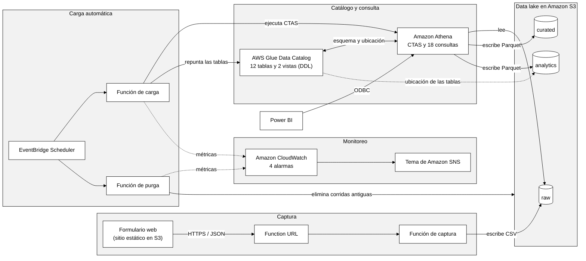
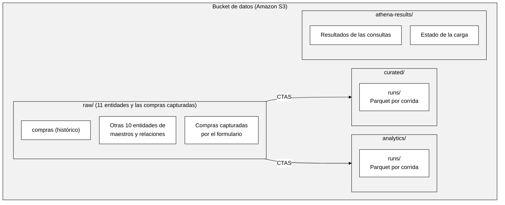
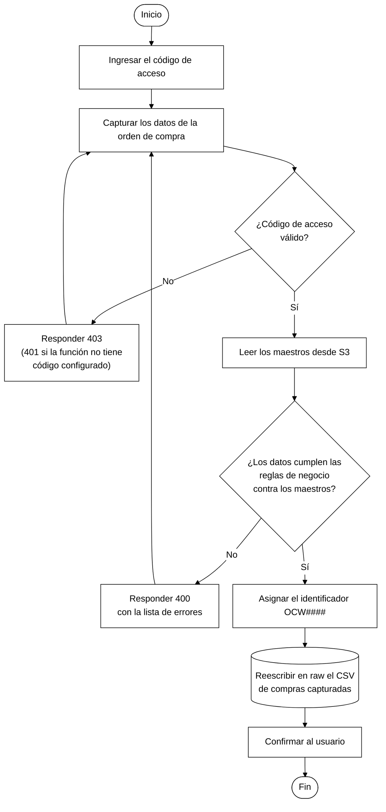
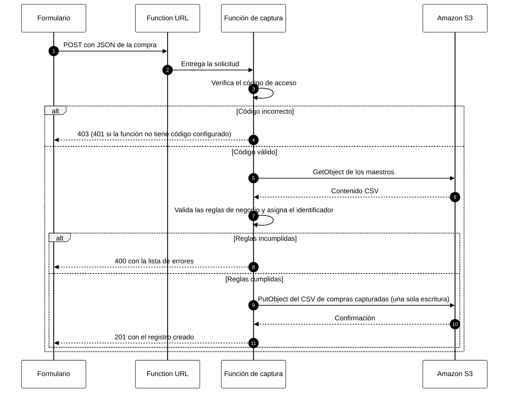
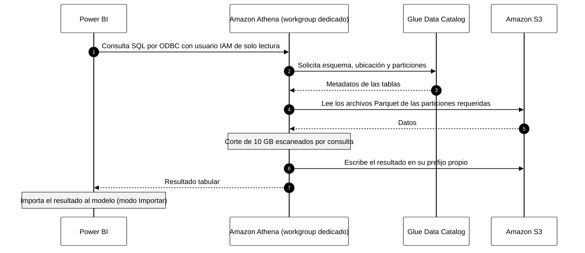
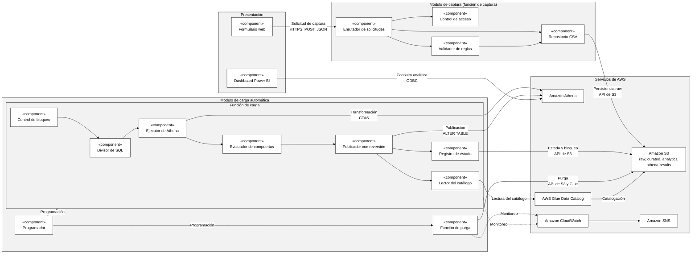
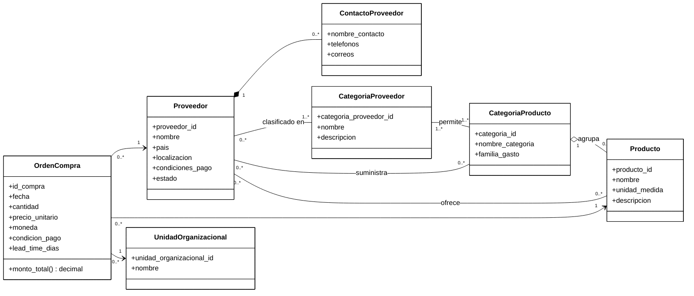
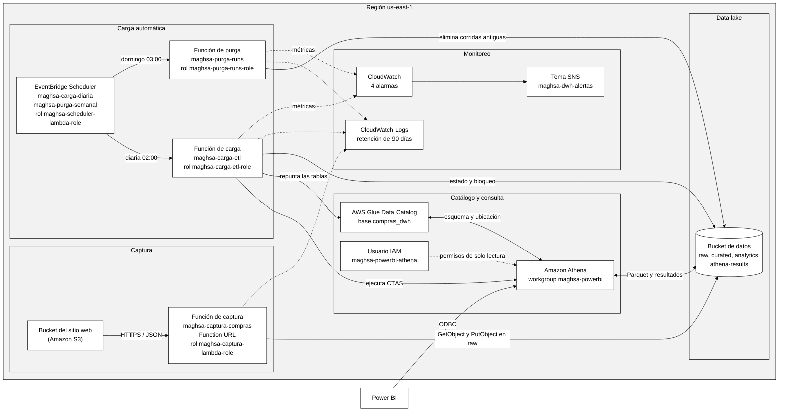

**UNIVERSIDAD MARIANO GÁLVEZ DE GUATEMALA**

**FACULTAD DE INGENIERÍA EN SISTEMAS DE**

**INFORMACIÓN**

**DESARROLLO E IMPLEMENTACIÓN DE UN DATA WAREHOUSE**   
**SERVERLESS EN AWS PARA EL ANÁLISIS DE COMPRAS MEDIANTE**   
**S3, GLUE DATA CATALOG Y ATHENA, CON DASHBOARDS DE**   
**INDICADORES Y ENFOQUE DE MANTENIMIENTO DE BAJO**   
**COSTO**  

**DAVID EDGAR RECINOS GARCÍA**

**Guatemala, noviembre de 2026.**

**UNIVERSIDAD MARIANO GÁLVEZ DE GUATEMALA**

**FACULTAD DE INGENIERÍA EN SISTEMAS DE**

**INFORMACIÓN**

**DESARROLLO E IMPLEMENTACIÓN DE UN DATA WAREHOUSE SERVERLESS EN AWS PARA EL ANÁLISIS DE COMPRAS MEDIANTE S3, GLUE DATA CATALOG Y ATHENA, CON DASHBOARDS DE INDICADORES Y ENFOQUE DE MANTENIMIENTO DE BAJO COSTO**

**TRABAJO DE GRADUACIÓN PRESENTADO**

**POR:**

**DAVID EDGAR RECINOS GARCÍA**

**PREVIO A OPTAR AL GRADO ACADÉMICO DE**

**LICENCIADO EN INGENIERÍA EN SISTEMAS DE**

**INFORMACIÓN Y CIENCIAS DE LA COMPUTACIÓN**

**Y TÍTULO PROFESIONAL DE**

**INGENIERO EN SISTEMAS DE INFORMACIÓN**

**Y CIENCIAS DE LA COMPUTACIÓN**

**Guatemala, noviembre de 2026.**

**AUTORIDADES DE LA FACULTAD Y ASESOR DEL TRABAJO**

**DE GRADUACIÓN.**

| DECANO DE LA FACULTAD: | ING. JORGE ALBERTO ARIAS TOBAR |
| :---- | :---- |
| **SECRETARIO DE LA FACULTAD:** | M.A. HUGO ADALBERTO HERNÁNDEZ SANTIZO |
| **ASESOR:** | M.A. EDDY ORLANDO HERNANDEZ CHOC |

**REGLAMENTO DE TESIS**

**Artículo 8: RESPONSABILIDAD**

Solamente el autor es responsable de los conceptos expresados en el trabajo de tesis. Su aprobación en manera alguna implica responsabilidad para la Universidad.

**Índice**

- [Introducción](#introducción)
- [Capítulo I - Marco Conceptual](#capítulo-i---marco-conceptual)
  - [1.1 Antecedentes](#11-antecedentes)
  - [1.2 Descripción del problema](#12-descripción-del-problema)
    - [1.2.1 Preguntas de investigación](#121-preguntas-de-investigación)
  - [1.3 Justificación](#13-justificación)
  - [1.4 Objetivos](#14-objetivos)
    - [1.4.1 Objetivo general](#141-objetivo-general)
    - [1.4.2 Objetivos específicos](#142-objetivos-específicos)
  - [1.5 Alcance](#15-alcance)
  - [1.6 Limitaciones](#16-limitaciones)
- [Capítulo II - Marco Teórico](#capítulo-ii---marco-teórico)
  - [2.1 Fundamentos de Data Warehouse y modelado analítico](#21-fundamentos-de-data-warehouse-y-modelado-analítico)
    - [2.1.1 Evolución de los Data Warehouses: de enfoques tradicionales a arquitecturas en la nube](#211-evolución-de-los-data-warehouses-de-enfoques-tradicionales-a-arquitecturas-en-la-nube)
    - [2.1.2 ETL vs ELT: estrategias modernas para DWH en la nube](#212-etl-vs-elt-estrategias-modernas-para-dwh-en-la-nube)
    - [2.1.3 Calidad de datos en entornos analíticos: consistencia, completitud, unicidad y trazabilidad](#213-calidad-de-datos-en-entornos-analíticos-consistencia-completitud-unicidad-y-trazabilidad)
  - [2.2 Arquitecturas serverless aplicadas a analítica](#22-arquitecturas-serverless-aplicadas-a-analítica)
    - [2.2.1 Computación serverless: principios, ventajas, limitaciones y modelos de costo](#221-computación-serverless-principios-ventajas-limitaciones-y-modelos-de-costo)
    - [2.2.2 Gobierno de datos en arquitecturas serverless: catálogo, metadatos, linaje y acceso](#222-gobierno-de-datos-en-arquitecturas-serverless-catálogo-metadatos-linaje-y-acceso)
    - [2.2.3 Diseño de zonas de datos (raw/bronze, curated/silver, analytics/gold)](#223-diseño-de-zonas-de-datos-rawbronze-curatedsilver-analyticsgold)
  - [2.3 Componentes AWS](#23-componentes-aws)
    - [2.3.1 S3 como Data Lake: organización por prefijos, particionamiento y ciclo de vida (lifecycle)](#231-s3-como-data-lake-organización-por-prefijos-particionamiento-y-ciclo-de-vida-lifecycle)
    - [2.3.2 Glue Data Catalog: esquemas, tablas, particiones y vistas](#232-glue-data-catalog-esquemas-tablas-particiones-y-vistas)
    - [2.3.3 Athena: ejecución SQL sobre S3, optimización por particiones y formatos columnares](#233-athena-ejecución-sql-sobre-s3-optimización-por-particiones-y-formatos-columnares)
    - [2.3.4 Seguridad en analítica cloud: IAM, control de acceso, cifrado at-rest/in-transit](#234-seguridad-en-analítica-cloud-iam-control-de-acceso-cifrado-at-restin-transit)
  - [2.4 Operación de compras: analítica, indicadores y gestión](#24-operación-de-compras-analítica-indicadores-y-gestión)
    - [2.4.1 Indicadores clave de compras (KPIs): costo, ahorro, cumplimiento, lead time, proveedores](#241-indicadores-clave-de-compras-kpis-costo-ahorro-cumplimiento-lead-time-proveedores)
    - [2.4.2 Evaluación de desempeño de proveedores: calidad, puntualidad, variabilidad de precio](#242-evaluación-de-desempeño-de-proveedores-calidad-puntualidad-variabilidad-de-precio)
    - [2.4.3 Gobernanza del dato de compras: maestros (proveedor, producto), reglas y consistencia](#243-gobernanza-del-dato-de-compras-maestros-proveedor-producto-reglas-y-consistencia)
  - [2.5 BI y Dashboards: Power BI y analítica](#25-bi-y-dashboards-power-bi-y-analítica)
    - [2.5.1 Dashboards para toma de decisiones: principios de visualización de KPIs y storytelling](#251-dashboards-para-toma-de-decisiones-principios-de-visualización-de-kpis-y-storytelling)
    - [2.5.2 Modelado semántico en Power BI: medidas DAX, star schema y performance](#252-modelado-semántico-en-power-bi-medidas-dax-star-schema-y-performance)
    - [2.5.3 Gobierno del reporte: refresh, dataset, control de acceso y versionado](#253-gobierno-del-reporte-refresh-dataset-control-de-acceso-y-versionado)
- [Capítulo III - Marco Metodológico](#capítulo-iii---marco-metodológico)
  - [3.1 Ruta de investigación](#31-ruta-de-investigación)
  - [3.2 Tipo de investigación](#32-tipo-de-investigación)
  - [3.3 Análisis de factibilidad](#33-análisis-de-factibilidad)
    - [3.3.1 Factibilidad económica](#331-factibilidad-económica)
    - [3.3.2 Factibilidad operativa](#332-factibilidad-operativa)
    - [3.3.3 Factibilidad tecnológica](#333-factibilidad-tecnológica)
    - [3.3.4 Factibilidad cognoscitiva](#334-factibilidad-cognoscitiva)
    - [3.3.5 Factibilidad legal y ambiental](#335-factibilidad-legal-y-ambiental)
  - [3.4 Hipótesis](#34-hipótesis)
    - [3.4.1 Variable independiente](#341-variable-independiente)
    - [3.4.2 Variable dependiente](#342-variable-dependiente)
  - [3.5 Definición de la población y tamaño de la muestra](#35-definición-de-la-población-y-tamaño-de-la-muestra)
    - [3.5.1 Tamaño de la población](#351-tamaño-de-la-población)
    - [3.5.2 Cálculo del tamaño de la muestra](#352-cálculo-del-tamaño-de-la-muestra)
    - [3.5.3 Instrumento](#353-instrumento)
    - [3.5.4 Recolección de datos](#354-recolección-de-datos)
  - [3.6 Interpretación de resultados](#36-interpretación-de-resultados)
    - [3.6.1 Gráficos y tabulares](#361-gráficos-y-tabulares)
  - [3.7 Recursos utilizados](#37-recursos-utilizados)
  - [3.8 Cronograma](#38-cronograma)
- [Capítulo IV - Análisis de la Aplicación](#capítulo-iv---análisis-de-la-aplicación)
  - [4.1 Descripción del proyecto](#41-descripción-del-proyecto)
  - [4.2 Identificación de usuarios](#42-identificación-de-usuarios)
  - [4.3 Modelado del negocio](#43-modelado-del-negocio)
    - [4.3.1 Design Science Research (DSR)](#431-design-science-research-dsr)
    - [4.3.2 Ciclo de vida](#432-ciclo-de-vida)
    - [4.3.3 Características](#433-características)
    - [4.3.4 Fases](#434-fases)
    - [4.3.5 Artefactos](#435-artefactos)
- [Capítulo V - Diseño de la Aplicación](#capítulo-v---diseño-de-la-aplicación)
  - [5.1 Diagramas UML](#51-diagramas-uml)
    - [5.1.1 Diagrama de casos de uso](#511-diagrama-de-casos-de-uso)
    - [5.1.2 Diagrama de actividades](#512-diagrama-de-actividades)
    - [5.1.3 Diagrama de secuencia](#513-diagrama-de-secuencia)
    - [5.1.4 Diagrama de componentes](#514-diagrama-de-componentes)
    - [5.1.5 Diagrama de objetos](#515-diagrama-de-objetos)
    - [5.1.6 Diagrama de clases](#516-diagrama-de-clases)
    - [5.1.7 Diagrama de entidad relación](#517-diagrama-de-entidad-relación)
  - [5.2 Entidad Relación](#52-entidad-relación)
  - [5.3 Diagramas de infraestructura](#53-diagramas-de-infraestructura)
    - [5.3.1 Arquitectura general](#531-arquitectura-general)
    - [5.3.2 Infraestructura en AWS](#532-infraestructura-en-aws)
    - [5.3.3 Integraciones](#533-integraciones)
    - [5.3.4 Correspondencia entre objetivos y diseño](#534-correspondencia-entre-objetivos-y-diseño)
- [Conclusiones](#conclusiones)
- [Recomendaciones](#recomendaciones)
- [Glosario](#glosario)
- [Bibliografía](#bibliografía)
- [Anexos](#anexos)

**Índice de figuras**

- [Figura 1 - Arquitectura de la solución del Data Warehouse serverless](#figura-1)
- [Figura 2 - Diagrama entidad-relación del modelo dimensional de compras](#figura-2)
- [Figura 3 - Diagrama de proceso de extremo a extremo](#figura-3)
- [Figura 4 - Estructura de zonas del Data Lake en Amazon S3](#figura-4)
- [Figura 5 - Tablas del esquema dimensional registradas en AWS Glue Data Catalog](#figura-5)
- [Figura 6 - Resultado de la consulta de costo total de compras por periodo en Amazon Athena](#figura-6)
- [Figura 7 - Formulario de captura de datos de compras](#figura-7)
- [Figura 8 - Diagrama de casos de uso del sistema](#figura-8)
- [Figura 9 - Diagrama de actividades del registro de una orden de compra](#figura-9)
- [Figura 10 - Diagrama de secuencia del registro de una orden de compra](#figura-10)
- [Figura 11 - Diagrama de secuencia de la consulta de indicadores](#figura-11)
- [Figura 12 - Diagrama de componentes del sistema](#figura-12)
- [Figura 13 - Diagrama de objetos de la orden de compra OC0001](#figura-13)
- [Figura 14 - Diagrama de clases del dominio de compras](#figura-14)
- [Figura 15 - Diagrama de infraestructura de la solución en AWS](#figura-15)

**Índice de tablas**

- [Tabla 1 - Resumen general de costos](#tabla-1)
- [Tabla 2 - Factibilidad técnica de software](#tabla-2)
- [Tabla 3 - Fuentes documentales del proyecto](#tabla-3)
- [Tabla 4 - Variables e indicadores del análisis de compras](#tabla-4)
- [Tabla 5 - Costo total de compras por periodo](#tabla-5)
- [Tabla 6 - Gasto por categoría](#tabla-6)
- [Tabla 7 - Gasto por proveedor](#tabla-7)
- [Tabla 8 - Lead time promedio por proveedor](#tabla-8)
- [Tabla 9 - Recursos necesarios](#tabla-9)
- [Tabla 10 - Cronograma referencial](#tabla-10)
- [Tabla 11 - Módulos y tecnologías del Data Warehouse](#tabla-11)
- [Tabla 12 - Especificación resumida de casos de uso principales](#tabla-12)
- [Tabla 13 - Interfaces entre componentes](#tabla-13)
- [Tabla 14 - Entidades del modelo de datos](#tabla-14)
- [Tabla 15 - Recursos de infraestructura y configuración](#tabla-15)
- [Tabla 16 - Correspondencia entre objetivos, procesos y elementos de diseño](#tabla-16)
# **Introducción**

La gestión y el control del proceso de compras dependen, en gran medida, de la disponibilidad de información confiable y oportuna. En la práctica, los datos relacionados con órdenes de compra, proveedores, productos, costos, condiciones de pago y tiempos de entrega suelen generarse en diferentes sistemas transaccionales y en diversos formatos, lo cual dificulta su integración, su trazabilidad y su análisis histórico. Esta dispersión provoca que, con frecuencia, el análisis de compras se realice mediante actividades manuales como extracción de datos, depuración en hojas de cálculo y elaboración de reportes estáticos, incrementando el esfuerzo operativo, el riesgo de inconsistencias y la dificultad para sostener indicadores bajo un mismo criterio.

Ante este escenario, surge la necesidad de contar con una solución que permita consolidar la información de compras en un repositorio analítico centralizado, orientado a consultas y generación de indicadores. Sin embargo, la implementación de un Data Warehouse tradicional puede implicar infraestructura dedicada, costos fijos y una carga de mantenimiento asociada a la administración de servidores, respaldos, escalamiento y operación continua. Por ello, el enfoque serverless representa una alternativa adecuada cuando se busca simplicidad operativa y control del costo, ya que permite construir capacidades de almacenamiento, catalogación y consulta analítica con servicios administrados y escalables bajo demanda.

El Data Warehouse serverless de compras de MAGHSA, desplegado en AWS y en operación, utiliza Amazon S3 como capa de almacenamiento, AWS Glue Data Catalog como repositorio de metadatos técnicos y Amazon Athena como motor de consulta SQL sobre los datos almacenados. El personal de compras registra la información mediante un portal web respaldado por una función AWS Lambda, que valida cada registro y lo escribe en la zona raw; una segunda función AWS Lambda, programada con Amazon EventBridge Scheduler, ejecuta cada día la transformación mediante consultas de Athena. A partir de esta base, los resultados analíticos se materializan mediante dashboards de indicadores en Power BI, de forma que la información consolidada pueda visualizarse en métricas y tendencias relevantes para la toma de decisiones. La selección de Power BI responde a un criterio de economía y experiencia previa, privilegiando una herramienta que permita producir tableros con rapidez y menor curva de aprendizaje, sin dejar de aprovechar el motor de consulta serverless de Athena.

El modelo dimensional de compras (hechos y dimensiones) soporta los indicadores seleccionados y responde a necesidades de análisis frecuentes como comparaciones por periodo, por proveedor, por categorías de gasto y por unidades organizacionales. El almacenamiento en S3 se organiza en tres zonas lógicas (raw, curated y analytics) que facilitan la consulta y el control del ciclo de vida de los datos.

El catálogo de metadatos se define en AWS Glue Data Catalog mediante sentencias DDL, lo que habilita el descubrimiento y la consulta consistente de los datasets. Las consultas analíticas de Athena producen las métricas y agregaciones que alimentan los indicadores definidos: 18 consultas, de las cuales 16 alimentan las 5 páginas del dashboard de Power BI y 2 son de catálogo puntual; el dashboard se conecta a Athena mediante ODBC a través de un workgroup dedicado con corte de 10 GB por consulta. La carga diaria transforma los datos de la zona raw a formato Parquet con sentencias CTAS de Athena, aplica compuertas de validación antes de publicar el resultado y se complementa con una purga semanal de las corridas antiguas. Las alarmas de Amazon CloudWatch notifican por Amazon SNS los errores, la duración excesiva y la ausencia de corridas. Esta capa de presentación traduce los datos consolidados en información interpretable y utilizable por usuarios de negocio.

La validación de extremo a extremo (S3 → Glue Data Catalog → Athena → Power BI) se apoya en pruebas de consultas y en la verificación de indicadores. El objetivo de bajo costo de mantenimiento se sostiene con la organización adecuada de los datos, el control de accesos con permisos de mínimo privilegio, la documentación del flujo y el uso eficiente de consultas; con el conjunto de datos sintético, el costo mensual de la infraestructura es inferior a USD 0.01. El resultado es un Data Warehouse serverless aplicado al análisis de compras, con énfasis en simplicidad, escalabilidad y sostenibilidad operativa.

# **Capítulo I - Marco Conceptual**

## **1.1 Antecedentes**

Durante las últimas décadas, las organizaciones han incrementado considerablemente la generación de datos provenientes de múltiples fuentes: sistemas transaccionales, archivos planos, bases de datos relacionales, registros de auditoría, integraciones con proveedores, servicios externos y aplicaciones corporativas, entre otras. Este crecimiento no solo se ha manifestado en volumen, sino también en diversidad y frecuencia de actualización, lo cual ha reforzado la necesidad de transformar dichos datos en información analítica útil para el control y la toma de decisiones del negocio.

En particular, en los procesos de compras se originan datos críticos relacionados con órdenes, proveedores, productos, costos, condiciones de pago, tiempos de entrega y movimientos de inventario. Sin embargo, en muchos escenarios estos datos se distribuyen en diferentes sistemas y formatos, dificultando la consolidación histórica, el análisis por dimensiones y la obtención de indicadores de gestión de manera oportuna. Como consecuencia, es común que las áreas operativas y administrativas recurran a reportes manuales y hojas de cálculo, generando esfuerzos repetitivos, inconsistencias y limitada trazabilidad del origen de los datos.

Tradicionalmente, para responder a estas necesidades analíticas se han implementado almacenes de datos y plataformas de integración que centralizan información estructurada y semiestructurada. No obstante, estos enfoques suelen implicar costos relevantes de infraestructura y licenciamiento, además de requerir tareas continuas de administración, aprovisionamiento, respaldo, actualización de componentes y soporte operativo. Dichas actividades incrementan la carga de mantenimiento y pueden convertirse en una barrera para organizaciones o proyectos que buscan soluciones analíticas escalables sin depender de infraestructura compleja.

Con la adopción creciente de computación en la nube, se han consolidado alternativas orientadas a arquitecturas administradas y de pago por uso. En este contexto, el enfoque serverless permite implementar capacidades de almacenamiento, catalogación y consulta analítica sin la necesidad de operar servidores o clústeres permanentes, reduciendo significativamente el esfuerzo de administración y permitiendo escalar el consumo conforme a la demanda real. Para escenarios de analítica de compras, esta aproximación facilita la construcción de un repositorio central en el que los datos puedan mantenerse organizados, versionados y disponibles para consultas, indicadores y tableros de visualización, priorizando la sostenibilidad y el bajo costo de mantenimiento.

De esta manera, surge la oportunidad de diseñar e implementar un Data Warehouse serverless en AWS, utilizando servicios administrados como Amazon S3 para almacenamiento, AWS Glue Data Catalog para la organización y descripción de metadatos, y Amazon Athena para la ejecución de consultas analíticas sobre los datos, complementando con dashboards que permitan visualizar indicadores clave. Este enfoque responde a la necesidad de consolidar la información de compras de forma estructurada y gobernada, habilitando analítica y reportes con una arquitectura de soporte a largo plazo, adaptable y con costos controlables.

## **1.2 Descripción del problema**

En la actualidad, muchas organizaciones dependen de información proveniente de distintos sistemas operacionales para ejecutar y controlar sus procesos de compras. Dichos datos suelen originarse en módulos transaccionales (órdenes de compra, recepciones, facturación), catálogos de proveedores y productos, archivos externos y registros históricos. Aunque estos insumos contienen información valiosa para evaluar el desempeño del proceso de abastecimiento, con frecuencia se encuentran dispersos, con formatos heterogéneos y con diferentes niveles de calidad y consistencia. Esta situación dificulta la consolidación histórica, la trazabilidad de los registros y la generación de indicadores confiables de manera oportuna.

Como consecuencia, la analítica de compras tiende a sostenerse mediante esfuerzos manuales: extracción de datos a hojas de cálculo, elaboración de reportes estáticos y depuración repetitiva de inconsistencias. Además de consumir tiempo operativo, este enfoque incrementa el riesgo de errores, reduce la reproducibilidad de los análisis y limita la disponibilidad de información para la toma de decisiones, especialmente cuando se requieren comparaciones por periodos, por proveedor, por categoría de gasto o por unidades organizacionales.

Bajo este escenario, se identifica la necesidad de contar con un repositorio analítico centralizado que permita integrar la información de compras en un modelo orientado al análisis, con estructura y gobierno de datos. No obstante, en contextos académicos o en organizaciones con presupuestos limitados, implementar un Data Warehouse tradicional puede representar un reto debido a los costos de infraestructura, licenciamiento y, principalmente, por el esfuerzo de administración y mantenimiento que implica operar servidores, bases de datos y herramientas dedicadas de forma permanente. En este sentido, las arquitecturas serverless en la nube representan una alternativa para reducir el costo total de propiedad y simplificar la operación, al basarse en servicios administrados y en un esquema de pago por uso. Sin embargo, adoptar un enfoque serverless requiere una definición clara de componentes, flujo de datos y criterios de diseño: cómo almacenar y organizar los datos de compras, cómo catalogarlos para garantizar consistencia y descubrimiento, cómo habilitar consultas eficientes y cómo exponer los resultados a tableros de control con indicadores relevantes, manteniendo el principio de bajo costo y bajo mantenimiento.

Por lo tanto, el problema central consiste en que no existe una implementación práctica consolidada, de alcance acotado y orientada a bajo costo, que demuestre cómo construir un Data Warehouse serverless en AWS para el análisis de compras, integrando almacenamiento en Amazon S3, catalogación mediante AWS Glue Data Catalog y consultas con Amazon Athena, y que a su vez permita visualizar indicadores a través de dashboards en Power BI. La ausencia de una solución de este tipo limita la posibilidad de contar con analítica de compras sostenible y escalable sin incurrir en infraestructura compleja o costos fijos elevados.

En consecuencia, se plantea como necesidad desarrollar e implementar una arquitectura que permita consolidar datos de compras en una estructura orientada a análisis, habilitar un catálogo de metadatos que facilite el gobierno y el acceso controlado, ejecutar consultas analíticas optimizadas sobre los datos, y disponibilizar indicadores de gestión mediante tableros en Power BI. Todo ello, con un enfoque explícito de mantenimiento de bajo costo, priorizando servicios administrados, facilidad operativa y escalabilidad bajo demanda.

### **1.2.1 Preguntas de investigación**

¿Qué problema se identificó y cómo se pretende dar solución? Se identificó la dificultad para consolidar y analizar datos de compras de forma consistente, debido a dispersión de fuentes, reprocesos manuales y limitada trazabilidad. La solución consiste en un Data Warehouse serverless en AWS con S3, Glue Data Catalog y Athena, desplegado en la infraestructura de MAGHSA, cuyos indicadores se consumen mediante dashboards en Power BI, con bajo mantenimiento y costos controlados.

¿Quiénes serán beneficiados al terminar el proyecto? Se benefician principalmente las áreas usuarias de análisis de compras, al disponer de indicadores más rápidos y consistentes. También se beneficia el área técnica o de soporte de datos, por la reducción de tareas operativas y por contar con una arquitectura más simple de administrar.

¿Se utilizará alguna metodología de desarrollo? Sí. Design Science Research (DSR) es el marco para diseñar, construir y evaluar el artefacto (DWH serverless y dashboards). El desarrollo práctico es incremental por etapas: almacenamiento, catalogación, consultas y visualización.

¿Cuántas personas se encuentran involucradas? Participa una persona responsable del desarrollo e implementación, con la revisión y retroalimentación del asesor académico.

¿Cuánto tiempo se necesita para terminarlo? La ejecución abarca 12 semanas para implementación, pruebas y dashboard, conforme al cronograma del apartado 3.8.

¿Los recursos con los que actualmente se cuentan son suficientes? Sí. Los recursos son una computadora personal, conexión a internet, una cuenta de AWS, un dataset de compras y Power BI Desktop. La publicación en Power BI Service con actualización programada requeriría un componente adicional, fuera del alcance definido.

¿Se capacitará al personal al finalizar el proyecto? La transferencia de conocimiento se apoya en documentación técnica y en una guía de uso que facilitan la adopción, y en una capacitación breve sobre el uso del dashboard y la lectura de indicadores, prevista en la última semana del cronograma (apartado 3.8).

¿Qué beneficios traerá a la empresa el implementar el proyecto? Mejora la disponibilidad de indicadores de compras, reduce reprocesos manuales y facilita análisis histórico por dimensiones. Además, aporta mayor trazabilidad de datos y un esquema de consulta más flexible sin necesidad de operar infraestructura compleja.

¿Cuál es la importancia de implementar este tipo de proyecto? Permite convertir datos de compras en información accionable con una base analítica estructurada y reutilizable. Además, introduce un enfoque moderno de analítica con servicios administrados, que favorece continuidad, escalabilidad y sostenibilidad operativa con costos controlados.

¿Se considera que el proyecto pueda ser operativo para la empresa a futuro? Sí, debido a que la arquitectura se basa en servicios administrados y escalables, lo cual facilita su continuidad; además, la carga diaria automática, la purga semanal de corridas antiguas y las alarmas de CloudWatch reducen la intervención manual. Su operatividad a futuro depende de mantener actualizados los datos de compras, controlar costos de consultas y documentar el flujo para que pueda ser administrado sin alta especialización.

## **1.3 Justificación**

El análisis de compras requiere información consolidada, consistente y trazable, debido a que los datos suelen originarse en múltiples fuentes, con variaciones de formato y calidad. Esta dispersión dificulta la construcción de indicadores confiables y oportunos, incrementa el trabajo manual para depurar datos y limita la capacidad de comparar el desempeño del gasto por periodos, proveedores, categorías y unidades organizacionales. En consecuencia, resulta necesario implementar un repositorio analítico que unifique la información de compras bajo una estructura orientada a consulta y generación de indicadores.

La implementación de un Data Warehouse (DWH) serverless en AWS se justifica como alternativa viable cuando se busca disminuir el esfuerzo operativo y el costo asociado a la administración de infraestructura. A diferencia de enfoques tradicionales que requieren servidores dedicados, licenciamiento y actividades recurrentes de mantenimiento, una arquitectura basada en servicios administrados permite enfocarse en el diseño del modelo de datos, el aseguramiento de calidad y el consumo analítico, reduciendo la complejidad operativa. Este enfoque es consistente con un objetivo de mantenimiento de bajo costo, al priorizar componentes que escalan bajo demanda y se gestionan principalmente mediante configuración y buenas prácticas de organización de datos.

Bajo esta perspectiva, el uso de Amazon S3 como capa de almacenamiento se fundamenta en su capacidad para funcionar como repositorio central de datos, favoreciendo la conservación histórica y la separación por zonas lógicas, lo cual facilita el control del ciclo de vida de la información. Asimismo, AWS Glue Data Catalog aporta valor al actuar como repositorio de metadatos técnicos, permitiendo describir bases, tablas y particiones, y habilitando un punto común de descubrimiento y estandarización de esquemas. Finalmente, Amazon Athena se justifica como motor de consulta porque permite realizar análisis mediante SQL directamente sobre los datos almacenados, evitando la necesidad de aprovisionar y administrar infraestructura de cómputo para consultas. En conjunto, estos componentes conforman una base adecuada para un DWH orientado a analítica de compras con énfasis en simplicidad operativa y control de costos.

La inclusión de dashboards de indicadores se justifica por la necesidad de traducir los datos consolidados en métricas accionables para la toma de decisiones. Power BI consume los datos de Athena mediante ODBC en modo Importar, a través de un workgroup dedicado con corte de 10 GB por consulta, lo que mantiene la capa analítica alineada con el enfoque serverless al consultar sobre el repositorio en AWS.

## **1.4 Objetivos**

### **1.4.1 Objetivo general**

Construir y evaluar una arquitectura de Data Warehouse serverless en AWS orientada al análisis de compras, basada en S3, Glue Data Catalog y Athena, y presentar indicadores mediante Power BI, priorizando simplicidad operativa y bajo costo de mantenimiento.

### **1.4.2 Objetivos específicos**

Definir el modelo dimensional de compras (hechos y dimensiones) para soportar indicadores clave.

Organizar el almacenamiento de datos de compras en Amazon S3 con una estructura lógica que facilite su consulta.

Catalogar los datasets de compras en AWS Glue Data Catalog para habilitar descubrimiento y consulta consistente.

Implementar un conjunto de visualizaciones en Power BI (KPIs y tendencias) a partir de consultas en Athena para apoyar la toma de decisiones.

Validar el funcionamiento del DWH mediante la ejecución de consultas y la visualización correcta de indicadores en Power BI.

## **1.5 Alcance**

El alcance de la investigación comprende el diseño, la construcción y la evaluación funcional de una arquitectura de Data Warehouse serverless orientada al análisis de compras. De manera específica, se contempla la definición del modelo dimensional de compras, la organización lógica de los datasets en Amazon S3, la catalogación de tablas y particiones en AWS Glue Data Catalog, la ejecución de consultas analíticas en Amazon Athena, la carga diaria automática con compuertas de validación, la purga semanal de corridas antiguas, las alarmas de monitoreo, la construcción de dashboards en Power BI con los indicadores de compras definidos, y la validación del flujo de extremo a extremo, desde el almacenamiento hasta la visualización.

Dado que el acceso directo a la consola de AWS no resulta viable para el personal operativo de compras, se contempla dentro del alcance un módulo mínimo de ingesta validada, que permite registrar la información de compras sin requerir credenciales de AWS, aplicando reglas básicas de validación antes de escribir el registro en la zona raw del repositorio. Este módulo constituye el mecanismo de entrada de datos hacia la arquitectura ya descrita, y no sustituye ni amplía dicha arquitectura.

Quedan fuera del alcance la implementación de un sistema transaccional completo de compras (con flujo de aprobación, gestión de órdenes o integración con proveedores), la implementación empresarial a gran escala, la integración con múltiples sistemas operacionales en tiempo real, la ingesta continua por eventos y las plataformas corporativas de monitoreo. Estas exclusiones son deliberadas y responden al principio de acotamiento propio de una investigación académica con enfoque en la demostración funcional del artefacto diseñado (Hevner et al., 2004). Los resultados presentados se obtienen con un conjunto de datos sintético que reproduce la estructura de los datos de MAGHSA (sección 1.6).

## **1.6 Limitaciones**

Toda investigación aplicada presenta limitaciones que deben reconocerse y documentarse explícitamente, dado que estas condicionan el alcance de los resultados y la validez de las conclusiones. En el contexto del Design Science Research, identificar las restricciones del artefacto forma parte del proceso de evaluación honesta de su contribución (Peffers et al., 2007).

El alcance se enfoca en una implementación funcional, no en una plataforma corporativa de gran escala; en consecuencia, los resultados obtenidos son representativos del enfoque propuesto, pero no necesariamente generalizables a otras organizaciones sin adaptaciones adicionales. El sistema se despliega en la infraestructura de MAGHSA y, por confidencialidad, las cifras, las tablas de resultados y las capturas presentadas provienen de un conjunto de datos sintético que reproduce la estructura de los datos reales. Por esta razón, los valores de los indicadores ilustran el funcionamiento del sistema y no describen el comportamiento real de las compras de la empresa. La calidad y el volumen del conjunto de datos condicionan, asimismo, el nivel de detalle del análisis y de los indicadores.

La solución se construye con servicios específicos de AWS, por lo cual su implementación responde a las características, restricciones y políticas de dicho proveedor; cambios en los precios, la disponibilidad o las interfaces de los servicios utilizados podrían requerir ajustes en la arquitectura. La evaluación del artefacto, por su parte, se basa en pruebas funcionales y en la validación de indicadores, no en despliegues de producción a gran escala; en consecuencia, aspectos como la latencia bajo carga alta o la estabilidad a largo plazo quedan fuera del alcance de la evaluación formal realizada. Finalmente, la solución prioriza un bajo costo de mantenimiento, por lo cual evita componentes que impliquen administración continua de infraestructura, decisión que puede limitar capacidades de integración en tiempo real que requerirían servicios adicionales.

# **Capítulo II - Marco Teórico**

## **2.1 Fundamentos de Data Warehouse y modelado analítico**

### **2.1.1 Evolución de los Data Warehouses: de enfoques tradicionales a arquitecturas en la nube**

La evolución de los Data Warehouses (DWH) puede describirse como la transición desde enfoques tradicionales, sustentados en infraestructura local y procesos de integración rígidos, hacia arquitecturas basadas en servicios de cómputo en la nube, más elásticas y orientadas a componentes. Este cambio no solo implica reubicar el almacenamiento, sino también redefinir cómo se integran, procesan y disponibilizan los datos para análisis, enfatizando la automatización y la escalabilidad. En ese sentido, Mayor Cebrian (2025) destaca que “… estos procesos se ejecutaban de forma manual o programada en servidores locales. Sin embargo, con la adopción generalizada de la computación en la nube y las arquitecturas Big Data, el enfoque ETL ha evolucionado hacia soluciones automatizadas, escalables y modulares…” (pp. 20–21).

Comprender esta evolución es clave en proyectos analíticos porque explica por qué muchas organizaciones migran de soluciones tradicionales (con costos fijos, operación intensiva y escalabilidad limitada) hacia modelos en nube que favorecen el crecimiento por demanda y la reducción de carga operativa. En la práctica, esta transformación habilita plataformas más flexibles para integrar datos heterogéneos, conservar históricos y acelerar la generación de indicadores para toma de decisiones. 

### **2.1.2 ETL vs ELT: estrategias modernas para DWH en la nube**

En la integración de datos para analítica, ETL (Extract, Transform, Load) y ELT (Extract, Load, Transform) representan dos estrategias para mover datos desde fuentes operacionales hacia repositorios analíticos. En ETL, los datos se transforman antes de cargarse al destino analítico; en ELT, se cargan primero (generalmente en un repositorio escalable como un Data Lake o almacén analítico) y luego se transforman en el propio entorno de análisis o consumo. En arquitecturas modernas en la nube, esta distinción se vuelve más relevante porque los repositorios de almacenamiento y los motores de consulta/transformación suelen estar desacoplados, permitiendo flujos más flexibles y escalables. 

Diferenciar ETL y ELT es importante porque influye directamente en la calidad y consistencia de la información que llega a los modelos analíticos; la agilidad para incorporar nuevas fuentes o redefinir reglas de transformación: el costo y rendimiento, especialmente cuando el motor de consulta cobra por procesamiento o por datos escaneados; y la gobernanza, ya que define dónde se aplican controles, validaciones y estandarización. En palabras de Palan Murillo (2025), “el procesamiento de los datos en bruto constituye una fase importante dentro de la arquitectura de gobernanza del dato, ya que garantiza que la información almacenada en el Data Lake sea consistente, fiable y lista para su consumo posterior” (pp. 41–42).

La solución adopta un enfoque ELT. Los registros se almacenan sin transformar en la zona raw de Amazon S3 y las consultas de Athena realizan después la transformación hacia las zonas curated y analytics, de modo que el cómputo se consume únicamente durante la carga.

### **2.1.3 Calidad de datos en entornos analíticos: consistencia, completitud, unicidad y trazabilidad**

La calidad de datos en entornos analíticos se refiere al grado en que los datos son aptos para su uso en análisis, reportes e indicadores. En un Data Warehouse o un Data Lake orientado al análisis, la calidad no es un “extra”, sino un requisito para garantizar que las conclusiones y métricas representen la realidad del negocio. En ese sentido, Muñoz Ramírez (2025) enfatiza que “la calidad de los datos es un prerrequisito para la analítica avanzada. Modelos de predicción, segmentación de clientes o evaluación de riesgo crediticio dependen de datos limpios, completos y actualizados” (p. 18).

La calidad de datos es crítica porque condiciona la confiabilidad de todo lo que se construye encima: indicadores, tendencias, segmentaciones y comparaciones históricas. Si los datos llegan incompletos, duplicados o inconsistentes, el sistema analítico puede producir conclusiones equivocadas. Para esto es clave los distintos indicadores de calidad de datos, como lo es la consistencia, que se refiere a que los datos no se contradicen entre sí a través de tablas, fuentes o periodos; la completitud, indica el grado en que los datos contienen todos los campos necesarios para soportar indicadores; la unicidad, evalúa que los registros no estén duplicados cuando deben ser únicos; y la trazabilidad, que es la capacidad de rastrear el origen del dato y sus transformaciones. En la solución, la carga diaria ejecuta compuertas de validación que verifican la integridad referencial de las claves, los conteos, la cobertura de la dimensión tiempo y el rango de fechas, y detienen la publicación de la corrida cuando alguna falla.

## **2.2 Arquitecturas serverless aplicadas a analítica**

### **2.2.1 Computación serverless: principios, ventajas, limitaciones y modelos de costo**

La computación serverless (o “sin servidor”) se refiere a un paradigma de computación en la nube en el que el usuario no administra servidores de forma directa (aprovisionamiento, escalado, parches, capacidad fija), sino que consume capacidades de ejecución y servicios administrados bajo demanda. Para entender dónde encaja este enfoque, resulta útil considerar que los servicios de nube suelen organizarse como una pila (stack) de servicios construidos unos sobre otros, desde capas más cercanas a infraestructura hasta capas más cercanas a aplicaciones. En esa línea, Kamlofsky (2022) indica que “el modelo de Servicios de la computación en nube a menudo se describe como una pila, como respuesta a la amplia gama de servicios construidos uno encima del otro bajo el nombre 'Nube'” (p. 5).

Este concepto es especialmente relevante en proyectos analíticos porque entre sus ventajas permite reducir carga operativa (administración de servidores), habilitar escalabilidad automática y alinear el consumo de recursos a la demanda real. En escenarios de analítica, donde el uso puede ser intermitente, serverless evita pagar capacidad de cómputo “ociosa” y favorece arquitecturas más simples de operar. No obstante, hay factores limitantes que no se pueden ignorar, como lo es la dependencia con el proveedor del servicio, ya que las decisiones quedan atadas a dichas especificaciones o cambios; la observabilidad y depuración, esta puede ser más compleja al momento de rastrear fallos entre componentes utilizados; y los costos impredecibles si no existe un control correcto, las consultas mal diseñadas o consumo sin límites pueden elevar considerablemente los gastos. En la solución, el cómputo se limita a tres funciones AWS Lambda (captura, carga diaria y purga semanal), invocadas por demanda o por Amazon EventBridge Scheduler, sin servidores ni clústeres permanentes; las alarmas de Amazon CloudWatch con notificación por Amazon SNS atienden la observabilidad de la carga y la purga. 

### **2.2.2 Gobierno de datos en arquitecturas serverless: catálogo, metadatos, linaje y acceso**

El gobierno de datos en arquitecturas serverless se entiende como el conjunto de prácticas, controles y mecanismos que permiten asegurar que los datos sean descubribles, confiables, seguros y trazables, desde su ingestión hasta su consumo analítico. En entornos cloud modernos, donde el almacenamiento, el catálogo y la consulta suelen estar desacoplados, el gobierno de datos se apoya fuertemente en metadatos, catálogos, control de acceso, auditoría y mejora continua. En ese contexto, el uso de marcos de referencia para evaluar decisiones técnicas es clave, así como nos guían Marceliano Alcantara & Villarreal Tello (2025), indicando un servicio útil para esto, es “el marco AWS Well-Architected actúa como una guía de referencia para mantener la calidad técnica y la gobernanza del sistema, permitiendo auditorías periódicas y una mejora continua de la arquitectura” (p. 29).

En una solución analítica serverless, el gobierno de datos es esencial porque reduce inconsistencias y ambigüedades, facilita el descubrimiento de datasets y su reutilización sin depender de conocimiento tribal, incrementa la confiabilidad de indicadores y dashboards, y refuerza seguridad y cumplimiento al asegurar que cada usuario/rol solo acceda a lo que le corresponde. Bajo este contexto, un catálogo centraliza la descripción de los datasets analíticos y sirve como punto de “descubrimiento” para usuarios técnicos y analíticos; los metadatos son los “datos sobre los datos”, es decir, esquemas, tipos, particiones, fechas de actualización, propietarios, definiciones y reglas de uso; el linaje permite corroborar de dónde vino un dato, qué transformaciones sufrió, y cuándo cambió; y cabe recalcar que el gobierno de datos exige un control claro de quién puede ver qué, con principios como mínimo privilegio, separación por roles y auditoría de actividades. En la solución, el catálogo registra en una única base de datos 12 tablas y 2 vistas, y el acceso se separa por rol: la función de captura opera únicamente sobre la zona raw y Power BI lee mediante un usuario IAM de solo lectura.

### **2.2.3 Diseño de zonas de datos (raw/bronze, curated/silver, analytics/gold)**

El diseño de zonas de datos (también conocido como arquitectura por capas o patrón multicapa) consiste en organizar el repositorio analítico en capas lógicas que representan distintos niveles de madurez del dato, desde su estado original hasta su forma lista para consumo analítico. Este enfoque se conoce ampliamente como arquitectura Medallion, donde las capas Bronze (bronce o raw), Silver (plata o curated) y Gold (oro o analytics) describen la calidad y preparación del dato en cada etapa del flujo. Su propósito central es refinar el dato de forma gradual mediante validaciones y transformaciones hasta obtener información confiable para inteligencia de negocios. 

En concordancia con esto, Berbel Carballal (2025) afirma que “su objetivo es mejorar de forma incremental y progresiva la estructura y calidad de los datos a medida que fluyen por cada capa de la arquitectura” (p. 32). Esta idea es consistente con la definición técnica del patrón Medallion, donde la mejora progresiva ocurre conforme los datos avanzan de Bronze (datos brutos), Silver (datos validados y depurados), y Gold (datos listos para consumo). El valor práctico de separar los datos por zonas/capas es que con esto evitamos que los repositorios tengan datos mezclados, sin calidad ni trazabilidad; se permite asignar garantías distintas de calidad según la capa; se facilita la auditoría y el reproceso, ya que es más sencillo de rastrear si un indicador termina mal; y mejora el rendimiento y el costo, esto gracias a que la capa de consumo debe estar optimizada para consultas y dashboards, esto reduciendo reprocesos. En la solución, las zonas raw, curated y analytics corresponden a Bronze, Silver y Gold. Cada corrida de carga escribe en prefijos propios y las tablas del catálogo se apuntan a la corrida únicamente después de superar las compuertas de validación. 

## **2.3 Componentes AWS**

### **2.3.1 S3 como Data Lake: organización por prefijos, particionamiento y ciclo de vida (lifecycle)**

Un Data Lake en Amazon S3 es un enfoque de almacenamiento analítico donde los datos se conservan en un repositorio central basado en almacenamiento de objetos, permitiendo alojar datos de diferentes fuentes y formatos y habilitar su consumo posterior mediante motores de consulta y procesamiento. En arquitecturas serverless, S3 suele funcionar como la capa base de almacenamiento por su desacoplamiento natural respecto al cómputo, facilitando que el análisis se ejecute bajo demanda con otros servicios. En esa línea, López Saldarriaga (2025) sostiene que “Amazon S3 suele ser pieza central de los data lake serverless. Estudios sobre lagos de datos corporativos muestran reducciones de costos > 60 % al migrar almacenamiento primario a S3, gracias a su separación de cómputo…” (p. 51).

Diseñar S3 como Data Lake tiene valor directo en analítica porque reduce dependencia de infraestructura fija; facilita almacenar histórico a bajo costo y escalar almacenamiento sin “planificación de capacidad”; permite controlar costos mediante políticas de ciclo de vida; y mejora eficiencia de consultas cuando la organización por prefijos y particiones está alineada a patrones de consulta (especialmente para motores como Athena). El bucket de datos de la solución separa las zonas raw, curated y analytics, cifra los objetos con SSE-S3 y aplica una regla de ciclo de vida que expira a los 30 días los resultados de consultas de Athena. La zona raw contiene 11 entidades.

### **2.3.2 Glue Data Catalog: esquemas, tablas, particiones y vistas**

El AWS Glue Data Catalog es un repositorio centralizado de metadatos que almacena información técnica sobre los conjuntos de datos de una organización, como ubicación, esquema, propiedades y estructura; y organiza dichos metadatos en bases de datos y tablas (similar a un catálogo relacional). AWS describe que los metadatos se almacenan en tablas de metadatos, donde cada tabla representa un almacén/dataset específico, y que el catálogo se integra con servicios analíticos como Amazon Athena. 

Bajo este contexto, Rodríguez Serrato & Quiñonez Zapata (2025) añaden que es un “… componente de gobernanza que mantiene … el inventario actualizado de todos los conjuntos de datos almacenados en las diferentes capas de la arquitectura medallón…” (p. 46). El catálogo se organiza en bases de datos y tablas, cada tabla incluye información como esquema y ubicación, habilitando que servicios de análisis consulten de forma uniforme. Las particiones forman parte del diseño de tablas y permiten segmentar datasets para mejorar consultas y administración. En la solución, las tablas se definen con sentencias DDL ejecutadas en Athena, que registran el formato, el esquema y la ubicación de cada tabla. La tabla de hechos resuelve sus particiones por año y mes mediante proyección de particiones, sin registrarlas una a una, y el catálogo incluye además dos vistas para consultas recurrentes.

### **2.3.3 Athena: ejecución SQL sobre S3, optimización por particiones y formatos columnares**

Amazon Athena es un servicio de consultas interactivo y serverless que permite analizar datos almacenados en Amazon S3 utilizando SQL estándar, sin necesidad de aprovisionar o administrar servidores; además, su modelo de cobro se basa en el consumo de consultas. En concordancia con esto, Landa Felices & Lujan Canicela (2024) señalan que "Amazon Athena permite realizar análisis potentes directamente en el almacenamiento de Amazon S3, eliminando la necesidad de una infraestructura de consultas independiente. Facilita la toma de decisiones proporcionando resultados en tiempo real y es compatible con SQL estándar…" (p. 36).

Athena es especialmente útil en analítica moderna porque reduce carga operativa, al ser serverless, elimina tareas típicas de operar un motor de consultas, permitiendo enfocarse en el modelado y el análisis; acelera exploración y consumo, ya que habilita consultas interactivas sobre datos ya almacenados en S3, ideal para escenarios donde los análisis se hacen “a demanda”; y por el control de costo por diseño, como el costo y el rendimiento están muy ligados a cómo se organizan los datos y qué formato se utiliza, Athena obliga a aplicar buenas prácticas de ingeniería (particiones, Parquet/ORC, compresión) para mantener la eficiencia.

En la solución, las sentencias CTAS (CREATE TABLE AS SELECT) de Athena materializan el resultado de cada consulta como tablas en formato Parquet dentro de Amazon S3; esa es la transformación que realiza la carga diaria. Las consultas de Power BI se ejecutan en un workgroup dedicado que escribe sus resultados en un prefijo propio y corta toda consulta que escanee más de 10 GB.

### **2.3.4 Seguridad en analítica cloud: IAM, control de acceso, cifrado at-rest/in-transit**

La seguridad en entornos de analítica en la nube constituye un componente esencial para garantizar la confidencialidad, integridad y disponibilidad de los datos. En arquitecturas orientadas al almacenamiento y consulta analítica, como las implementadas sobre AWS, la protección de la información no depende únicamente del resguardo del repositorio de datos, sino también del control riguroso sobre quién puede acceder a los recursos, qué acciones puede ejecutar y bajo qué condiciones se permite dicho acceso. En este contexto, la gestión de identidades y permisos adquiere un papel central, especialmente cuando diferentes servicios interactúan entre sí dentro de una misma solución analítica.

Uno de los mecanismos fundamentales para este propósito es AWS Identity and Access Management (IAM), servicio que permite definir políticas y roles para controlar el acceso a los recursos de la nube. En este sentido, Merchán y Azúa (2018) explican que "un rol de IAM en AWS, permite que un usuario, un grupo o una aplicación ejecutada en EC2 o en un dispositivo móvil asuma los permisos definidos por el rol, es decir que las credenciales transitorias se crean y se aplican a la entidad que asume el rol" (p. 10). Esta característica resulta especialmente relevante en arquitecturas serverless, ya que favorece un modelo de acceso más seguro y flexible, evitando el uso de credenciales permanentes y facilitando la asignación de permisos bajo el principio de mínimo privilegio.

En la solución, la función de captura asume un rol cuya política permite leer y escribir únicamente en la zona raw; las funciones de carga y purga y el servicio de programación asumen roles independientes con políticas propias; y Power BI se conecta con un usuario IAM de solo lectura asociado a una política gestionada. El bucket de datos cifra los objetos en reposo con SSE-S3 y aplica una política que rechaza las conexiones que no usan TLS.

## **2.4 Operación de compras: analítica, indicadores y gestión**

### **2.4.1 Indicadores clave de compras (KPIs): costo, ahorro, cumplimiento, lead time, proveedores**

Los indicadores clave de desempeño (Key Performance Indicators, KPIs) en el proceso de compras constituyen herramientas fundamentales para evaluar la eficiencia, eficacia y comportamiento general de la función de abastecimiento dentro de una organización. Su utilidad radica en que permiten traducir grandes volúmenes de datos operativos en métricas concretas que facilitan el monitoreo del desempeño, la identificación de desviaciones y la toma de decisiones basada en evidencia. En el contexto de la analítica de compras, los KPIs cumplen un papel central, ya que permiten analizar el gasto, medir oportunidades de optimización y evaluar el comportamiento de proveedores y procesos asociados.

Uno de los indicadores más relevantes es el costo de compras, entendido como el valor monetario total asociado a la adquisición de bienes o servicios en un periodo determinado. Este KPI permite identificar patrones de gasto, concentración presupuestaria y evolución histórica de las adquisiciones. Su análisis puede realizarse de forma agregada o segmentada por proveedor, categoría, unidad organizacional o periodo, lo que aporta una visión más detallada sobre cómo se distribuyen los recursos destinados al abastecimiento. Desde una perspectiva analítica, este indicador constituye una base para la elaboración de comparativos temporales, participación por categorías y evaluación del comportamiento del gasto frente a presupuestos o metas establecidas.

En la solución, 18 consultas de Athena, de las cuales 16 alimentan las 5 páginas del dashboard y 2 son de catálogo puntual, calculan los indicadores; el dashboard se organiza en cinco páginas: resumen ejecutivo, gasto y categorías, proveedores, desempeño y riesgo, y alternativas de proveedor.

### **2.4.2 Evaluación de desempeño de proveedores: calidad, puntualidad, variabilidad de precio**

La evaluación del desempeño de proveedores constituye una práctica esencial dentro de la gestión de compras, debido a que permite medir el grado en que los actores externos cumplen con las condiciones esperadas por la organización en términos de calidad, oportunidad y estabilidad comercial. Más allá de la simple relación transaccional, los proveedores representan un componente estratégico dentro de la cadena de abastecimiento, ya que su desempeño impacta directamente en la continuidad operativa, en los costos del proceso y en la capacidad de respuesta de la organización frente a sus propias necesidades internas. Por esta razón, el análisis sistemático del comportamiento de los proveedores se convierte en un elemento fundamental para la toma de decisiones en compras.

Uno de los criterios más relevantes en esta evaluación es la calidad de los bienes o servicios suministrados. Este aspecto puede interpretarse como el nivel de conformidad entre lo recibido y lo requerido por la organización, considerando especificaciones técnicas, condiciones pactadas y ausencia de defectos o incumplimientos funcionales. En términos analíticos, la calidad del proveedor puede medirse mediante indicadores relacionados con rechazos, devoluciones, incidencias recurrentes, cumplimiento de especificaciones o nivel de aceptación de entregas. La importancia de este criterio radica en que una baja calidad no solo afecta el resultado inmediato de la compra, sino que también puede generar costos adicionales por reposiciones, interrupciones operativas, reprocesos o insatisfacción en áreas usuarias.

### **2.4.3 Gobernanza del dato de compras: maestros (proveedor, producto), reglas y consistencia**

La gobernanza del dato en el proceso de compras se refiere al conjunto de lineamientos, reglas y mecanismos orientados a asegurar que la información utilizada en el análisis sea confiable, consistente y reutilizable a lo largo del tiempo. En un entorno analítico, la gobernanza no solo implica resguardar los datos, sino también definir cómo deben estructurarse, validarse, actualizarse y consumirse dentro de la organización. Esta dimensión adquiere especial relevancia en compras, debido a que la información suele provenir de múltiples fuentes y procesos operativos, lo que incrementa el riesgo de inconsistencias, duplicidades y ambigüedades si no existe una gestión adecuada de los datos fundamentales.

Dentro de este contexto, los datos maestros representan un componente esencial para sostener la calidad del análisis. En particular, entidades como proveedor y producto cumplen una función central, ya que actúan como referencias comunes sobre las cuales se articulan las transacciones de compras. El maestro de proveedores permite identificar de forma única a cada entidad con la que la organización mantiene relación comercial, integrando atributos como nombre, código, categoría, condiciones de pago, localización o estado de vigencia. De forma similar, el maestro de productos organiza la información asociada a los bienes o servicios adquiridos, incluyendo descripciones, clasificaciones, unidades de medida y vínculos con categorías o familias de gasto. La correcta administración de estos maestros resulta fundamental porque evita que un mismo proveedor o producto sea representado de maneras distintas en el sistema, situación que dificultaría la consolidación analítica y afectaría la precisión de los indicadores. En la solución, el módulo de captura aplica estas reglas antes de escribir en la zona raw: valida los datos de los maestros, rechaza toda compra cuyo producto no pertenece al proveedor y bloquea la eliminación de registros en uso.

## **2.5 BI y Dashboards: Power BI y analítica**

### **2.5.1 Dashboards para toma de decisiones: principios de visualización de KPIs y storytelling**

Los dashboards constituyen una herramienta central dentro de los sistemas de Business Intelligence, ya que permiten representar información clave del negocio de forma visual, resumida e interpretable. Su propósito no se limita a mostrar datos, sino a facilitar la comprensión de comportamientos, tendencias y desviaciones relevantes para la toma de decisiones. En este sentido, un dashboard efectivo transforma resultados analíticos en información accionable, reduciendo la complejidad del análisis y permitiendo que los usuarios identifiquen rápidamente situaciones que requieren atención, seguimiento o intervención.

En el contexto organizacional, los dashboards resultan especialmente valiosos cuando se utilizan para visualizar indicadores clave de desempeño (KPIs), debido a que estos sintetizan el comportamiento de procesos, áreas o resultados estratégicos en métricas concretas. La visualización adecuada de KPIs permite evaluar el estado actual de una operación, comparar resultados entre periodos, detectar variaciones significativas y monitorear el cumplimiento de objetivos previamente definidos. Por ello, la utilidad de un dashboard depende en gran medida de la calidad de los datos subyacentes, pero también de la forma en que dichos datos se presentan visualmente al usuario.

### **2.5.2 Modelado semántico en Power BI: medidas DAX, star schema y performance**

El modelado semántico en Power BI constituye una etapa fundamental dentro de la construcción de soluciones de inteligencia de negocios, ya que permite transformar los datos provenientes del repositorio analítico en una estructura comprensible, reutilizable y eficiente para el análisis. Mientras que el Data Warehouse organiza y consolida la información desde una perspectiva física y lógica orientada al almacenamiento y consulta, el modelo semántico define la forma en que los usuarios interactúan con dichos datos en la herramienta de visualización. En este sentido, el modelado semántico no solo establece relaciones entre tablas, sino que también organiza métricas, jerarquías, atributos y reglas de cálculo que permiten interpretar correctamente los indicadores expuestos en los dashboards.

Uno de los componentes más relevantes dentro de este modelo son las medidas DAX (Data Analysis Expressions), las cuales permiten construir cálculos dinámicos sobre los datos cargados en Power BI. A diferencia de las columnas calculadas, que generan valores fila por fila y quedan almacenadas dentro del modelo, las medidas se evalúan en tiempo de consulta según el contexto de filtros aplicado por el usuario. Esta característica las convierte en un recurso especialmente útil para el análisis de KPIs, ya que posibilitan calcular agregaciones, variaciones, acumulados, porcentajes, comparativos temporales y otras métricas que responden de forma flexible a la interacción con los reportes. En términos prácticos, las medidas DAX permiten que un mismo indicador pueda visualizarse por proveedor, período, categoría o unidad organizacional sin necesidad de replicar lógica de cálculo en múltiples tablas o visualizaciones.

El modelo semántico del dashboard contiene la tabla de hechos de compras y cinco dimensiones (tiempo, proveedor, producto, categoría y unidad organizacional), junto con dos vistas auxiliares ocultas. Las tablas puente no se importan, para evitar la multiplicación de filas en las agregaciones.

### **2.5.3 Gobierno del reporte: refresh, dataset, control de acceso y versionado**

El gobierno del reporte constituye una dimensión fundamental dentro de las soluciones de Business Intelligence, ya que permite asegurar que la información visualizada en dashboards y reportes mantenga condiciones adecuadas de disponibilidad, consistencia, seguridad y trazabilidad. En términos generales, no basta con construir visualizaciones atractivas o modelos analíticos técnicamente correctos; también es necesario establecer mecanismos que regulen la actualización de los datos, la administración de los datasets, el acceso de los usuarios y el control de versiones de los artefactos analíticos. Estos elementos son especialmente relevantes cuando los reportes se convierten en instrumentos recurrentes para la toma de decisiones, ya que cualquier inconsistencia o descontrol en su administración puede afectar directamente la confiabilidad del análisis.

Uno de los componentes centrales dentro del gobierno del reporte es el refresh o actualización de datos. Este proceso se refiere a la forma en que la información consumida por el dashboard se sincroniza con las fuentes analíticas subyacentes, asegurando que los resultados visualizados reflejen el estado más reciente disponible según la periodicidad definida. La gestión del refresh resulta importante porque influye tanto en la oportunidad de la información como en la eficiencia operativa de la solución. Una actualización excesivamente frecuente puede generar consumo innecesario de recursos y afectar el desempeño, mientras que una actualización insuficiente puede hacer que los indicadores pierdan vigencia para el usuario final. Por ello, el gobierno del reporte debe definir criterios claros sobre periodicidad, horario, dependencia de la fuente y validación posterior a cada actualización, considerando el uso real de los tableros y el propósito analítico de la solución.

En la solución, Power BI se conecta a Athena mediante ODBC con un usuario IAM de solo lectura, en modo Importar y a través del workgroup dedicado. Por ello, el dashboard refleja el estado publicado por la última carga diaria al momento de actualizar el modelo.

# **Capítulo III - Marco Metodológico**

## **3.1 Ruta de investigación**

La investigación siguió una ruta secuencial derivada del modelo de proceso propuesto para Design Science Research por Peffers et al. (2007). El trabajo inició con la identificación del problema de dispersión y baja trazabilidad en los datos de compras de Máquinas Agroindustriales MAGHSA, S.A., seguido de la definición de los objetivos de la solución planteados en el Capítulo I. A partir de estos objetivos se diseñó la arquitectura del artefacto, se construyó el modelo dimensional y el flujo de datos correspondiente, y finalmente se evaluó su funcionamiento mediante la ejecución del flujo completo, desde la captura hasta el dashboard, en la infraestructura de AWS de MAGHSA y la interpretación de los indicadores obtenidos. Esta secuencia, de carácter iterativo, permitió validar avances parciales antes de continuar con la siguiente fase, en lugar de seguir un esquema lineal rígido.

## **3.2 Tipo de investigación**

Conforme al paradigma Design Science Research adoptado, el tipo de investigación no se ajusta plenamente a la clasificación tradicional de enfoque cuantitativo o cualitativo aplicada a estudios con sujetos humanos, dado que el objeto de evaluación es un artefacto tecnológico y no una población de personas. No obstante, para efectos de clasificación metodológica, el estudio combina un componente cualitativo, orientado al diseño y evaluación del artefacto mediante criterios de observación técnica y documental, con un componente cuantitativo, expresado en la medición de los indicadores definidos en la Tabla 4 y en los resultados de la validación funcional (apartado 3.6). El diseño es no experimental y transeccional, dado que los datos se recolectan y evalúan en un único conjunto que cubre de enero a noviembre de 2026, sin manipulación de variables ni comparación entre grupos de control.

## **3.3 Análisis de factibilidad**

### **3.3.1 Factibilidad económica**

La propuesta prioriza el bajo costo de mantenimiento como un principio de diseño explícito. Al emplear servicios serverless, el costo se alinea al uso real del almacenamiento y de las consultas, evitando el pago de capacidad ociosa característico de soluciones tradicionales. López Saldarriaga (2025) documenta reducciones de costos superiores al 60% al migrar almacenamiento analítico a Amazon S3 en comparación con infraestructura local, lo cual respalda la viabilidad económica de este enfoque. En operación, el costo mensual de la cuenta de AWS es inferior a USD 0.01, con el almacenamiento, las consultas, las funciones Lambda, las alarmas y las notificaciones dentro de los niveles de uso de bajo costo de cada servicio. La Tabla 1 resume los costos por tipo. El costo de la solución permanece así dentro de márgenes mínimos.

##### **Tabla 1**

###### *Resumen general de costos*

| Tipo de costo | Descripción | Valor estimado |
| ----- | ----- | ----- |
| Personal | Desarrollo de la solución por el estudiante | Sin costo adicional |
| Software | Servicios serverless de AWS y Power BI Desktop | Menos de USD 0.01 mensuales (AWS) |
| Hardware | Computadora personal e internet | Ya disponible |
| Total | Operación mensual del Data Warehouse | Menos de USD 0.01 mensuales |

*Nota.* Los valores corresponden a estimaciones basadas en los costos mensuales observados en la consola de facturación de AWS (Cost Explorer) para los servicios de la solución. Montos en dólares estadounidenses (USD).

### **3.3.2 Factibilidad operativa**

La solución es operativamente viable porque se basa en servicios administrados, lo cual reduce la necesidad de mantenimiento continuo y elimina tareas operativas de alto esfuerzo como la administración de parches, respaldos manuales o escalamiento de servidores. Además, los dashboards en Power BI facilitan la interpretación de la información por parte de usuarios no técnicos, ampliando el alcance de la solución más allá del equipo de datos. La operación cotidiana es automática. Cada día a las 02:00 (zona horaria de Guatemala), Amazon EventBridge Scheduler invoca la función Lambda de carga, que ejecuta consultas CTAS de Amazon Athena para transformar los datos de la zona raw a formato Parquet. Antes de publicar, la función aplica compuertas de validación sobre integridad referencial, conteos, tiempos y rangos. Cada domingo a las 03:00, la función de purga elimina las corridas antiguas y conserva las 14 más recientes. Cuatro alarmas de Amazon CloudWatch vigilan los errores y la duración de la carga, la ausencia de corridas y los errores de la purga, y notifican mediante Amazon SNS. El personal de compras registra nuevas compras desde el portal de captura. La actualización del modelo en Power BI es la única tarea manual recurrente.

### **3.3.3 Factibilidad tecnológica**

La implementación es tecnológicamente factible porque utiliza servicios administrados de AWS (Amazon S3, AWS Glue Data Catalog, Amazon Athena, AWS Lambda, Amazon EventBridge Scheduler, Amazon CloudWatch, Amazon SNS y AWS IAM) y Power BI Desktop, que se conecta a Athena mediante ODBC. Asimismo, no se requiere aprovisionamiento de servidores propios ni configuración de redes complejas, lo cual reduce significativamente la barrera técnica de implementación. La madurez y documentación disponible para cada uno de los servicios seleccionados respalda la viabilidad tecnológica de la solución (Landa Felices & Lujan Canicela, 2024). La Tabla 2 detalla la función de cada componente de software en la solución.

##### **Tabla 2**

###### *Factibilidad técnica de software*

| Descripción | Motivo |
| ----- | ----- |
| Amazon S3 | Almacenamiento en las zonas raw, curated y analytics |
| AWS Glue Data Catalog | Gestión de metadatos: 12 tablas definidas por DDL y 2 vistas |
| Amazon Athena | Consultas CTAS de transformación y consultas SQL de los indicadores, con un workgroup dedicado y corte de 10 GB escaneados por consulta |
| AWS Lambda | Funciones de captura, de carga diaria y de purga de corridas antiguas |
| Amazon EventBridge Scheduler | Programación de la carga diaria y de la purga semanal |
| Amazon CloudWatch | Alarmas sobre errores, duración y ausencia de corridas |
| Amazon SNS | Notificación de las alarmas |
| AWS IAM | Roles de mínimo privilegio y usuario de solo lectura para Power BI |
| Power BI Desktop | Dashboard de 5 páginas conectado a Athena mediante ODBC |
| Formatos CSV / Parquet | CSV en la zona raw y Parquet en las zonas curated y analytics |

*Nota.* CTAS = *CREATE TABLE AS SELECT*; DDL = lenguaje de definición de datos; ODBC = *Open Database Connectivity*; SNS = *Simple Notification Service*.

### **3.3.4 Factibilidad cognoscitiva**

El desarrollo de la solución requiere conocimientos en modelado dimensional, arquitectura de servicios en la nube, lenguaje SQL y herramientas de visualización de datos. El estudiante cuenta con experiencia profesional previa en ingeniería de datos sobre AWS, lo cual respalda la factibilidad cognoscitiva del proyecto. Los aspectos que exceden ese conocimiento previo, particularmente el diseño específico del modelo dimensional de compras y la configuración de AWS Glue Data Catalog y Amazon Athena para este caso de estudio, se desarrollaron mediante consulta de documentación oficial de AWS y de la literatura especializada citada en el Capítulo II.

### **3.3.5 Factibilidad legal y ambiental**

En el plano legal, la implementación debe cumplir con los licenciamientos de software aplicables y con el uso adecuado de los datos empleados para fines académicos. Por confidencialidad, los datos que presenta el documento provienen de un conjunto sintético que reproduce la estructura de los datos de MAGHSA y no contiene información de personas naturales o jurídicas reales. Asimismo, deben respetarse la licencia y las condiciones de uso de AWS y Power BI, especialmente en lo relativo al almacenamiento de datos de terceros en servicios de nube y a la publicación de reportes en entornos compartidos. En el contexto del control de acceso, la configuración de roles de IAM debe seguir el principio de mínimo privilegio (Merchán y Azúa, 2018), garantizando que solo las entidades autorizadas puedan acceder a los recursos analíticos de la solución.

En el plano ambiental, la arquitectura diseñada favorece una operación predominantemente digital, reduciendo la dependencia de reportes impresos y promoviendo la consulta electrónica de indicadores a través de dashboards accesibles desde cualquier dispositivo, lo cual contribuye indirectamente a disminuir el uso de papel y los recursos asociados a la impresión y distribución física de informes. Adicionalmente, al utilizarse infraestructura compartida en la nube bajo un modelo de consumo bajo demanda, se evita el aprovisionamiento de hardware dedicado, lo cual también reduce la huella energética asociada a la operación de servidores propios. Desde esta perspectiva, la adopción de servicios serverless no solo tiene implicaciones económicas y operativas, sino que también se alinea con principios de eficiencia en el consumo de recursos computacionales (Kamlofsky, 2022).

## **3.4 Hipótesis**

¿Desarrollar e implementar un Data Warehouse serverless en AWS para el análisis de compras mediante S3, Glue Data Catalog y Athena, con dashboards en Power BI, ayudará a reducir el esfuerzo de mantenimiento y operación, manteniendo un costo de soporte bajo?

### **3.4.1 Variable independiente**

X: implementación del Data Warehouse serverless en AWS para el análisis de compras.

### **3.4.2 Variable dependiente**

Y: esfuerzo de mantenimiento y costo de soporte de la solución.

La variable X se valida mediante la construcción funcional del artefacto y la ejecución de las consultas de validación (apartado 3.6), mientras que la variable Y se evalúa de forma documental y cualitativa a través del análisis de factibilidad operativa y económica (apartados 3.3.1 y 3.3.2), dado que una medición cuantitativa formal del esfuerzo de mantenimiento requeriría un periodo de operación sostenido que excede el alcance temporal del estudio. Esta situación se reconoce como una limitación metodológica.

## **3.5 Definición de la población y tamaño de la muestra**

### **3.5.1 Tamaño de la población**

En el marco de una investigación desarrollada bajo Design Science Research, la noción clásica de población y muestra, propia de estudios cuantitativos o cualitativos con sujetos humanos, se adapta al objeto de análisis del artefacto construido. En este caso, la población de referencia corresponde al conjunto de registros transaccionales generados por el proceso de compras de Máquinas Agroindustriales MAGHSA, S.A., específicamente las órdenes de compra, el maestro de proveedores, el maestro de productos y el catálogo de categorías. La calidad y completitud de estas fuentes tiene un impacto directo en la confiabilidad de los indicadores que se generan posteriormente; como señala Muñoz Ramírez (2025), la detección temprana de inconsistencias en las fuentes de datos es fundamental para garantizar resultados analíticos válidos.

##### **Tabla 3**

###### *Fuentes documentales del proyecto*

| Tipo de referencia | Referencia | Descripción |
| ----- | ----- | ----- |
| Hoja de cálculo / CSV | Registro de compras | Contiene información de órdenes o transacciones de compra, montos, fechas y proveedores |
| Hoja de cálculo / CSV | Maestro de proveedores | Incluye identificadores y atributos descriptivos de los proveedores |
| Hoja de cálculo / CSV | Maestro de productos | Incluye códigos, nombres, categorías y atributos asociados a los productos o servicios adquiridos |
| Hoja de cálculo / CSV | Catálogo de categorías | Permite clasificar el gasto por tipo de producto, familia o segmento de compra |
| Hoja de cálculo / CSV | Catálogo de categorías de proveedor | Clasifica a los proveedores por tipo de suministro (repuestos, materia prima, servicios, insumos, combustibles) |
| Hoja de cálculo / CSV | Catálogo de unidades organizacionales | Cataloga las unidades organizacionales que originan las compras |
| Hoja de cálculo / CSV | Relación proveedor–categoría de proveedor | Vincula cada proveedor con la(s) categoría(s) de proveedor a la(s) que pertenece |
| Hoja de cálculo / CSV | Regla de compatibilidad categoría de proveedor–categoría de producto | Define qué categorías de producto son válidas para cada categoría de proveedor |
| Hoja de cálculo / CSV | Relación proveedor–categoría de producto | Vincula cada proveedor con las categorías de producto que suministra |
| Hoja de cálculo / CSV | Relación proveedor–producto | Vincula cada proveedor con los productos específicos que suministra |
| Hoja de cálculo / CSV | Directorio de contacto de proveedores | Contiene nombre, teléfono(s) y correo(s) de contacto por proveedor |
| Documento técnico | Definición de KPIs | Documento de apoyo que especifica los indicadores analíticos visualizados en Power BI |

*Nota.* Las fuentes corresponden al conjunto de datos sintético que reproduce la estructura de los datos de MAGHSA, S.A. CSV = valores separados por comas.

### **3.5.2 Cálculo del tamaño de la muestra**

Debido a la confidencialidad de los registros de compras de la organización, la muestra de trabajo es un conjunto de datos sintéticos que reproduce la estructura, los campos y las relaciones del proceso real de compras. La muestra comprende 8 proveedores, 11 productos, 6 categorías con gasto y 98 órdenes de compra, con fechas de orden desde el 1 de enero hasta el 3 de noviembre de 2026. El diseño del modelo dimensional y de la organización en S3 admite el volumen real de datos de la organización sin cambios estructurales en la arquitectura.

### **3.5.3 Instrumento**

La recolección y validación de la información se apoya en instrumentos propios de la arquitectura serverless implementada, en lugar de instrumentos tradicionales de encuesta o entrevista, dado que el objeto de estudio es un artefacto tecnológico. En primer lugar, se emplean archivos fuente en formato CSV correspondientes al registro de compras y a los maestros de proveedores, productos y categorías, utilizados como insumo de carga hacia la zona raw del repositorio en Amazon S3. En segundo lugar, se utilizan sentencias SQL de definición de datos, empleadas para crear en AWS Glue Data Catalog las tablas externas de la tabla de hechos y de las dimensiones, y consultas CTAS de Amazon Athena, que transforman los datos de la zona raw a las zonas curated y analytics. En tercer lugar, se ejecutan consultas SQL de validación en Amazon Athena, orientadas a verificar la correcta relación entre la tabla de hechos y las dimensiones, y a calcular los indicadores definidos en la Tabla 4. Como cuarto instrumento, se toman capturas de pantalla de la consola de AWS (S3, Glue Data Catalog y Athena), utilizadas como evidencia documental del funcionamiento del flujo de extremo a extremo. Finalmente, se aplica un guión de verificación funcional, a manera de lista de cotejo, para confirmar que cada capa de la arquitectura se ejecuta correctamente antes de considerarse validada.

Adicionalmente, se incorpora un módulo propio de ingesta validada como instrumento de recolección, el cual permite registrar nuevas compras sin exponer el acceso directo a la consola de AWS, aplicando reglas de validación antes de escribir el dato en la zona raw del repositorio.

### **3.5.4 Recolección de datos**

La recolección de datos sigue la secuencia del proceso extremo a extremo (Figura 3): los archivos fuente descritos en la Tabla 3 se cargan en la zona raw del repositorio en Amazon S3, las consultas CTAS de Amazon Athena calculan los campos derivados requeridos por el modelo dimensional y escriben el resultado en formato Parquet en las zonas curated y analytics, y las tablas definidas en AWS Glue Data Catalog quedan disponibles para su consulta mediante Amazon Athena. La validación funcional de este flujo se documenta en el apartado 3.6.

El registro de nuevas compras se realiza a través del módulo de ingesta validada descrito en el apartado 3.5.3. La carga diaria automática descrita en el apartado 3.3.2 incorpora esos registros a las zonas curated y analytics.

## **3.6 Interpretación de resultados**

Por confidencialidad, las cifras, las tablas de resultados y las capturas del documento provienen de un conjunto de datos sintético que reproduce la estructura de los datos reales de MAGHSA. El conjunto cubre de enero a noviembre de 2026, con órdenes fechadas entre el 1 de enero y el 3 de noviembre, e incluye 98 órdenes de compra, 8 proveedores y 11 productos. Sus valores no corresponden a operaciones reales de la empresa.

Con el propósito de evaluar el valor analítico del artefacto más allá de su funcionamiento técnico, la Tabla 4 reúne las variables e indicadores del dashboard, que se apoya en 18 consultas, de las cuales 16 alimentan las 5 páginas del dashboard y 2 son de catálogo puntual. La Tabla 4 cubre las 16 consultas de las páginas. El apartado 3.6.1 interpreta los cuatro indicadores base: costo por periodo, gasto por categoría, gasto por proveedor y lead time por proveedor.

##### **Tabla 4**

###### *Variables e indicadores del análisis de compras*

| Variable/Indicador | Definición operativa | Fuente (modelo dimensional) |
| ----- | ----- | ----- |
| Resumen ejecutivo (página 1): tarjetas del encabezado | Gasto total, órdenes de compra, líneas de compra, ticket promedio por orden, proveedores con compras y lead time promedio global | hechos_compras |
| Costo total de compras por periodo (página 1) | Suma del monto total de las órdenes de compra, agrupada por año y mes | hechos_compras.monto_total, dim_tiempo |
| Variación mensual del gasto (página 1) | Gasto del último mes completo contra el mes completo anterior, con seguimiento diario del mes en curso contra el mismo tramo del mes anterior | hechos_compras.monto_total, dim_tiempo |
| Gasto por categoría (página 2) | Suma del monto total agrupada por categoría y familia de gasto, expresada también como porcentaje del total | hechos_compras.monto_total, dim_categoria |
| Gasto por unidad organizacional, y por unidad y categoría (página 2) | Suma del monto total por unidad organizacional que origina la compra y matriz de gasto unidad por categoría | hechos_compras.monto_total, dim_unidad_organizacional, dim_categoria |
| Gasto, cantidad y precio por producto (página 2) | Suma del monto total y de la cantidad, y precio promedio por producto | hechos_compras.monto_total, hechos_compras.cantidad, dim_producto |
| Gasto por proveedor (página 3) | Suma del monto total y cantidad de órdenes agrupadas por proveedor | hechos_compras.monto_total, dim_proveedor |
| Concentración del gasto en proveedores (página 3) | Porcentaje individual y acumulado del gasto por proveedor (análisis de Pareto) | hechos_compras.monto_total, dim_proveedor |
| Gasto por condición de pago (página 3) | Suma del monto total agrupada por condición de pago (contado, 30, 45 y 60 días) | hechos_compras.condicion_pago, hechos_compras.monto_total |
| Lead time promedio por proveedor (página 4) | Promedio de días entre la emisión de la orden y la recepción del bien o servicio, agrupado por proveedor | hechos_compras.lead_time_dias, dim_proveedor |
| Cumplimiento de entrega por proveedor (página 4) | Porcentaje de órdenes entregadas dentro del umbral de 7 días | hechos_compras.lead_time_dias, dim_proveedor |
| Productos con proveedor único (página 4) | Productos que dependen de un único proveedor vigente, sin alternativa de abastecimiento inmediata | v_producto_proveedores_vigentes |
| Compras a proveedores inactivos (página 4) | Gasto y órdenes registrados a proveedores que no están vigentes; toda fila es una alerta de control | hechos_compras, dim_proveedor.estado |
| Alternativas de proveedor por producto (página 5) | Proveedores vigentes autorizados distintos del principal (el de mayor gasto), con cuántos se usaron alguna vez y cuántos nunca | v_alternativas_proveedor |

*Nota.* Las páginas 1 a 5 corresponden a las del dashboard de Power BI. Los nombres con prefijo hechos_, dim_ y v_ designan tablas y vistas del modelo dimensional (Tabla 14).

### **3.6.1 Gráficos y tabulares**

##### **Tabla 5**

###### *Costo total de compras por periodo*

| Año | Mes | Costo total (GTQ) |
| ----- | ----- | ----- |
| 2026 | Enero | 86,416.90 |
| 2026 | Febrero | 102,512.76 |
| 2026 | Marzo | 278,879.91 |
| 2026 | Abril | 121,193.50 |
| 2026 | Mayo | 135,056.34 |
| 2026 | Junio | 118,467.99 |
| 2026 | Julio | 178,538.90 |
| 2026 | Agosto | 180,633.31 |
| 2026 | Septiembre | 133,698.27 |
| 2026 | Octubre | 182,092.42 |
| 2026 | Noviembre | 12,012.00 |

*Nota.* Datos sintéticos generados por confidencialidad; no corresponden a operaciones reales de MAGHSA, S.A. Resultado de la consulta de costo por periodo en Amazon Athena sobre el almacén de datos, de enero a noviembre de 2026. Montos en quetzales (GTQ); noviembre incluye las órdenes hasta el 3 de ese mes.

##### **Tabla 6**

###### *Gasto por categoría*

| Categoría | Familia de gasto | Gasto total (GTQ) | % del total |
| ----- | ----- | ----- | ----- |
| Materia prima metalica | Produccion | 594,592.12 | 38.87% |
| Neumaticos agricolas | Mantenimiento | 558,703.84 | 36.53% |
| Servicios de maquinado | Produccion | 135,246.51 | 8.84% |
| Aceites y lubricantes | Mantenimiento | 118,045.85 | 7.72% |
| Combustibles | Operacion | 108,156.29 | 7.07% |
| Repuestos de motor | Mantenimiento | 14,757.69 | 0.96% |

*Nota.* Datos sintéticos generados por confidencialidad; no corresponden a operaciones reales de MAGHSA, S.A. Resultado de la consulta de gasto por categoría en Amazon Athena sobre el almacén de datos, de enero a noviembre de 2026. Montos en quetzales (GTQ).

##### **Tabla 7**

###### *Gasto por proveedor*

| Proveedor | Categoría | Órdenes | Gasto total (GTQ) |
| ----- | ----- | ----- | ----- |
| Aceros y Maquinaria S.A. | Materia Prima | 14 | 311,554.11 |
| Repuestos Agroindustriales del Norte | Repuestos | 16 | 311,306.46 |
| Aceros del Pacifico S.A. | Materia Prima | 14 | 283,038.01 |
| Distribuidora de Llantas Agricolas | Repuestos | 9 | 256,869.99 |
| Servicios Metalmecanicos del Sur | Servicios | 13 | 135,246.51 |
| Importadora Diesel Centroamericana | Repuestos, Combustibles | 12 | 113,441.37 |
| Lubricantes Industriales GT | Insumos | 12 | 67,412.06 |
| Lubricantes y Aditivos del Centro | Insumos | 8 | 50,633.79 |

*Nota.* Datos sintéticos generados por confidencialidad; no corresponden a operaciones reales de MAGHSA, S.A. Resultado de la consulta de gasto por proveedor en Amazon Athena sobre el almacén de datos, de enero a noviembre de 2026. Montos en quetzales (GTQ).

##### **Tabla 8**

###### *Lead time promedio por proveedor*

| Proveedor | Órdenes evaluadas | Lead time promedio (días) |
| ----- | ----- | ----- |
| Lubricantes y Aditivos del Centro | 8 | 2.5 |
| Importadora Diesel Centroamericana | 12 | 2.5 |
| Lubricantes Industriales GT | 12 | 3.6 |
| Aceros del Pacifico S.A. | 14 | 5.9 |
| Repuestos Agroindustriales del Norte | 16 | 6.2 |
| Distribuidora de Llantas Agricolas | 9 | 6.8 |
| Servicios Metalmecanicos del Sur | 13 | 7.0 |
| Aceros y Maquinaria S.A. | 14 | 8.5 |

*Nota.* Datos sintéticos generados por confidencialidad; no corresponden a operaciones reales de MAGHSA, S.A. Resultado de la consulta de lead time por proveedor en Amazon Athena sobre el almacén de datos, de enero a noviembre de 2026. El lead time se mide en días entre la emisión de la orden y la recepción.

En cuanto al costo por periodo (Tabla 5), el gasto acumulado de los 98 registros es de GTQ 1,529,502.30. Marzo marca el máximo mensual con GTQ 278,879.91, que equivale al 18.23% del total y a 2.72 veces el gasto de febrero (GTQ 102,512.76). Abril desciende a GTQ 121,193.50, un 56.54% menos que marzo. Enero (GTQ 86,416.90) es el mes completo de menor gasto. Julio, agosto y octubre superan cada uno los GTQ 178,000, y octubre (GTQ 182,092.42) es el segundo mes de mayor gasto. Noviembre (GTQ 12,012.00) solo incluye las órdenes hasta el 3 de noviembre. Esta variabilidad mensual es consistente con un patrón de compras concentradas en periodos puntuales, más que con un gasto distribuido de forma uniforme, lo cual respalda la utilidad de contar con un indicador histórico para anticipar picos de gasto.

Respecto al gasto por categoría (Tabla 6), se identifica una concentración marcada: materia prima metalica (38.87%) y neumaticos agricolas (36.53%) representan en conjunto el 75.40% del gasto total, equivalente a GTQ 1,153,295.96. Con servicios de maquinado (8.84%), las tres categorías principales alcanzan el 84.25%. Las tres categorías restantes (aceites y lubricantes con 7.72%, combustibles con 7.07% y repuestos de motor con 0.96%) no superan, de forma individual, el 8%. Este resultado evidencia una dependencia significativa de un número reducido de categorías de gasto, información relevante para priorizar esfuerzos de negociación o de búsqueda de proveedores alternativos.

El análisis por proveedor (Tabla 7) coincide con esta concentración. Aceros y Maquinaria S.A. (GTQ 311,554.11; 20.37% del gasto total) y Repuestos Agroindustriales del Norte (GTQ 311,306.46; 20.35%) casi empatan en el primer lugar, con una diferencia de GTQ 247.65, y los cuatro proveedores de mayor gasto reúnen el 76.02%. Los dos proveedores de materia prima suman GTQ 594,592.12, cifra idéntica al gasto de la categoría materia prima metalica en la Tabla 6, por lo que el gasto de esa categoría se reparte entre dos proveedores. Al contrastar este resultado con el indicador de lead time (Tabla 8), Aceros y Maquinaria S.A. presenta el tiempo de entrega promedio más alto de los ocho proveedores (8.5 días) y, a la vez, el mayor gasto. Repuestos Agroindustriales del Norte, segundo en gasto, registra 6.2 días. Ambos valores superan el promedio simple de los ocho proveedores (5.4 días). En el extremo opuesto, Lubricantes y Aditivos del Centro e Importadora Diesel Centroamericana entregan en 2.5 días y participan con el 3.31% y el 7.42% del gasto, respectivamente. La diferencia entre el proveedor más lento y los más rápidos es de 6.0 días. Esta combinación, alto gasto junto con un tiempo de entrega superior al promedio, constituye un riesgo operativo que, sin un repositorio analítico centralizado, sería difícil de identificar de forma oportuna mediante los reportes manuales descritos en el planteamiento del problema (apartado 1.2).

En conjunto, estos resultados muestran que el Data Warehouse serverless no solo valida el funcionamiento técnico de la arquitectura propuesta, sino que también genera información interpretable y accionable para la gestión de compras de MAGHSA, S.A., cumpliendo con el objetivo general planteado en el apartado 1.4.1.

## **3.7 Recursos utilizados**

La solución opera con los recursos detallados en la Tabla 9. La selección responde al criterio de bajo costo: los servicios de AWS son administrados y se facturan por uso, Power BI Desktop no tiene costo, y el hardware es el equipo personal del desarrollador.

##### **Tabla 9**

###### *Recursos necesarios*

| Recurso | Descripción |
| ----- | ----- |
| Computadora personal | Equipo para modelado, consultas y dashboards |
| Conexión a internet | Acceso a AWS y herramientas en línea |
| Cuenta de AWS | Amazon S3, AWS Glue Data Catalog, Amazon Athena (workgroup dedicado, corte de 10 GB por consulta), AWS Lambda (captura, carga y purga), Amazon EventBridge Scheduler, Amazon CloudWatch, Amazon SNS y AWS IAM |
| Power BI Desktop | Construcción del dashboard y conexión a Athena mediante ODBC con un usuario IAM de solo lectura |
| Dataset de compras | Fuente principal para alimentar la solución: 11 entidades en la zona raw |
| Documentación técnica | Apoyo para modelado, configuración y validación |

*Nota.* Los recursos corresponden al desarrollo y la operación de la solución. ODBC = *Open Database Connectivity*; SNS = *Simple Notification Service*.

## **3.8 Cronograma**

El cronograma se organiza en fases semanales que reflejan la secuencia lógica de las actividades definidas en el diseño general. La estructura temporal responde al enfoque incremental adoptado, en el cual cada etapa genera insumos para la siguiente y permite validar avances parciales antes de continuar. La Tabla 10 presenta las actividades por semana. Las semanas indicadas son referenciales y pueden ajustarse según la disponibilidad del dataset, el resultado de las pruebas intermedias y los ajustes derivados del proceso iterativo del DSR (Peffers et al., 2007).

##### **Tabla 10**

###### *Cronograma referencial*

| Actividad | Semanas |
| ----- | ----- |
| Revisión bibliográfica y definición metodológica | 1 – 2 |
| Diseño de arquitectura y modelo dimensional  | 3 – 4 |
| Preparación de datos en S3 y consultas CTAS de transformación | 5 |
| Catalogación en Glue Data Catalog | 6 |
| Desarrollo de consultas en Athena | 7 – 8 |
| Construcción del dashboard en Power BI  | 9 – 10 |
| Carga automática, alarmas, validación funcional y pruebas | 11 |
| Ajustes finales, documentación y capacitación | 12 |

*Nota.* Las semanas son referenciales y se numeran de forma correlativa desde el inicio del proyecto (semanas 1 a 12).

# **Capítulo IV - Análisis de la Aplicación**

## **4.1 Descripción del proyecto**

El Data Warehouse de compras de MAGHSA, S.A. es un sistema serverless desplegado y en operación en Amazon Web Services. Responde a la ausencia de un repositorio centralizado y consultable de información de compras, dispersa en archivos independientes sin una estructura analítica común (véase 1.2).

La solución se organiza en tres capas sobre Amazon S3: raw, curated y analytics. Las tablas se definen mediante sentencias DDL en AWS Glue Data Catalog, que registra su esquema sin recurrir a un motor de base de datos administrado: 12 tablas externas y 2 vistas en una misma base de datos. La transformación a formato Parquet la realizan sentencias CTAS de Amazon Athena, que materializan cada tabla en las capas curated y analytics. Athena ejecuta además las consultas SQL sobre la capa analítica: 18 consultas, de las cuales 16 alimentan las 5 páginas del dashboard de Power BI y 2 son de catálogo puntual. La Figura 1 presenta la arquitectura completa.

Un módulo de captura y mantenimiento de datos, compuesto por una función AWS Lambda y un formulario web, permite registrar y actualizar información sin acceso a la consola de AWS. El módulo valida las reglas de negocio antes de escribir cualquier dato (véase 1.5).

Una carga diaria automática lleva los datos capturados hasta la capa analítica. Amazon EventBridge Scheduler invoca cada día una función de carga, que ejecuta las consultas CTAS de cada entidad y evalúa compuertas de validación antes de publicar el resultado. La función impide ejecuciones simultáneas mediante un bloqueo, revierte la publicación ante un fallo y registra el estado de cada corrida. Una función de purga, invocada cada semana, elimina las corridas antiguas: conserva las 14 más recientes y protege lo que el catálogo o el estado de la carga aún referencian. Cuatro alarmas de Amazon CloudWatch avisan por Amazon SNS los errores y la duración excesiva de la carga, la ausencia de corridas y los errores de la purga. El resultado es un flujo continuo: desde la captura validada de un registro de compra hasta su disponibilidad para consulta analítica, sin intervención manual entre ambas etapas.

## **4.2 Identificación de usuarios**

El personal de compras registra y consulta proveedores, productos, categorías, categorías de proveedor, unidades organizacionales y órdenes de compra a través del formulario web. No requiere conocimiento técnico de AWS ni acceso a credenciales de la cuenta; ingresa con un código de acceso compartido. Este perfil motivó el diseño del módulo de captura (4.3.5). La Figura 7 muestra la interfaz que utiliza.

El personal analítico utiliza el dashboard de Power BI, que presenta los indicadores obtenidos de las consultas de Athena en cinco páginas: Resumen ejecutivo, Gasto y categorías, Proveedores, Desempeño y riesgo, y Alternativas de proveedor. Entre ellos figuran los indicadores definidos en 3.6: costo por periodo, gasto por categoría, gasto por proveedor y lead time promedio. Este perfil no interactúa con el formulario de captura ni necesita conocer la estructura interna del Data Warehouse.

Ambos perfiles comparten el mismo origen de datos. Acceden a él por rutas distintas: uno escribe a través de una interfaz validada; el otro solo lee, a través de consultas ya preparadas y con un usuario IAM de solo lectura. La actualización de la capa analítica no depende de ninguno de los dos: la ejecuta la carga diaria automática (4.1).

## **4.3 Modelado del negocio**

### **4.3.1 Design Science Research (DSR)**

La solución se desarrolla con Design Science Research como marco de trabajo. DSR estructura la investigación en cuatro fases: identificación del problema, diseño de la solución, construcción del artefacto y evaluación (véase 3.1). El artefacto central es el propio Data Warehouse, junto con el módulo de captura que lo alimenta y la carga automática que lo actualiza.

### **4.3.2 Ciclo de vida**

El desarrollo siguió un ciclo mayormente secuencial. Cada componente se evaluó de inmediato después de construirse. Las consultas de Athena se validaron al terminar cada una (véase 3.6). El módulo de captura se probó de forma funcional sobre la función ya desplegada. La función de carga cuenta con pruebas automatizadas que verifican el contrato de las sentencias SQL, las compuertas, la publicación y la reversión ante fallos.

### **4.3.3 Características**

La solución es serverless: no administra servidores ni instancias, solo servicios gestionados por AWS. Su modelo de costo es de pago por uso; el costo mensual de la infraestructura es inferior a USD 0.01 (véase 3.3.1). La escritura validada de datos, realizada a través de la función de captura, está separada de la lectura analítica, realizada a través de Athena. La carga y la purga operan con roles IAM propios, distintos del rol de captura. Ningún usuario final requiere permisos amplios sobre el bucket de datos.

El modelo de datos sigue un esquema estrella normalizado, con tablas puente para las relaciones de múltiples valores. Este diseño permite consultas de negocio directas, como identificar qué proveedores vigentes suministran una categoría de producto determinada, sin recorrer manualmente el historial de compras.

### **4.3.4 Fases**

El desarrollo se ejecutó en seis fases. Primero, la carga de los archivos fuente a la zona raw de S3. Segundo, la definición de las tablas y vistas en Glue Data Catalog mediante sentencias DDL. Tercero, la transformación con sentencias CTAS de Athena y el almacenamiento en formato Parquet en las zonas curated y analytics. Cuarto, la construcción y validación de las consultas SQL de los indicadores y del dashboard de Power BI. Quinto, el diseño e implementación del módulo de captura con validación de reglas de negocio. Sexto, la automatización de la carga diaria, la purga semanal y las alarmas de monitoreo. La Figura 3 muestra el flujo de datos de extremo a extremo, desde el origen hasta la disponibilidad para consulta.

### **4.3.5 Artefactos**

La Tabla 11 resume los artefactos producidos y la tecnología que los soporta.

##### **Tabla 11**

###### *Módulos y tecnologías del Data Warehouse*

| Módulo | Tecnología | Artefacto producido |
| ----- | ----- | ----- |
| Almacenamiento por capas | Amazon S3 (raw / curated / analytics) | Estructura de bucket (Figura 4) |
| Transformación de datos | Amazon Athena (sentencias CTAS) | Sentencias por entidad que materializan Parquet en curated y analytics |
| Catalogación de esquema | AWS Glue Data Catalog (sentencias DDL) | 12 tablas externas y 2 vistas (Figura 5) |
| Consulta analítica | Amazon Athena | 18 consultas SQL, de las cuales 16 alimentan el dashboard y 2 son de catálogo puntual; resultado de ejemplo en Figura 6 |
| Carga automática | Amazon EventBridge Scheduler + AWS Lambda | Función de carga diaria con compuertas de validación, bloqueo de ejecuciones simultáneas, reversión y registro de estado |
| Mantenimiento de corridas | Amazon EventBridge Scheduler + AWS Lambda | Función de purga semanal que conserva las 14 corridas más recientes |
| Monitoreo | Amazon CloudWatch + Amazon SNS | 4 alarmas con aviso por SNS |
| Captura y mantenimiento validado | AWS Lambda + Function URL | Función de captura maghsa-captura-compras |
| Interfaz de captura | Sitio estático en S3 | Formulario (Figura 7) |
| Visualización | Power BI (ODBC, modo Importar) | Dashboard de 5 páginas |
| Modelo relacional de referencia | SQLite | Archivo de apoyo, complementario a la Figura 2 |

*Nota.* CTAS = *CREATE TABLE AS SELECT*; DDL = lenguaje de definición de datos; ODBC = *Open Database Connectivity*; SNS = *Simple Notification Service*.

# **Capítulo V - Diseño de la Aplicación**

## **5.1 Diagramas UML**

Los diagramas UML describen el comportamiento y la estructura del módulo de captura, de la carga automática, de la consulta analítica y de la relación entre ellos. Se presentan los diagramas que aportan información al diseño. El diagrama de estados se omite, porque las entidades del sistema no tienen ciclos de vida con transiciones relevantes, más allá del campo estado del proveedor (vigente o inactivo).

### **5.1.1 Diagrama de casos de uso**

La Figura 8 presenta los casos de uso del sistema. Intervienen los dos perfiles definidos en 4.2. El personal de compras ejecuta los casos de captura y mantenimiento (CU-01 a CU-06), a través del formulario de la Figura 7. El personal analítico ejecuta los casos de consulta y visualización (CU-08 y CU-09). La carga diaria y la purga semanal no se modelan como casos de uso, porque no tienen actor humano: las dispara el programador de EventBridge Scheduler. Su flujo se describe en 5.1.3 y su estructura en las Figuras 12 y 15.

Las relaciones de inclusión expresan dependencias obligatorias. Todo registro de compra incluye el ingreso con código de acceso (CU-01) y la validación de reglas de negocio (CU-07). La gestión de proveedores (CU-03) también incluye CU-07, porque las categorías de producto y los productos asociados deben ser compatibles con las categorías del proveedor. La visualización del dashboard (CU-09) incluye la consulta de indicadores (CU-08), porque Power BI obtiene los datos mediante Athena.

La Tabla 12 describe los casos de uso de mayor impacto en el diseño.

##### **Tabla 12**

###### *Especificación resumida de casos de uso principales*

| Caso de uso | Actor | Precondición | Flujo principal | Flujo alterno |
| ----- | ----- | ----- | ----- | ----- |
| CU-02 Registrar orden de compra | Personal de compras | Código de acceso válido | Selecciona proveedor, producto y unidad organizacional; ingresa fecha, cantidad, precio y lead time; el sistema valida y registra la orden con un identificador correlativo de la forma OCW####, separado del histórico (OC####) | El sistema rechaza la solicitud con una lista de errores (proveedor sin el producto, cantidad o precio no positivos, lead time fuera del rango de 0 a 9999 días, fecha inexistente o futura) |
| CU-03 Gestionar proveedores y asociaciones | Personal de compras | Código de acceso válido | Registra o actualiza el proveedor, sus categorías, productos y contacto; elimina registros que no estén en uso | El sistema rechaza categorías o productos incompatibles con las categorías de proveedor marcadas, y la eliminación de un registro en uso |
| CU-08 Consultar indicadores en Athena | Personal analítico | Tablas publicadas por la última carga diaria | Ejecuta una de las 18 consultas definidas y obtiene el resultado agregado | La consulta no devuelve filas si el periodo no tiene datos |
| CU-09 Visualizar dashboard en Power BI | Personal analítico | Modelo semántico importado desde Athena | Navega las cinco páginas del dashboard: Resumen ejecutivo, Gasto y categorías, Proveedores, Desempeño y riesgo, y Alternativas de proveedor | El dashboard refleja el estado de la última carga diaria al momento de actualizar el modelo |

*Nota.* CU = caso de uso. Se describen los casos CU-02, CU-03, CU-08 y CU-09; la numeración completa va de CU-01 a CU-09.

### **5.1.2 Diagrama de actividades**

La Figura 9 describe las actividades del caso CU-02, que concentra la lógica de validación del sistema. El flujo inicia con el ingreso del código de acceso y termina con la confirmación visible para el usuario.

El diagrama contiene dos decisiones. La primera verifica el código de acceso; un código inválido produce una respuesta 403, y una respuesta 401 si la función no tiene un código configurado. La segunda verifica las reglas de negocio contra los maestros leídos desde S3; un incumplimiento produce una respuesta 400 con la lista de errores. En ambos casos, el flujo retorna a la captura de datos para su corrección. Si se superan las dos verificaciones, la función asigna el identificador, reescribe el archivo CSV de la zona raw destinado a las compras capturadas desde el formulario y devuelve la confirmación. La siguiente carga diaria incorpora la orden a la tabla de hechos. El flujo completo, desde la carga de los archivos fuente hasta la disponibilidad para consulta, se presenta en la Figura 3.

### **5.1.3 Diagrama de secuencia**

La Figura 10 muestra la interacción entre los componentes durante el registro de una orden de compra. El formulario envía una solicitud POST en formato JSON a la Function URL. La función de captura verifica el código de acceso, lee los maestros necesarios desde S3, ejecuta la validación y, solo si esta es satisfactoria, escribe el registro nuevo. La lectura previa de los maestros asegura que la validación se aplique sobre el estado vigente de los datos. La escritura se realiza una sola vez por solicitud y reemplaza el archivo completo, lo que evita estados intermedios parcialmente escritos.

La Figura 11 muestra la interacción de consulta. Power BI envía una consulta SQL a Athena mediante ODBC, con el usuario IAM de solo lectura y a través de un workgroup dedicado, que corta toda consulta que escanee más de 10 GB. Athena obtiene del Glue Data Catalog el esquema, la ubicación y las particiones de las tablas, lee solo los archivos Parquet de las particiones requeridas y escribe el resultado en un prefijo propio del bucket de datos. Power BI importa el resultado a su modelo semántico. Esta secuencia es la misma para cualquiera de las consultas de indicadores. La Figura 6 presenta el resultado de una de ellas, calculado sobre el conjunto de datos sintético descrito en 3.6.

La carga diaria sigue una secuencia propia, que se resume en la Figura 3. El programador invoca la función de carga a las 02:00, hora de Guatemala. La función adquiere un bloqueo en S3 y, si existe una corrida vigente, termina sin ejecutar sentencias. En caso contrario, ejecuta en Athena las consultas CTAS de cada entidad en un orden definido, que escriben en prefijos exclusivos de la corrida dentro de curated y analytics. Antes de publicar, evalúa las compuertas de validación: calidad de los datos de origen (identificadores duplicados, formato de fechas, importes y lead time), integridad referencial, consistencia de conteos, cobertura de la dimensión de tiempo, rango de años y variación de filas respecto de la tabla publicada; esta última puede forzarse de forma explícita. La publicación repunta las 12 tablas del catálogo a los prefijos de la corrida nueva, después de guardar las ubicaciones anteriores. Una compuerta final verifica la publicación y solo entonces se registra la corrida como la última publicada. Si la publicación falla, la función revierte las tablas a sus ubicaciones anteriores. La función reintenta una sola vez, únicamente ante un fallo de integridad referencial o de consistencia de conteos, o ante un error del servicio de consulta, y siempre que el tiempo restante lo permita. Cada corrida deja un registro de su resultado y la función emite métricas y registros a CloudWatch. La purga semanal se invoca los domingos a las 03:00: elimina los prefijos de las corridas antiguas, conserva las 14 más recientes y no toca lo referenciado por el catálogo ni por el estado de la carga.

### **5.1.4 Diagrama de componentes**

La Figura 12 presenta los componentes de software y sus interfaces. Los módulos y tecnologías se resumen en la Tabla 11. El módulo de captura se compone de cuatro componentes internos: el enrutador de solicitudes, el control de acceso, el validador de reglas de negocio y el repositorio CSV sobre S3. El enrutador recibe la solicitud, delega la verificación del código de acceso y la validación, y utiliza el repositorio para leer y escribir.

El módulo de carga automática se compone del programador (EventBridge Scheduler) y de dos funciones. La función de carga integra un divisor de sentencias SQL, un ejecutor de consultas de Athena, un evaluador de compuertas, un control de bloqueo en S3, un registro de estado, un lector del catálogo de Glue y un publicador con reversión. La función de purga identifica las corridas antiguas y las que siguen referenciadas, y elimina las demás. Las alarmas de CloudWatch y el tema de SNS completan el monitoreo.

La Tabla 13 define las interfaces entre componentes. La interfaz principal es el contrato JSON de la Function URL, que desacopla el formulario de la lógica de validación: cualquier cliente que respete el contrato puede sustituir al formulario sin modificar la función.

##### **Tabla 13**

###### *Interfaces entre componentes*

| Interfaz | Origen → Destino | Protocolo y formato | Contenido |
| ----- | ----- | ----- | ----- |
| Solicitud de captura | Formulario → función de captura | HTTPS, POST, JSON | codigo_acceso, entidad (seis editables: proveedores, productos, categorías, categorías de proveedor, unidades organizacionales y compras; cinco de solo lectura, que admiten únicamente listar: categorías del proveedor, categorías de producto del proveedor, productos del proveedor, contacto del proveedor y combinaciones permitidas entre categorías), accion (listar, crear, actualizar, eliminar), datos |
| Respuesta de captura | Función de captura → Formulario | HTTPS, JSON | Código 200 o 201 con mensaje y registro; 400 con lista de errores (JSON inválido, entidad o acción no reconocida, reglas de negocio); 401 si la función no tiene código de acceso configurado; 403 si el código es incorrecto; 404 si el registro no existe; 409 con lista de errores al eliminar un registro en uso; 500 por error interno, con detalle solo en CloudWatch Logs |
| Persistencia raw | Función de captura → S3 | API de S3 (GetObject, PutObject, ListBucket) | Archivos CSV por entidad; lectura y escritura de objetos restringidas al prefijo raw/ y listado sobre el bucket de datos; las compras capturadas se guardan en un archivo propio, separado del histórico |
| Programación | EventBridge Scheduler → funciones de carga y de purga | Invocación programada de Lambda | Carga diaria a las 02:00 y purga semanal los domingos a las 03:00, hora de Guatemala |
| Transformación | Función de carga → Athena | API de Athena, sentencias CTAS | Lectura de CSV en raw; escritura de Parquet en curated y analytics, en prefijos por corrida; la tabla de hechos se particiona por año y mes |
| Publicación | Función de carga → Athena y Glue | Sentencias ALTER TABLE y lectura del catálogo | Repunte de las 12 tablas a la corrida nueva y reversión a las ubicaciones anteriores ante fallo |
| Estado y bloqueo | Función de carga → S3 | API de S3 con escritura condicional | Bloqueo de ejecuciones simultáneas, última corrida publicada, ubicaciones previas y registro de cada corrida |
| Purga | Función de purga → S3 y Glue | API de S3 y de Glue | Eliminación de corridas antiguas; conserva las 14 más recientes y lo referenciado por el catálogo y el estado |
| Catalogación | Glue → S3 | Definición de tablas sobre prefijos mediante DDL | 12 tablas externas y 2 vistas en la base compras_dwh |
| Consulta analítica | Power BI → Athena | ODBC, SQL, modo Importar | Consultas de indicadores y resultado tabular, mediante un workgroup dedicado y un usuario IAM de solo lectura |
| Monitoreo | Funciones de carga y purga → CloudWatch → SNS | Registros, métricas y notificación | Cuatro alarmas: errores, duración y ausencia de corrida de la carga, y errores de la purga |

*Nota.* Los códigos numéricos de respuesta son códigos de estado HTTP. CTAS = *CREATE TABLE AS SELECT*; ODBC = *Open Database Connectivity*; DDL = lenguaje de definición de datos.

### **5.1.5 Diagrama de objetos**

La Figura 13 muestra una instancia concreta del modelo: la orden de compra histórica OC0001 del conjunto de datos sintético (3.6) y los objetos con los que se relaciona. Las órdenes capturadas desde el formulario utilizan identificadores de la forma OCW0001 y se almacenan por separado del histórico. La orden registra 20 unidades del producto PROD001 al proveedor PRV001, para la unidad organizacional Mantenimiento. El producto pertenece a la categoría CAT01 y el proveedor pertenece a la categoría de proveedor Repuestos. La instancia ilustra la regla de integridad aplicada en el registro: el par PRV001–PROD001 existe en la asociación proveedor–producto, por lo que la orden es válida.

### **5.1.6 Diagrama de clases**

La Figura 14 presenta las clases del dominio de compras, con sus atributos, multiplicidades y relaciones. La clase OrdenCompra se asocia con exactamente un proveedor, un producto y una unidad organizacional. El método monto_total() representa el cálculo del campo derivado (cantidad por precio unitario), que la transformación CTAS calcula al construir la tabla de hechos.

Las relaciones de múltiples valores reflejan las reglas del negocio. Un proveedor se clasifica en una o más categorías de proveedor. Cada categoría de proveedor permite una o más categorías de producto. Un proveedor suministra categorías de producto y ofrece productos específicos, y cada producto pertenece a una sola categoría. Estas relaciones se resuelven en el modelo físico mediante tablas puente (5.2). El módulo de captura se implementa con funciones y no con orientación a objetos; por ello, el diagrama modela el dominio y no la estructura del código.

### **5.1.7 Diagrama de entidad relación**

El diagrama entidad relación del modelo de datos corresponde a la Figura 2 y se describe en 5.2.

## **5.2 Entidad Relación**

El modelo de datos sigue un esquema estrella con una tabla de hechos y dimensiones, complementado con tablas puente para las relaciones de muchos a muchos, con una tabla de reglas de negocio y con dos vistas de apoyo. La Figura 2 presenta el diagrama completo, con 12 tablas (una de hechos, siete dimensiones, tres puentes y una de reglas de negocio) y sus relaciones, y la Figura 5 muestra su registro en AWS Glue Data Catalog, donde las tablas se definen mediante sentencias DDL. La Tabla 14 resume las entidades según su función.

##### **Tabla 14**

###### *Entidades del modelo de datos*

| Tipo | Tabla | Clave | Descripción |
| ----- | ----- | ----- | ----- |
| Hechos | hechos_compras | id_compra | Una fila por línea de orden de compra; contiene medidas (cantidad, precio unitario, monto total, lead time) y claves de las dimensiones |
| Dimensión | dim_proveedor | proveedor_id | Datos del proveedor y su estado |
| Dimensión | dim_producto | producto_id | Producto, unidad de medida y categoría |
| Dimensión | dim_categoria | categoria_id | Categoría de producto y familia de gasto |
| Dimensión | dim_unidad_organizacional | unidad_organizacional_id | Unidad solicitante (Mantenimiento, Producción, Operación) |
| Dimensión | dim_tiempo | fecha_id | Atributos de calendario para el análisis por periodo |
| Dimensión | dim_categoria_proveedor | categoria_proveedor_id | Clasificación del proveedor |
| Dimensión | dim_contacto_proveedor | proveedor_id | Persona de contacto, teléfonos y correos |
| Puente | puente_proveedor_categoria_proveedor | (proveedor_id, categoria_proveedor_id) | Clasificación múltiple del proveedor |
| Puente | puente_proveedor_categoria_producto | (proveedor_id, categoria_id) | Categorías de producto que suministra el proveedor |
| Puente | puente_proveedor_producto | (proveedor_id, producto_id) | Productos que ofrece el proveedor |
| Regla de negocio | categoria_proveedor_x_categoria_producto | (categoria_proveedor_id, categoria_id) | Combinaciones permitidas; valida la captura y no se une a los hechos |
| Vista | v_producto_proveedores_vigentes | producto_id | Cantidad de proveedores vigentes por producto; fuente del indicador de proveedor único |
| Vista | v_alternativas_proveedor | (proveedor_id, producto_id) | Una fila por proveedor y producto autorizado, con su situación y su diferencia de precio frente al proveedor principal; fuente de la página Alternativas de proveedor |

*Nota.* Se listan las 12 tablas y las 2 vistas del catálogo compras_dwh. Las claves entre paréntesis son compuestas.

Los hechos se relacionan con las dimensiones de proveedor, producto, categoría, unidad organizacional y tiempo mediante relaciones de uno a muchos. Esta estructura permite consultas por periodo, proveedor, categoría de gasto y unidad organizacional. Las tablas puente se excluyen de las uniones directas con los hechos, porque duplicarían filas y distorsionarían las sumas; las consultas que necesitan atributos de una relación múltiple los agregan previamente en una subconsulta.

El modelo semántico de Power BI importa la tabla de hechos, cinco dimensiones (tiempo, proveedor, producto, categoría y unidad organizacional) y las dos vistas, que permanecen ocultas. La vista de proveedores vigentes se relaciona uno a uno con la dimensión de producto, con filtro bidireccional; la vista de alternativas no tiene relaciones. Los puentes y la dimensión de categoría de proveedor, que solo se vincula con los hechos a través de un puente, no se importan, porque su unión con los hechos duplicaría filas (fan-out). La dimensión de contacto tampoco se importa, porque sus datos son de consulta puntual y no se agregan.

La tabla puente_proveedor_producto no almacena la categoría del producto, que se obtiene de la tabla de productos y evita así la redundancia. La coherencia entre las categorías marcadas para el proveedor y sus productos se verifica en la función de captura. La tabla de hechos conserva el campo categoria_id para analizar el gasto por categoría sin uniones adicionales.

## **5.3 Diagramas de infraestructura**

### **5.3.1 Arquitectura general**

La arquitectura de la solución, presentada en la Figura 1, se organiza en capas desacopladas. Cada capa utiliza un servicio administrado de AWS, y las capas se comunican mediante las interfaces de la Tabla 13. Cuatro decisiones de diseño sustentan esta organización. Primero, la escritura y la lectura se separan: el personal de compras escribe solo a través de la función de captura, y el personal analítico lee solo a través de Athena. Segundo, el almacenamiento y el cómputo se desacoplan, de modo que el costo de consulta depende del volumen escaneado y no de infraestructura permanente. Tercero, los datos se conservan en formatos abiertos (CSV y Parquet), lo que permite sustituir el motor de consulta sin migrar los datos. Cuarto, la operación es programada y observable: la carga diaria, la purga semanal y las alarmas de monitoreo funcionan sin intervención manual. La organización por zonas del almacenamiento se muestra en la Figura 4.

### **5.3.2 Infraestructura en AWS**

La Figura 15 presenta los recursos desplegados en la región us-east-1, agrupados en captura, data lake, carga automática, catálogo y consulta, y monitoreo. El personal de compras accede al formulario alojado en un sitio estático de S3. El formulario invoca la Function URL de la función de captura, que opera con un rol IAM limitado y registra su ejecución en CloudWatch Logs. La función escribe en la zona raw del data lake. EventBridge Scheduler invoca cada día la función de carga y cada semana la función de purga; las dos funciones y el programador operan con roles IAM propios. La función de carga lee la zona raw, ejecuta las consultas CTAS de Athena que escriben las zonas curated y analytics en prefijos por corrida y, superadas las compuertas, repunta las tablas del catálogo a la corrida nueva. Glue Data Catalog registra las tablas de la zona analytics, y Athena las consulta y almacena sus resultados en un prefijo dedicado. Power BI se conecta a Athena mediante ODBC con un usuario IAM de solo lectura, a través de un workgroup dedicado. Las alarmas de CloudWatch evalúan las métricas de la carga y la purga y notifican a un tema de SNS.

La Tabla 15 identifica los recursos y su configuración relevante.

##### **Tabla 15**

###### *Recursos de infraestructura y configuración*

| Recurso | Identificación | Configuración relevante |
| ----- | ----- | ----- |
| Bucket del data lake | Bucket de datos | Prefijos raw/, curated/, analytics/ y athena-results/; corridas de la carga en prefijos runs/ de curated y analytics; cifrado SSE-S3; solo acepta transporte seguro; los resultados de Athena expiran a los 30 días |
| Bucket del formulario | Bucket del sitio web | Alojamiento de sitio web estático |
| Función de captura | maghsa-captura-compras | Python 3.12; 256 MB y 15 s; Function URL con CORS; variables de entorno BUCKET_NAME y ACCESS_CODE |
| Rol IAM de captura | maghsa-captura-lambda-role | Política acceso-raw-bucket: lectura y escritura de objetos (GetObject y PutObject) sobre el prefijo raw/\* y listado (ListBucket) sobre el bucket de datos |
| Función de carga | maghsa-carga-etl | Python 3.12; 256 MB y 900 s; sin Function URL; sin reintentos automáticos de la invocación |
| Función de purga | maghsa-purga-runs | Python 3.12; 256 MB y 300 s; sin Function URL; conserva las 14 corridas más recientes |
| Roles IAM de carga, purga y programador | maghsa-carga-etl-role, maghsa-purga-runs-role y maghsa-scheduler-lambda-role | Políticas en línea propias, independientes del rol de captura |
| Programador | maghsa-carga-diaria y maghsa-purga-semanal (EventBridge Scheduler) | Carga a las 02:00 y purga los domingos a las 03:00, zona horaria de Guatemala |
| Alarmas y notificación | maghsa-carga-errores, maghsa-carga-duracion, maghsa-carga-sin-corrida y maghsa-purga-errores; tema SNS maghsa-dwh-alertas | Cuatro alarmas de CloudWatch que notifican al tema de SNS; registros de las funciones de carga y purga con retención de 90 días |
| Base de datos de catálogo | compras_dwh | 12 tablas externas y 2 vistas en Glue Data Catalog, definidas por DDL; tabla de hechos con proyección de particiones por año y mes |
| Motor de consulta | Amazon Athena, workgroup maghsa-powerbi | Resultados en un prefijo propio; corte de 10 GB escaneados por consulta; configuración del workgroup forzada; consultas sobre formato Parquet |
| Usuario IAM de Power BI | maghsa-powerbi-athena | Política gestionada maghsa-powerbi-athena-lectura, de solo lectura; conexión ODBC en modo Importar |

*Nota.* Los recursos están desplegados en la región us-east-1. SSE-S3 = cifrado del lado del servidor con claves administradas por Amazon S3; CORS = intercambio de recursos de origen cruzado.

### **5.3.3 Integraciones**

Las integraciones del sistema se limitan a servicios de AWS y a una conexión ODBC de Power BI. El formulario se comunica con la función de captura mediante HTTPS y JSON. La función accede al data lake mediante el SDK de AWS, con permisos de objetos restringidos al prefijo raw/. El programador invoca las funciones de carga y de purga con un rol propio; la función de carga ejecuta sentencias en Athena y repunta tablas en Glue, y las alarmas notifican a SNS. Power BI accede a Athena mediante ODBC, con un usuario IAM de solo lectura. Ningún componente requiere servidores dedicados. El control de acceso del formulario es un código compartido que la función de captura valida en cada solicitud; la Function URL no exige autenticación de AWS, de modo que ese código es el único control de acceso del formulario. El esquema puede sustituirse por un servicio de autenticación si la empresa lo requiere.

### **5.3.4 Correspondencia entre objetivos y diseño**

La Tabla 16 relaciona los objetivos específicos del apartado 1.4.2, el módulo de ingesta validada del apartado 1.5 y el principio de bajo costo del objetivo general con los elementos de diseño que los atienden.

##### **Tabla 16**

###### *Correspondencia entre objetivos, procesos y elementos de diseño*

| Requerimiento | Proceso | Elementos de diseño |
| ----- | ----- | ----- |
| Objetivo específico 1: definir el modelo dimensional de compras | Modelado de datos | Figuras 2, 13 y 14; Tabla 14 |
| Objetivo específico 2: organizar el almacenamiento en Amazon S3 | Carga automática por corridas y almacenamiento por zonas | Figuras 3, 4 y 12; Tablas 13 y 15 |
| Objetivo específico 3: catalogar los datasets en Glue Data Catalog | Catalogación por DDL | Figuras 5 y 15; Tablas 13 y 14 |
| Objetivo específico 4: implementar visualizaciones en Power BI a partir de Athena | CU-08 y CU-09 | Figuras 8, 11 y 12; Tabla 12 |
| Objetivo específico 5: validar el funcionamiento del DWH | CU-08, CU-09 y compuertas de validación de la carga | Figuras 3, 6 y 11; Tabla 12 |
| Módulo de ingesta validada (1.5) | CU-01, CU-02, CU-03 y CU-07 | Figuras 7, 9, 10 y 12; Tablas 12 y 13 |
| Objetivo general: simplicidad operativa y bajo costo de mantenimiento | Toda la solución | Servicios administrados de la Tabla 11; carga diaria, purga semanal y alarmas automáticas; Figuras 1, 3 y 15; Tabla 15 |

*Nota.* Los objetivos específicos corresponden a los del apartado 1.4.2. CU = caso de uso.

El diseño cubre los cinco objetivos específicos y el módulo de ingesta validada: cada uno cuenta con al menos un proceso y un elemento de diseño asociado.

# **Conclusiones**

[PENDIENTE: contenido no incluido en el documento fuente]

# **Recomendaciones**

[PENDIENTE: contenido no incluido en el documento fuente]

# **Glosario**

**Amazon Athena.** Servicio de consultas interactivo y serverless de AWS que permite analizar datos almacenados en Amazon S3 mediante SQL estándar, sin necesidad de aprovisionar ni administrar servidores. Su modelo de facturación se basa en la cantidad de datos procesados por consulta.

**Amazon CloudWatch.** Servicio de observabilidad de AWS que recopila registros y métricas y permite definir alarmas que se activan cuando una métrica supera un umbral. En la solución, las alarmas vigilan los errores, la duración y la ausencia de corridas de la carga, y los errores de la purga.

**Amazon EventBridge Scheduler.** Servicio serverless de AWS que invoca recursos según una programación definida mediante expresiones cron. En la solución, dispara la carga diaria y la purga semanal.

**Amazon S3 (Simple Storage Service).** Servicio de almacenamiento de objetos de AWS diseñado para ofrecer escalabilidad, disponibilidad y durabilidad. En arquitecturas analíticas, actúa como capa de almacenamiento central del Data Lake, organizando los datos en prefijos lógicos y zonas por nivel de madurez.

**Amazon SNS (Simple Notification Service).** Servicio de mensajería de AWS que publica notificaciones a los suscriptores de un tema. En la solución, entrega los avisos de las alarmas de CloudWatch.

**API (Application Programming Interface).** Interfaz de programación que permite la comunicación entre sistemas de software mediante un conjunto de definiciones y protocolos estandarizados.

**Arquitectura Medallion.** Patrón de diseño para repositorios analíticos que organiza los datos en tres capas progresivas de calidad: Bronze (datos brutos), Silver (datos validados y depurados) y Gold (datos listos para consumo analítico). Su objetivo es mejorar de forma incremental la estructura y confiabilidad del dato a medida que avanza por cada capa.

**AWS (Amazon Web Services).** Plataforma de servicios de computación en la nube de Amazon que ofrece infraestructura, plataforma y software como servicio. Incluye servicios de almacenamiento, cómputo, bases de datos, analítica, seguridad e inteligencia artificial, entre otros.

**AWS Glue Data Catalog.** Repositorio centralizado de metadatos de AWS que almacena información técnica sobre los conjuntos de datos de una organización, incluyendo ubicación, esquema, particiones y propiedades. Se integra de forma nativa con Amazon Athena y otros servicios analíticos.

**AWS IAM (Identity and Access Management).** Servicio de AWS que permite gestionar de forma segura el acceso a los recursos de la nube mediante la definición de usuarios, grupos, roles y políticas de permisos, siguiendo el principio de mínimo privilegio.

**AWS Lambda.** Servicio de cómputo serverless de AWS que ejecuta código en respuesta a invocaciones o eventos, sin aprovisionar servidores. En la solución, ejecuta la captura de compras, la carga diaria y la purga semanal.

**Bucket (S3).** Contenedor lógico de nivel superior en Amazon S3 utilizado para almacenar objetos. Cada bucket posee un nombre único a nivel global dentro de la nube de AWS y funciona como la unidad base de organización, permisos y facturación del almacenamiento.

**Business Intelligence (BI).** Conjunto de estrategias, procesos, tecnologías y herramientas que permiten recopilar, transformar y analizar datos con el fin de apoyar la toma de decisiones organizacionales mediante reportes, dashboards e indicadores.

**Catálogo de datos.** Repositorio centralizado que almacena metadatos sobre los activos de datos de una organización, facilitando su descubrimiento, comprensión y gobierno. Incluye información sobre esquemas, propietarios, linaje y reglas de uso.

**Cifrado at-rest / in-transit.** Mecanismos de seguridad que protegen los datos mientras se encuentran almacenados (at-rest) o mientras se transmiten entre sistemas (in-transit), asegurando su confidencialidad e integridad mediante algoritmos criptográficos.

**Completitud.** Dimensión de calidad de datos que indica el grado en que los campos requeridos de un registro contienen valores válidos y no nulos, indispensable para garantizar que los indicadores analíticos sean representativos.

**Compuerta de validación.** Consulta de control que se ejecuta durante la carga y detiene la publicación de una corrida cuando detecta registros que incumplen una regla, como claves huérfanas, conteos inconsistentes o fechas fuera de rango.

**Computación serverless.** Paradigma de computación en la nube en el que el proveedor administra de forma automática la infraestructura de cómputo (aprovisionamiento, escalado, parches, capacidad), permitiendo que el usuario se enfoque en la lógica de la solución y pague únicamente por el consumo real de recursos.

**Consistencia.** Dimensión de calidad de datos que indica que los valores almacenados no se contradicen entre sí a través de tablas, fuentes o periodos de tiempo distintos.

**Corrida de carga.** Ejecución completa de la carga diaria, identificada por una marca de tiempo, que escribe sus resultados en prefijos propios de las zonas curated y analytics. Las tablas del catálogo se apuntan a la corrida únicamente después de superar las compuertas de validación.

**CORS (Cross-Origin Resource Sharing).** Mecanismo de los navegadores que define qué sitios pueden invocar un servicio alojado en otro origen. En la solución, la Function URL de la función de captura lo configura para aceptar las solicitudes del formulario web.

**CSV (Comma-Separated Values).** Formato de texto plano en el que cada línea es un registro y los campos se separan por comas. En la solución, es el formato de los datos en la zona raw.

**CTAS (CREATE TABLE AS SELECT).** Sentencia de Athena que crea una tabla a partir del resultado de una consulta y escribe los datos en Amazon S3 en el formato indicado, por ejemplo Parquet. En la solución, realiza la transformación de la zona raw hacia las zonas curated y analytics.

**Dashboard.** Panel de control interactivo que presenta indicadores clave de desempeño (KPIs) y métricas relevantes de forma visual y resumida, con el propósito de facilitar el monitoreo de procesos y la toma de decisiones.

**Data Lake.** Repositorio centralizado que permite almacenar datos estructurados, semiestructurados y no estructurados a escala, conservando el dato en su formato original. En la solución, Amazon S3 cumple esta función.

**Data Warehouse (DWH).** Sistema de almacenamiento analítico orientado a consultas e informes, que integra datos de múltiples fuentes bajo un modelo estructurado y optimizado para el análisis histórico y la generación de indicadores de negocio.

**DAX (Data Analysis Expressions).** Lenguaje de fórmulas utilizado en Power BI para crear medidas y columnas calculadas de forma dinámica. Permite construir cálculos como agregaciones, variaciones temporales, acumulados y porcentajes en función del contexto de filtro aplicado por el usuario.

**DDL (Data Definition Language).** Conjunto de sentencias SQL que definen la estructura de los datos, como tablas, columnas y vistas. En la solución, las sentencias DDL registran las tablas y vistas en AWS Glue Data Catalog.

**Design Science Research (DSR).** Paradigma de investigación en Sistemas de Información orientado a la creación y evaluación de artefactos tecnológicos que resuelven problemas organizacionales identificados. Contempla ciclos iterativos de diseño, demostración y evaluación del artefacto.

**Dimensión (modelo dimensional).** Tabla en un esquema estrella que contiene atributos descriptivos mediante los cuales se segmenta y contextualiza el análisis. Ejemplos: dimensión tiempo, dimensión proveedor, dimensión producto.

**ELT (Extract, Load, Transform).** Estrategia de integración de datos en la que los datos se extraen de las fuentes, se cargan en el repositorio analítico y se transforman posteriormente en el propio entorno de destino. Es el enfoque predominante en arquitecturas modernas en la nube.

**Esquema estrella (star schema).** Véase Modelo dimensional.

**ETL (Extract, Transform, Load).** Estrategia de integración de datos en la que los datos se extraen de las fuentes, se transforman antes de ser cargados y finalmente se almacenan en el repositorio analítico de destino.

**Formato Parquet.** Formato de archivo columnar de código abierto optimizado para consultas analíticas, ya que permite leer únicamente las columnas necesarias y aplica compresión eficiente. Su uso en S3 mejora el rendimiento y reduce el costo de las consultas en Athena.

**Function URL.** Dirección HTTPS dedicada que AWS Lambda asigna a una función para invocarla directamente, sin una capa intermedia de API. En la solución, el formulario web envía sus solicitudes a la Function URL de la función de captura.

**Gobernanza del dato.** Conjunto de políticas, procesos y mecanismos que aseguran que los datos sean confiables, seguros, descubribles y trazables desde su origen hasta su consumo analítico. Incluye la gestión de metadatos, control de acceso, linaje y calidad.

**Hechos (tabla de hechos).** Tabla central en un esquema estrella que almacena las métricas o eventos cuantificables del negocio, como montos de compra, cantidades y fechas, junto con las claves foráneas que la vinculan con las tablas de dimensiones.

**Indicador clave de desempeño (KPI).** Métrica cuantificable utilizada para evaluar el nivel de desempeño de un proceso, área o resultado estratégico en función de objetivos previamente definidos.

**Infraestructura como código (IaC).** Práctica de gestionar y aprovisionar infraestructura tecnológica mediante archivos de configuración legibles por máquina, en lugar de procesos manuales, favoreciendo la reproducibilidad y el control de versiones.

**Ingestión de datos.** Proceso de recopilación y carga de datos desde sus fuentes de origen hacia un repositorio analítico o Data Lake, ya sea de forma manual, programada o automatizada.

**JSON (JavaScript Object Notation).** Formato de texto ligero para intercambiar datos estructurados mediante pares de nombre y valor. En la solución, el formulario web y la función de captura intercambian sus mensajes en este formato.

**KPI.** Véase Indicador clave de desempeño.

**Lead time.** Tiempo transcurrido entre la emisión de una orden de compra y la recepción del bien o servicio solicitado. Es un indicador de eficiencia en la gestión de proveedores y cadena de abastecimiento.

**Linaje de datos.** Capacidad de rastrear el origen de un dato, las transformaciones que ha sufrido y los sistemas por los que ha pasado, desde su creación hasta su uso en análisis o reportes.

**Maestro de datos.** Conjunto de datos de referencia que define de forma única las entidades fundamentales del negocio, como proveedores, productos o clientes, asegurando que estas entidades sean representadas de manera consistente en todos los sistemas.

**Metadatos.** Datos que describen a otros datos. En el contexto analítico, incluyen información sobre esquemas, tipos de campo, ubicaciones, fechas de actualización, propietarios y reglas de uso de los datasets.

**Modelo dimensional.** Enfoque de modelado de datos para entornos analíticos que organiza la información en tablas de hechos y dimensiones, optimizando el rendimiento de las consultas y facilitando el análisis multidimensional.

**ODBC (Open Database Connectivity).** Estándar de conexión a fuentes de datos que permite a una aplicación consultar un motor mediante SQL a través de un controlador. En la solución, Power BI se conecta a Athena mediante ODBC.

**Pareto (análisis de).** Técnica que ordena los elementos por su contribución a un total y la acumula, para identificar los pocos que concentran la mayor parte del efecto. En la solución, se aplica a la concentración del gasto por proveedor.

**Particionamiento.** Técnica de organización de datos en S3 que divide los datasets en subconjuntos lógicos según valores de una o más columnas (por ejemplo, año, mes, proveedor), permitiendo que Athena lea únicamente las particiones relevantes para una consulta y reduciendo el costo de procesamiento.

**Power BI.** Herramienta de Microsoft para inteligencia de negocios que permite conectar, modelar y visualizar datos provenientes de múltiples fuentes mediante dashboards interactivos y medidas DAX. En la solución, es la capa de presentación conectada a Amazon Athena mediante ODBC.

**SQL (Structured Query Language).** Lenguaje estándar para definir, consultar y transformar datos organizados en tablas. En la solución, las consultas de Athena y las sentencias CTAS y DDL se escriben en SQL.

**SSE-S3 (Server-Side Encryption with Amazon S3-managed keys).** Cifrado en reposo en el que Amazon S3 cifra cada objeto al guardarlo y administra las claves por su cuenta. En la solución, protege los datos del bucket del data lake.

**Tabla puente.** Tabla que resuelve una relación de muchos a muchos entre dos entidades mediante pares de claves. En la solución, relaciona proveedores con categorías y con productos.

**Trazabilidad.** Dimensión de calidad de datos que indica la capacidad de rastrear el origen y el historial de transformaciones de un dato, permitiendo reconstruir su procedencia dentro del flujo analítico.

**UML (Unified Modeling Language).** Lenguaje gráfico estándar para representar la estructura y el comportamiento de un sistema mediante diagramas, como los de casos de uso, secuencia y clases.

**Unicidad.** Dimensión de calidad de datos que evalúa que los registros de un conjunto de datos no se encuentren duplicados cuando deben representar entidades únicas, evitando el doble conteo en los indicadores analíticos.

**Vista.** Consulta SQL almacenada en el catálogo que se usa como una tabla, sin guardar datos propios. En la solución, dos vistas del catálogo alimentan los indicadores de proveedor único y de alternativas de proveedor.

**Workgroup (Athena).** Recurso de Athena que separa la ejecución, la ubicación de resultados y los límites de consumo de las consultas. En la solución, un workgroup dedicado a Power BI limita cada consulta a 10 GB escaneados.

# **Bibliografía**

Mayor Cebrian, A. (2025). Sistema ETL automatizado y escalable en la nube \[Treball Final de Grau, Universitat Politècnica de Catalunya\]. UPCommons. https://hdl.handle.net/2117/431574

Palan Murillo, J. D. (2025). Gobernanza del dato en sistemas analíticos y de IA en AWS \[Trabajo Fin de Máster, Universidad Europea de Madrid\]. Repositorio TITULA. https://hdl.handle.net/20.500.12880/13602

Muñoz Ramírez, L. A. (2025). Evaluación de la calidad de datos mediante análisis exploratorio para la detección de inconsistencias en la base de datos de asociados de Promedico \[Proyecto aplicado\]. Repositorio Institucional UNAD. https://repository.unad.edu.co/handle/10596/73339

Kamlofsky, J. (2022). Computación en la nube: Fundamentos, críticas y desafíos. Revista Abierta de Informática Aplicada, 6(2), 3–30. https://doi.org/10.59471/raia20222

Marceliano Alcantara, R. & Villarreal Tello, I. A. (2025). Diseño e implementación de un prototipo de portal serverless de centralización y automatización en AWS con integración de agentes de IA y bots para la administración de más de 4000 cuentas en una organización orientada a la transformación digital \[Tesis de grado, Universidad Peruana de Ciencias Aplicadas\]. Repositorio Académico UPC. http://hdl.handle.net/10757/688167

Berbel Carballal, J. (2025). Modelo de costes para la gestión y optimización de gastos de una organización para entornos multi-cloud \[Trabajo Fin de Máster, Universidad de A Coruña\]. RUC – Repositorio Universitario da UDC. http://hdl.handle.net/2183/45882

López Saldarriaga, D. A. (2025). Implementación de analítica descriptiva y predictiva a partir de una arquitectura serverless en la nube para pymes \[Tesis de maestría, Universidad Nacional de Colombia\]. Repositorio Institucional UN. https://repositorio.unal.edu.co/handle/unal/89135

Rodríguez Serrato, J. D. & Quiñonez Zapata, M. C. (2025). Automatización del aprovisionamiento de infraestructura para lagos de datos (Data Lakes) en la nube de AWS para organizaciones data driven \[Tesis de grado, Universidad Distrital Francisco José de Caldas\]. Repositorio Institucional UD. https://repository.udistrital.edu.co/items/30a2c9d9-6708-4ce6-869f-736b5b10ad59

Landa Felices, R. A. & Lujan Canicela, O. J. (2024). Integración de servicios de AWS enfocado al uso de DevSecOps para mejorar el rendimiento y la seguridad en proyectos de Data & Analytics \[Tesis de grado, Universidad Peruana de Ciencias Aplicadas\]. Repositorio Académico UPC. http://hdl.handle.net/10757/674691 

Merchán Millán, C. & Azúa Campos, M. S. (2018). Análisis de brechas de seguridad en el acceso a datos en la nube para soluciones Big Data \[Tesis de posgrado, Universidad de Especialidades Espíritu Santo\]. Repositorio Institucional UEES. http://repositorio.uees.edu.ec/123456789/2760

Hevner, A. R., March, S. T., Park, J. & Ram, S. (2004). Design science in information systems research. MIS Quarterly, 28(1), 75–105. https://doi.org/10.2307/25148625

Peffers, K., Tuunanen, T., Rothenberger, M. A. & Chatterjee, S. (2007). A design science research methodology for information systems research. Journal of Management Information Systems, 24(3), 45–77. https://doi.org/10.2753/MIS0742-1222240302

# **Anexos**

##### **Figura 1**

###### *Arquitectura de la solución del Data Warehouse serverless*



*Nota. Elaboración propia (2026).*

##### **Figura 2**

###### *Diagrama entidad-relación del modelo dimensional de compras*

```mermaid
%%{init: {"theme": "base", "themeVariables": {"primaryColor": "#ffffff", "primaryTextColor": "#000000", "primaryBorderColor": "#000000", "lineColor": "#000000", "secondaryColor": "#f2f2f2", "tertiaryColor": "#ffffff", "background": "#ffffff", "fontFamily": "Arial, sans-serif", "secondaryTextColor": "#000000", "secondaryBorderColor": "#000000", "tertiaryTextColor": "#000000", "tertiaryBorderColor": "#000000", "textColor": "#000000", "mainBkg": "#ffffff", "nodeBorder": "#000000", "nodeTextColor": "#000000", "clusterBkg": "#f2f2f2", "clusterBorder": "#000000", "titleColor": "#000000", "edgeLabelBackground": "#ffffff", "defaultLinkColor": "#000000", "arrowheadColor": "#000000", "noteBkgColor": "#f2f2f2", "noteBorderColor": "#000000", "noteTextColor": "#000000", "actorBkg": "#ffffff", "actorBorder": "#000000", "actorTextColor": "#000000", "actorLineColor": "#000000", "signalColor": "#000000", "signalTextColor": "#000000", "activationBkgColor": "#f2f2f2", "activationBorderColor": "#000000", "labelBoxBkgColor": "#f2f2f2", "labelBoxBorderColor": "#000000", "labelTextColor": "#000000", "loopTextColor": "#000000", "sequenceNumberColor": "#ffffff", "classText": "#000000", "attributeBackgroundColorOdd": "#ffffff", "attributeBackgroundColorEven": "#f2f2f2"}, "flowchart": {"nodeSpacing": 25, "rankSpacing": 35}}}%%
erDiagram
    hechos_compras {
        string id_compra PK
        int fecha_id FK
        string proveedor_id FK
        string producto_id FK
        string categoria_id FK
        string unidad_organizacional_id FK
        int cantidad
        decimal precio_unitario
        decimal monto_total
        int lead_time_dias
    }
    dim_tiempo {
        int fecha_id PK
    }
    dim_proveedor {
        string proveedor_id PK
    }
    dim_producto {
        string producto_id PK
        string categoria_id FK
    }
    dim_categoria {
        string categoria_id PK
    }
    dim_categoria_proveedor {
        string categoria_proveedor_id PK
    }
    dim_unidad_organizacional {
        string unidad_organizacional_id PK
    }
    dim_contacto_proveedor {
        string proveedor_id PK, FK
    }
    puente_proveedor_categoria_proveedor {
        string proveedor_id PK, FK
        string categoria_proveedor_id PK, FK
    }
    puente_proveedor_categoria_producto {
        string proveedor_id PK, FK
        string categoria_id PK, FK
    }
    puente_proveedor_producto {
        string proveedor_id PK, FK
        string producto_id PK, FK
    }
    categoria_proveedor_x_categoria_producto {
        string categoria_proveedor_id PK, FK
        string categoria_id PK, FK
    }
    dim_tiempo ||--o{ hechos_compras : "fecha_id"
    dim_proveedor ||--o{ hechos_compras : "proveedor_id"
    dim_producto ||--o{ hechos_compras : "producto_id"
    dim_categoria ||--o{ hechos_compras : "categoria_id"
    dim_unidad_organizacional ||--o{ hechos_compras : "unidad_organizacional_id"
    dim_categoria ||--o{ dim_producto : "categoria_id"
    dim_proveedor ||--o| dim_contacto_proveedor : "proveedor_id"
    dim_proveedor ||--o{ puente_proveedor_categoria_proveedor : "proveedor_id"
    dim_categoria_proveedor ||--o{ puente_proveedor_categoria_proveedor : "categoria_proveedor_id"
    dim_proveedor ||--o{ puente_proveedor_categoria_producto : "proveedor_id"
    dim_categoria ||--o{ puente_proveedor_categoria_producto : "categoria_id"
    dim_proveedor ||--o{ puente_proveedor_producto : "proveedor_id"
    dim_producto ||--o{ puente_proveedor_producto : "producto_id"
    dim_categoria_proveedor ||--o{ categoria_proveedor_x_categoria_producto : "categoria_proveedor_id"
    dim_categoria ||--o{ categoria_proveedor_x_categoria_producto : "categoria_id"
```



*Nota. Elaboración propia (2026).*

##### **Figura 3**

###### *Diagrama de proceso de extremo a extremo*


*Nota. Elaboración propia (2026).*

##### **Figura 4**

###### *Estructura de zonas del Data Lake en Amazon S3*



*Nota. Elaboración propia (2026).*

##### **Figura 5**

###### *Tablas del esquema dimensional registradas en AWS Glue Data Catalog*

> [Insertar captura: consola de AWS Glue, Data Catalog, Tablas, filtrada por la base de datos compras_dwh, con la lista completa de 12 tablas externas y 2 vistas visibles (columnas Nombre, Base de datos, Ubicación y Tipo de tabla). Perfil: usuario IAM del autor con permisos de lectura de Glue, región us-east-1, sin mostrar el identificador de la cuenta en la barra superior. Acción previa: abrir AWS Glue, Data Catalog, Tablas y seleccionar la base de datos compras_dwh; ampliar la página a 20 filas para que se vean las 14 entradas. Demuestra: que el esquema dimensional está catalogado mediante DDL en Glue (12 tablas, 2 vistas). Enlace: https://us-east-1.console.aws.amazon.com/glue/home?region=us-east-1#/v2/data-catalog/tables]

*Nota.* [por completar tras tomar la captura: describir la pantalla mostrada y la fecha. Datos sintéticos.]

##### **Figura 6**

###### *Resultado de la consulta de costo total de compras por periodo en Amazon Athena*

> [Insertar captura: editor de consultas de Amazon Athena con la consulta de costo por periodo en el editor y su tabla de resultados debajo (periodo y costo total), con el workgroup maghsa-powerbi y la base compras_dwh seleccionados. Perfil: usuario IAM del autor con permisos de lectura de Athena, región us-east-1, sin identificador de cuenta visible. Acción previa: abrir Athena, elegir el workgroup maghsa-powerbi y la base compras_dwh, pegar la consulta de costo por periodo y ejecutarla; esperar el estado Completada. Demuestra: que la capa analítica en Parquet responde las consultas de indicadores sobre el conjunto de datos sintético, y el volumen escaneado reportado por Athena. Enlace: https://us-east-1.console.aws.amazon.com/athena/home?region=us-east-1#/query-editor]

*Nota.* [por completar tras tomar la captura: describir la pantalla mostrada y la fecha. Datos sintéticos.]

##### **Figura 7**

###### *Formulario de captura de datos de compras*

> [Insertar captura: página única del formulario de captura con el código de acceso ya ingresado, la entidad Compras seleccionada y el formulario de registro de una orden de compra con sus campos (proveedor, producto, unidad organizacional, fecha, cantidad, precio, lead time) y el listado de compras debajo. Perfil: personal de compras, navegador de escritorio, sin consola de AWS. Acción previa: abrir el formulario, ingresar el código de acceso (no mostrarlo en la captura), elegir Compras y registrar una orden sintética de ejemplo para que aparezca en el listado con identificador OCW####. Demuestra: que el personal de compras captura y consulta registros sin acceso a la consola, con el identificador correlativo OCW####. Enlace: dirección HTTPS del sitio estático del formulario en S3 (endpoint del sitio web del bucket del formulario), sin identificadores de cuenta en el texto del documento]

*Nota.* [por completar tras tomar la captura: describir la pantalla mostrada y la fecha. Datos sintéticos.]

##### **Figura 8**

###### *Diagrama de casos de uso del sistema*

```mermaid
%%{init: {"theme": "base", "themeVariables": {"primaryColor": "#ffffff", "primaryTextColor": "#000000", "primaryBorderColor": "#000000", "lineColor": "#000000", "secondaryColor": "#f2f2f2", "tertiaryColor": "#ffffff", "background": "#ffffff", "fontFamily": "Arial, sans-serif", "secondaryTextColor": "#000000", "secondaryBorderColor": "#000000", "tertiaryTextColor": "#000000", "tertiaryBorderColor": "#000000", "textColor": "#000000", "mainBkg": "#ffffff", "nodeBorder": "#000000", "nodeTextColor": "#000000", "clusterBkg": "#f2f2f2", "clusterBorder": "#000000", "titleColor": "#000000", "edgeLabelBackground": "#ffffff", "defaultLinkColor": "#000000", "arrowheadColor": "#000000", "noteBkgColor": "#f2f2f2", "noteBorderColor": "#000000", "noteTextColor": "#000000", "actorBkg": "#ffffff", "actorBorder": "#000000", "actorTextColor": "#000000", "actorLineColor": "#000000", "signalColor": "#000000", "signalTextColor": "#000000", "activationBkgColor": "#f2f2f2", "activationBorderColor": "#000000", "labelBoxBkgColor": "#f2f2f2", "labelBoxBorderColor": "#000000", "labelTextColor": "#000000", "loopTextColor": "#000000", "sequenceNumberColor": "#ffffff", "classText": "#000000", "attributeBackgroundColorOdd": "#ffffff", "attributeBackgroundColorEven": "#f2f2f2"}, "flowchart": {"nodeSpacing": 25, "rankSpacing": 35}}}%%
usecase-beta
    actor Compras("Personal de compras")
    actor Analitico("Personal analítico")
    systemBoundary Sistema["Sistema de Data Warehouse de compras"]
        CU1("CU-01 Ingresar con código de acceso")
        CU2("CU-02 Registrar orden de compra (incluye CU-01 y CU-07)")
        CU3("CU-03 Gestionar proveedores y asociaciones (incluye CU-07)")
        CU4("CU-04 Gestionar productos y categorías")
        CU5("CU-05 Gestionar unidades organizacionales")
        CU6("CU-06 Consultar registros")
        CU7("CU-07 Validar reglas de negocio")
        CU8("CU-08 Consultar indicadores en Athena")
        CU9("CU-09 Visualizar dashboard en Power BI (incluye CU-08)")
    end
    Compras --> CU1
    Compras --> CU2
    Compras --> CU3
    Compras --> CU4
    Compras --> CU5
    Compras --> CU6
    Analitico --> CU8
    Analitico --> CU9
```

*Nota. Elaboración propia (2026).*

##### **Figura 9**

###### *Diagrama de actividades del registro de una orden de compra*



*Nota. Elaboración propia (2026).*

##### **Figura 10**

###### *Diagrama de secuencia del registro de una orden de compra*



*Nota. Elaboración propia (2026).*

##### **Figura 11**

###### *Diagrama de secuencia de la consulta de indicadores*



*Nota. Elaboración propia (2026).*

##### **Figura 12**

###### *Diagrama de componentes del sistema*



*Nota. Elaboración propia (2026).*

##### **Figura 13**

###### *Diagrama de objetos de la orden de compra OC0001*


*Nota. Elaboración propia (2026).*

##### **Figura 14**

###### *Diagrama de clases del dominio de compras*



*Nota. Elaboración propia (2026).*

##### **Figura 15**

###### *Diagrama de infraestructura de la solución en AWS*



*Nota. Elaboración propia (2026).*
