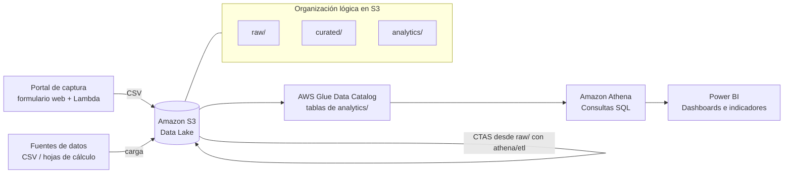

# Data Warehouse Serverless en AWS para Análisis de Compras — MAGHSA, S.A.

Trabajo de Graduación — Ingeniería en Sistemas de Información y Ciencias de la Computación (UMG)
Autor: David Edgar Recinos García

## Objetivo

Construir y evaluar una arquitectura de Data Warehouse serverless en AWS orientada al análisis
de compras de Máquinas Agroindustriales MAGHSA, S.A., basada en S3, Glue Data Catalog y Athena,
con dashboards de indicadores en Power BI, priorizando simplicidad operativa y bajo costo de
mantenimiento.

## Arquitectura



Flujo de cuatro capas desacopladas: **almacenamiento (S3) → metadatos (Glue Data Catalog) →
cómputo/consulta (Athena) → presentación (Power BI)**. Cada capa se puede escalar o reemplazar
de forma independiente sin afectar al resto de la solución.

Dos entradas escriben en `raw/`: la carga manual de los CSV de origen y el **portal de captura**
(una página HTML con una Lambda de Function URL), con el que el personal de compras registra
datos sin acceso a la consola. Las compras capturadas quedan en `raw/compras_web/` (el archivo se crea con la primera compra registrada). La carga
oficial a `curated/` y `analytics/` son las sentencias CTAS de Athena de `athena/etl/`
(orden y recarga en su README).

## Stack

| Componente | Rol |
|---|---|
| Amazon S3 | Almacenamiento de datasets analíticos (Data Lake) y sitio estático del portal |
| AWS Lambda | Backend del portal de captura: valida y escribe CSV en `raw/` |
| AWS Glue Data Catalog | Repositorio de metadatos: base `compras_dwh`, tablas y particiones |
| Amazon Athena | Motor de consultas SQL serverless; ejecuta también la carga (CTAS) |
| Power BI Desktop | Modelado semántico y dashboards de KPIs |
| Formatos | CSV (raw) → Parquet (curated/analytics) |

## Estructura del repositorio

```
/lambda-captura/        → Portal de captura: formulario (index.html) y Lambda (lambda_function.py)
/sample-data/           → Dataset sintético de prueba (no son datos reales de MAGHSA)
/s3-structure/          → Organización de prefijos/zonas en S3
/athena/etl/            → Carga oficial: CTAS de raw/ a curated/ y analytics/
/athena/queries/        → Consultas SQL de los KPIs de compras
/modelo-dimensional/    → DDL de hechos y dimensiones (esquema estrella)
/glue/                  → Glue Data Catalog: base y tablas definidas por DDL
/scripts/               → Generador de datos sintéticos
/powerbi/               → Proyecto PBIP del dashboard de gerencia (modelo semántico e informe)
/PG2-009 – DAVID EDGAR RECINOS GARCÍA.md → Documento de tesis (texto)
```

## Modelo dimensional (resumen)

Esquema estrella orientado a análisis de compras:

- **Hechos:** `hechos_compras` — una fila por línea de orden de compra, particionada por `anio`/`mes`
- **Dimensiones:** `dim_tiempo`, `dim_proveedor`, `dim_producto`, `dim_categoria`,
  `dim_unidad_organizacional`, `dim_categoria_proveedor`, `dim_contacto_proveedor` (consulta puntual)
- **Puentes N:M:** `puente_proveedor_categoria_proveedor`, `puente_proveedor_categoria_producto`,
  `puente_proveedor_producto`
- **Regla de negocio:** `categoria_proveedor_x_categoria_producto`

Ver detalle en [`/modelo-dimensional/`](./modelo-dimensional).

## Alcance

Este repositorio documenta la parte técnica del alcance definido en el documento de tesis:
definición del modelo dimensional, organización lógica en S3, catalogación en Glue Data Catalog,
consultas analíticas en Athena y validación funcional del flujo de extremo a extremo. Quedan
fuera del alcance: implementación empresarial a gran escala, ingesta en tiempo real, pipelines de
transformación complejos y automatización avanzada.

## Estado del avance

- [x] Problema y requerimientos definidos (documento de tesis)
- [x] Arquitectura de la solución
- [x] Modelo dimensional (hechos, dimensiones y puentes)
- [x] Datos cargados en S3 (`raw/`, `curated/`, `analytics/`)
- [x] Catalogación en Glue Data Catalog (base `compras_dwh`)
- [x] Consultas de los KPIs en Athena (`athena/queries/`)
- [x] Dashboard en Power BI (5 páginas)
- [x] Portal de captura desplegado (formulario y Lambda)
